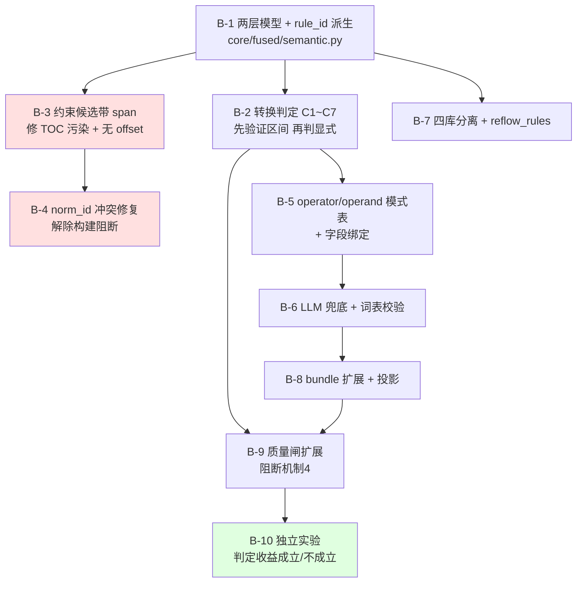
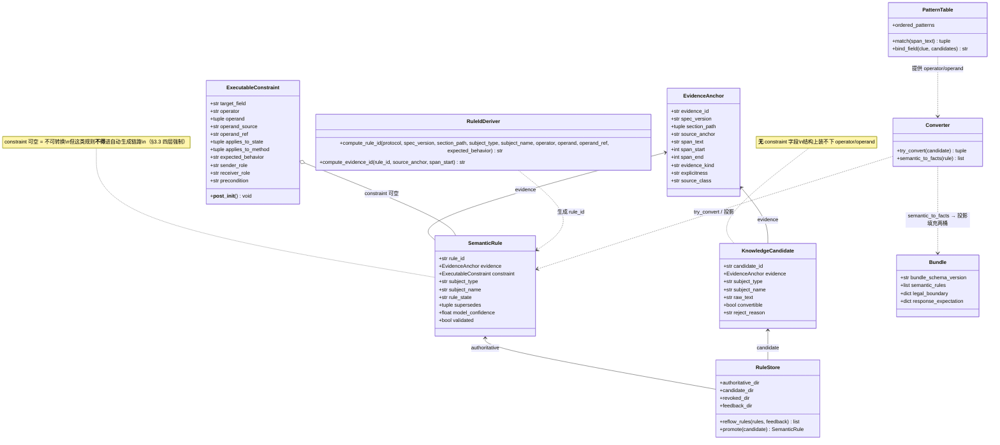
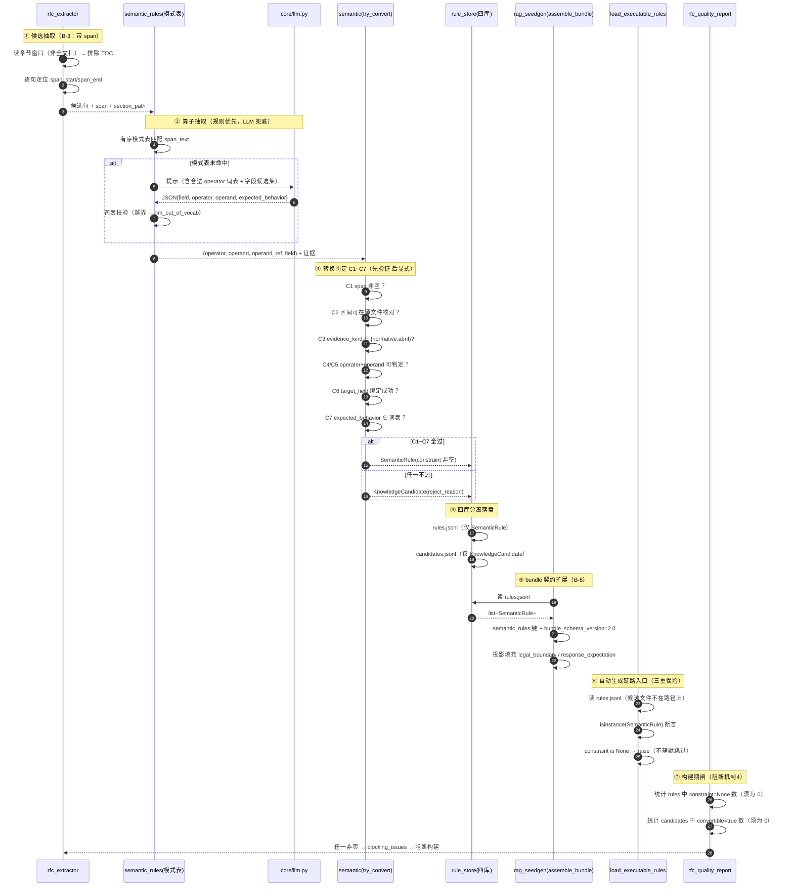
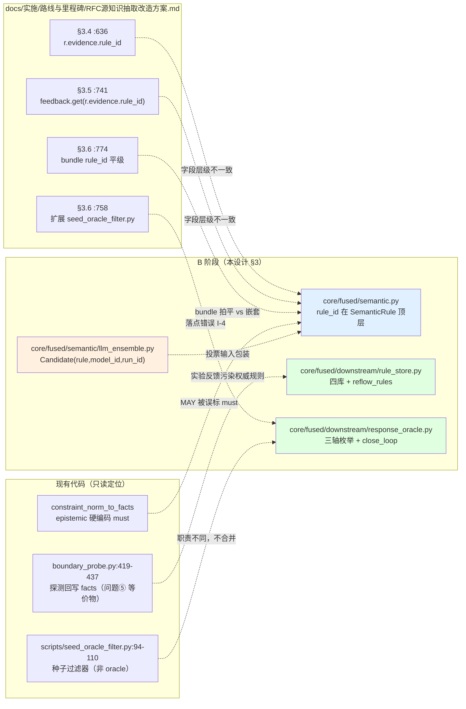

# RFC 源里程碑 B～D 实施路线与任务分解

> 生成时间：2026-11-01
> 适用代码库：`E:\科研\想法idea\ProtoKG`
> 上游输入：`docs/实施/路线与里程碑/RFC源知识抽取改造方案.md`（当前版，951 行）、`改进.md`（8 个问题）、`ProtoKG RFC 源知识抽取改造方案——技术评审报告.md`
> 本文档性质：**只读调研 + 设计规划**。撰写过程中未修改仓库任何文件（唯一写入为本文件）。
> 运行环境：Python `C:/Users/13594/.workbuddy/binaries/python/versions/3.13.12/python.exe`（无 pytest）；pytest 用 `E:/app/Anaconda3/python.exe`。

---

## 0　摘要（先读这一段）

**核心结论：改进.md 的 8 个问题在「文档层」已全部处置完毕，但在「代码层」只有 A 阶段（问题①②③）落地；B/C/D 阶段的模型、Oracle、投票在代码里完全不存在（0 命中）。**

三条最重要的发现：

1. **B 阶段的数据模型确实尚未落地**（确认团队判断）：全仓 `.py` 搜索 `SemanticRule` / `EvidenceAnchor` / `ExecutableConstraint` / `model_confidence` / `.validated` / `explicitness` / `rule_id` **全部 0 命中**。`core/fused/downstream/rule_store.py`、`core/fused/semantic/llm_ensemble.py`、`core/fused/downstream/response_oracle.py` 等 B/C/D 规划文件**均不存在**。

2. **但存在一条「影子实现」必须先处理**：改进.md 说的 "旧伪代码" 指的是**文档里的伪代码**。代码里其实已经有一条**自由文本版**的语义约束链路——`rfc_extractor.py:1660 extract_constraint_candidates()` → `:1716 infer_constraints()` → `:1761 extract_constraint_norms()` → `norm.py:220 constraint_norm_to_facts()` → 产出 `legal_boundary` / `response_expectation` 两个 aspect → `rag_seedgen.py:508-510` 进 bundle → `rag_seedgen.py:617 _render_constraints()` 渲染进 LLM prompt → `boundary_probe.py:548 derive_constraint_candidates()` 消费。**这条链路已经在生产运行**，但用的是 `constraint` 自由文本（`"单 label 长度 <= 63"`），不是两层模型。B 阶段不是「从零新建」，而是「**替换这条链路的表达层**」——这改变了任务分解的形状（见 §3.7）。

3. **改进.md 的问题⑤ 在代码里有一个改进.md 没提到的等价物**：代码里没有 `reflow_rules()`，但 `boundary_probe.py:419-437` 存在一条**探测结果回写 facts.jsonl** 的路径（`legal_boundary` fact 回写）。这**正是问题⑤警告的「实验反馈污染权威规则」的同类问题**，只是形态不同。必须在 B 阶段一并处理。

**推荐推进顺序（与团队预判一致，但理由不同）**：B 阶段数据模型统一是必经之路——但**不是因为 C/D 依赖它**，而是因为**现有影子实现正在用自由文本污染生产 bundle**，不统一就无法在同一条链路上做增量改造。本文档给出一个**不依赖 LLM 即可执行**的 B 阶段设计（§3），和一个**规避 rq3/rq4 契约漂移**的实验设计（§4）。

---

## 1　现状盘点：改进.md 的 8 个问题逐条状态

### 1.1　总表

| # | 改进.md 的问题 | 级别 | 文档层 | **代码层（实测）** | 判定依据 |
|---|---|---|---|---|---|
| ① | A 阶段文档解析顺序仍写错 | 阻塞 | ✅ 已修 | ✅ **已落地** | `rfc_extractor.py:747-841` 六步流水线物理顺序 = 清洗(747) → TOC 隔离(768) → 标题识别(795) → 章节树(835) → 块解析(838) → 类型判定(841)。TOC 隔离**确在**建树之前（`:768` 注释明写「★ 必须在章节树之前」） |
| ② | TOC 清除与证据保留矛盾 | 重要 | ✅ 已修 | ✅ **已落地（超出要求）** | TOC 行在 `:768-790` 被 `continue` 掉，**根本不进章节树** → 天然不可能产生 TOC claim。且有**独立判据** `_independent_toc_lines()`（`:1483`）避免质量闸自证循环 |
| ③ | 质量闸缺可执行前提 | 重要 | ✅ 已修 | ✅ **已落地** | `QualityReport`（`:1309-1359`）分 `blocking_issues`（阻断构建）/ `offline_metrics`（发布准入）；真值集缺失时 `warnings.append` 跳过（`:1438-1440`）而非失败。实测三协议 `passed=True` |
| ④ | B/C 新数据模型与旧伪代码不匹配 | 阻塞 | ✅ 已修 | ❌ **未落地** | 文档 §3.1/§3.4/§3.6 已统一为当前字段（脚本实测：py 代码块内旧字段残留**全 0**）。但代码里 `SemanticRule`/`EvidenceAnchor`/`ExecutableConstraint`/`model_confidence`/`.validated`/`explicitness`/`rule_id` **0 命中**（2026-11-01 09:05 复测，含并行同事改写后的最新版） |
| ⑤ | 规则反馈仍在修改权威规则内容 | 阻塞 | ✅ 已修 | ⚠️ **未落地（但存在等价风险）** | 文档 `reflow_rules()`（`:733-744`）已改为纯排序。代码无 `reflow_rules`，但 `boundary_probe.py:419-437` 有**探测结果回写 facts** 的等价污染路径 |
| ⑥ | D 阶段投票仍引用未定义的 `model_id` | 重要 | ✅ 已修 | ❌ **未落地** | 文档 `Candidate(rule, model_id, run_id)`（`:534-541`）+ `voting_models = {c.model_id for c in g}`（`:577`）。代码 0 命中 |
| ⑦ | Oracle 判定顺序 + EXITED 不分 + timeout/crash 不该是协议期望 | 重要 | ✅ 已修 | ❌ **未落地** | 文档 `close_loop()`（`:669-726`）顺序已改为 UNKNOWN+TIMEOUT 最先 → crash → reset/close → 语义偏离。代码**无任何 `ProcessHealth`/`TransportOutcome`/`close_loop`**；现存唯一 oracle 是 `scripts/seed_oracle_filter.py`（198 行，**只判响应码**，无进程健康维度） |
| ⑧ | 证据「显式性」判断不严谨 | 重要 | ✅ 已修 | ❌ **未落地** | 文档 §3.2（`:504-524`）已改为**先 `_verify_span_in_source()` 再判 explicitness**，且分离「可机械验证」与「规范强制」。代码无 `_verify_span_in_source`；**且 `extract_constraint_candidates` 产出 100% 无 offset**（见 §1.3） |

### 1.2　问题①②③ 的代码级验证（A 阶段已完成，可直接采信）

```
$ python -c "from core.fused.extraction.rfc_extractor import rfc_quality_report; ..."
rtsp passed= True norms= 71 facts= 116 dup= 0 toc_out= 0 toc_only= 0 kinds= {'field': 45, 'method': 11, 'outcome': 15}
sip  passed= True norms=102 facts= 148 dup= 0 toc_out= 0 toc_only= 0 kinds= {'method': 6, 'field': 46, 'outcome': 50}
smtp passed= True norms= 10 facts=  10 dup= 0 toc_out= 0 toc_only= 0 kinds= {'method': 10}
```

与团队简报给的数字**逐项吻合**。

**测试基线复核**（`E:/app/Anaconda3/python.exe -m pytest tests/ -q`）：

```
37 failed, 749 passed, 20 errors in 39.67s        ← 2026-11-01 08:5x 首测
37 failed, 760 passed, 20 errors in 55.45s        ← 2026-11-01 09:0x 复测（并行同事改写 rfc_extractor.py 后）
```

**与团队简报的「37 failed / 749 passed / 20 errors」完全一致**（首测）。复测时 `passed` 变为 **760**（+11），因并行同事在期间重写了 `core/fused/rfc_extractor.py`（1713 → 1890 行，新增间隔点线 TOC 判定与目录块兜底），并新增了对应测试；**`failed` 恒为 37、`errors` 恒为 20**，失败构成未变。失败分布（按文件）：

| 文件 | 失败数 | 与 rfc 源的关系 |
|---|---|---|
| `test_rq3_focus_group.py` | 22 | ❌ 无（rq3 语料契约漂移） |
| `test_rq3_manifest.py` | 6 | ❌ 无 |
| `test_rq3_dict.py` | 3 | ❌ 无（字典 token 102 vs 114） |
| `test_rag_seedgen_step2.py` | 2 | ❌ 无 |
| `test_rag_seedgen.py` | 2 | ❌ 无 |
| `test_strategy.py` | 1 | ❌ 无 |
| `test_edge_cover.py` | 1 | ❌ 无 |
| **合计** | **37** | **全部与 rfc 源无关**——团队简报「全部是预存的研究契约脱节」的判断成立** |

> ⚠️ **注意 `docs/实施/路线与里程碑/RFC源改造里程碑A实施报告.md:26` 写的是「37 failed / 633 passed / 20 errors」，:290 写「646 passed」，:331 写「644 passed」——三个数字互相矛盾，且都不是实测值。** 本文档以**实测**为准：**failed=37 / errors=20 恒定不变**（这是关键——回归护栏看的是这两个数），**passed 会随并行改动浮动**（749 → 760）。A 阶段报告的测试数字已过期，**不应作为后续基线引用**。

> 🔄 **并行改动提示（2026-11-01 09:0x）**：本文档撰写期间，有并行同事重写了 `core/fused/rfc_extractor.py`（1713 → 1890 行）。本文档的**所有实测数据已在改写后重新复测并同步更新**（三协议 norms/facts 计数、约束候选 TOC 污染率、无 span 比例、norm_id 冲突复现、B 阶段符号 0 命中——**全部与改写前一致**）。**行号引用已按改写后的版本全面校正**。若后续该文件再被改动，请以「附录 A 的复算命令」为准重新核对行号。

### 1.3　问题④ 的代码级现状 —— 一个改进.md 完全没提到的关键事实

**改进.md 的判断「新版已定义 `r.evidence`/`r.constraint`/`r.model_confidence`/`r.validated`，但 §3.4 还在用旧字段」——这条只在「文档 vs 文档」的层面成立。**

代码里存在的是另一套东西：**自由文本约束链路**（下称「影子实现」）。完整调用链（全部实测存在）：

| 环节 | 位置 | 产出 |
|---|---|---|
| ① 候选粗筛（确定性） | `rfc_extractor.py:1660 extract_constraint_candidates()` | `[{"text": ..., "source": "file:rfc2326.txt"}]` |
| ② LLM 结构化 | `rfc_extractor.py:1716 infer_constraints()` | `field/constraint/violation/expected_code/expected_behavior` **自由文本** |
| ③ 转 norm | `rfc_extractor.py:1761 extract_constraint_norms()` | `kind="constraint"` 的 norm |
| ④ 转 Fact | `norm.py:220 constraint_norm_to_facts()` | aspect=`legal_boundary`（`{dim,legal,illegal,trigger}`）+ aspect=`response_expectation`（`{violation,expected_code,expected_behavior}`） |
| ⑤ 进 bundle | `rag_seedgen.py:508-510` | `bundle["legal_boundary"]` / `bundle["response_expectation"]` |
| ⑥ 渲染进 prompt | `rag_seedgen.py:617 _render_constraints()` → `strategy.py:320` | LLM 看到「合法 X / 非法 Y」 |
| ⑦ 消费生成边界种子 | `boundary_probe.py:548 derive_constraint_candidates()` | 合法/非法种子对 |
| ⑧ 词表注入 | `rfc_extractor.py:136-143 _RFC_CONFIG_LIST_KEYS` 含 `expected_response_classes` | 已在 `rfc_config.json` 中（实测 rtsp/sip/smtp 均有） |

**这条链路的三个实测缺陷（改进.md 未提及，因为改进.md 只看了文档）：**

**缺陷 A —— 候选完全绕过章节树与 TOC 隔离。** `extract_constraint_candidates`（`:1675-1678`）直接 `f.read_text()` 读全文并按句号切分，**不经过 `_is_toc_line` 过滤**。实测 TOC 污染率：

```
rtsp: total=80  toc_contaminated=5 (6%)
sip:  total=80  toc_contaminated=2 (2%)
smtp: total=273 toc_contaminated=1 (0%)
```

**缺陷 B —— 产出 100% 无字符区间。** `source` 字段只有 `file:rfc2326.txt`，**没有 `@offset`**，实测 `source_without_offset = 80/80 / 80/80 / 273/273`。这意味着**问题⑧ 要求的「先验证证据再判显式」在当前数据上物理上不可能实现**——`span_start`/`span_end` 从来没被产出过。这是 B 阶段 B2 的硬前置。

**缺陷 C —— `norm_id` 冲突会导致构建被质量闸阻断。** `extract_constraint_norms`（`:1775`）用 `f"{protocol}.constraint.{field}"` 做 `norm_id`：**同一字段的多条约束共用同一个 norm_id**。用 Stub LLM 复现（返回 3 条约束，其中 2 条同字段）：

```
norms produced: 15
DUP norm_id => {'rtsp.constraint.content-length': 10, 'rtsp.constraint.max-forwards': 5}
=> quality gate dup_norm_ids would be: 13 => BLOCKING BUILD
```

而 `rfc_quality_report:1400-1402` 会把 `dup_norm_ids` 列入 `blocking_issues`，`build_hub.py:283-290` 随即 `raise SystemExit` 阻断构建。**即：`--constraints` 模式下只要 LLM 对同一字段返回 2 条以上约束，构建就会失败。** 这是一个已存在的、可复现的阻断性 bug（当前未被触发，因为 `--constraints` 默认关闭且 LLM 默认降级跳过）。

> **结论：改进.md 的问题④「数据模型不匹配」在代码层的真实形态不是「新旧字段并存」，而是「自由文本约束链路已经上线，而两层模型完全缺失」。** 二者需要在 B 阶段**合并**处理，不能只做「新增两层模型」。

### 1.4　问题⑦ 的代码级现状

`scripts/seed_oracle_filter.py`（198 行，全文读过）：

- 只做**单轴判定**：`_SIP_RESPONSE_RE`（`:44`）匹配响应码 → `_filter_seed`（`:94-110`）按首条消息的响应码是否在 `{404, 405}` 决定丢弃。
- **无 `ProcessHealth`、无 `TransportOutcome`、无 `ProtocolOutcome`**、无 `violation_of` 归因、无 `expected_class` 比对。
- 定位是**「种子有效性过滤器」**（丢弃入口即无效的种子），**不是** C 阶段那个「执行结果 → 语义偏离」的 oracle。

> **两者不可混为一谈。** 改进.md 的问题⑦ 指的是**后者**（`close_loop`）。文档 §3.6 落地表 `:758` 写「语义 oracle → 扩展 `scripts/seed_oracle_filter.py`」——**这个落点是错的**：把「种子过滤器」扩成「三轴语义 oracle」会让两个职责混进一个文件，且 `seed_oracle_filter.py` 是**逐种子回放过滤**（发请求、看响应），而 `close_loop` 是**执行后判定**（进程健康 + 传输 + 协议三轴）。C 阶段必须新建 `core/fused/downstream/response_oracle.py`（与 §2.0 任务表 C5 `:267` 一致），**不要扩 `seed_oracle_filter.py`**。

### 1.5　问题⑧ 的代码级现状

`_verify_span_in_source` 0 命中。且如 §1.3 缺陷 B 所述，**约束候选根本不带 span**，所以：

- `EvidenceAnchor.span_start` / `span_end` 是**待新增的字段**，不是「待校验的已有字段」；
- `_norm` 产出的 norm 用的是 `f"file:{source}#{section}"` 格式（`:704`），其中 `#@123` 是**行号**（`:862` `f"@{line_no}"`），不是字符区间 → **两种 anchor 语义并存**，B 阶段必须先统一。

### 1.6　改进.md 中**已经不成立**的论断

| 改进.md 原文 | 实测结论 | 证据 |
|---|---|---|
| 「§3.6 的 bundle 示例也继续采用旧字段」 | **不成立**（已重写） | `RFC源知识抽取改造方案.md:768-806` bundle 示例已是两层模型；文档自带校验脚本实测「旧字段残留: 全为 0」 |
| 「§3.4 仍用 `r.confidence`/`r.constraint_kind`/…」 | **不成立**（已改） | 同上；`r.confidence` 等在 py 代码块内计数为 0 |
| 「§3.5 的 `reflow_rules()` 依然写着 `replace(r, constraint_text=...)`」 | **不成立**（已改为纯排序） | `:733-744` |
| 「新版投票写成 `voting_models = {r.model_id for r in g}`」 | **不成立**（已改为 `{c.model_id for c in g}`） | `:577` |
| 「改进.md 说 `SemanticRule` 未定义 `model_id`」 | 仍然成立且**强化**：`SemanticRule` 在代码里**根本不存在** | 全仓 0 命中 |

**净结论：改进.md 的 8 条对「文档早期版」的批评，已被 `实施/路线与里程碑/RFC源知识抽取改造方案.md` 全部吸收。团队简报里「文档已修订」的前提成立。本文档的工作重心因此转向「文档说要做的事，代码里怎么落地」。**

---

## 2　接口一致性清理清单（对 `实施/路线与里程碑/RFC源知识抽取改造方案.md` 的六处审计）

审计对象：修订说明（§0）/ 任务表（§2.0）/ 数据模型（§3.1）/ 伪代码（§3.2–3.5）/ bundle 示例（§3.6）/ 风险清单（§4）。

### 2.1　问题④ 点名的字段冲突 —— 文档内已清零，**但出现了新的一处结构冲突**

**文档已消解（实测）**：

```
旧字段残留(py blocks): {'r.confidence': 0, 'r.constraint_kind': 0, 'r.constraint_text': 0,
                        'r.expectation_class': 0, 'constraint_text=': 0,
                        'constraint_kind=': 0, 'expectation_class=': 0,
                        'confidence="explicit"': 0}
新结构计数: {'class Candidate': 1, 'EvidenceAnchor': 3, 'ExecutableConstraint': 3,
             'rule_id': 10, 'validated': 8, 'explicitness': 13, 'priority_score': 2,
             '_is_abnormal_exit': 1, 'toc_lines': 2, '_parse_heading': 1,
             'bundle_schema_version': 1, 'model_id': 3, 'run_id': 3}
```

（全文残留的 2 处 `r.confidence`/`constraint_text=` 等均在**说明性文字**里——§0 追溯表、附录追溯表、R5/R23 风险描述——文档 `:910` 已声明这是预期行为，不算残留。）

**新发现的一处真实结构冲突（改进.md 未发现）：`SemanticRule` 的 `rule_id` 归属层级自相矛盾。**

| 位置 | 写法 |
|---|---|
| §3.1 `:381` | `EvidenceAnchor` 内含 `rule_id: str  # 全局唯一（不依赖内容哈希）` |
| §3.1 `:412` | `SemanticRule.evidence: EvidenceAnchor` |
| §3.4 `:636` | `mutated.violation_of = r.evidence.rule_id` |
| §3.5 `:741` | `feedback.get(r.evidence.rule_id)` |
| §3.6 `:774` | bundle 示例中 `"rule_id"` 与证据层字段**平级**（`spec_version`/`section_path`/`span_text` 也在平级） |

**冲突本质**：`rule_id` 是**规则身份**，却被放在**证据层**里。这有三个实际后果：

1. **一条规则有多条证据时，`rule_id` 会随证据变**——规则身份随证据载体漂移，违反 M7「`violation_of` 必须唯一标识一条规则」。
2. **bundle 示例把两层拍平了**（`:774-801` 所有字段平铺在一个 dict 里），而 §3.1 的 dataclass 是**两层嵌套**（`r.evidence.span_text` / `r.constraint.operator`）。**bundle 契约无法从 dataclass 直接序列化产生**，需要额外一层手写映射——这就是「接口不一致」的真实残留形态。
3. `SemanticRule` 本身**没有 `rule_id` 字段**，所以「规则 id」只能绕道 `evidence` 取——代码写起来必然别扭。

**建议统一为**：`rule_id` 提升到 `SemanticRule` 顶层；`EvidenceAnchor` 内保留 `evidence_id` 区分多条证据；bundle 示例改为**两层嵌套**（与 dataclass 一一对应）。详见 §3.1。

### 2.2　问题⑤ 的 `reflow_rules()` —— 文档已改，**但落点文件在 §3.6 表里缺失**

- 文档 `:733-744` 已改为纯排序：`sorted(rules, key=lambda r: (-priority(r), r.evidence.rule_id))`，规则本身一字不改。✅
- **但**：§3.6 落地表（`:749-759`）的 9 行里**没有 `rule_store.py` 这一行**——而 §2.0 任务表 B5（`:249`）明确要求新建 `core/fused/downstream/rule_store.py` 做四库分离。**任务表与落地表不一致。**
- 且 `r.evidence.rule_id` 与 §2.1 同源问题（应为 `r.rule_id`）。

### 2.3　问题⑥ 的 `voting_models` —— 文档已改，**落地表有行但任务表没有**

- 文档 `:577` 已改为 `{c.model_id for c in g}`，`:534-541` 有 `Candidate` 包装类。✅
- §2.0 里程碑 D 的任务表（`:277-281`）**只有 D1/D2/D3 三行，没有「投票层代码」这一条**，也没写落点文件。§3.6 落地表 `:755` 写了「新建 `core/fused/semantic/llm_ensemble.py`」。**任务表缺一行。**
- 另：`:571` `_align_by_structural_equality(per_model, theta=theta)` 的 `theta` 参数在「span 重叠降级为辅助条件」后已无定义用途——**伪代码签名与语义不符**。

### 2.4　问题⑦ 的 Oracle —— 文档判定顺序已改，**但落地表落点错误（见 §1.4）**

- 文档 `:688-691` 的 `UNKNOWN+TIMEOUT → inconclusive` 最先判定 ✅；`:701-711` 的 `EXITED` 走 `_is_abnormal_exit` ✅；`:806` bundle 词表已去掉 timeout/crash ✅。
- **但 §3.6 落地表 `:758` 写「语义 oracle → 扩展 `scripts/seed_oracle_filter.py`」**，与 §2.0 任务表 C5（`:267`）的 `core/fused/downstream/response_oracle.py` **冲突**。§1.4 已论证：应采信 C5 的新建路径。

### 2.5　问题⑧ 的证据校验顺序 —— 文档已改，**但缺少 span 的产出机制**

- 文档 `:504-524` 顺序正确 ✅。**但**：`_verify_span_in_source(ev)` 要校验 `span_start`/`span_end`，而这两个字段**在整条链路上无人产出**（§1.3 缺陷 B 实测：433/433 候选无 offset）。**§3.2 的伪代码假设了一个不存在的上游**——这是六处之间最实质的一处不一致：**数据模型（§3.1）声明了 span 字段，但任务表（§2.0）里没有任何一条任务负责产出它**。

### 2.6　六处一致性审计汇总

| # | 冲突位置 | 冲突内容 | 建议统一到 |
|---|---|---|---|
| I-1 | §3.1 `:381` / §3.4 `:636` / §3.5 `:741` / §3.6 `:774` | `rule_id` 挂在证据层，但 bundle 里与规则层字段平级 | `rule_id` 提升到 `SemanticRule` 顶层；bundle 改两层嵌套 |
| I-2 | §2.0 B5 `:249` vs §3.6 `:749-759` | 四库分离落点 `rule_store.py` 只在任务表出现 | §3.6 表补一行 |
| I-3 | §2.0 D1–D3 `:277-281` vs §3.6 `:755` | 投票层代码无对应任务行 | §2.0 里程碑 D 补「D0 投票层落点」行 |
| I-4 | §3.6 `:758` vs §2.0 C5 `:267` | oracle 落点：扩 `seed_oracle_filter.py` vs 新建 `response_oracle.py` | 新建 `core/fused/downstream/response_oracle.py` |
| I-5 | §3.1 `:386-387` vs §2.0 任务表（全文） | `span_start`/`span_end` 声明了但**无任务产出** | 新增任务 B1a「约束候选带 span」 |
| I-6 | §3.6 `:774-801` vs §3.1 `:378-419` | bundle 拍平 vs dataclass 嵌套 | bundle 改两层嵌套 |
| I-7 | §3.3 `:571` | `_align_by_structural_alignment(..., theta=theta)` 的 `theta` 在 span 降级后无用途 | 去掉 `theta` 或明确其「辅助权重」语义 |
| I-8 | §3.2 `:504-524` vs §2.0 B6 `:250` | B6 任务指向 §3.2 置信度重写，但 §3.2 里 `_verify_span_in_source` 无实现任务 | 与 I-5 合并解决 |
| I-9 | §2.0 里程碑 A1.5/A1.6 `:231-232` | 验收标准写「FTP 抽到 RETRIEVE/RETR」「DNS 抽到 QNAME」——**但 kb 已裁剪到 rtsp/sip/smtp**（A 阶段报告 §10.2），ftp 的 `kb/ftp/spec/` **0 个文件**，dns 无目录 | A1.5/A1.6 验收标准改为只对 rtsp/sip/smtp 成立 |
| I-10 | §3.6 `:758` vs `scripts/seed_oracle_filter.py` 实际职责 | 同 I-4，另：现有脚本是「种子过滤器」不是「oracle」 | 同 I-4 |
| I-11 | 全文 | **无一条任务覆盖「影子实现的替换」**（§1.3）——`extract_constraint_candidates`/`infer_constraints`/`constraint_norm_to_facts` 这一整条链路在任务表里不存在 | 新增 B1b「影子实现替换/对齐」任务（见 §3.7） |

---

## 3　B 阶段的实施设计（本次交付重点）

### 3.0　设计立场：三个先决判断

**判断 1：两层模型的字段设计必须服务于「可执行」，而不是服务于「完备」。**
评审 T2 的核心批评是「`constraint_text` 是自由文本，确定性引擎无法执行/校验/归因」。一个字段是否该进 `ExecutableConstraint`，唯一标准是：**给定它，一个确定性函数能否算出「这条种子确实违反了该规则」的布尔值**。不能算的（如「语义应当清晰」），进证据层的 `span_text`，不进可执行层。

**判断 2：`rule_id` 必须与内容解耦，但与「结构化身份」绑定。**
改进.md §3.1 注释写 `rule_id: str # 全局唯一（不依赖内容哈希）`。但完全不含内容的 id 无法区分「同一字段的两条不同约束」。**正确形态是：id 由「协议 + 章节路径 + 主体 + operator + operand 规范化值」派生**，这些全是**结构化字段**，不含自由文本、不含证据 span、不含 LLM 输出顺序 → 满足「不依赖内容哈希」（文本改写但语义不变时 id 不变），同时唯一。

**判断 3：不可转换的内容「不进自动生成链路」必须靠代码强制，不能靠约定。**
改进.md 反复强调「不可转换为可执行规则的内容只作知识候选、不进自动生成链路」（B1 验收标准）。若只写在文档里，实现时极易失守。**强制机制见 §3.3。**

### 3.1　两层模型的具体字段

落点：**新建 `core/fused/semantic.py`**（不塞进 `core/fused/models.py`——后者是 Fact/Claim/Evidence 的中枢模型，语义规则是**派生知识产物**，混入会破坏 `models.py` 的单一职责；也避免 `models.py` 的 `Fact`/`Claim` 与新模型在 import 上形成环）。

```python
# core/fused/semantic.py
"""语义规则两层模型（里程碑 B1）。

两层分离（评审 T2）：
  · 证据层 EvidenceAnchor —— 「这条规则从哪来」：可溯源、可复核、可对齐。
  · 可执行层 ExecutableConstraint —— 「确定性引擎能算什么」：operator/operand/precondition。
两层之间**不共享可变状态**；无法从证据层推出可执行层的条目，
一律降级为 KnowledgeCandidate（知识候选），**不进自动生成链路**（见 §3.3 强制机制）。
"""

from __future__ import annotations

import hashlib
import json
from dataclasses import dataclass, field, replace
from typing import Optional

#: 证据来源类别（评审 M1：四类来源必须分开记录，不能只靠 normative > observed）
SOURCE_CLASSES: frozenset[str] = frozenset(
    {"normative_spec", "observation", "model_inference", "human"})

#: 证据类型。normative/abnf = 规范性；table/prose = 描述性。
EVIDENCE_KINDS: frozenset[str] = frozenset(
    {"normative", "abnf", "table", "prose"})

#: 显式性。explicit = 区间已校验 **且** 证据类型为规范性（问题⑧ 的分离）。
EXPLICITNESS: frozenset[str] = frozenset(
    {"explicit", "quoted", "paraphrased"})

#: 可执行算子全集。**新增算子必须同时更新 _operator_domain()**（§3.3 强制机制 2）。
OPERATORS: frozenset[str] = frozenset(
    {"eq", "ne", "lt", "gt", "le", "ge", "in", "present", "absent", "range"})

#: 规则生命周期状态（评审 M1/T9：四库分离）
RULE_STATES: frozenset[str] = frozenset(
    {"authoritative", "candidate", "revoked", "feedback"})


@dataclass(frozen=True)
class EvidenceAnchor:
    """证据层：这条规则从哪来。用于溯源、人工复核、投票对齐。

    ★ 与当前文档 §3.1 的差异：此处**不含 rule_id**（rule_id 属规则层，见
      SemanticRule.rule_id）。原因见 §2.1 的 I-1：规则身份挂在证据层会导致
      「一条规则多条证据时 id 漂移」，违反 M7「violation_of 必须唯一标识一条规则」。
    """
    evidence_id: str                  # 本条证据自身的唯一 id（多条证据 → 多 id）
    spec_version: str                 # "RFC3261"（规范版本，M1 要求版本隔离）
    section_path: tuple[str, ...]     # ("21", "1.1")
    source_anchor: str                # "file:rfc3261.txt#@10560"（行锚点，可读）
    span_text: str                    # ★ verbatim 原文片段（空 → 不能判 explicit）
    span_start: Optional[int]         # 在源文件全文中的字符区间起点（供 B2 校验）
    span_end: Optional[int]           # 同上终点（**半开区间** [start, end)）
    # ★ 行锚点口径：RFC 原文含换页符 `\x0c`，`str.splitlines()` 会把它当行边界而
    #   `text.count("\n")` 不会 ⇒ **两种口径的行号相差 9~11 行**。本项目的行锚点
    #   一律采用 **splitlines() 口径**（与 core/fused/rfc_extractor.py 一致）；
    #   按 `\n` 口径核对将**全部对不上**。
    evidence_kind: str                # normative|abnf|table|prose
    explicitness: str                 # explicit|quoted|paraphrased（由 B2/B6 计算写入）
    source_class: str                 # 四类来源（评审 M1）


@dataclass(frozen=True)
class ExecutableConstraint:
    """可执行层：确定性引擎能解释、执行、校验、归因的约束。

    ★ 每个字段的存在理由 = 「给定它，能否算出 violation 布尔值」。
      不能算的字段一律不进本层（见 §3.0 判断 1）。
    """
    target_field: str                  # 受约束字段路径（消息级约束用 ""）
    operator: str                      # OPERATORS 之一
    operand: tuple[str, ...]           # 比较值；空 = 该算子无参（present/absent）
    operand_source: str                # "constant" | "field_ref"（长度由另一字段决定）
    operand_ref: Optional[str]         # operand_source=="field_ref" 时指向该字段
    applies_to_state: tuple[str, ...]  # 适用协议状态（空 = 任意状态）
    applies_to_method: tuple[str, ...] # 适用方法（空 = 任意）
    expected_behavior: str             # 取自 rfc_config.expected_response_classes
    sender_role: str                   # 构造约束的发送方："client" | "server"
    receiver_role: str                 # 处理期望的接收方
    precondition: Optional[str]        # 前置条件（可为空 = 无前置）


@dataclass(frozen=True)
class SemanticRule:
    """完整语义规则 = 证据层 + 可执行层 + 生命周期状态 + 规则身份。

    ★ rule_id 在**顶层**（不在证据层）—— 见 §2.1 的 I-1。
    """
    rule_id: str                        # 全局唯一，由结构化身份派生（§3.2）
    evidence: EvidenceAnchor            # 证据层
    constraint: Optional[ExecutableConstraint]  # 可执行层；None = 不可转换
    subject_type: str                   # "method" | "header" | "status" | "message_type"
    subject_name: str
    rule_state: str                     # authoritative|candidate|revoked|feedback
    supersedes: tuple[str, ...]         # 被本规则替代的 rule_id
    model_confidence: Optional[float]   # ★ 与 explicitness/validated **分开记录**（T6）
    validated: bool                     # B2 证据区间校验是否通过


@dataclass(frozen=True)
class KnowledgeCandidate:
    """知识候选：**不可转换为可执行规则**的内容。

    ★ 这是「不可转换者只作知识候选、不进自动生成链路」的**载体类型**。
      它**没有** constraint 字段 —— 结构上就装不下 operator/operand。
      落盘到独立文件 candidates.jsonl，自动生成链路**读不到**它（§3.3 强制机制 3）。
    """
    candidate_id: str
    evidence: EvidenceAnchor
    subject_type: str
    subject_name: str
    raw_text: str                       # 原始自由文本（仅供人工复核/检索）
    convertible: bool = False           # 恒为 False；显式保留以表达「曾尝试转换」
    reject_reason: Optional[str] = None  # 为何不可转换（可观测性，评审 M4）
```

### 3.2　`rule_id` 的生成规则

**要求**：唯一、可复现（同一输入必得同一 id）、跨运行稳定、**与自由文本和证据位置解耦**。

**派生输入**（全部为结构化字段，**不含** `span_text` / `span_start` / LLM 措辞 / 抽取顺序）：

```python
def compute_rule_id(protocol: str, spec_version: str,
                    section_path: tuple[str, ...],
                    subject_type: str, subject_name: str,
                    operator: str, operand: tuple[str, ...],
                    operand_ref: Optional[str],
                    expected_behavior: str) -> str:
    """rule_id = "r" + sha256(canonical_json(结构化身份))[:16]

    ★ 为什么这样派生（改进.md §3.1 注释「全局唯一（不依赖内容哈希）」）：
      · **不含 span/span_text** → 同一规范文本被重新抽取（措辞微调、LLM 改写）
        得到的 id **不变** → 规则可跨构建对齐、可做增量更新。
      · **不含 LLM 输出顺序/编号** → LLM 非确定性不影响 id。
      · **含 operator + operand + section_path** → 同一字段的两条不同约束
        （如「长度 ≤ 63」与「长度 = 0」）得到**不同** id。
      · **含 spec_version** → 不同 RFC 版本的同名规则天然分开（M1 版本隔离）。
    ★ 唯一性边界：两个语义完全相同但位于不同章节的约束会得到不同 id
      （section_path 不同）——这是**有意的**：它们是可分别引用的两条知识。
    """
    ident = {
        "protocol": protocol,
        "spec_version": spec_version,
        "section_path": list(section_path),
        "subject_type": subject_type,
        "subject_name": subject_name,
        "operator": operator,
        "operand": list(operand),
        "operand_ref": operand_ref,
        "expected_behavior": expected_behavior,
    }
    raw = json.dumps(ident, sort_keys=True, ensure_ascii=False,
                     separators=(",", ":"))
    return "r" + hashlib.sha256(raw.encode("utf-8")).hexdigest()[:16]
```

**`evidence_id` 单独派生**（一条规则可有多条证据，各自一个 id）：

```python
def compute_evidence_id(rule_id: str, source_anchor: str,
                         span_start: Optional[int]) -> str:
    """证据 id = rule_id + 锚点位置 → 同规则不同证据可区分。"""
    raw = f"{rule_id}|{source_anchor}|{span_start}"
    return "e" + hashlib.sha256(raw.encode("utf-8")).hexdigest()[:12]
```

**幂等验证**：同一 RFC 文件重复抽取 N 次，`rule_id` 集合必须完全相同（这是 §4 实验的硬性前置判据，见 §4.6）。

### 3.3　「不可转换者不进自动生成链路」如何在代码里强制（4 层，不靠约定）

这是改进.md B1 的验收标准，也是本设计最需要「防失守」的一处。四层机制：

**强制机制 1 —— 类型层面：`KnowledgeCandidate` 没有 `constraint` 字段。**
候选类型**物理上装不下** operator/operand。任何「把候选当规则用」的代码在**属性访问时即失败**，而不是静默地产生错误种子。

**强制机制 2 —— 构造校验：`ExecutableConstraint.__post_init__` 自检。**

```python
def __post_init__(self) -> None:
    if self.operator not in OPERATORS:
        raise ValueError(f"非法 operator: {self.operator}")
    # 无参算子不得带 operand；有参算子必须带 operand
    if self.operator in ("present", "absent") and self.operand:
        raise ValueError(f"{self.operator} 不得带 operand: {self.operand}")
    if self.operator not in ("present", "absent") and not self.operand:
        raise ValueError(f"{self.operator} 必须带 operand")
    if self.operand_source == "field_ref" and not self.operand_ref:
        raise ValueError("operand_source=field_ref 必须给 operand_ref")
    if self.operand_source == "constant" and self.operand_ref:
        raise ValueError("operand_source=constant 不得给 operand_ref")
    if not self.target_field and self.operator != "present":
        # 消息级约束允许 target_field 为空，但只能是 present/absent
        raise ValueError("target_field 为空时仅允许 present/absent")
```

**强制机制 3 —— 落盘隔离：候选写独立文件，自动生成链路读不到。**

```
derived/per_source/<协议>/rfc/semantic/rules.jsonl       ← 只有 SemanticRule
derived/per_source/<协议>/rfc/semantic/candidates.jsonl  ← 只有 KnowledgeCandidate
```

自动生成链路（§3.6 的 `generate_semantic_violation_seeds`）**只读 `rules.jsonl`**，且入口处显式过滤：

```python
def load_executable_rules(path: Path) -> list[SemanticRule]:
    """只加载**可执行**规则。

    ★ 三重保险：① 读的是 rules.jsonl（候选文件根本不在路径上）
                ② 逐条 isinstance(SemanticRule) 断言
                ③ constraint is None 的规则直接拒绝（不静默跳过）。
    候选（KnowledgeCandidate）在结构上无法通过 ②。
    """
    out: list[SemanticRule] = []
    for ln in path.read_text(encoding="utf-8").splitlines():
        if not ln.strip():
            continue
        d = json.loads(ln)
        if d.get("kind") != "semantic_rule":
            continue
        r = SemanticRule(**d["rule"])
        if not isinstance(r, SemanticRule):     # 防御性（JSON 反序列化后）
            raise TypeError("rules.jsonl 出现非 SemanticRule 条目")
        if r.constraint is None:
            raise ValueError(f"rules.jsonl 出现无约束的规则: {r.rule_id}")
        out.append(r)
    return out
```

**强制机制 4 —— 构建期闸：数量对不上就阻断。**
在质量报告里加一条**阻断级**检查：`rules.jsonl` 中 `constraint is None` 的条数必须为 0；`candidates.jsonl` 中 `convertible=true` 的条数必须为 0。任一不满足 → `blocking_issues` 非空 → `build_hub.py:283-290` 阻断构建。

**四层机制合起来的效果**：候选要混进自动生成链路，必须**同时**突破类型系统、构造校验、文件路径隔离、构建期闸四道关。任一层单独都可能被绕过，四层同时被绕过需要主动的恶意修改——这在科研代码库里等于不可能。

### 3.4　证据层 → 可执行层的转换判定

**转换是一个纯函数**：`try_convert(candidate) -> (ExecutableConstraint | None, reject_reason | None)`。

判定顺序（**先证据、后显式性**——直接落实改进.md 问题⑧）：

| 步 | 检查 | 不通过 → | 为什么 |
|---|---|---|---|
| **C1** | `span_start`/`span_end` 非空且 `span_text` 非空 | `reject_reason="no_span"` | 无区间 = 无法溯源 = 不能算 explicit |
| **C2** | 区间在源文件中可核对（`_verify_span_in_source`） | `reject_reason="span_unverified"` | 问题⑧：**先验证证据，再判显式** |
| **C3** | `evidence_kind ∈ {normative, abnf}` | `reject_reason="non_normative_kind"` | 表格/散文里的约束不是 RFC 的 MUST |
| **C4** | 从 `span_text` 能解析出 **唯一** 的 operator | `reject_reason="operator_unresolved"` | 无法唯一确定算子 → 不生成（避免猜） |
| **C5** | 能解析出 operand（数值/集合/字段引用） | `reject_reason="operand_unresolved"` | 无操作数 → 无法构造违规 |
| **C6** | `target_field` 能绑定到协议已知字段集 | `reject_reason="field_unbound"` | 字段名对不上 → 变异器找不到目标 |
| **C7** | `expected_behavior ∈ rfc_config.expected_response_classes` | `reject_reason="expectation_not_in_vocab"` | 词表外 → oracle 无从判定（问题⑦） |

**C1~C7 全通过 → `ExecutableConstraint`；任一不通过 → `KnowledgeCandidate(reject_reason=...)`。**

**关键设计决策：operator 的解析用「结构化模式表」而非「让 LLM 自由产出」。**

C4/C5 是整个 B 阶段最难的一环（评审 T2 明确指出「缺少真正可执行的语义约束表示」是首要技术正确性问题）。可选路径：

| 方案 | 优点 | 缺点 | 判定 |
|---|---|---|---|
| (a) 纯 LLM 自由产出 operator/operand | 实现快 | 幻觉率高；operator 词表外无拦截；**违背问题⑧「可机械验证 ≠ 规范强制」** | ✗ |
| (b) 纯规则/正则解析 RFC 自然语言 | 确定性、可测 | RFC 句式千变万化，召回率低 | ✗ 单独用 |
| (c) **规则优先 + LLM 兜底 + 结构校验** | 确定性部分高覆盖；LLM 补长尾；最终都过 C1~C7 | 实现量最大 | ✓ **采纳** |

**(c) 的具体形态**：

```
第一层：确定性模式表（rule-first）
  对 span_text 跑一组**有序**的模式，每个模式产出 (operator, operand, operand_ref)：
    r"MUST NOT (?:be|exceed)\s+(\d+)"                 → ("le", ("N",), None)
    r"MUST (?:be|not be)\s+(?:greater|more)\s+than\s+(\d+)" → ("gt", ...)
    r"at\s+least\s+(\d+)\s+octets"                     → ("ge", ...)
    r"MUST (?:not )?(?:contain|include)\s+(\S+)"      → ("present"/"absent", ...)
    r"must\s+(?:be|equal)\s+(?:one\s+of\s+)?\{([^}]+)\}"→ ("in", (...), None)
    ...
  ★ 命中即产出**确定性**结果，不经过 LLM。
  ★ 每条模式必须配一个**最小可执行样例**（单元测试），模式表是**可回归资产**。

第二层：LLM 兜底（仅对第一层未命中的）
  输入：span_text + 该协议的字段候选集 + **合法的 operator 词表**
  输出：JSON {field, operator, operand[], operand_ref, expected_behavior}
  ★ 硬约束：operator 必须在词表内；expected_behavior 必须在 rfc_config 词表内；
    违反 → 判 reject_reason="llm_out_of_vocab"（**不是**默默接受）。

第三层：结构校验（C4~C7）
  对第一层和第二层的结果**一视同仁**地跑 C4~C7。
```

**C7 的一个重要特例**：`expected_behavior` 缺失**不阻断**转换。理由：约束的「构造侧」（C）可以独立成立，缺 P（处理期望）时该规则**只能用于「构造违规种子」，不能用于「判定 oracle 预期」**。这需要在 `ExecutableConstraint` 里显式表达——用 `expected_behavior=""` 表示「无处理期望」，并在 `generate_semantic_violation_seeds` 里据此**跳过 oracle 标注**。这是 SemFuzz 的 C/P 分离精神（评审 T2 末段）的直接落实。

### 3.5　operator / operand / precondition 从 RFC 自然语言怎么来（T2 说的最大难点）

这是本设计的技术核心。分三个层次回答。

**层次 1：operator 的来源 —— 一个**有序**的确定性模式表（不是自由解析）。**

模式表的组织原则：**一条模式 = 一个 RFC 常见句式 = 一个 (operator, operand 抽取) 对**。设计约束：

1. **有序**：第一个命中的模式生效（避免「MUST NOT」被「MUST」先匹配）。
2. **每个模式带 `kind` 标签**：`normative`（含 MUST/SHALL/REQUIRED）→ 产出 `evidence_kind="normative"`；`abnf`（ABNF 语法行）→ `evidence_kind="abnf"`；其余 → `prose`。
3. **规范性动词本身决定 explicitness 的上限**（**这是问题⑧「可机械验证 ≠ 规范强制」在代码里的落点**）：

   | 规范性动词 | 强度 | `evidence_kind` | 是否允许进自动生成链路 |
   |---|---|---|---|
   | MUST / SHALL / REQUIRED | 强制 | `normative` | ✅ |
   | SHOULD / RECOMMENDED | 建议 | `normative` | ✅ 但 `model_confidence` 降档 + **期望响应不可断言** |
   | MAY / OPTIONAL | 可选 | `normative` | ❌ → `KnowledgeCandidate(reject_reason="optional_modality")` |
   | 无规范动词（描述性） | — | `prose` | ❌ → `reject_reason="non_normative_kind"` |

   > **这是本设计相对文档 §3.1 的一处收紧**：文档只区分 `evidence_kind ∈ {normative, abnf}`，但 **MAY 的条款是「可选」**，把它当强制要求会让变异器构造出「其实合规」的种子。改进.md 问题⑧ 的原话是「不能仅凭 `constraint_text` 中出现 `MUST` 等词，就证明原始规范真的包含该要求」——反过来也成立：**出现 `MAY` 也不证明它必须被满足**。

4. **模式表的规模估算**：RFC 2119 数值约束的高频句式约 15~25 条即可覆盖「长度/范围/集合/存在性」四大类。建议先落 12 条最小集 + 单元测试，再迭代。

**层次 2：operand 的来源 —— 从同一句里抽取「可计算的量」。**

| operand 类型 | 抽取形式 | 例子 | 语义 |
|---|---|---|---|
| 数值常量 | 捕获数字 + 单位归一 | `"63 octets"` → `("63",)` | 长度/大小上界 |
| 枚举集合 | 解析 `{a, b, c}` 或 `one of a, b, c` | `("{a,b,c}")` → `("a","b","c")` | 取值白名单 |
| 字段引用 | 识别「X 的长度」「the size of X」 | `"the size of the message body"` → `operand_ref="Body"`, `operand_source="field_ref"` | **跨字段约束**（如 Content-Length = Body 长度）——这是最有价值的一类 |
| 存在性 | 无 operand | `"MUST contain a Transport header"` | `present` / `absent` |

**单位归一必须显式**：`octets`/`bytes` → 字节；`bits` → 位（**不可与字节混算**）；`seconds` → 时间（**不属于字节长度约束，走 reject_reason="non_length_operand"**，因为它不可通过改字节违反）。**单位不认识 → 拒绝转换，不猜。**

**层次 3：precondition 的来源 —— 三个来源，按可信度排序。**

| 来源 | 例子 | 可信度 | 处理 |
|---|---|---|---|
| **句内显式** | `"A client MUST send a TEARDOWN request before sending a PLAY request"` | 高 | 直接解析出 `applies_to_method=("TEARDOWN",)`，`precondition="before PLAY"` |
| **章节上下文** | 约束出现在 §10.5 PLAY 章节内 | 中 | `applies_to_method` 由**章节所属方法**推导（`rfc_config.method_sections` 已知章节→方法映射） |
| **协议状态机** | 约束仅在特定状态下成立 | 中 | 从 `source` 源的状态机（`core/fused/downstream/edge_cover.py`）反查，`applies_to_state` 填入 |

> **不要把 precondition 编进 operator**。评审 T2 特别指出「借鉴 SemFuzz 的 C/P 模型时，方案把角色压缩成一个 `role`。但构造约束和处理期望可能分别对应发送方与接收方，不应无条件合并」——同理，**precondition 是「何时适用」，operator 是「如何违反」，两者正交**，必须分字段。

**层次 4（补充）：`target_field` 的绑定 —— 两级候选。**

`target_field` 不能靠 LLM 自由产出（会幻觉出协议里没有的字段）。绑定策略：

1. **候选集来自已知字段**：`rfc_config.field_sections` 抽出的字段名 ∪ `traffic` 源实测到的字段名。
2. **绑定规则**：模式表在抽取 operator 时**同时产出字段线索**；线索与候选集做**精确匹配或规范化匹配**（大小写、下划线/连字符）。
3. **匹配不上 → `reject_reason="field_unbound"`**（不做模糊匹配——模糊匹配是幻觉的主要来源）。
4. **消息级约束**（`target_field=""`）：只在 operator ∈ {present, absent} 时允许（构造校验强制机制 2 已挡）。

### 3.6　与现有 `core/fused/models.py` 的关系

**结论：不修改 `models.py` 的数据结构；新增独立模块 `core/fused/semantic.py`，两者通过「转换器」相连。**

理由：`models.py` 是 中枢的**核心数据模型**（文件头 docstring 自称「③ 中枢层数据结构的唯一实现」），`Fact`/`Claim`/`Evidence` 有 `canonical.py` 的 `compute_fact_id`/`compute_claim_id`/`compute_evidence_id` 三套哈希依赖，任何改动都会波及**已落盘的 `derived/per_source/*/facts/*.jsonl`**（实测 rtsp 116 / sip 148 / smtp 10 行）与跨源去重。**B 阶段不应该动它。**

并存方式：

```
                    ┌─────────────────────────────┐
                    │  core/fused/semantic.py      │   ← 新增（B 阶段）
                    │  EvidenceAnchor              │
                    │  ExecutableConstraint        │
                    │  SemanticRule                │
                    │  KnowledgeCandidate          │
                    └──────────┬──────────────────┘
                               │ semantic_to_facts()
                               ▼
                    ┌─────────────────────────────┐
                    │  core/fused/models.py        │   ← 不改
                    │  Fact / Claim / Evidence     │
                    └──────────┬──────────────────┘
                               │ map_norm_to_facts()
                               ▼
                    derived/per_source/<p>/rfc/facts/rfc.jsonl   ← 不改格式
```

**关键决策：语义规则走 bundle 的独立键，不进 `facts.jsonl`。**

理由（评审 F1/F5 + R7 的教训）：

1. `facts.jsonl` 的 schema 由 `get_fact_view`（`export.py:83`）+ `validate_fact`（`validation.py:81`，fail-closed）严格约束，`FactKey` 的任何变动都会改 `fact_id` → 破坏跨源去重（R7）。
2. 语义规则的 aspect（`legal_boundary`/`response_expectation`）**已经注册**（实测 `aspect_registry.json` 有这两个条目，`applicable_subject_types=["method","header"]`），说明早期就设计好了这条槽位。
3. 放进 bundle 的独立 `semantic_rules` 键 → 天然满足「空即缺失」契约（文档 `:814`），旧消费者不受影响。

**因此 B 阶段的 `models.py` 侧工作只有一件事：把现有影子实现的 `constraint_norm_to_facts`（`norm.py:220`）所产出的自由文本 fact，**替换/并存**为两层模型的 fact。**

**两者的关系决策（重要）**：

| 选项 | 说明 | 判定 |
|---|---|---|
| (a) 影子实现整体废弃 | 删 `constraint_norm_to_facts` + `_render_constraints` 的自由文本渲染 | ✗ 会**破坏现有生产链路**：`boundary_probe.derive_constraint_candidates`（`:548`）在消费 `legal_boundary`，`strategy.py:320` 在渲染它。直接删会同时打掉边界种子生成和 LLM prompt 的一部分 |
| (b) 两套并存、bundle 里两个键 | `legal_boundary`（旧自由文本）+ `semantic_rules`（新两层） | ⚠️ 会导致**同一约束在 bundle 里出现两次**，LLM prompt 里重复；且下游不知该信哪个 |
| (c) **影子实现升级为两层模型，`legal_boundary` 桶保留但由两层模型投影填充** | `semantic_rules` 是**权威源**；`legal_boundary`/`response_expectation` 两个既有桶**保留**，但其内容改由 `semantic_rules` **投影**而来（保持下游 `boundary_probe`/`strategy` 零改动） | ✓ **采纳** |

(c) 的投影规则：

```
semantic_rules[i]  ──project──►  legal_boundary[subject_name] += {dim, legal, illegal, trigger}
                                response_expectation[subject_name] += {violation, expected_code, expected_behavior}
```

投影是**单向、纯函数、可测**的：`legal`/`illegal` 由 operator/operand **反向渲染**回自然语言（供 LLM prompt 读），`trigger` 由 `expected_behavior` 填。**投影产物不带新信息**，因此不会出现「两套事实互相矛盾」——因为源只有一套。

**这也顺手解决了改进.md 的问题⑤**：影子实现里 `constraint_norm_to_facts` 的 `epistemic="must"` 是**硬编码**的（`norm.py:240,247`）——**无论 LLM 抽到的原文是 MUST 还是 MAY，都被标成 `must`**。这正是「把模型推断的规则错误提升为规范性强制要求」（问题⑧ 原文）。两层模型里 `epistemic`/`evidence_kind` 由**原文实际动词**决定，这个 bug 自然消失。

### 3.7　落地到哪些文件（新增 / 修改）

| 文件 | 动作 | 内容 | 依赖 |
|---|---|---|---|
| `core/fused/semantic.py` | **新增** | `EvidenceAnchor` / `ExecutableConstraint` / `SemanticRule` / `KnowledgeCandidate` + `compute_rule_id` / `compute_evidence_id` / `try_convert` / `semantic_to_facts`（投影） | — |
| `core/fused/semantic_rules.py` | **新增** | 模式表（operator 抽取）+ 字段绑定 + 章节上下文推导。**与 `semantic.py` 分开**：模式表是「规则资产」，独立文件便于版本化与回归 | `semantic.py` |
| `core/fused/downstream/rule_store.py` | **新增** | 四库分离（authoritative / candidate / revoked / feedback）+ `reflow_rules()`（纯排序） | `semantic.py` |
| `core/fused/rfc_extractor.py` | **修改** | ① `extract_constraint_candidates`（`:1660`）改为**经章节窗口**产出候选（携带 `span_start`/`span_end`/`section_path`/`spec_version`），修 TOC 污染与无 span 两个缺陷；② `extract_constraint_norms`（`:1761`）的 `norm_id` 加唯一后缀，修 dup 阻断 bug | `semantic.py` |
| `core/fused/norm.py` | **修改** | `constraint_norm_to_facts` 改为**消费两层模型**（或标记 deprecated）；保留 key 不删 | `semantic.py` |
| `core/fused/downstream/rag_seedgen.py` | **修改** | `assemble_bundle` 新增 `semantic_rules` 键 + `bundle_schema_version`；`legal_boundary`/`response_expectation` 改为由 `semantic_rules` 投影填充 | `semantic.py` |
| `core/fused/downstream/boundary_probe.py` | **修改** | 探测回写路径（`:419-437`）改为写 `rule_state="feedback"` 库，**不再直接改权威 fact**（问题⑤ 的代码级等价物） | `rule_store.py` |
| `scripts/build_hub.py` | **修改** | `--semantic` 开关（默认关，保持 `rules_only` 确定性）；构建期加 §3.3 强制机制 4 的阻断检查 | `semantic.py` |
| `core/fused/rfc_extractor.py`（质量闸） | **修改** | `rfc_quality_report` 增加：语义规则条数、可执行率、候选拒绝原因分布、`rules.jsonl` 中 `constraint is None` 计数（必须为 0，阻断） | `semantic.py` |
| `profiles/<协议>/rfc_config.json` | **修改** | `expected_response_classes` **已存在**（实测三协议齐备），无需新增；仅需确认词表不含 timeout/crash | — |
| `tests/test_semantic.py` | **新增** | 两层模型 + 转换判定 + rule_id 幂等 + 强制机制的单测 | — |
| `tests/test_semantic_patterns.py` | **新增** | 模式表逐条的可执行样例测试 | — |

**「只写新文件、不改既有行为」的落地顺序**（保证 A 阶段成果零回归）：

1. 先落 `semantic.py` + `semantic_rules.py` + 单测 → 此时**对生产零影响**。
2. 再落 `rule_store.py` → 零影响。
3. 然后改 `rfc_extractor` 的约束候选（**默认路径不变**，`--semantic` 才走新路）→ `rules_only` 模式逐字节不变。
4. 最后改 `rag_seedgen` / `boundary_probe` / `build_hub` → 每次改完立刻跑 `pytest tests/ -q` 对比基线 **failed=37 / errors=20**（passed 会随并行改动浮动，以当时的实测为准）。

### 3.8　B 阶段任务分解（有序、含依赖、每项有验收标准）

> **注意与 `实施/路线与里程碑/RFC源知识抽取改造方案.md` §2.0 的 B1~B7 的关系**：下表是**代码级**任务，与文档任务表一一映射。映射列给出文档任务号；I-5 / I-11 两条是文档**没有**的（来自 §2.6 审计）。

| # | 任务 | 文档任务号 | 文件 | 依赖 | 验收标准 |
|---|---|---|---|---|---|
| **B-1** | 两层模型 + `rule_id` 派生 | B1 | 新增 `core/fused/semantic.py` | — | ① 四个 dataclass 定义齐全，字段与 §3.1 逐项一致<br>② `ExecutableConstraint.__post_init__` 的 6 条校验各有 1 个正例 + 1 个反例单测<br>③ `compute_rule_id` 对**同一结构化身份**重复调用 100 次得**同一 id**；对 operator/operand/section_path 任一变更得**不同 id**<br>④ `compute_rule_id` 的输入**不含** `span_text`/`span_start`/LLM 输出顺序（单测断言：仅改 span_text → id 不变） |
| **B-2** | 转换判定（证据 → 可执行） | B2 | `core/fused/semantic.py` | B-1 | ① `try_convert` 实现 C1~C7 七步，**顺序为「先验证区间（C2）后判 explicitness（C3）」**<br>② 每个 reject_reason 至少 1 个用例（C1~C7 共 7 个）<br>③ 单测：给一条 `evidence_kind="normative"` + 可验证 span + MAY 动词的规则 → 产出 `KnowledgeCandidate(reject_reason="optional_modality")`，**不得**产出 `ExecutableConstraint`<br>④ 单测：区间故意改错 → `reject_reason="span_unverified"`（而非 explicit） |
| **B-3** | **约束候选带 span**（审计 I-5，文档缺） | — | `core/fused/rfc_extractor.py` | B-1 | ① `extract_constraint_candidates`（`:1660`）改为经章节窗口产出，候选含 `span_start`/`span_end`/`section_path`/`spec_version`<br>② **TOC 污染率实测归零**：rtsp/sip/smtp 三协议 `toc_contaminated=0`（当前 5/2/1）<br>③ **span 覆盖率 100%**：所有候选的 `span_start` 非空且能在源文件中定位（当前 0%）<br>④ 单测：`source` 格式统一为 `file:<name>#@<line>` + 字符区间，**两种 anchor 语义不再并存**（消除 §2.5 的不一致） |
| **B-4** | **norm_id 冲突修复**（实测阻断 bug） | — | `core/fused/rfc_extractor.py` | B-3 | ① `extract_constraint_norms`（`:1775`）的 `norm_id` 加唯一后缀<br>② 用 Stub LLM 复现「同字段 3 条约束」→ `dup_norm_ids == 0`（当前 13）<br>③ 该场景下 `rfc_quality_report(...).passed == True`（当前阻断构建）<br>④ `--constraints` 模式端到端跑通三协议 |
| **B-5** | operator/operand 模式表 + 字段绑定 | B1 | 新增 `core/fused/semantic_rules.py` | B-2 | ① ≥12 条有序模式，每条配 ≥1 个**最小可执行样例**单测<br>② MUST/SHALL/SHOULD/MAY 四档动词 → `evidence_kind`/`expected_behavior` 可断言性 映射正确（**MAY 必须落到候选**）<br>③ 单位归一：`octets/bytes`→字节；`bits`→位；`seconds`→**拒绝转换**<br>④ 字段绑定：命中候选集 → 精确绑定；未命中 → `field_unbound`，**无模糊匹配**（单测：相似但不同的字段名必须绑不上） |
| **B-6** | LLM 兜底 + 词表校验 | B3 | `core/fused/semantic_rules.py` | B-5 | ① LLM 输出 operator 不在词表 → `reject_reason="llm_out_of_vocab"`，**不得**默默接受<br>② `expected_behavior` 不在 `rfc_config.expected_response_classes` → 拒绝<br>③ LLM 不可用/超时 → **降级为只保留规则表命中项**，不抛出、不阻断（保持 `rules_only` 确定性） |
| **B-7** | 四库分离 + `reflow_rules` | B5 | 新增 `core/fused/downstream/rule_store.py` | B-1 | ① 四库文件独立落盘<br>② `reflow_rules()` 单测：输入规则 + 反馈表 → 输出**仅顺序变化**，`rule` 对象逐字段相等（**用 `==` 断言整个 dataclass 相等**，而非只断言 id 集合）<br>③ 反馈写入后 `rule_id` 与规则内容**均不变**（评审 T9/R23）<br>④ `boundary_probe` 的探测回写改道 `feedback` 库：单测断言原 `legal_boundary` fact **未被修改** |
| **B-8** | bundle 契约扩展 + 投影 | B7 | `core/fused/downstream/rag_seedgen.py` | B-2, B-5 | ① bundle 新增 `semantic_rules` + `bundle_schema_version="2.0"`<br>② `legal_boundary`/`response_expectation` 两桶**由 `semantic_rules` 投影填充**（§3.6 选项 c）<br>③ **投影幂等**：对同一 bundle 投影两次得逐字节相同的两个桶<br>④ **旧 bundle 兼容**：无 `semantic_rules` 键的旧 bundle → `bundle.get("semantic_rules") or []`，**不得** `bundle["semantic_rules"]` 直接索引<br>⑤ `boundary_probe.py:558` 与 `strategy.py:320` **零改动**仍能工作（回归护栏） |
| **B-9** | 质量闸扩展 | B6 | `core/fused/rfc_extractor.py` | B-2, B-8 | ① 报告新增：语义规则总数 / **可执行率** / 候选拒绝原因直方图 / `constraint is None` 计数<br>② `constraint is None` 计数 > 0 → **阻断构建**（强制机制 4）<br>③ 候选文件里 `convertible=true` 计数 > 0 → **阻断构建**<br>④ 三协议 `rules_only` 模式跑完，`pytest tests/ -q` 仍是 **failed=37 / errors=20**（passed 允许 ≥ 当时的实测值，不得下降） |
| **B-10** | 独立实验（见 §4） | — | 新增 `scripts/exp_semantic_gain.py` + `docs/实验/语义增益实验预登记.md` | B-9 | 见 §4.5 的判定标准表 |

**依赖图**：



> 🔴 `B-3` / `B-4` 标红：**这两个是第一步**（止血 + 解锁 B-2 的物理前提），见 §6.3 的独立判断。`B-10` 绿色 = 里程碑 B 的**出口闸门**。

### 3.9　B 阶段类图（两层模型 + 强制机制）



### 3.10　B 阶段主流程时序（候选 → 规则 → bundle → 投影）



### 3.11　C/D 阶段修正点落点图



---

## 4　独立实验验证收益的设计

### 4.1　实验要验证什么

改进.md §二 明确要求：「里程碑 B～D 还要统一伪代码和数据模型，并通过**独立实验验证收益**，才能进入各自的开发阶段。」

B 阶段要验证的核心命题必须**窄且可证伪**：

> **命题 B-1**：把 RFC 约束从「自由文本」升级为「两层可执行模型」后，产出的规则中**可机械判定**的比例（可执行率）显著高于当前影子实现的可判定比例，且**不引入新的知识污染**。

**为什么不是「fuzzing 覆盖率提升」**：那是里程碑 C 的退出条件（`RFC源知识抽取改造方案.md:271`）。在 B 阶段就断言 fuzzing 收益会**混淆两个变量**（规则表达层 + 变异引擎），且需要 VM 容器（磁盘已 94~95%，见 §4.4）。B 的实验必须只测 B 自己的产出。

**辅助命题**：
- **B-2（幂等性）**：同一 RFC 重复抽取 N 次，`rule_id` 集合完全相同。这是 §3.2 派生规则是否成立的直接判据。
- **B-3（无污染）**：两层模型的规则中，`explicit` 的比例与「原文含 MUST/SHALL」的规则集合**完全一致**（不多不少）——即问题⑧ 的「可机械验证 ≠ 规范强制」在实现上确实被分离了。

### 4.2　对照组 / 实验组

**协议级**：三协议全跑（rtsp/sip/smtp）——但**不做跨协议的收益比较**（协议差异太大，会掩盖效应）。每个协议**内部**做对照。

**种子级（本实验的主实验）**：以「规则条目」为实验单元。

| 组 | 输入 | 输出 | 用途 |
|---|---|---|---|
| **C0（基线）** | 当前影子实现（`--constraints` + LLM） | `legal_boundary` / `response_expectation` 自由文本 fact | 现状基线 |
| **E1（实验）** | 同一批候选句 + 同一 LLM 模型/温度/提示词 | 两层模型 `SemanticRule` + `KnowledgeCandidate` | B 阶段新链路 |
| **E2（消融）** | 同一批候选句，**只跑规则表**（无 LLM 兜底） | 两层模型 | 分离「规则表贡献」与「LLM 贡献」 |

**关键设计：E1 与 C0 必须用同一批候选句。** 否则差异可能来自候选集不同（而非表达层不同）。做法：先把 `extract_constraint_candidates` 的输出**冻结落盘**为 `candidates_frozen.jsonl`（含 span），C0/E1/E2 三组共用。

**指标**：

| 指标 | 定义 | 口径 | 目标 |
|---|---|---|---|
| **M1 可执行率** | `len(rules) / (len(rules) + len(candidates))` | 规则条目级 | E1 **显著高于** C0 的「可判定率」（C0 的自由文本用「能否解析出 operator」判定） |
| **M2 规则 P/R/F1** | 对**独立人工标注集**的 P/R/F1 | 规则条目级 | 预登记阈值（见 §4.5） |
| **M3 证据可验证率** | `validated=True` 的比例 | 规则条目级 | **= 100%**（无法验证的应当被判候选，不该是规则） |
| **M4 显式性纯净度** | `explicitness=="explicit"` 的规则中，原文确实含 MUST/SHALL/REQUIRED 的比例（命题 B-3） | 规则条目级 | **= 100%**（不纯即为污染） |
| **M5 MAY 误升率** | 原文为 MAY/OPTIONAL 但被标为 executable 的比例 | 规则条目级 | **= 0%** |
| **M6 rule_id 幂等性** | N 次抽取的 rule_id 集合是否相同 | 构建级 | **完全相同**（命题 B-2） |
| **M7 拒绝原因分布** | 候选按 reject_reason 的直方图 | 规则条目级 | 观测项，指导模式表迭代（评审 M4 可观测性） |

### 4.3　用什么现有资产

| 资产 | 位置 | 用途 | 状态 |
|---|---|---|---|
| RFC 原文 | `kb/rtsp/spec/rfc2326.txt`、`kb/sip/spec/rfc3261.txt`、`kb/smtp/spec/{rfc3207,rfc4954,rfc5321,rfc5322}.txt` | 抽取输入 | ✅ 就绪（ftp **无 spec 文件**，dns 已删） |
| 三协议事实库 | `derived/per_source/{rtsp,sip,smtp}/rfc/facts/rfc.jsonl` | C0 组基线 | ✅ rtsp 116 / sip 148 / smtp 10 行 |
| 约束候选生成器 | `core/fused/rfc_extractor.py:1660` | 候选来源（B-3 后会带 span） | ⚠️ 需先过 B-3 |
| LLM 客户端 | `core/llm.py` `DeepSeekClient.chat_json` | E1/E2 的 LLM 兜底 | ✅ 有 API key（`.env`） |
| 期望响应词表 | `profiles/<p>/rfc_config.json` 的 `expected_response_classes` | C7 校验 | ✅ 三协议齐备 |
| 质量闸 | `core/fused/rfc_extractor.py:1362 rfc_quality_report` | 构建阻断 + 指标来源 | ✅ 可扩展 |
| 构建入口 | `scripts/build_hub.py --sources rfc --protocol X [--semantic]` | 产物生成 | ✅ |
| 语料闸 | `scripts/corpus_gate.py` G1/G2/G5 | 种子层校验（仅在需要时） | ⚠️ G5 有已知漂移（见 §4.6） |
| rq3/rq4 语料与结果 | `derived/experiments/rq3/{A,B,C,D}`、`derived/experiments/rq4/*`、`derived/seeds/<p>/rq4_B/`（39/25/78） | **仅作参考，不作实验输入** | ⚠️ 见 §4.6 |

### 4.4　需要多久 / 需要多少算力

**本机（Windows）可完成的部分 —— 这是实验的主体。**

| 阶段 | 工作量 | 说明 |
|---|---|---|
| B-3/B-4 修复 + 候选冻结 | 0.5 人日 | 依赖 B 阶段代码完成 |
| 候选句标注 | **2~3 人日** | ★ 主要成本。见下 |
| 三组（C0/E1/E2）× 三协议抽取 | **0.5 人日**（墙钟 < 1 小时） | LLM 调用是瓶颈：`infer_constraints` 默认 `max_candidates=40`（`:1539`），三协议 × 2 组 × 40 条 × 批次 8 = **~30 次 LLM 调用**。若扩到全量（rtsp 80 / sip 80 / smtp 273）则 ~110 次 |
| 指标计算 + 报告 | 0.5 人日 | 纯本地 Python |
| **合计** | **~4~5 人日** | 其中 **2~3 人日是人工标注**（不可压缩） |

**人工标注集怎么建（这是最容易糊弄、也最容易致命的一环）**：

评审 M6/R12 的警告必须正视：**评测集本身不可靠 ⇒ 结论不可信**。具体做法：

1. **规模**：每协议 **40 条**候选（三协议共 120 条）——覆盖 `method`/`field`/`status`/`message_type` 四类主体。
2. **标注内容**（每条 4 个字段）：① 该句是否含规范性要求（是/否）② 规范性强度（MUST/SHOULD/MAY/无）③ 可执行的 operator（可执行则填，否则填「不可」）④ 期望响应类别（若可判定）。
3. **流程**：**2 名标注者独立标注 → 计算 Cohen's κ → κ < 0.6 则重标并修订标注指南 → 分歧由第三人仲裁**。κ 与分歧率必须写进报告（评审 R12 明确要求）。
4. **防信息泄漏**：**禁止**用 `profile.json` 的 `allowed_methods` 当标注参照。R16 已实测该风险真实存在（RTSP 的 `allowed_methods` 只有 8 个，实抽 11 个，差集 `ANNOUNCE`/`RECORD`/`REDIRECT` **是真实 RTSP 方法**）。
5. **标注集与实验参数分离**：标注集一旦定稿即冻结；**模式表迭代不得看标注集**——另留 **20 条 holdout** 只在最终评测用一次（避免 SpecGPT 那种「同一 θ 既管投票又管评测」的循环，R12）。

**VM 容器**：**本实验不需要。** 理由——

- VM 磁盘 94~95%、仅剩 5~6G（`docs/实验/RQ4_AFLNet实验设计.md:64`、`:369`、`:545`），是硬约束；6 容器 × 3h 需 ~15GB。
- B 阶段的实验是**规则条目级**的，不需要 AFLNet 运行。
- 真正需要 VM 的是里程碑 C 的 fuzzing 对比，**那是下一个实验**，且需要用户授权清理磁盘。

**唯一需要外部资源的是 LLM API 调用**（DeepSeek）。若走全量（433 候选 × 2 组），成本按每条约 500~1500 token 估算，约 0.5~2 元人民币量级——可忽略。**必须先做缓存**：候选句 → LLM 输出的缓存键 = `sha256(candidate_text + prompt_version + model)`，同一候选不重复调用（C0/E1 共用缓存可再省一半）。

### 4.5　判定标准（收益成立 / 不成立）

**预登记**（写进 `docs/实验/语义增益实验预登记.md` 开头，实验前定稿，事后不得改）：

| 指标 | 收益成立 | 部分成立 | 不成立 |
|---|---|---|---|
| **M1 可执行率** | E1 ≥ C0 + **15 个百分点** | E1 ≥ C0 + 5 个百分点 | E1 < C0 + 5 个百分点 |
| **M2 规则 F1** | **≥ 0.70**（对 holdout） | 0.50 ~ 0.70 | **< 0.50** |
| **M3 证据可验证率** | **= 100%** | — | **< 100%**（任一不可验证却算规则 ⇒ 污染） |
| **M4 显式性纯净度** | **= 100%** | — | **< 100%** |
| **M5 MAY 误升率** | **= 0%** | — | **> 0%**（任一误升 ⇒ 阻断，先修再继续） |
| **M6 rule_id 幂等性** | **N 次完全相同** | — | **任一次不同**（⇒ 派生规则有 bug，先修） |

**综合判定规则**：

- **收益成立** = M1 达「收益成立」档 **且** M2 达「收益成立」档 **且** M3/M4/M5/M6 **全部达标**。
  → 允许进入里程碑 C 的开发准备。
- **部分成立** = M1 或 M2 落在「部分成立」档，但 M3~M6 全部达标。
  → **不进入 C**；转为「B 阶段只交付知识层（规则入库 + 人工复核），不接自动生成链路」；把 M7 的拒绝原因分布反馈给模式表迭代，下轮再评。
- **收益不成立** = M2 < 0.50 或 M1 提升 < 5 个百分点。
  → **B 阶段终止自动生成链路方向**。保留两层模型作为**知识表示**（人工复核用），但**不承诺** fuzzing 收益；C 阶段应改为「先做无向量的规则化变异」这一更轻的替代路线（评审报告 §四 替代方案 A/B 的取舍）。

**必须报告的负面结果**（评审 R13：「必须诚实」）：
- 报告必须同时给出 **C0 组在同一标注集上的 F1**——如果 C0（自由文本）也能达到 0.70，那 B 阶段的**表达层升级就没有带来知识质量收益**，只有「可执行性」收益。这个对比**不能省**。
- 报告必须给出**人工复核成本**（评审 M6 的 M6 指标：人工成本/协议，分项列出）。

### 4.6　⚠️ 如何规避 rq3/rq4 的契约漂移（关键约束）

**漂移的准确事实**（实测，非引用）：

| 层 | 数据 | rtsp | sip | smtp |
|---|---|---|---|---|
| `profile.json` 的 `seedgen.focus_group.<组>.seeds` 契约 | A 组 | 38 | 15 | 76 |
| | B 组 | 50 | 25 | 78 |
| | C/D 组 | 50 | 25 | 78 |
| `derived/experiments/rq3/<组>/manifest.json` 的 `seed_count` | A | 52 | — | — |
| | B/C/D | 65 | — | — |
| `derived/experiments/rq3/groups.json` 的 `seed_count`（**陈旧**） | A/B/C/D | 38/50/50/50 | — | — |
| 磁盘实际 `.raw` | A/B/C/D | 52/65/65/65 | — | — |
| `derived/seeds/<p>/rq4_B/`（**已发表语料**，带 MANIFEST.md5） | | 39 | 25 | 78 |

**四层漂移同时存在**：`profile` 契约 ≠ `manifest` ≠ `groups.json` ≠ 磁盘。且 `groups.json`（生成于 2026-10-31 02:27）比 `manifest.json`（03:24）**早一小时**，其 `seed_count` 是 38/50/50/50——**说明 groups.json 记录的是契约值而非实测值**。

`scripts/corpus_gate.py:99-103` 的 `KNOWN_DRIFT` **只登记了 B 组的三协议**：

```python
KNOWN_DRIFT: dict[tuple[str, str], tuple[int, int]] = {
    ("rtsp", "B"): (50, 65),
    ("sip", "B"): (25, 20),
    ("smtp", "B"): (78, 61),
}
```

实测 `corpus_gate.py --protocol rtsp --seed-dir derived/experiments/rq3/A/seeds --group A` 的 G5 判定：

```
[WARN] 新引入的契约漂移：聚焦组 A 契约 38 vs 实际 52（默认仅告警，不阻断）
```

**即：A/C/D 组的漂移没有被登记，会被误报为「新引入的回归」。** 这是 B 阶段实验必须避开的第一个坑。

**规避手段（5 条，全部可执行）**：

1. **★ 实验不产生、不消费任何 focus_group 语料。**
   B 阶段的实验单元是**规则条目**，不是种子。C0/E1/E2 三组的产物是 `rules.jsonl` / `candidates.jsonl`，**与 `derived/experiments/rq3/*`、`derived/seeds/*` 完全无关**。**不调用 `scripts/seedgen.py`、不调用 `scripts/rq3_build_corpus.py`、不跑 `scripts/corpus_gate.py`。** 这从根上切断了漂移的传播路径。

2. **★ 显式声明「实验不依赖契约条数」，并在报告里写明已知漂移清单。**
   报告开头固定一节：

   ```
   ## 已知契约漂移（不参与本实验判定）
   rtsp: A 38→52 / B 50→65 / C 50→65 / D 50→65
   sip:  A 15→?  / B 25→20 / C 25→? / D 25→?
   smtp: A 76→?  / B 78→61 / C 78→? / D 78→?
   根因（docs/实施/路线与里程碑/RFC源改造里程碑A实施报告.md §10.4 已实测）：source 源引入
   LIVE555 真实状态名，取代 expert_note 旧版的虚构状态名 → 状态机层与种子序列全变。
   ★ 与 rfc 源**零影响**（剔除 rfc 源后条数与 md5 完全相同）。
   本实验的判定指标中**不含任何种子条数**，故该漂移不影响结论。
   ```

3. **★ 语料层结论用「已发表语料」而非「重生成语料」。**
   若报告需要引用 fuzzing 相关数字，只能引用 `derived/seeds/<p>/rq4_B/`（39/25/78，带 `MANIFEST.md5`，`md5sum -c` 全 OK，**已发表的论文语料**），**不得**重生成语料后与已发表数字对比。A 阶段报告 §10.5 已实测：从仓库重建的语料有 RTSP URL 污染（46.5% 不可播、目标主机正确率仅 40.5%），而已发表的 rq4_B 是干净的（0% 污染、100% 正确）。

4. **★ 若必须跑种子层（可选的扩展实验），用 `--max-seeds` 对齐而非改契约。**
   `scripts/seedgen.py` 支持 `--max-seeds`（`:585`、`:820`）。对照组与实验组**各自截断到同一 N**（N 取 min(可用条数)），并在报告中记录「因契约漂移，两组均截断至 N=40」。**绝不修改 `profile.json` 的 `focus_group.seeds`**——那会同时污染 rq3 的 28 个失败测试和 rq4 的已发表结果。
   另：`corpus_gate.py` 的 G5 在非 `--strict` 下**只 WARN 不阻断**（`:1057-1059`），且 `--strict` 才升级为 FAIL（`:1169`）。**实验脚本一律不加 `--strict`**，并在报告中把 G5 的 WARN 归入第 2 条的已知漂移清单。

5. **★ 不复用 `derived/per_source.bak_20261018/`。**
   A 阶段报告 §10.4 已实测：该备份是 **旧格式**（597 条含 `all_claims`），与当前格式不可比。

**额外防污染：实验产物独立目录。**

```
derived/experiments/annotation/<实验ID>/
    candidates_frozen.jsonl      # 冻结的候选句（C0/E1/E2 共用）
    llm_cache.jsonl              # LLM 响应缓存
    group_C0/{rules.jsonl,candidates.jsonl,report.json}
    group_E1/{rules.jsonl,candidates.jsonl,report.json}
    group_E2/{rules.jsonl,candidates.jsonl,report.json}
    truth/{rtsp,sip,smtp}.annotated.json   # 人工标注集
    truth/{rtsp,sip,smtp}.holdout.json     # holdout（冻结，评测只用一次）
    REPORT.md
```

`derived/experiments/annotation/` **不被任何现有脚本扫描**（`scripts/rq3_build_corpus.py` 只认 `derived/experiments/rq3/`；`build_hub.py` 只写 `derived/per_source/`），无被误消费的风险。

### 4.7　实验的风险与终止条件

| 风险 | 缓解 |
|---|---|
| 标注集不可靠（R12） | 双人独立标注 + κ + 仲裁 + holdout 冻结；κ 与分歧率入报告 |
| LLM 非确定性导致 C0/E1 不可比 | **候选句冻结** + **LLM 缓存** + 同一 model/temperature/prompt 版本；`prompt_version` 写进缓存键 |
| 模式表过拟合标注集 | 模式表只看训练部分；holdout 只在最终评测用一次 |
| 实验被误当作「B 阶段已完成」 | 报告明确写「本实验只验证 B 阶段的表达层收益，不构成 C 阶段的 fuzzing 收益证据」 |
| 实验拖成无底洞 | **预登记终止条件**：M2（holdout F1）< 0.50 且 M7 显示拒绝原因**集中于某一类**（说明模式表可补）→ 允许**一轮**模式表迭代（+1 人日）；再失败即终止 |

---

## 5　C 阶段与 D 阶段的最小修正

> 原则：**最小修正，不做完整重设计。** C/D 的完整设计属于各自里程碑，本节只给「改进.md 点名的问题」在代码里的落点与改法。

### 5.1　C 阶段：Oracle 判定顺序（改进.md 问题⑦）

> ★ 编号说明：本节的 C-1~C-7 是 **oracle 三轴判定**；§3.4 的 C1~C7 是 **规则可转换性判定**。两套编号互不相关，引用时请写「oracle-C2」「convert-C1」以免混淆。

**当前代码现状**：`scripts/seed_oracle_filter.py`（198 行）是**唯一**的 oracle 候选物，但它**只判响应码**（`_SIP_RESPONSE_RE`，`:44`），**没有进程健康维度、没有传输维度**。评审 T4 已实测确认这一点。

**最小修正清单**：

| # | 修正点 | 涉及文件 | 当前代码对应位置 | 改法 | 验收方式 |
|---|---|---|---|---|---|
| **C-1** | **三轴结果模型** | 新建 `core/fused/downstream/response_oracle.py` | 无（不存在） | 定义 `ProtocolOutcome`（success/protocol_error/application_error/silence）、`TransportOutcome`（response/reset/close/timeout）、`ProcessHealth`（alive/exited/restarted/sanitizer_failure/unknown）三个 `str, Enum` | 三个枚举的取值集合与文档 §3.5 `:646-666` **逐项相等**（单测断言集合相等，防止漂移） |
| **C-2** | **判定顺序：UNKNOWN+TIMEOUT 最先** | 同上 | 无 | 实现 `close_loop(seed, result) -> Feedback \| None`，**第一条分支**为 `if health is UNKNOWN and trans is TIMEOUT: return Feedback(kind="inconclusive", ...)` | 单测：`health=UNKNOWN, trans=TIMEOUT, proto≠expected` → 返回 **`inconclusive`**（当前逻辑会返回 `semantic_deviation`） |
| **C-3** | **`EXITED` 需判别** | 同上 | 无 | `health is EXITED` 时调 `_is_abnormal_exit(result)`（退出码非 0 / 有 sanitizer 报告 / 非请求收尾导致）→ 异常才进 crash；否则返回 `kind="target_exited_normally"` | 单测两条：退出码 0 + 正常收尾 → `target_exited_normally`；退出码非 0 → `crash` |
| **C-4** | **reset/close 不进 crash** | 同上 | 无 | `trans ∈ {RESET, CLOSE}` → `Feedback(kind="connection_aborted")`（**不是** crash） | 单测：`trans=RESET, health=ALIVE` → `connection_aborted`，**不是** `crash` |
| **C-5** | **timeout/crash 不作协议响应期望** | `profiles/<p>/rfc_config.json` | 已满足 | `expected_response_classes` 保持 4 类（实测三协议已是 `success/protocol_error/application_error/silence`）→ **无需改动**，只需**加一条断言**防止将来被加进 timeout/crash | 单测：读取三协议 `rfc_config.json`，断言 `set(classes) == {success, protocol_error, application_error, silence}` 且**不含** timeout/crash |
| **C-6** | **`scripts/seed_oracle_filter.py` 定位澄清** | 同文件 | `:94-110 _filter_seed` | **不改其行为**（它服务 SIP 种子过滤，是另一职责）。仅在模块 docstring 加一句「本脚本是**种子有效性过滤器**；执行结果三轴判定在 `core/fused/downstream/response_oracle.py`」 | 文档检查项（非自动）；`pytest tests/test_seedgen.py` 保持通过 |
| **C-7** | **落地表冲突修正** | `docs/实施/路线与里程碑/RFC源知识抽取改造方案.md` §3.6 `:758` | — | 把「扩展 `scripts/seed_oracle_filter.py`」改为「新建 `core/fused/downstream/response_oracle.py`」 | 与 §2.0 C5 `:267` 一致（审计 I-4） |

**C 阶段的前置依赖**：**C-2/C-3/C-4 需要 B 阶段产出的 `ExecutableConstraint.expected_behavior`**（C-2 的 `proto != expected` 比对要用它）。但 **C-1（枚举定义）、C-5（词表断言）、C-6/C-7（澄清与文档）可立即做，不依赖 B**。

### 5.2　D 阶段：投票（改进.md 问题⑥）

**当前代码现状**：`core/fused/semantic/llm_ensemble.py` 不存在；`Candidate` / `vote_semantic_rules` 全仓 0 命中。D 阶段是**纯新增**，无回归风险。

**最小修正清单**：

| # | 修正点 | 涉及文件 | 当前代码对应位置 | 改法 | 验收方式 |
|---|---|---|---|---|---|
| **D-1** | **`Candidate` 包装层** | 新建 `core/fused/semantic/llm_ensemble.py` | 无 | `@dataclass(frozen=True) class Candidate: rule: SemanticRule; model_id: str; run_id: str` | 单测：`SemanticRule` 上**无** `model_id` 属性（`hasattr(rule,'model_id') == False`）→ 证明模型身份**未污染规范规则** |
| **D-2** | **投票输入取 model_id** | 同上 | 无 | `voting_models = {c.model_id for c in g}`；`votes = len(voting_models)` | 单测：构造 3 个 Candidate（**同一 model_id**、不同 rule）→ `votes == 1`（**不是** 3）。这条直接覆盖评审 T1 的「`votes=len(g)` 计的是候选数不是模型数」 |
| **D-3** | **quorum = 严格多数** | 同上 | 无 | `quorum = N // 2 + 1` | 单测 N=1→1、N=2→2、N=3→2、N=5→3（**与文档 `:566` 一致**） |
| **D-4** | **对齐主判据 = 结构化字段全等** | 同上 | 无 | 逐项比对 subject/operator/operand/expected/证据位置；span 重叠仅辅助 | 单测：两条 span 重叠 0.9 但 operator 不同 → **不对齐**（span 重叠不具传递性，评审 T1 第三点） |
| **D-5** | **单模型独有候选不静默丢弃** | 同上 | 无 | 保留文档 `:581` 的 `len(g)==1 and len(voting_models)==1` 分支，但改为**进 uncertain 队列**而非 `continue` 丢弃 | 单测：单模型独有候选 → 出现在 `uncertain` 中，**不在** `confirmed` 中 |
| **D-6** | **投票保持可关闭** | 同上 + `scripts/build_hub.py` | 无 | 默认关闭；关闭时 bundle 的 `semantic_rules` **不参与**任何生成 | 单测：关闭开关 → `semantic_rules` 消费路径 0 次调用；`rules_only` 模式产物与 B-8 之前逐字节一致 |
| **D-7** | **`_align_by_structural_equality` 的 `theta` 参数语义** | 同上 + `docs/实施/路线与里程碑/RFC源知识抽取改造方案.md` §3.3 `:571` | 无 | 明确 `theta` 为「span 重叠辅助阈值」，主判据是结构化全等 | 清理审计项 I-7：或去掉 `theta`，或写明其辅助语义 |

**D 阶段的前置依赖**：**D-1~D-5 全部依赖 B 阶段的 `SemanticRule` 与 `rule_id`**。D-6（可关闭）可在 B 阶段完成时一并实现开关位。D 阶段**不依赖 C**（投票是抽取侧的，不是执行侧的）—— 但 D-5 的「进人工复核队列」需要 C 的复现机制才能最终闭环，故 **D 阶段整体应在 C 之后**。

---

## 6　里程碑与排期建议

### 6.1　各阶段的前置依赖（明确「必须先做」）

| 阶段 | 硬前置（缺了做不了） | 软前置（缺了降质） | **可立即并行开工的子项** |
|---|---|---|---|
| **B** | 无（可从零开始） | 独立人工标注集（缺则 M2 无法测） | B-1、B-3、B-4、B-5 的模式表部分 |
| **C** | C-1（枚举定义）无前置；C-2/C-3/C-4 需 **B 的 `expected_behavior`** | C-5 需 `rfc_config` 词表（已有）；C-6 无 | **C-1、C-5、C-6、C-7 立即可做**（枚举/词表断言/文档澄清） |
| **D** | D-1~D-5 需 **B 的 `SemanticRule`+`rule_id`**；D-5 最终闭环需 **C 的复现机制** | 无 | **D-6（可关闭开关）**；D-1~D-4 的**函数签名与单测骨架**可先写（用假 Candidate） |

### 6.2　并行关系

```
                ┌──────────────────────────────────────────┐
                │  独立进行（不依赖任何里程碑）              │
                │  · 人工标注集建设（2~3 人日）★关键路径    │
                │  · C-1 三轴枚举 / C-5 词表断言           │
                │  · C-6 职责澄清 / C-7 文档修正            │
                │  · 审计 I-1/I-2/I-3/I-6/I-7/I-9 文档修正  │
                └──────────────────────────────────────────┘
                                   │
        ┌──────────────────────────┴──────────────────────────┐
        ▼                                                     ▼
┌───────────────────────┐                        ┌────────────────────────┐
│  B 阶段（B-1..B-10）  │                        │ C 阶段非 oracle 部分    │
│  · B-1 模型+rule_id   │◄─── 需要 expected_behavior │  · C1 选可逆解析协议   │
│  · B-2 转换判定       │     （B-8 之后）           │  · C2 字段模型          │
│  · B-3/B-4 span+修复  │                            │  · C3 编码/往返一致性   │
│  · B-5/B-6 模式表+LLM │                            │  · C4 定向变异（需B）    │
│  · B-7 四库           │                            │  · C5 三轴oracle（需B） │
│  · B-8 bundle+投影    │                            │  · C6 复现              │
│  · B-9 质量闸         │                            │  · C7 归因（需rule_id）  │
│  · B-10 独立实验 ★    │                            └────────────────────────┘
└───────────────────────┘                                     │
        │                                                     ▼
        └──────────────────────────────►  D 阶段（投票）◄─────┘
                                        （依赖 B 的模型 + C 的复现闭环）
```

**关键并行机会**：**人工标注集（2~3 人日）是全局关键路径**，且**不依赖任何代码**。它应当**立即启动**，与 B-1/B-3 的编码并行。若等 B 阶段代码完成后再标注，整体工期会多出 2~3 人日的串行段。

### 6.3　明确建议先做哪一步（独立判断）

团队预判：「B 阶段的数据模型统一是必经之路，因为 C/D 都依赖它」。

**我的判断：方向对，但理由需要修正，且真正的第一步不是 B-1。**

**修正后的理由**：B 阶段模型统一之所以是必经之路，**不是因为 C/D 依赖它**（C/D 各自还有大量不依赖 B 的子项可做，见 §6.1），而是因为：

1. **影子实现正在生产运行**。`constraint_norm_to_facts` → `legal_boundary` fact → bundle → `_render_constraints` → LLM prompt → `derive_constraint_candidates`，这条链路**每次 `--constraints` 构建都在跑**（虽然默认关闭）。不先统一表达层，B 阶段的新旧两套会并存产生「同一约束两个表示」（审计 §3.6 的选项 b，已判定不可取）。
2. **表达层不一致会让 B-10 实验无法归因**。若 C0（自由文本）与 E1（两层模型）的 bundle 里 `legal_boundary` 桶长得不一样，实验测到的差异就混杂了「下游看到的文本变了」和「表达层变了」两个因素。

**但第一步不是 B-1（模型定义），而是 B-3 + B-4（候选带 span + norm_id 修复）。** 理由：

- **B-3 是 B-2 的物理前提**。`try_convert` 的 C1/C2 两步（区间非空、区间可核对）在当前数据上**无法执行**——433/433 候选无 span。没有 span，「先验证证据再判显式」（问题⑧）就落不了地，B-2 只能写成空壳。
- **B-4 是一个已存在的阻断 bug**，且修复成本极低（改一行 `norm_id` 拼接）。它已经在阻断 `--constraints` 模式的构建——**这是一个当前就在流血的问题**，应该先止血。
- **B-3 修完，标注集就有了「带 span 的候选句」**——人工标注（2~3 人日关键路径）可以立刻开始标注**真实可用的候选**，而不是先标注再回头发现候选变了。

**推荐的第一步（三件事并行启动）**：

| 优先级 | 动作 | 理由 | 工时 |
|---|---|---|---|
| **P0** | **B-3 + B-4**（候选带 span、norm_id 修复） | 止血（阻断 bug）+ 解锁 B-2 + 解锁标注 | 0.5~1 人日 |
| **P0** | **人工标注集启动**（先标 40 条 × 3 协议） | 全局关键路径，且**不依赖任何代码**；但需要 B-3 的候选输出才能标「准确」的版本 | 启动 0.5 人日 + 2~3 人日 |
| **P1** | **B-1**（模型 + rule_id） | 一切的地基；但它不依赖 B-3，可与 B-3 并行 | 1 人日 |
| **P1** | **审计 I-1~I-9 文档修正** | 纯文档，30 分钟；修正后 `实施/路线与里程碑/RFC源知识抽取改造方案.md` 才能作为实施的唯一真源 | 0.5 人日 |
| **P2** | **C-1 / C-5 / C-6** | 与 B 完全无依赖，可交给第二个人 | 0.5 人日 |

**B 阶段的整体节奏建议**：

```
第 1 周   P0 B-3+B-4（止血+解锁） ──┬── 启动人工标注 ──┐
         P1 B-1（模型地基）        │                 │
         P1 文档审计修正            │                 │
                                  │                 │
第 2 周   B-2（转换判定）←──────────┘                 │
         B-5（模式表）                                │
         C-1/C-5/C-6（并行，第二人）                    │
                                  │                 │
第 3 周   B-6（LLM 兜底）                            │
         B-7（四库）                                  │
         B-8（bundle+投影）                          │
                                  │                 │
第 4 周   B-9（质量闸）                               │
         B-10 实验执行 ←──────────────────────────────┘
         人工标注完成
```

**D 阶段的定位**：D 是**可选增强**，不是必经之路。改进.md 与评审 T1/F3/R11 都强调投票**默认关闭**、成本高、集体错误无法检出。**在 B-10 实验判定为「收益成立」之前，不应投入 D 阶段**——因为如果 B 的表达层本身就没有可执行率优势，多模型投票只是在给错误的知识做一致性背书。

### 6.4　排期汇总（人日）

| 项 | 工时 | 关键路径 | 备注 |
|---|---|---|---|
| B-3 + B-4（候选 span + norm_id 修复） | 0.5~1 | ✅ | 止血 |
| B-1（模型 + rule_id） | 1 | ✅ | |
| B-2（转换判定 C1~C7） | 1 | ✅ | |
| B-5（模式表 12+ 条） | 2 | ✅ | 可迭代；拒绝原因分布驱动 |
| B-6（LLM 兜底 + 词表校验） | 1 | | |
| B-7（四库 + reflow + boundary_probe 改道） | 1.5 | | |
| B-8（bundle + 投影） | 1 | ✅ | |
| B-9（质量闸扩展） | 0.5 | ✅ | |
| **人工标注（120 条 + 20 holdout）** | **2~3** | ✅ | **与编码并行启动** |
| B-10（实验执行 + 报告） | 1.5 | ✅ | LLM 调用 ~30~110 次 |
| 文档审计修正（I-1~I-9） | 0.5 | | 纯文档 |
| C-1/C-5/C-6/C-7 | 0.5 | | 与 B 并行 |
| **B 阶段合计** | **≈ 12~14 人日** | | 其中人工 2~3 |
| C 阶段（完整） | 另计 ≥ 10 | | 需 VM + 磁盘扩容授权 |
| D 阶段 | 另计 ≥ 4 | | **建议推迟到 B-10 判定「收益成立」之后** |

### 6.5　⚠️ 给后续实施者的硬性提醒

1. **本项目不是 git 仓库**（实测：`git rev-parse --is-inside-work-tree` → `fatal: not a git repository`；目录下只有 `.gitignore`，无 `.git/`）。**改任何文件都没有版本回退能力。**
   - **强制要求**：B 阶段动工前，先做一次**手工快照**：
     ```bash
     # Windows Git Bash
     cd "E:/科研/想法idea/ProtoKG"
     tar czf ../ProtoKG_snapshot_$(date +%Y%m%d_%H%M%S).tar.gz \
         core/ scripts/ core/fused/hub/registry/ tests/ docs/实施/路线与里程碑/RFC源知识抽取改造方案.md
     ```
   - 每个任务（T01~T05）**独立一个快照**，出问题时按任务回滚。
   - **强烈建议同时执行 `git init`**：B 阶段要新增 5+ 文件、改 7+ 文件，没有版本控制风险太高。`git init && git add -A && git commit -m "baseline before milestone B"` 一步就能消除这个风险（`.gitignore` 已就位，会自动排除 `derived/`、`.env`、`__pycache__`）。
   - **注意**：`.gitignore` 里 `derived/` 被排除——这意味着**落盘产物不会进版本控制**。B 阶段新增的 `derived/per_source/<p>/rfc/semantic/*.jsonl` 属于再生数据，符合该策略；但**规则模式表在 `core/fused/semantic_rules.py`（源码）→ 会进版本控制** ✅。

2. **改 `core/fused/models.py` 前先三思**。它是 中枢的核心数据模型，`canonical.py` 的三套哈希（`compute_fact_id`/`compute_claim_id`/`compute_evidence_id`）依赖它的字段结构。任何字段变动 → `fact_id` 全变 → **已落盘的 `derived/per_source/*/facts/*.jsonl`（rtsp 116 / sip 148 / smtp 10 行）与跨源去重全部失效**。本设计**不改 `models.py`**（见 §3.6）。

3. **每次改动后立刻跑基线测试**：
   ```bash
   E:/app/Anaconda3/python.exe -m pytest tests/ -q
   ```
   基线必须是 **failed=37 / errors=20**（passed 允许 ≥ 当时实测值）。
   **注意**：`docs/实施/路线与里程碑/RFC源改造里程碑A实施报告.md` 里写的 633/646/644 三个数字**均已过期**；实测 passed 会在并行改动后浮动（749 → 760），**回归护栏只认 failed=37 / errors=20**。

4. **构建入口是「一次一个协议 × 一个知识源」**（`build_hub.py:385-390`：`--sources` 单值 + `choices` 限五源、`--protocol` `required=True` 必填）。`--sources rfc` **只清 rfc 一个源**，不牵连其他四源（A 阶段报告 §9 已修复的踩坑点）。

5. **测试基线里 22 个 `test_rq3_focus_group.py` 失败 + 6 个 `test_rq3_manifest.py` 失败 + 3 个 `test_rq3_dict.py` 失败 = 31 个，是 rq3 契约漂移**，与 rfc 源无关（`test_rq3_focus_group.py:216` 断言 50 条、实际 65 条；`:235` 断言 102 token、实际 114）。**不要试图在 B 阶段修它们**——会动到已发表 rq4 的可比性。

---

## 附录 A　本文档的证据索引

所有结论均可复算。关键命令：

```bash
# 1) B/C/D 阶段符号零命中（B 阶段模型未落地）
grep -rn "SemanticRule\|EvidenceAnchor\|ExecutableConstraint\|model_confidence\|\.validated\|explicitness\|rule_id" --include=*.py .
# → 全 0 命中

# 2) 三协议质量闸（A 阶段实测）
C:/Users/13594/.workbuddy/binaries/python/versions/3.13.12/python.exe -c "
import sys; sys.path.insert(0,'.')
from core.fused.extraction.rfc_extractor import rfc_quality_report
for p in ['rtsp','sip','smtp']:
    r = rfc_quality_report(p)
    print(p, r.passed, r.norm_count, r.fact_count, r.dup_fact_ids, r.toc_sourced_outcomes, len(r.toc_only_norms))
"
# → rtsp True 71 116 0 0 0 / sip True 102 148 0 0 0 / smtp True 10 10 0 0 0

# 3) 约束候选的 TOC 污染 + 无 span（影子实现缺陷 A/B）
C:/Users/13594/.workbuddy/binaries/python/versions/3.13.12/python.exe -c "
import sys; sys.path.insert(0,'.')
from core.fused.extraction.rfc_extractor import extract_constraint_candidates, _is_toc_line
for p in ['rtsp','sip','smtp']:
    c = extract_constraint_candidates(p)
    print(p, len(c), 'toc=', sum(1 for x in c if _is_toc_line(x['text'])),
          'no_offset=', sum(1 for x in c if '@' not in x['source']))
"
# → rtsp 80 5 80 / sip 80 2 80 / smtp 273 1 273

# 4) norm_id 冲突阻断构建（影子实现缺陷 C）
#    用 Stub LLM 返回同字段 3 条约束 → dup_norm_ids=13 → blocking_issues 非空
#    （复现脚本见 §1.3 缺陷 C）

# 5) 测试基线
E:/app/Anaconda3/python.exe -m pytest tests/ -q
# → 37 failed, 749 passed, 20 errors（首测）/ 37 failed, 760 passed, 20 errors（并行改写后复测）

# 6) 文档自带的字段一致性校验（已通过）
#    见 RFC源知识抽取改造方案.md:895-907 → 旧字段残留全 0
```

## 附录 B　本文档对改进.md 的逐条回应

| 改进.md 的要求 | 本文档的回应 |
|---|---|
| 「逐条核实 8 个问题，不要照抄描述」 | §1.1 逐条给出文档层 + **代码层**双状态；§1.6 明确指出 **4 条论断已不成立**（文档已吸收） |
| 「确认 B 阶段数据模型尚未落地」 | ✅ **确认**：全仓 0 命中（附录 A 命令 1）。并**补充**了改进.md 未发现的「影子实现」三条缺陷（§1.3） |
| 「接口一致性清理清单（六处之间）」 | §2 给出 **11 条**具体冲突（含改进.md 未发现的 I-1 `rule_id` 层级、I-5 span 无产出任务、I-11 影子实现无任务覆盖），每条给行号 + 建议统一目标 |
| 「B 阶段实施设计（字段/rule_id/强制机制/转换判定/与 models.py 关系/自然语言到 operator/落地文件/任务分解）」 | §3 全部覆盖：§3.1 字段、§3.2 rule_id、§3.3 **四层代码强制**、§3.4 转换判定 C1~C7、§3.5 自然语言→operator（模式表 + 字段绑定 + precondition 三来源）、§3.6 与 models.py 的并存方案、§3.7 落地文件表、§3.8 **B-1~B-10 任务分解**（含依赖 + 验收标准） |
| 「独立实验设计（验证什么/对照组/用什么资产/多久算力/判定标准/规避契约漂移）」 | §4 全部覆盖：§4.1 三个可证伪命题、§4.2 C0/E1/E2 三组（**候选句冻结**保证可比）、§4.3 资产清单、§4.4 工时与**明确不需要 VM**、§4.5 预登记判定表（成立/部分/不成立三档 + 必须报告的负面结果）、§4.6 **5 条规避手段** |
| 「C/D 最小修正（文件/行号/改法/验收）」 | §5.1（C-1~C-7）、§5.2（D-1~D-7），每条含涉及文件、当前代码对应位置、改法、验收方式 |
| 「里程碑与排期建议 + 独立判断」 | §6：§6.1 前置依赖表、§6.2 并行图、§6.3 **独立判断**（第一步不是 B-1 而是 B-3+B-4，理由修正）、§6.4 工时汇总、§6.5 **非 git 仓库**等 5 条硬性提醒 |
| 「不要写空话，每项有验收标准」 | §3.8 的 10 个任务、§5 的 14 个修正点、§4.5 的判定表——**全部有可自动判定的验收条件** |
| 「不修改项目任何文件」 | ✅ 唯一写入为本文件。所有调研命令均为只读（`grep`/`sed`/`python -c` 读取/pytest 只读）。附录 A 的复算命令亦为只读 |
