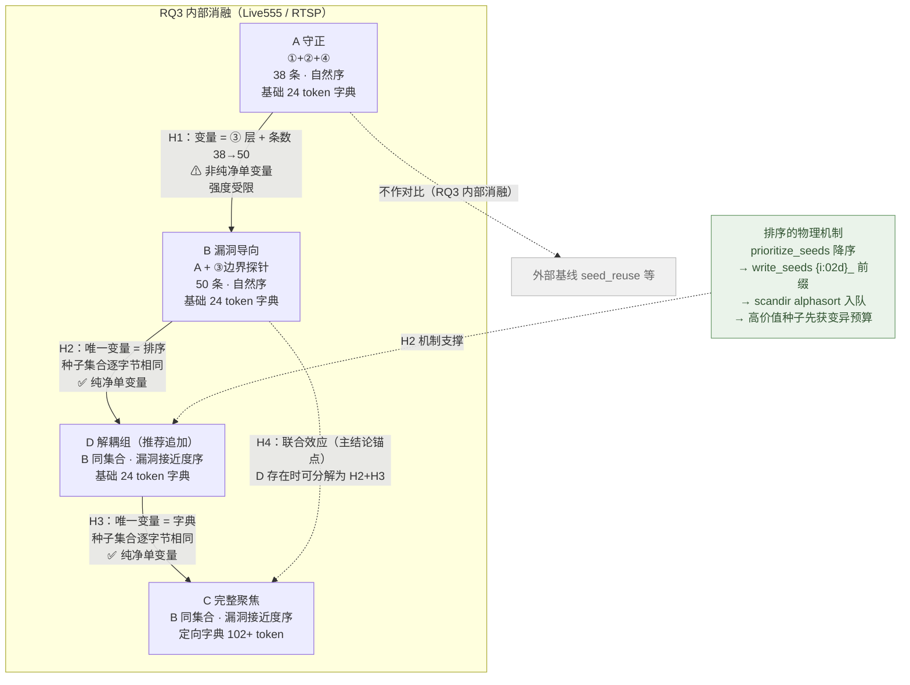
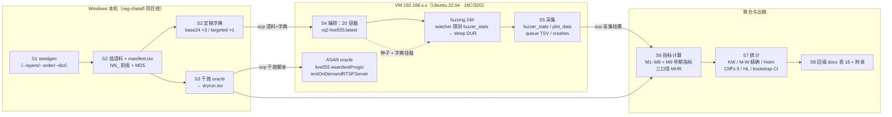

# RQ3 种子聚焦 —— A/B/C 逐层消融实验需求规格（实验方案）

> 项目：ProtoRAG（检索增强生成 + LLM 的协议模糊测试种子生成框架）
> 论文 RQ3：种子聚焦（**ProtoRAG 内部逐层消融，不与外部基线对比**）
> 对应论文章节：`docs/实验/实验方案_详细版.docx` → 表 18（docx 内部 table index = 18）
> 编写日期：2026-10-24　|　编写人：许清楚（产品经理）
> 目标系统：Live555（RTSP，text）· `testOnDemandRTSPServer` · 镜像 `rq2-live555:latest`
> 上一阶段：RQ1.2 有效性实验（2026-10-24 11:09 启动 → 2026-10-25 11:09 计划停止）

---

## 0. 结论先行（TL;DR）

| # | 结论 | 依据 |
|---|---|---|
| 0.1 | **RQ3 的唯一变量轴是「种子层 → 排序 → 字典」三段递进**，三组均在 Live555 上以同一 fuzzer / 同一镜像 / 同一参数 / 同一时长 / 同一 rep 数运行 | 【主理人核实】+ 【代码事实】`scripts/seedgen.py` 三层产出链路 |
| 0.2 | **A 组种子数 = 38 条、B 组 = C 组 = 50 条**（精确实测，非估算；本机复算与主理人独立实测**完全一致**） | 【实测】本机复跑 `edge_cover`/`generic_danger`/`derive_vuln_pattern_candidates` 全链路 + 【主理人核实】 |
| 0.3 | ⚠ **A→B 不是单变量对照**：它同时包含「新增③层」与「种子数 38→50」两个变化。A 的 38 条是 B 的**逐字节前缀**（MD5 序列相等），故 A 的种子内容**未被改写**，但条数差异是真实混淆 | 【实测】MD5 序列比对 + 【主理人核实】 |
| 0.4 | ✅ **B→C 是纯净单变量对照**：种子集合完全相同（50 条逐字节一致），**仅顺序 + 字典**不同 → **RQ3 的主结论锚定在 B→C** | 【实测】MD5 集合比对 + 【主理人核实】 |
| 0.5 | **C 组的 50 条种子集合与 RQ1.2 正在跑的 `protorag` 语料完全相同（MD5 集合相等，50/50）**，故 C 组 vs RQ1.2 protorag 的差异**恰好只有字典一项** | 【实测】`derived/seeds/rtsp/live555_20261024_110155` |
| 0.6 | **推荐追加 D 组（B + 仅排序 + 基础字典）**，用 3 格 2×2 解耦 B→C 的双变量；D 组进论文**附录/补充列**，不占表 18 的 A/B/C 三行 | 【产品判断】见 §2.5 |
| 0.7 | **变异命中率主口径选定「定向命中口径」**（变异衍生条目中命中漏洞触发模式的比例），另配「③层归因口径」与「崩溃归因口径」作机制佐证；三口径全部可执行、可验证，崩溃为 0 时明确记 N/A 而非 0 | 见 §4.7 |
| 0.8 | **rep 数必须取 5**：n=3 vs 3 的 Mann-Whitney 最小可达双侧 p = 0.10，**在数学上不可能宣称显著**；n=5 vs 5 最小可达 p = 0.0079 | 【统计】精确检验下界 |
| 0.9 | **推荐方案**：Wave 1 = A/B/C/D × chatafl × 5 rep = **20 容器**（与当前已稳定运行的 RQ1.2 完全同构的负载），Wave 2（可选）= 同构 × aflnet | 见 §5.4 |
| 0.10 | ★ **排序的物理机制已验证**（主理人核实）：AFLNet(`afl-fuzz.c:2287`) 与 ChatAFL(`afl-fuzz.c:2814`) 均用 `scandir(in_dir,&nl,NULL,alphasort)` 按**文件名字母序**入队，而 `write_seeds`(`rag_seedgen.py:1017`) 用 `{i:02d}_` 前缀（i = 排序后下标）→ **文件名数字前缀 = 变异优先级**。ProtoRAG 的漏洞接近度排序**真的**把高价值种子排到队列前面 | 【主理人核实】+ 【代码事实】 |
| 0.11 | ⚠ **排序机制的局限（必须诚实写明）**：AFL 队列轮转（cycle）会让所有种子最终都被变异，排序只影响**前期预算分布**；24h 长跑下末态覆盖的边际效应会被时间稀释 → **H2 的主证据必须用早期指标**（前 1h/2h 覆盖与路径增长、崩溃首次出现时刻），末态覆盖降级为辅助 | 【主理人核实】见 §1.4 |
| 0.12 | ⚠ **实测发现重大缺口**：102 token 的定向字典 `generate_protocol_dict` **不含触发 Session 值 `000022B8`**（亦不含 `interleaved=0-1` / `client_port=50000-50001`），而历史结论明确要求「定向字典喂 track1/track2/**触发 Session 值**」——C 组字典必须补齐，否则 H3 的机制链断在最后一环 | 【实测】`core/fused/downstream/boundary_probe.py` 四种字典函数逐一比对 |
| 0.13 | ⚠ **实测发现历史教训的量化支撑**：项目内已记载「63 token 增强字典稀释关键 token，崩溃发现反而不如 24 token 基础字典」——102 token 的定向字典存在**同向稀释风险**，C 组必须预留对照 | 【代码事实】`generate_dict_minimal` docstring + `generate_dict_balanced` docstring |
| 0.14 | ⚠ **代码现状：A 组当前无法产出** —— `scripts/seedgen.py` 的③层无条件生成、排序无条件执行 → 必须新增开关。**推荐 `--focus-group {A,B,C,D}` 单一入口**（防误用），底层由 `--no-vuln-boundary` / `--no-sort` / `--dict` 组合实现 | 【主理人核实】+ 【代码事实】`scripts/seedgen.py` |
| 0.15 | **红线遵守**：本方案全程**全量种子、不截断、不复制**，且**不把「多协议低成本迁移」作为任何创新点或卖点** | 【用户铁律】 |

---

## 1. RQ3 假设与研究问题

### 1.1 研究问题

> 在 **不减少初始种子条数** 的前提下，ProtoRAG 的三层检索产物经由「漏洞接近度排序 + 定向变异字典」引导，能否把 AFL 的变异预算更有效地导向漏洞触发边界，从而提升状态/分支覆盖并提高崩溃发现？

RQ3 是**内部消融**：所有对比均在 ProtoRAG 自身的三个配置之间进行，**不与 seed_reuse / ChatAFL / AFLNet 原始种子等外部基线比较**。【用户铁律】

### 1.2 假设表（逐条可检验）

| 假设 | 唯一变量 | 对照 | 可观测指标 | 预期方向 | 依据 |
|---|---|---|---|---|---|
| **H1**<br>漏洞边界候选层把种子推到漏洞触发边界附近，从而提高变异命中率 | ③ 漏洞边界探针层**开/关**（⚠ 伴随条数 38→50，见 §3.3 混淆处置） | A → B | **主**：定向命中条目数、每条 ③ 层种子的派生条目数；**辅**：末态覆盖与路径数 | B > A（**强度弱、解释受限**，非纯净单变量） | 【代码事实】`derive_vuln_pattern_candidates` 生成 legal/illegal 边界对；【设计假设】边界种子与触发点距离更近 |
| **H2**<br>在种子集合完全相同的前提下，按漏洞接近度排序能把变异预算**优先**分配给高价值种子 | **排序**（自然序 → 漏洞接近度降序） | B → D | **主（早期）**：T+1h / T+2h 的 `paths_total`、`bitmap_cvg`、前 N cycle 路径增长、**崩溃首次出现时刻**；**辅（末态）**：③ 层种子派生条目占比、末态覆盖 | D > B，**差异集中在前期**；24h 末态差异**预期显著小于早期差异**（时间稀释） | 【主理人核实】`alphasort` 入队机制 + 【代码事实】`write_seeds` `{i:02d}_` 前缀 + 【局限】AFL 队列轮转 → 见 §1.4 |
| **H3**<br>定向变异字典把随机变异导向漏洞触发 token，从而提升分支覆盖与崩溃发现 | **字典**（基础 24 token → 定向字典） | D → C | 分支覆盖%；n_edges；崩溃数；定向命中条目数 | C > D | 【代码事实】`generate_protocol_dict` 自动抽取方法/字段/触发 token；【项目历史】`generate_dict_minimal` docstring 记载「精简字典崩溃 +29%、发现效率 3.2 倍」 |
| **H4**<br>排序与字典两项叠加（完整聚焦）优于任一单项 | 排序 + 字典同时变 | B → C（综合） | 分支覆盖%；n_states/n_edges；崩溃数；**早期指标同 H2** | C > B，且 C 增益 ≈ 单独排序 + 单独字典之和（待检验，不预设） | 【产品判断】C 组的论文定位即「完整聚焦」 |

> **H2 与 H3 的拆分是本方案的关键设计**。B→C 在原始定义中同时改变了「顺序」与「字典」两个因素，若不追加 D 组，论文只能声称「排序+字典的联合效应」，无法回答「哪一项贡献更大」——审稿人必问。故追加 D 组（见 §2.5）。

> **H1 不是纯净单变量对照**（A→B 同时改变「层」与「条数」），**H2/H3 是**（种子集合逐字节相同）。因此**论文的主结论锚定在 B→C 与 B→D/D→C**，A→B 的结论强度须按 §3.3 降级表述。

### 1.3 假设与实验设计的对应关系（Mermaid）



---

### 1.4 ★ 排序机制的物理基础与边界（H2 的机制性支撑）

#### 1.4.1 机制链条（已核实）

```
ProtoRAG 漏洞接近度打分  →  prioritize_seeds() 降序排序
        ↓
write_seeds() 落盘命名 f"{i:02d}_{stream}_{methods}.raw"   （i = 排序后下标）
        ↓
AFL 加载初始种子：scandir(in_dir, &nl, NULL, alphasort)   ← 按【文件名字母序】
        ↓
add_to_queue() 依次入队 → 字母序 = 数字前缀序 = 漏洞接近度降序
        ↓
AFL 主循环优先变异队列前部条目 → 高价值种子先获得变异预算
```

| 环节 | 代码位置 | 依据 |
|---|---|---|
| 排序 | `core/fused/downstream/selector.py` → `prioritize_seeds()`，分数 100/95/85/60/40/20/10 | 【代码事实】 |
| 命名 | `core/fused/downstream/rag_seedgen.py:1017` → `f"{i:02d}_{stream}_{methods}.raw"` | 【代码事实】 |
| 入队 | AFLNet `afl-fuzz.c:2287`、ChatAFL `afl-fuzz.c:2814` → `scandir(in_dir, &nl, NULL, alphasort)` | 【主理人核实】 |

**结论**：ProtoRAG 的「漏洞接近度排序」**不是装饰性标签**，它通过「文件名数字前缀 → alphasort 入队顺序」这一物理链条，**真的**把高价值种子排到 AFL 变异队列前面。这正是「**不砍种子也能聚焦**」的物理机制 —— 这是 RQ3 最核心的机制贡献，必须在论文中讲清楚。

> ★ **对「不复制多份」铁律的正面支撑**：该机制**不需要**复制任何种子、不需要增加任何种子条数，仅靠**重命名顺序**即可改变预算分配。这从机制层面证明了「聚焦 = 排序 + 定向字典」优于「聚焦 = 砍种子」。

#### 1.4.2 ⚠ 机制的边界与诚实声明

| # | 局限 | 对实验设计的影响 | 处置 |
|---|---|---|---|
| L1 | **AFL 队列轮转（cycle）**：AFL 会循环遍历队列，最终**所有**种子都会被变异到 | 排序只影响**前期预算分布**，不改变「谁最终被变异」 | **H2 主证据改用早期指标**（§4.8），末态覆盖降级为辅助 |
| L2 | **24h 长跑的时间稀释**：末态覆盖是 24h 累积量，排序的早期优势会被后续轮转抹平 | 若只看末态覆盖，可能出现「B 与 D 无显著差异」的**假阴性** | ① 必须采集并报告**时间序列**（`plot_data` 逐行）而非只取末行；② 早期窗口定义为 T+1h / T+2h；③ 论文明确写「排序的效应集中在前期，末态差异被时间稀释」 |
| L3 | **排序只对初始种子生效**：fuzzer 后续产生的路径不受此机制控制 | 排序的效应**随队列增长而衰减** | 报告「③ 层种子在 T+1h / T+2h 的派生条目占比」，直接观测效应衰减曲线 |
| L4 | **初始队列的 18 条④黄金路径在排序后被排到末位**（分数 10，最低） | C/D 组的前期预算全给 ③ 层 → 前期覆盖可能**低于** B 组，但漏洞导向性更强 | **预期方向必须写明**：D 组在**前期覆盖率**上可能与 B 组持平甚至略低，而**定向命中/崩溃时刻**更优。**不得**把「前期覆盖持平」写成「排序无效」 |
| L5 | `alphasort` 是**字母序**，依赖 `{i:02d}` 前缀；种子数 > 99 时 `f"{i:02d}"` 会溢出到 3 位，字母序与数值序脱钩 | 本次 50 条远低于 99，**当前无风险** | 实现阶段加断言：种子数 > 99 时改用 `{i:03d}` 或 `{i:04d}`；并在 spec 中记录该约束 |

#### 1.4.3 由机制推导的「早期指标」清单（新增 M9 指标，见 §4.8）

| 指标 | 定义 | 采集 | 期望方向（D vs B） |
|---|---|---|---|
| `paths_T1h` | T+1h 时的 `paths_total` | `plot_data` 时间序列按 `unix_time` 插值 | D > B |
| `cvg_T1h` / `cvg_T2h` | T+1h / T+2h 的 `bitmap_cvg` | 同上 | D ≈ B 或略低（见 L4），**不得**预期显著更高 |
| `bp_layer_share_T1h` | T+1h 时派生条目中源自 ③ 层种子的占比 | `queue/` + `orig:` 血缘 | **D >> B**（这是排序最直接的证据） |
| `t_first_crash` | 首个崩溃出现的时刻 | `plot_data` 首次 `unique_crashes > 0` 的时间戳 | **D < B**（越早越好） |
| `paths_slope_early` | 前 2h 的路径增长斜率（条/h） | `plot_data` 一阶差分 | D > B |
| `n_edges_T1h` | T+1h 的状态机边数 | `plot_data` `n_edges` 列 | D ≈ B |

---

## 2. A / B / C 三组的精确定义

### 2.1 种子层与「唯一变量」的归属

| 层 | 代码事实 | 在 A/B/C 中的启用 | 说明 |
|---|---|---|---|
| ① 结构覆盖 `edge_cover` | `core/fused/downstream/edge_cover.py`；**永远生成** | A ✅ / B ✅ / C ✅ | 三组共有，非变量 |
| ② 通用危险 `generic_danger` | `core/fused/downstream/generic_danger.py`；需 `--danger` 或 `profile.seedgen.danger` 开启 | A ✅ / B ✅ / C ✅ | 三组共有，非变量。⚠ 必须用 `minimal=False`（非 `--focused`），否则层②内容被裁剪 → 变成第二个变量 |
| ③ 漏洞边界候选 `derive_vuln_pattern_candidates` | `core/fused/downstream/boundary_probe.py`；当前 `scripts/seedgen.py` **无条件生成** | A ❌ / B ✅ / C ✅ | **A→B 的唯一变量**。需新增开关以支持 A 组（见 §6.1） |
| ④ 黄金路径 `canonical_flow` | `profile.json → seedgen.canonical_flow = [OPTIONS, DESCRIBE, SETUP, PLAY, TEARDOWN]`；经 `_apply_url_placeholders` **多流展开为 18 条**（RTSP 18 个流） | A ✅ / B ✅ / C ✅ | 三组共有，非变量。**计入「结构覆盖」的完整会话形态**（依据：它由状态机唯一推导，是 ① 的极端形态）。⚠ 若改为剔除，则 A/B/C 全体重构，见 §9 待确认 #1 |
| 排序 `prioritize_seeds` | `core/fused/downstream/selector.py`；分数：③边界=100/95、③字段=85、②序列型=60、②其他=40、①=20、④=10；**当前默认总是排序** | A 自然序 / B 自然序 / C 漏洞接近度降序 | **B→C 的变量之一**（需 D 组解耦）。⚠ 需新增 `--no-sort` 开关 |
| 字典 `generate_protocol_dict` | `core/fused/downstream/boundary_probe.py`；协议无关，从知识中枢自动抽 token | A 基础 24 / B 基础 24 / C 定向（102+） | **B→C 的另一个变量**（需 D 组解耦） |

### 2.2 三组定义卡

#### A 组 —— 守正（结构覆盖 + 通用危险）

| 项 | 值 | 依据 |
|---|---|---|
| 启用种子层 | ① + ② + ④ | 【代码事实】 |
| 排除种子层 | ③（漏洞边界候选） | 【设计】H1 对照基线 |
| 排序 | **自然序**（生成序：④ → ① → ②），**不做漏洞接近度排序** | 【设计】与 B 同序规则，保证 A→B 唯一变量是③层 |
| 变异字典 | **镜像内基础 `rtsp.dict`（24 token）** | 【主理人核实】；与 RQ1.2 同一份，保证跨实验可比 |
| 种子条数 | **38 条**（实测） | 【实测】21 条去重后 → 多资源展开 38（④ 展开 18 条） |
| 截断/复制 | **无。全量、不截断、不复制** | 【用户铁律】 |
| 角色 | 逐层消融起点；「守正」参照点 | — |

#### B 组 —— 漏洞导向（A + 边界探针）

| 项 | 值 | 依据 |
|---|---|---|
| 启用种子层 | ① + ② + ③ + ④ | 【代码事实】 |
| 新增相对 A | **③ 层净增 12 条**（③ 产出 18 条候选 → 与 ①/②/④ 签名去重后折叠 6 条 → 净增 12 条；其中 legal 端 4 条、illegal 端 8 条） | 【实测】`dedupe_seeds` 完整签名去重 |
| 排序 | **自然序**（③ 层种子位于队列**尾部**，编号 39–50） | 【设计】H2 对照基线；【实测】B 组层序列 = ④×18 → ①×5 → ②×15 → ③×12 |
| 变异字典 | **镜像内基础 `rtsp.dict`（24 token）** | 【主理人核实】；字典是 RQ3 变量，A/B 必须一致 |
| 种子条数 | **50 条**（实测） | 【实测】 |
| 与 A 的关系 | **A 的 38 条是 B 的逐字节前缀**（MD5 序列比对相等） | 【实测】→ A→B 是纯增量对照 |
| 截断/复制 | **无** | 【用户铁律】 |
| 角色 | 隔离「③ 层有无」的效果 | — |

#### C 组 —— 完整聚焦（B + 排序 + 定向字典）

| 项 | 值 | 依据 |
|---|---|---|
| 启用种子层 | ① + ② + ③ + ④（**与 B 完全相同**） | 【实测】MD5 集合相等 |
| 排序 | **漏洞接近度降序**：③边界(100/95)×6 → ③字段(85)×6 → ②序列型(60)×15 → ②其他(40) → ①(20)×5 → ④(10)×18 | 【实测】`prioritize_seeds` 实跑层序列 |
| 变异字典 | **定向字典**（`generate_protocol_dict` + 关键触发 token 补齐，见 §2.4） | 【设计】H3 变量 |
| 种子条数 | **50 条**（实测，与 B 同） | 【实测】 |
| 与 B 的关系 | **种子集合逐字节相同**，仅顺序 + 字典不同 | 【实测】 |
| 跨实验连续性 | **= RQ1.2 正在运行的 `protorag` 语料**（`derived/seeds/rtsp/live555_20261024_110155`，50 条 MD5 集合相等） | 【实测】→ C vs RQ1.2 protorag 的差异恰好只有字典 |
| 截断/复制 | **无** | 【用户铁律】 |

### 2.3 A → B → C 逐层增量对照表

| 组 | 相对上一组的**新增变量** | 启用层 | 排序 | 字典 | 种子数 | 与上一组种子集合的关系 | 对照纯净度 |
|---|---|---|---|---|---|---|---|
| **A** | ——（基线） | ①②④ | 自然序 | 基础 24 | **38** | —— | —— |
| **B** | **③ 漏洞边界候选层（+12 条净新）** ⚠ **同时条数 38→50** | ①②③④ | 自然序 | 基础 24 | **50** | **A ⊂ B 逐字节前缀**；A 的 38 条内容与顺序均不变 | ⚠ **非单变量**（层增 + 条数增） |
| **D** | **排序** | ①②③④ | 漏洞接近度降序 | 基础 24 | **50** | 与 B **逐字节相同**，仅顺序变 | ✅ **纯净单变量** |
| **C** | **定向字典**（相对 D）；相对 B 则是「排序 + 字典」 | ①②③④ | 漏洞接近度降序 | 定向 102+ | **50** | 与 B / D **逐字节相同** | ✅ **纯净单变量**（D→C） |

> **对照纯净度小结**：**A→B 双变量**（层 + 条数）；**B→D 与 D→C 均为纯净单变量**。因此论文的主结论应锚定在 **B→D→C 这条链**上，A→B 作为「漏洞导向层的整体价值（含条数贡献）」呈现并明确标注混杂。详见 §3.3。

**逐层语义表**（论文叙述可直接引用）：

| 层 | A | B | D | C | 该层的论文含义 |
|---|---|---|---|---|---|
| ① 结构覆盖 | ✅ | ✅ | ✅ | ✅ | 守正底座，保证状态机覆盖完整性 |
| ② 通用危险 | ✅ | ✅ | ✅ | ✅ | 守正底座 + 序列型危险（自环/生命周期） |
| ③ 漏洞边界候选 | ❌ | ✅ | ✅ | ✅ | **漏洞导向层**：legal 端（不同 track/不重建/不切换）是「离非法最近仍合法」的理想种子；illegal 端需定向字典喂触发 token 才可能被走到 |
| ④ 黄金路径（多流） | ✅ | ✅ | ✅ | ✅ | 完整会话形态，保证每个流都有一条完整会话（排序后位于队列**末位**，见 §1.4.2 L4） |
| 排序 | ❌ | ❌ | ✅ | ✅ | 变异预算再分配（**H2**），物理机制见 §1.4 |
| 定向字典 | ❌ | ❌ | ❌ | ✅ | 变异方向偏置（**H3**） |

### 2.4 定向字典的最终定义与必须补齐的缺口（P0）

⚠ **实测结论（必须处理）**：`generate_protocol_dict` 产出 102 token，其中**含** `track1`/`track2`/`Session`/方法名/字段名/流名，但**不含**：

| 缺失 token | 是否为触发关键 | 后果 |
|---|---|---|
| `000022B8`（真实触发 Session 值，对照实验证实 `clientSessionId=8888` 命中 matroska UAF 栈） | **是** | illegal 端「同 track 双 SETUP + 触发值」**无法被随机变异构造出来** → H3 机制链断裂 |
| `interleaved=0-1` | 是（Transport 切换维度的变异目标） | interleave_seq illegal 端难以被构造 |
| `client_port=50000-50001` | 是（Transport 切换维度的变异目标） | 同上 |

根因【代码事实】：`generate_protocol_dict` 只从 `bundle["methods"]` / `bundle["headers"]` / `vuln_pattern` 的 `trigger_sequence`+`streams` / URL 模板 / 资源名 / 通用数值边界 取 token，**未调用** `extract_session_candidates()`；而 `generate_dict_minimal` / `generate_dict_balanced` **调用了**该函数，故含 `000022B8` / `interleaved=0-1` / `client_port=50000-50001`。

**处置要求（P0，C 组必须执行）**：

1. C 组定向字典 = `generate_protocol_dict(bundle, protocol, resources)` **∪** `extract_session_candidates()`（3 个：000022B8 / 107518505 / 7477886380351771441）**∪** {`interleaved=0-1`, `client_port=50000-50001`, `RTP/AVP;unicast;interleaved=0-1`}，并保持 `_is_dict_token` 过滤规则不变。预计最终 token 数 ≈ **108**（实测待最终定稿）。
2. 字典文件**定稿后冻结**：落盘 `rq3/dict/c_targeted.dict`，记录 token 数与 **MD5**，随论文作为实验材料归档，避免「字典是变量但内容在漂移」。
3. ⚠ **token 稀释风险必须评估**：项目内已有实证——「63 token 增强字典稀释了关键 token 的被选概率，导致崩溃发现反而不如 24 token 的 `rtsp.dict`」（`generate_dict_minimal` docstring）；「34 token 折中字典崩溃 +29%、发现效率 3.2 倍，但覆盖率 −0.13%」（`generate_dict_balanced` docstring）。102→108 token 属同向风险区。
   **对策**：Wave 1 结束后若 C 组崩溃数与 D 组持平（字典未带来增益），在 Wave 2 追加一个 **C′ 组**（定向字典的精简档：仅保留关键触发 token + 协议结构 token，控制在 30–40 token），以区分「字典无效」与「字典被稀释」。C′ 不进论文表 18，作为附录消融。
4. **不要复用现成产物**：`derived/seeds/rtsp/live555_20261024_110155/rtsp.dict` 与 `derived/seeds/rtsp/dict_rtsp/rtsp.dict` 均为 102 token 的旧版定向字典，**未被 RQ1.2 使用**（RQ1.2 用的是镜像内 24 token 基础字典）。组装容器时必须显式区分挂载来源，防止误挂。

### 2.5 是否追加 D 组：推荐 **追加**

**推荐结论**：追加 D 组 = B 组种子集合 + 漏洞接近度排序 + **基础 24 token 字典**。

| 判据 | 评估 |
|---|---|
| **必要性** | B→C 同时改「顺序 + 字典」。无 D 组则 H2、H3 均不可单独检验，H4 只能作为「联合效应」表述，无法回答「贡献主要来自排序还是字典」——这是审稿必问项。【产品判断】 |
| **可行性** | D 组与 B 组种子集合**逐字节相同**，仅顺序不同 → 零额外语料构造成本，只需一次 seedgen + 一次容器编排。【实测】 |
| **容器成本** | D × chatafl × 5 rep = **+5 容器**，Wave 1 总数 20 —— 与当前已稳定运行的 RQ1.2（20 容器 × `--cpus=1 --memory=1.5g`）**完全同构**，负载已被验证。【实测】RQ1.2 运行 8.5h 稳定 |
| **是否进论文表 18** | **不占表 18 的 A/B/C 三行**。表 18 是「三层递进」主线，D 组破坏叙事节奏。建议：D 组数据进**表 18 下方的补充行 / 论文附录「排序与字典解耦」小表**，正文一句话引用「为解耦排序与字典的联合效应，另设 D 组（B+仅排序）……」【产品判断】 |
| **与 RQ1.2 的连续性** | D 组（50 条排序种子 + 基础 24 字典）**恰好等于 RQ1.2 的 `protorag_chatafl` 配置** → RQ3 内部消融与 RQ1.2 外部对照共用同一条种子-字典配置链，交叉印证价值高。【实测】 |
| **备选（不加 D）** | 若容器预算被压缩：保留 D 但降到 **3 rep**（+3 容器），并在论文中明确标注「D 组为探索性对照，n=3，仅作方向性佐证，不做显著性声明」 |
| **与 A′-补齐组的优先级** | **D 组优先于 A′-补齐组**（D 解决的是审稿必问的主命题解耦；A′ 解决的是次要对比的纯净度，且代价是超出已验证负载）。详见 §2.5.1 |

**替代项 E 组（不推荐）**：完整 2×2 还需「自然序 + 定向字典」格（E）。加上 E 后 Wave 1 = 25 容器，超出已验证的 20 容器负载（超订 1.56×），**不建议**。3 格（B/D/C）已可分解出 H2 与 H3 两条单变量对比。

### 2.5.1 A→B 条数混淆的处置：A′-补齐组 vs 只披露

【主理人核实】A→B 同时含「新增③层」与「条数 38→50」两个变化，需决定如何隔离「条数」混淆。

> **关于「不复制多份」铁律的边界判定**：铁律禁止的是「**把同一条种子复制多份来加权变异预算**」（即人为制造重复以放大某条种子的变异机会）。而「为 A 组补齐**资源覆盖**」是**扩大合法资源空间**——若补齐出的种子与原种子**内容不同**（不同流/不同 URL），则不是复制。**因此 A′-补齐组不违反铁律**，前提是补齐方式必须产生内容互异的种子。

| 方案 | 做法 | 优点 | 缺点 | 容器成本 | 我的判断 |
|---|---|---|---|---|---|
| **① 追加 A′-补齐组** | A 的 38 条 + 从 A 自身种子池按资源展开补齐至 50 条（**内容互异**，如同一 golden-path 模板在更多流上的展开） | 彻底分离「条数」与「层」：A′→B 变成**纯净单变量**（条数相同，仅多③层） | ⚠ 补齐方式本身引入新变量（补齐种子不是③层）；实现复杂度上升；且补齐出的种子质量与③层不同，可能影响结论解读 | +5 容器（Wave 1 → 25，**超出已验证负载**） | ⚠ **有条件推荐** |
| **② 只在论文披露混淆，依赖 B→C 结论** | 明确写「A→B 非单变量」，主结论锚定 B→D→C | **零额外成本**；不占用已验证的容器预算；B→D→C 本就是纯净链 | A→B 的结论强度受限，审稿人可能追问 | 0 | ✅ **默认推荐** |
| **③ 追加 A′ 但不追加 D** | 只做 A′ | —— | ❌ **最差**：牺牲了 H2/H3 的解耦（审稿必问项），换来的只是次要对比的纯净性 | +5 | ❌ **不推荐** |

**我的推荐：默认采用 ②（只披露 + 依赖 B→C），并在论文中把 A→B 的结论强度如实降级。**

理由：
1. **成本收益不对称**：② 零成本；① 需把 Wave 1 推到 25 容器（超订 1.56×，**超出 RQ1.2 已验证的 20 容器负载**），引入新的运行风险，而收益只是让**次要**对比（A→B）变纯净。
2. **主结论不依赖 A→B**：RQ3 的核心命题是「聚焦机制（排序 + 定向字典）有效」，其纯净证据链是 **B→D→C**，完全不涉及条数问题。
3. **A→B 的价值在于「漏洞导向层有增量价值」这一方向性结论**，方向性结论不需要单变量纯净度 —— 只要如实披露「+32% 条数」，读者即可自行判断。
4. **① 的补齐方式无法真正「中性」**：A′ 补齐的种子必然不是③层种子（否则就不是 A′ 了），因此 A′ vs B 仍然存在「新增 12 条种子性质不同」这一层残余混淆 —— 它隔离了「条数」，但没隔离「层的性质」，收益远小于成本。

**若主理人仍决定采纳 ①**，我的实施建议：
- A′ 补齐到 **50 条**（与 B/C/D 对齐），方式为「A 组已有种子在**更多资源实例**上的展开」（内容互异，MD5 互异）；
- A′ **只进附录**（不进表 18），与 D 组同表呈现为「A/A′/B/D/C 五格对照表」；
- **容器安排**：A′ 若加，Wave 1 变为 25 容器 → 建议改为 **Wave 1 = A/B/C/D × 5 rep = 20 容器**（保持已验证负载），**A′ 单独放 Wave 2**（Wave 2 = A′ × chatafl × 5 rep = 5 容器 + 可选 aflnet）；
- 论文必须写明 A′ 的补齐规则（哪些种子、在哪些资源上展开、如何保证 MD5 互异），否则不可复现。

### 2.6 建议新增的 seedgen CLI 开关（P0，实现阶段交付）

当前 `scripts/seedgen.py` 的三个行为**无法表达 A/B/C 三组**，必须新增开关（详细见 §6.1）：

| 开关 | 默认 | 作用 | 理由 |
|---|---|---|---|
| **`--focus-group {A,B,C,D}`** | 无（不传则保持现有行为） | **单一入口，一次性表达整组配置**，内部展开为下述原子开关的组合 | **主推荐入口**：避免三组配置靠多个布尔开关手工拼装而误用（如漏关排序）。与 RQ1.2 的实验语义一一对应，实验脚本可只传这一个参数 |
| `--layers` | `edge_cover,generic_danger,vuln_boundary,canonical` | 选择启用的种子层（③ 层当前**无条件生成**） | A 组构造的底层能力 |
| `--no-vuln-boundary` | 关 | 关闭③漏洞边界候选层 | A 组构造的**显式**开关（`--layers` 的快捷方式，二选一即可） |
| `--order` | `vuln-proximity` | `natural`（生成序）/ `vuln-proximity`（降序） | 排序当前**默认总是执行**，B 组无法构造 |
| `--no-sort` | 关 | 关闭排序，保持生成顺序 | B 组构造的**显式**开关（`--order` 的快捷方式） |
| `--dict` | `protocol` | `none` / `base` / `protocol` / 指定路径 | 当前**总是**落盘 `<out>/<protocol>.dict`（102 token），A/B/D 不得使用 |
| `--manifest` | 关 | 落盘 `manifest.tsv`（序号/文件名/MD5/层/分数/legal-illegal/描述） | 变异命中率归因的**必需**中间产物；当前 `write_seeds` 只写文件名不带层标签 |
| `--max-seeds` | `None` | **本实验全程不使用** | 【用户铁律】聚焦 ≠ 砍种子 |

**`--focus-group` 的组配置展开表（推荐的实现契约）**：

| 组 | `--layers` | `--order` | `--dict` | `--danger` | 预期种子数 | 预期字典 token |
|---|---|---|---|---|---|---|
| `A` | `edge_cover,generic_danger,canonical` | `natural` | `base` | ✅ | **38** | 24（镜像内） |
| `B` | `edge_cover,generic_danger,vuln_boundary,canonical` | `natural` | `base` | ✅ | **50** | 24（镜像内） |
| `C` | 同 B | `vuln-proximity` | `protocol`（含补齐，见 §2.4） | ✅ | **50** | ≈108（定向定稿版） |
| `D` | 同 B | `vuln-proximity` | `base` | ✅ | **50** | 24（镜像内） |

> ⚠ `--focused` **不可使用**：它同时启用 `generic_danger(minimal=True)`（改写层②内容）+ 排序 + 可选截断，会一次性引入三个变化。【代码事实】`scripts/seedgen.py:265-305`
>
> ⚠ `--focus-group` 与原子开关**互斥**：同时指定时必须报错退出（防止 `--focus-group B --no-sort` 这类语义冲突），由实现阶段加参数校验。

---

## 3. 控制变量与公平性约束

### 3.1 必须锁定的控制变量清单

| 类别 | 锁定项 | 取值 | 依据 |
|---|---|---|---|
| 目标程序 | live555 `testOnDemandRTSPServer`（ASAN 构建供 oracle；容器内构建供 fuzz） | 同一 | 【主理人核实】 |
| 镜像 | `rq2-live555:latest` | 同一 | 【主理人核实】 |
| Fuzzer | 同一二进制、同一版本 | chatafl（主）/ aflnet（次） | 【主理人核实】 |
| Fuzzer 参数 | `afl-fuzz -d -i <seeds> -x <dict> -o <out> -N tcp://127.0.0.1/<port> -P RTSP -D 10000 -q 3 -s 3 -E -K -R -m none -t 1000 -- ./testOnDemandRTSPServer <port>` | **A/B/C/D 完全一致**，仅 `-i`/`-x`/`-o`/`-N` 端口不同 | 【代码事实】`docs/实验/experiment_plan.md` 参数模板 |
| 容器资源 | `--cpus=1 --memory=1.5g` | 全部容器一致 | 【主理人核实】；RQ1.2 已验证 RSS 实测仅 40–90 MB |
| 运行时长 | 24h（自**正式 fuzzing 起**计时） | 全部容器一致 | 【主理人核实】RQ1.2 采用「watcher 探测到 `fuzzer_stats` 出现后再 sleep DUR」 |
| rep 数 | 5 | 全部组一致 | 【产品判断】§1.2/§5.5 |
| 字典策略 | **除被测变量外一律相同**；A/B/D = 镜像内基础 24 token；C = 定向字典 | 见 §2.4 | 【设计】字典是 RQ3 的变量 |
| 种子策略 | **全量、不截断、不复制**；A/B/C/D 均不传 `--max-seeds` | — | 【用户铁律】 |
| 端口 | 每容器独立端口，组间不重叠 | — | 【代码事实】 |

### 3.2 「字典是 RQ3 变量」的安排说明

字典在本实验中是**被测变量**，不是中性配置。因此：

- **A / B / D 必须使用镜像内基础 `rtsp.dict`（24 token）**，且必须是**镜像内那一份**（与 RQ1.2 同源），确保三组字典**逐字节相同**；
- **C 使用定向字典**（§2.4 定稿版），通过 `-x` 显式挂载；
- 若容器镜像内的基础字典在 Wave 1/2 之间被改动，必须**重启 Wave 2** 或在论文中声明变更（哈希比对）。

### 3.3 种子条数不等（A=38 < B=C=50）的混淆风险与缓解

| 风险 | 说明 | 缓解措施 |
|---|---|---|
| **R1 ⚠ A→B 是双变量对照**（本实验最重要的诚实性要求） | A(38) → B(50) 同时改变「**③ 层有无**」与「**种子条数 +32%**」两个因素。覆盖率/路径数差异**无法**归因于「种子更聚焦」——多 12 条种子本身就会抬高覆盖与路径数 | ① **论文必须显式声明 A→B 非单变量**，并把该对比的结论强度降级为「引入漏洞边界候选层（含其带来的条数增量）的整体效应」；② **主结论锚定 B→D→C 纯净单变量链**（§2.3 对照纯净度表）；③ 表 18「种子数」列**直接披露** 38 / 50 / 50 / 50；④ 附加报告**每条种子平均派生条目数**（`derived` 总数 ÷ 种子数），把「量」归一化后再比较「质」——该指标**不随条数线性放大**，可作为条数归一化后的补充证据；⑤ 若采纳 **A′-补齐组**（见 §9 待确认 #2），A→A′ 与 A′→B 可进一步把「条数」与「层」分开 |
| **R2 ③ 层含 8 条 illegal 端种子**（设计上逼近崩溃） | 它们在 dry-run 可能判 ILLEGAL，且可能改变 AFL 初始队列的接受行为 | ① 干跑前**逐条标注**每条种子的 legal/illegal 标签并公开；② 报告 **dry-run 通过率**（§4.3）；③ 崩溃数用 **Δ(P2−P1)** 口径剥离「启动即崩」；④ 若发现 illegal 种子在启动期被 AFL 拒绝，在附录披露被拒种子清单 |
| **R3 ④ 层多流展开造成 A/B 的流分布不同** | ④ 展开 18 条（每流一条，占 A 的 47%），其余按流轮转 | 保持三组同一套展开规则（代码同一路径），差异只来自 ③ 层的 12 条新增；论文须披露 ④ 在 A 中的占比 |
| **R4 B→C 双变量** | 顺序 + 字典同变 | **D 组解耦**（§2.5）；B→D、D→C 构成两条**纯净单变量**对比，B→C 为联合效应 |
| **R5 ChatAFL 启动期 LLM 增强污染语料** | ChatAFL 在 startup 阶段会往 `-i` 目录回写 `enriched_*.raw`（RQ1 实测：7 条种子 → 8 条增强文件） | **必须在容器启动参数中关闭该行为**，否则三组语料都被污染且「种子数」列失真。**列为 §9 待确认 #7，启动前必须实测确认** |
| **R6 端口/资源竞争** | 同机多容器互相干扰 | 每容器独立端口 + 独立输出目录；容器数 ≤ 20（已验证负载） |
| **R7 ⚠ 排序效应被时间稀释**（§1.4.2 L1/L2） | AFL 队列轮转使所有种子最终都被变异；24h 末态覆盖可能掩盖排序的早期优势 | ① 采集**完整 `plot_data` 时间序列**而非只取末行；② H2 主证据用**早期指标**（M9，§4.8）；③ 论文明确写「排序效应集中在前期，末态差异被时间稀释」，避免「末态无差异 ⇒ 排序无效」的误读 |
| **R8 ⚠ ④ 层在排序后被排到末位**（§1.4.2 L4） | C/D 组前期预算全给 ③ 层，**前期覆盖率可能不高于 B 组** | 预期方向必须写明：**前期覆盖持平/略低 + 定向命中更优** 是排序的**正常表现**；不得写成「排序无效」 |

### 3.4 「B→C 纯净单变量」—— RQ3 结论可信度的核心论据

【主理人核实】**B 与 C 的种子集合完全相同（50 条，逐字节一致），仅顺序与字典不同**。

这条事实是 RQ3 结论可信度的**核心论据**，理由：

| 论据 | 说明 |
|---|---|
| **内容零差异** | B/C 的 50 条 `.raw` 内容逐字节相同 → 覆盖差异**不可能**来自「种子内容不同」或「种子质量不同」 |
| **数量零差异** | 均为 50 条 → 覆盖差异**不可能**来自「条数不同」 |
| **唯一剩余变量** | 仅剩「顺序」与「字典」两个 → 加上 D 组后，**完全闭合为两条纯净单变量链** |
| **与 RQ1.2 连续** | B 组 = RQ1.2 的 `protorag` 语料 + 基础 24 字典 = RQ1.2 `protorag_chatafl` 配置；C 组 = 同一语料 + 定向字典 → **RQ1.2 与 RQ3 构成一条连续的证据链**，C vs RQ1.2 的差异恰好只有字典 |
| **论文表述** | RQ3 主结论建议表述为：「在**种子集合与条数完全相同**的前提下，『漏洞接近度排序 + 定向变异字典』使 ProtoRAG 种子在 Live555 上取得 X 的分支覆盖 / Y 的定向命中 / 首次崩溃提前 Z 分钟」——**主语是 ProtoRAG 内部机制，不含任何外部基线对比** |

---

## 4. 指标口径与计算公式

### 4.1 指标总览

| # | 指标 | 定义域 | 主要来源文件 | 表 18 列 |
|---|---|---|---|---|
| M1 | 种子数 | 组级 | 语料目录 | ✅ |
| M2 | dry-run 通过率 % | 组级 | oracle 输出 | ✅ |
| M3 | 分支覆盖 % | 容器级 → 组级 | `fuzzer_stats` | ✅ |
| M4 | 崩溃数 | 容器级 → 组级 | `fuzzer_stats` + `crashes/` | ✅ |
| M5 | **变异命中率 %** | 容器级 → 组级 | `queue/` + `crashes/` + 语料 manifest | ✅ |
| M6 | n_states / n_edges（P1、P2） | 容器级 → 组级 | `plot_data` | ➖（进 RQ1.2 表 4 对照） |
| M7 | 路径数 paths_total | 容器级 → 组级 | `plot_data` / `fuzzer_stats` | ➖ |
| M8 | execs_done / execs_per_sec / max_depth / stability / unique_hangs | 容器级 | `fuzzer_stats` | ➖（健康度诊断） |
| **M9** | **早期窗口指标**（T+1h/T+2h 的覆盖与路径、路径斜率、首崩时刻、③层派生占比） | 容器级 → 组级 | `plot_data` 时间序列 + 周期性 `queue/` 快照 | ➖（**H2 主证据**，见 §4.8） |

### 4.2 M1 种子数

```
N_seeds(group) = |{ *.raw in <group>_seeds/ }|
```

- 采集点：语料目录本地统计（Windows 侧生成后即冻结）；容器侧校验 = `queue/` 初始条目数。
- 预期值：A = 38、B = 50、C = 50、D = 50。【实测】

### 4.3 M2 dry-run 通过率 %

```
Rv(group) = 100 × N_LEGAL(group) / N_seeds(group)
```

**oracle 判定语义**【代码事实 `local/_oracle.py`】：对每条种子，按 `\r\n\r\n` 切分 RTSP 消息后逐条 TCP 发往 ASAN 构建的 `testOnDemandRTSPServer`；判定：
- `LEGAL` = 服务器进程存活且发送未失败 → 合法；
- `ILLEGAL` = 进程退出 / 发送失败（ASAN abort）→ 越界；
- `ERROR` = 服务器 15s 内未就绪 / 无可切分消息 → **不可判定**。

重试语义：`oracle(seed, port, retries=3)` —— **任一次判 LEGAL 即返回 LEGAL**；3 次全 ILLEGAL 才判 ILLEGAL；否则 ERROR。（`LEGAL` 早退是为排除概率性 UAF 抖动。）

**批处理要求**：
- 使用 `local/_batch_oracle.py`（串行、每条种子递增独立端口，避开服务器残留冲突）；**必须串行**，并发会让 ASAN 服务器互相污染；
- 单条超时上限：连接 3s / 读 2s / 服务器就绪 15s；整批加墙钟看门狗（建议 30 min/组）；
- 重试 = 3（与 RQ1 口径一致）；
- **分母口径（主）**：`Rv = N_LEGAL / (N_seeds − N_ERROR)`；同时**强制披露** `N_ERROR` 与 `N_ILLEGAL`；若 `N_ERROR > 0` 必须人工复核后说明。

**预期自检值（假设·待实测）**：A ≈ 38/38 = 100%；B/C ≈ 42/50 ≈ 84%（差额来自 ③ 层 8 条 illegal 端）。若实测偏离此形态（如 A 组出现 ILLEGAL），说明存在未识别的变量污染，须回查。【依据：RQ1 实测「60 条中 3 条 ILLEGAL，全部为漏洞导向边界探针越界候选」】

### 4.4 M3 分支覆盖 %

```
cvg(container) = fuzzer_stats.bitmap_cvg        # 形如 10.27
cvg(group)     = mean(cvg_i)  ±  std(cvg_i)     # i = 1..5，样本标准差 ddof=1
```

- 采集：`fuzzer_stats` 的 `bitmap_cvg`（P2 时刻）。
- 交叉校验：`plot_data` 末行 `map_size` 列（索引 6，带 `%`）应与 `bitmap_cvg` 同量级。
- 跨实验可比：RQ1.2 的 protorag_chatafl 实测 10.27–10.48%（8.5h @ 2026-10-24 19:40）。【实测】

### 4.5 M4 崩溃数

```
crash(container) = fuzzer_stats.unique_crashes            # P2 总数
crash_mut(container) = fuzzer_stats.unique_crashes(P2) − fuzzer_stats.unique_crashes(P1)   # ★ 变异诱发崩溃
crash_total(group)   = Σ_i crash_i           # 合计
crash_mut(group)     = Σ_i crash_mut_i       # 合计（表 18 推荐填此值）
```

- `unique_crashes` = AFL 去重后的唯一崩溃数，**可重放**（replayable）。
- ★ **为什么推荐 `Δ(P2−P1)` 作为表 18 的崩溃列**：
  1. **剔除「启动即崩」污染**：③ 层 8 条 illegal 端种子在 dry-run 就可能触发崩溃；若某条在 AFL 初始校准阶段即崩溃，会计入 `unique_crashes` 但**与「聚焦」能力无关**，反而使 B/C 组凭空获益——这是对 RQ3 有利的**虚假增益**，必须剥离；
  2. P1 = 初始种子/dry-run 刚结束的快照（`plot_data` 首行 / watcher 首次探测到 `fuzzer_stats` 时刻），P2 = 实验结束时刻（`plot_data` 末行）；
  3. 同时**必须一并报告 P2 总崩溃数**（`Σ unique_crashes`），使读者可自行还原；两者并列出现在论文小注中。
- 归因补充：`crashes/` 目录下文件名含 `orig:` 字段，可反查崩溃源自哪条种子（用于 §4.7 崩溃归因口径）。
- ⚠ **若三组崩溃数全为 0**：表 18 该列填 0，并**明确加注**「Live555 的 matroska UAF 为概率性触发，本次 24h 窗口内未被观测到；崩溃列不具区分度，结论依据 M5/M6/M7 等次级指标（见 §7.1）」——**不得**用「崩溃数无差异」反推「聚焦无效」。

### 4.6 M6 / M7 状态数、边数、路径数

```
P1 = plot_data 首行数据；P2 = plot_data 末行数据
n_states(P) = int(plot_data[P].n_nodes)      # 索引 11
n_edges(P)  = int(plot_data[P].n_edges)      # 索引 12
paths_total(P) = int(plot_data[P].paths_total)  # 索引 3
```

- `plot_data` 列定义【代码事实】+【主理人核实】：chatafl 14 列 = `unix_time, cycles_done, cur_path, paths_total, pending_total, pending_favs, map_size, unique_crashes, unique_hangs, max_depth, execs_per_sec, n_nodes, n_edges, chat_times`；aflnet 13 列（无 `chat_times`）。**两种 fuzzer 的 n_nodes/n_edges 索引一致（均为 11/12）**，解析器可共用。
- 首行是注释头（以 `#` 开头），解析时跳过；取**第一条数据行**为 P1。
- ✅ **已验证**：`plot_data` 末行的 n_nodes/n_edges 与 `ipsm.dot` 的 grep 计数**完全相等**（4 个容器逐一对齐）→ n_states/n_edges **直接从 `plot_data` 取**，不依赖易丢失的 `ipsm.dot` 快照。【主理人核实】
- `ipsm.dot` 仅作**交叉校验备份**：`n_states = grep -cE '[0-9]+[[:space:]]+\[color='`，`n_edges = grep -c -- '->'`。
- 聚合：`mean ± std`（ddof=1），P1 与 P2 分别报告；**增量** `Δn_edges = n_edges(P2) − n_edges(P1)`、`Δpaths = paths_total(P2) − paths_total(P1)` 同样报告（更贴近「变异效率」）。

### 4.7 M5 变异命中率 ★（三口径并列，主口径明确选定）

#### 4.7.1 为什么必须换口径

候选定义「源自漏洞边界探针种子的崩溃数 / 边界探针种子数」与「边界探针种子后代路径触发的崩溃占比」**都寄生于崩溃**：Live555 当前 20 容器崩溃全 0（【实测】RQ1.2 8.5h），两个候选口径在本次窗口内**分母为 0**，无法产出可用数字。因此本方案将「命中」**从崩溃解耦到「变异衍生条目」层面**，并保留崩溃归因作为第三口径。

#### 4.7.2 三个口径的完整定义

> **前置概念**
> - **初始种子副本**：AFL 把 `-i` 目录的每条种子**逐字节拷贝**进 `<out>/queue/` 作为 `id:000000,...`、`id:000001,...` 的初始条目。【AFL 行为】
> - **变异衍生条目（derived）**：队列中非初始副本的条目，即变异产生的新路径/新覆盖条目。
> - **种子归属**：由种子文件名与 `manifest.tsv` 决定（层标签、legal/illegal、分数）。
> - **队列条目 → 种子血缘**：AFL 队列文件名携带 `orig:` 字段，指向其**祖先种子**的原始文件名。

**口径 A（主口径，表 18 填此列）：定向命中口径**

```
定向命中条目(entry)  ⟺  entry ∈ derived  且  entry 内容命中「漏洞触发模式集合」P

MHR_A(group) = 100 × Σ_i |{entry ∈ derived_i : entry ∈ P}| / Σ_i |derived_i|
```

**漏洞触发模式集合 P**（对 `queue/` 条目内容做 RTSP 消息切分后判定，四者取或）：

| 代号 | 模式 | 判定规则 | 溯源 |
|---|---|---|---|
| P1 | 同 track 双 SETUP | 切分后的请求行中，方法为 `SETUP` 且 URL path 的 track 编号**出现 ≥2 次** | `double_setup` illegal 端（同 track 双 SETUP = matroska UAF 触发流）【代码事实】`boundary_probe.generate_candidates` |
| P2 | 触发 Session 值 | 报文任意位置出现 `Session: 000022B8`（大小写不敏感） | 对照实验证实 `clientSessionId=8888` 命中 UAF 栈【代码事实】`boundary_probe._TRIGGER_SESSION` |
| P3 | Transport 切换 | 报文同时出现 `interleaved=` 与 `client_port=`（两种传输方式并存） | `interleave_seq` illegal 端【代码事实】 |
| P4 | 会话重建序列 | 请求行方法序列含 `SETUP … TEARDOWN … SETUP` 且前后 SETUP 的 track 相同 | `uaf_seq` / `lifecycle_seq` illegal 端【代码事实】 |

- **分母** `derived` 的判定**以 MD5 为准，不以 `id:` 序号为准**（因为 AFL 校准阶段可能插入 trimmed 变体，使序号区间与种子数错位）：
  - `MD5(entry) ∈ {MD5(seed) : seed ∈ group}` → 判为**初始副本**（不计入分母）；
  - 否则 → 判为 **derived**（计入分母）。
- **分子**：在 derived 上套用模式集合 P。
- **不依赖 `orig:` 的可解析性**：主口径完全基于**内容模式**，`orig:` 缺失/截断不影响 MHR_A 的计算 → **主口径鲁棒**。

**口径 B（机制佐证，进附录）：③ 层归因口径**

```
MHR_B(group) = 100 × |{entry ∈ derived : 祖先种子 ∈ ③ 层}| / |derived|
```

- 归属依赖 `orig:` 血缘链：解析队列文件名的 `orig:` 字段 → 种子文件名 → `manifest.tsv` 查层标签。
- **文件名截断兜底**：AFL 的 `orig:` 字段可能被截断（约 60 字符量级）。**硬性要求**：RQ3 语料文件名必须**保留 `NN_` 序号前缀**且**前 60 字符全局唯一** → 截断后仍可用序号前缀反查。构造后须**自动断言**「任意两条语料文件名的前 60 字符不相同」，否则该组血缘不可解析 → 降级为「仅按序号前缀解析」并在附录声明。
- **兜底二级**：若 `orig:` 字段缺失/不可解析 → 归入「未归属（unattributed）」桶，**单独报告其占比**；未归属占比 > 20% 时，MHR_B 标注为**近似口径**并说明局限。
- A 组该口径恒为 0（无 ③ 层种子）→ 表内记 0 并加结构说明。

**口径 C（崩溃归因，仅当崩溃数 > 0 时有效）：**

```
MHR_C(group) = 100 × |{crash ∈ crashes/ : 祖先种子 ∈ ③ 层}| / |crashes/|
```

- 崩溃数为 0 时 → **记 N/A（不适用），禁止记 0**（0 与 N/A 含义完全不同：0 是「测到了 0 个命中」，N/A 是「没有崩溃可归因」）。

#### 4.7.3 汇总方式

| 口径 | 聚合方式 | 表 18 |
|---|---|---|
| MHR_A 定向命中 | **池化比率**（Σ命中 / Σderived）为主 + 每容器比率的 mean±std 为辅 | ✅ **主口径** |
| MHR_B ③ 层归因 | 同上；A 组记 0（结构性） | 附录表 |
| MHR_C 崩溃归因 | 同上；崩溃为 0 记 N/A | 附录表 |

**同时必须报告的辅助量**（没有它们，MHR 无法被正确解读）：

```
每条种子平均派生条目数 = |derived| / N_seeds
③ 层每条种子平均派生条目数 = |derived_from_③| / N_③
```

因为 MHR_A 是**比率**，「每条种子产出多少新条目」才是**绝对量**；两者同时看才能区分「字典让变异更准」与「字典让 fuzzer 整体产出更多」。

#### 4.7.4 判定规则汇总（可直接编码）

```
1. 读 group_manifest.tsv → {seed_file: (md5, layer, score, legal_illegal, desc)}
2. 读 <out>/queue/ 全部条目 → 计算每条 MD5 与内容
3. 分类：md5 ∈ seed_md5_set ? 初始副本 : derived
4. derived 集合上套用模式 P1..P4 → 命中集
5. MHR_A(container) = |命中| / |derived|
6. 解析 derived 的 orig: 字段 → 截断兜底（序号前缀）→ 查 manifest → 层标签
   → MHR_B(container)；解析失败归入 unattributed 并统计占比
7. 对 <out>/crashes/ 同法处理 → MHR_C（崩溃为 0 → N/A）
8. 组级池化 + 每容器 mean/std
```

#### 4.7.5 验证方式（必须执行）

| 编号 | 验证动作 | 期望 |
|---|---|---|
| V1 | 取 3 条已知种子，比对其 MD5 与 `queue/` 中初始副本的 MD5 | 完全一致 → 确认「初始副本 = 种子逐字节拷贝」 |
| V2 | 统计 `queue/` 中初始副本条目数 vs 语料种子数 | 相等；若不等，列出被拒种子（干跑 ILLEGAL / 启动崩溃 / 被 AFL 跳过）并在附录披露 |
| V3 | 断言语料文件名前 60 字符全局唯一 | 通过 → `orig:` 截断仍可解析 |
| V4 | 人工抽检 10 条命中条目 + 10 条未命中条目，逐条核对 P1–P4 判定 | 假阳/假阴率需评估并写入附录 |
| V5 | 交叉校验 `queue/` 条目数 ≈ `paths_total`（P2） | 量级一致；偏差需解释 |
| V6 | 交叉校验 `plot_data` 末行 n_edges vs `ipsm.dot` grep 计数 | 相等【已验证】 |

#### 4.7.6 边界情况兜底口径

| 边界情况 | 处置 |
|---|---|
| 种子在启动期被 AFL 跳过/去重 | 不计入分母（N_seeds 用**实际接受数**），并在表注列出被拒清单；同时用「设计种子数」并列报告 |
| 队列条目 `orig:` 缺失 | 归入 unattributed；占比 > 20% → MHR_B 标注**近似口径**并说明局限；MHR_A 不受影响 |
| `orig:` 被截断 | 用 `NN_` 序号前缀反查（硬性要求，见 §4.7.2 口径 B） |
| 某条 derived 内容恰好与某条种子逐字节相同 | 归为初始副本（保守，会略微低估 MHR_A 分母）→ 在附录说明发生次数 |
| AFL 校准插入 trimmed 变体 | 以 MD5 判定而非 `id:` 序号（已在主口径中处理） |
| 三组崩溃全 0 | MHR_C 记 **N/A**；MHR_A / MHR_B 仍有效，作为主证据 |
| 干跑 ERROR 种子 | 从 Rv 分母剔除并单独计数；该种子仍计入语料（不截断原则） |
| ChatAFL 增强文件混入 `queue/` | **必须在启动前关闭增强**（§3.3 R5）；若实测发现混入，MHR 分母失真 → 标注并重跑该组 |

### 4.8 M9 早期窗口指标 ★（H2 的主证据，见 §1.4）

【主理人核实】排序机制经 `alphasort` 生效，但 **AFL 队列轮转会让所有种子最终都被变异**，排序只影响**前期预算分布**。24h 长跑下末态覆盖的边际效应会被时间稀释 → **H2 必须以早期指标为主证据，末态指标降级为辅助**。

#### 4.8.1 指标定义

| 指标 | 公式 | 采集 | 采集方式 |
|---|---|---|---|
| `paths_T1h` | `paths_total` @ T+1h | `plot_data` | 按 `unix_time` 列取 T0+3600s 附近的**最后一行**（不插值，取实测点） |
| `cvg_T1h` / `cvg_T2h` | `bitmap_cvg` @ T+1h / T+2h | `fuzzer_stats` 快照 + `plot_data` | 同上；`plot_data` 的 `map_size` 列（索引 6）含 `%`，解析时去 `%` |
| `paths_slope_early` | `(paths_T2h − paths_T1h) / 1h` | `plot_data` | 一阶差分，单位：条/h |
| `n_edges_T1h` | `n_edges` @ T+1h | `plot_data` | 索引 12 |
| `t_first_crash` | 首个 `unique_crashes > 0` 的 `unix_time` − T0 | `plot_data` | 索引 7；**无崩溃则记 N/A**（不是 0） |
| `bp_layer_share_T1h` | T+1h 时 derived 条目中祖先种子 ∈ ③ 层的占比 | `queue/` + `orig:` | 需**带时间戳的队列快照**（见 §4.8.3） |
| `bp_layer_share_full` | 全程 derived 条目中 ③ 层占比 | `queue/` + `orig:` | 与上一项对比 → **直接量化效应随时间的衰减**（§1.4.2 L3） |

#### 4.8.2 聚合与预期方向

| 指标 | 聚合 | 预期方向（D vs B） | 备注 |
|---|---|---|---|
| `paths_T1h` | mean ± std（n=5） | **D > B**（排序把预算给了高价值种子） | 早期是排序效应最集中的窗口 |
| `paths_slope_early` | mean ± std | **D > B** | 同上 |
| `bp_layer_share_T1h` | mean ± std + 池化 | **D >> B**（**最直接的机制证据**） | B 组 ③ 层种子在队列**末位**，T+1h 时几乎未被变异到 |
| `t_first_crash` | 中位数 + 分布（n=5） | **D < B**（越早越好） | 崩溃为 0 时记 N/A，转用 `bp_layer_share` |
| `cvg_T1h` / `cvg_T2h` | mean ± std | **D ≈ B 或略低**（§1.4.2 L4：④ 层被排到末位） | **不得**预期 D 显著更高；持平属正常表现 |
| `n_edges_T1h` | mean ± std | D ≈ B | 辅助 |

> ⚠ **H2 结论的表述纪律**：若 D 组在 `bp_layer_share_T1h` 与 `t_first_crash` 上显著优于 B，而末态覆盖持平 → 正确结论是「**排序在变异预算分配层面确实有效，效应集中在前期；长跑下末态覆盖因队列轮转而收敛**」。若只报末态覆盖并据此说「排序无效」，则是**结论错误**（把统计功效不足误读为效应不存在）。

#### 4.8.3 采集要求（新增）

| 要求 | 说明 |
|---|---|
| **保存完整 `plot_data` 时间序列** | 不能只留首行/末行 —— 早期窗口分析依赖全序列。容器停止后整份拷贝 |
| **周期性队列快照** | `bp_layer_share_T1h` 需要 T+1h 时刻的队列状态。**实现方式**：编排脚本在 fuzzing 启动后 T+1h / T+2h 各做一次 `cp -r <out>/queue` 快照（或至少「条目名 + MD5」清单）到独立目录 |
| **快照不得干扰 fuzzing** | 拷贝只读，不修改 `<out>/queue`；拷贝期间容器继续运行；拷贝耗时记入报告 |
| **T0 定义统一** | T0 = `fuzzer_stats` 首次出现的时刻（与 watcher 的 DUR 计时起点一致），所有早期窗口以 T0 为原点 |

---

## 5. 样本量、时长与容器预算

### 5.1 VM 约束（实测）

| 项 | 值 | 依据 |
|---|---|---|
| 主机 | Ubuntu 22.04，**16 核 / 32 GB** | 【主理人核实】 |
| 现役负载 | 20 容器 × `--cpus=1 --memory=1.5g`，**实测 RSS 40–90 MB**（限额远高于实际），已稳定运行 8.5h+ | 【实测】RQ1.2 |
| 超订比 | 20 容器 × 1 CPU / 16 核 = **1.25×** | 【计算】 |
| 内存余量 | 20 × 90 MB ≈ 1.8 GB 实际占用 / 32 GB → **内存不是瓶颈** | 【计算】 |

### 5.2 两个规定方案的对比

| 维度 | 方案（甲）3 组 × {chatafl, aflnet} × 3 rep = **18 容器** | 方案（乙）3 组 × chatafl × 5 rep = **15 容器**（另起一波 aflnet） |
|---|---|---|
| 容器数 | 18 | 15（+15 第二波 = 30 累计，两波串行） |
| CPU 超订 | 18/16 = **1.13×** | 15/16 = **0.94×**（无超订） |
| 总墙钟 | **24h**（一次跑完） | 24h + 24h = **48h**（两波串行） |
| rep 数 | 3 | 5 |
| **统计效力** | ❌ n=3 vs 3 的 Mann-Whitney 双侧**最小可达 p = 0.10** → **数学上不可能宣称显著**，只能做描述性陈述 | ✅ n=5 vs 5 最小可达 p = **0.0079** → 存在达到 p<0.05 的可能 |
| 跨 fuzzer 泛化 | ✅ 同波完成 chatafl + aflnet | ⚠ 需两波，日历跨度加倍；两波机器状态不同，需说明 |
| 与 RQ1.2 可比性 | ✅ 与 RQ1.2 同为双 fuzzer × 5 rep… 但 rep 降为 3，**与表 4 的 5 rep 不同口径** | ✅ 主波 chatafl × 5 rep，与 RQ1.2 表 4 的 chatafl 行**同口径**，可直接对照 |
| 新增容器成本 | 0 | 0（第二波在第一波结束后启动） |

### 5.3 CPU 超订对 execs/s 与覆盖率方差的影响

| 影响 | 机理 | 缓解 |
|---|---|---|
| **execs/s 下降** | 16 核跑 18–20 个单核容器 → 每容器实际获得 ≈ 16/N 核。18 容器 → ≈0.89 核/容器（约 −11%）；20 容器 → ≈0.80 核（约 −20%） | 所有组**同等**承受 → 组间比较的**相对**差异不被系统性偏移；execs/s 本身作为健康度指标报告 |
| **方差上升** | 容器间 CPU 份额的调度抖动 → 覆盖率与路径数的**容器间**方差上升 | ① rep=5 提供方差估计；② 报告 mean±std 而非只报均值；③ 固定 `--cpus=1` 且不同时启动其他重负载任务；④ 若某容器 execs_done 显著偏离组内中位数（>2σ），标记为异常并在附录披露（不静默剔除） |
| **启动风暴** | 20 容器同时启动 → 校准阶段 IO 争抢 | 沿用 RQ1.2 的错峰启动（编排脚本按 rep 顺序间隔启动） |

### 5.4 推荐方案

**推荐：方案「乙+」= Wave 1 = A/B/C/D × chatafl × 5 rep = 20 容器 × 24h；Wave 2（可选）= 同构 × aflnet × 5 rep = 20 容器 × 24h。**

| 理由 | 说明 |
|---|---|
| **统计效力是硬约束** | n=3 在数学上无法宣称显著；n=5 是「有资格做显著性陈述」的最低 rep 数。**这一条单独就足以否决方案（甲）**。【统计】 |
| **负载同构性已被验证** | 20 容器 × `--cpus=1 --memory=1.5g` 正是当前正在跑的 RQ1.2 负载，已稳定 8.5h+，**不引入新的未验证风险**。【实测】 |
| **D 组顺带免费** | +5 容器即得 D 组；20 容器恰好等于「A/B/C/D × 5 rep」 |
| **与 RQ1.2 形成连续证据链** | D 组配置 = RQ1.2 `protorag_chatafl`；C 组仅多一个字典变量 → RQ1.2 的「排序种子 vs 真实流量种子」与 RQ3 的「字典增益」首尾相接 |
| **aflnet 放 Wave 2** | 保留跨 fuzzer 泛化性证据，但与主表解耦；主表口径（chatafl × 5 rep）与 RQ1.2 表 4 一致 |

**若容器预算被硬性压缩**，退化路径（按优先级）：
1. 去掉 Wave 2（保留单 fuzzer）；
2. D 组降到 3 rep（+3 容器），明确标注「探索性对照，不做显著性声明」；
3. **绝不**把 rep 降到 3 却仍宣称显著性。

### 5.5 统计方法（诚实版）

| 项 | 方案 |
|---|---|
| **描述统计** | 每个指标：mean ± std（样本标准差，ddof=1），n=5；**同时列出全部 5 个原始值**（便于读者自行判断离散度） |
| **总体检验** | Kruskal-Wallis H（3 组或 4 组），给出精确 p；n=5×3=15 时完全分离可达 p = 0.0054 |
| **两两比较** | Mann-Whitney U **精确检验**（小样本，不用正态近似）；比较数 ≤ 6（A/B/C/D 的 6 对），用 **Holm 校正**控制族错误率 |
| **效应量** | Cliff's δ（或秩双列相关）+ Hodges-Lehmann 中位数差 + bootstrap 95% CI（≥10000 次重采样）。**效应量与 CI 是主陈述，p 值为辅** |
| **可达到的最小 p** | n=5 vs 5：0.0079；n=3 vs 3：0.10。**在方案描述与论文中如实写明这一下界**，避免读者误以为「p>0.05 = 无效」 |
| **若未达显著** | 如实写「**方向一致但未达统计显著（n=5，M-W 精确检验最小可达 p=0.0079，本次结果未达该界）**」；**禁止**写「无差异」或「证明无效」 |
| **崩溃数（计数、零膨胀）** | 不做正态检验。若三组全 0 → 明确写「未观测到崩溃，无差异可检验」，转向 M5/M6/M7 次级指标；若有非零 → 用 Fisher 精确检验（2×3 列联表）+ 报告比率与 CI |
| **多重比较** | Holm 校正；同时公开未校正 p 以便复核 |
| **预注册** | 主指标（M3 分支覆盖%、M5 变异命中率）在实验启动前**冻结**；次级指标（M6/M7/M8）用于解释性分析，**不得**在看到结果后改称主指标 |

### 5.6 日历排期（硬约束：必须等 RQ1.2 停）

| 时间 | 事项 | 负责 |
|---|---|---|
| 2026-10-24（今日） | 本规格定稿；seedgen 开关设计（`--layers`/`--order`/`--dict`/`--manifest`） | 产品 → 开发 |
| 2026-10-24 ~ 10-25 | RQ1.2 运行中（计划 10-25 11:09 停）。**本窗口内不得启动 RQ3 容器**，避免资源争抢与结论互污染 | — |
| **2026-10-25 11:09** | RQ1.2 停止 | — |
| 10-25 11:10 – 12:00 | 拉取 RQ1.2 全 20 容器 P1/P2 数据（填表 4 Live555 行） | 数据 |
| 10-25 12:00 – 14:00 | 生成 A/B/C/D 四组语料 + manifest + 定稿字典；**干跑 oracle 批处理**（A/B/C/D 逐条，预期 ≤ 30 min/组） | 数据 + 开发 |
| 10-25 14:00 – 15:00 | 编排脚本调优 + **1 容器 × 1h 冒烟测试**（验证：字典挂载正确、ChatAFL 增强已关闭、queue 血缘可解析、manifest 与语料一致） | 开发 |
| **10-25 15:00 – 10-26 15:00** | **Wave 1 正式运行**：A/B/C/D × chatafl × 5 rep = 20 容器 × 24h | 执行 |
| 10-26 15:00 – 17:00 | 采集 + 指标计算 + 交叉校验（V1–V6）+ 手工抽检 | 数据 |
| 10-26 17:00 | **决策点**：C vs D 的字典增益是否为正？→ 决定是否需要 C′ 组 | 全体 |
| 10-26 18:00 – 10-27 18:00 | **Wave 2（可选）**：A/B/C/D × aflnet × 5 rep = 20 容器 × 24h | 执行 |
| 10-27 18:00 – 20:00 | Wave 2 采集 + 汇总 | 数据 |
| 10-28 | 表 18 回填 + 附录表 + 统计检验 + 论文 RQ3 段落撰写 | 产品 + 数据 |

> ⚠ **资源与结论互污染的防护**：RQ3 必须在 RQ1.2 完全停止后启动；两波之间不得叠加第三波；Wave 1 与 Wave 2 的机器状态差异（若 aflnet 波延后一天）在论文中须注明。

---

## 6. 执行流程与产物清单

### 6.1 脚本清单与产出路径

| # | 脚本 | 输入 | 输出 | 失败回滚点 |
|---|---|---|---|---|
| S1 | `scripts/seedgen.py`（**改造**：新增 `--focus-group {A,B,C,D}` + `--layers`/`--no-vuln-boundary`/`--order`/`--no-sort`/`--dict`/`--manifest`；§2.6） | `fused_hub/targets/rtsp/profile.json` + 知识中枢 facts | `derived/seeds/rtsp/rq3_<group>_<ts>/*.raw`（+ `<protocol>.dict`） | 改造前先跑现有 `--protocol rtsp` 回归，确认 50 条 MD5 集合与 `live555_20261024_110155` 一致再继续；不一致则回退。**A 组需额外校验：38 条 + 无③层标签** |
| S2 | `scripts/rq3_build_corpus.py`（**新增**） | S1 输出 | `derived/rq3/<group>/seeds/`（**保留 `{i:02d}_` 序号前缀** —— 它同时是**变异优先级载体**（§1.4）与 `orig:` 血缘反查锚点；并断言前 60 字符唯一）+ `manifest.tsv`（序号/文件名/MD5/层/分数/legal-illegal/描述/stream）+ `dict/`（A/B/D=base24，C=定向定稿）+ `groups.json` | 语料 MD5 集合校验失败 → 保留旧目录重建；重命名不可逆 → 先写 `groups.json` 再改名 |
| S3 | `local/_batch_oracle.py`（**增强**：输出层标签汇总 + ERROR 计数 + 墙钟看门狗） | `<group>/seeds/` + VM ASAN 服务器 | `derived/rq3/<group>/dryrun.tsv`（文件名/层/判定）+ `dryrun_summary.json` | 服务器起不来 → 重试 3 次后改端口；仍失败 → 该组判为「干跑不可用」，先修环境再跑 fuzz |
| S4 | `scripts/rq3_orchestrate.sh`（**新增**，VM 侧；参照 `/home/zxy/rq2_live555_5rep_v2.sh`） | `groups.json` + 镜像 + 字典 | 20 容器 + 各自 `<out>/` + **T+1h / T+2h 的 `queue/` 快照**（§4.8.3） | 启动失败 → 单容器重试 2 次，仍失败则记为缺 rep 并在论文披露（**不静默补跑**）；启动前须校验镜像内 base dict 的 MD5；快照拷贝失败 → 重试 2 次后记录缺失并标注该容器早期指标不可用 |
| S5 | `scripts/rq3_collect.py`（**新增**，VM 侧采集 + 本地汇总） | 容器 `<out>/` + 早期快照 | `fuzzer_stats`(P2)、**完整 `plot_data` 时间序列**（不得只留首末行）、`queue/` 条目名+MD5+内容摘要、`crashes/` 清单+MD5、`ipsm.dot`、启动期 P1 快照 | `queue/` 过大 → **只导出「文件名 + MD5 + 命中模式标记」的 TSV**，不搬运全量队列内容；采集失败 → 从 `plot_data` 重建指标 |
| S6 | `scripts/rq3_metrics.py`（**新增**） | S5 TSV + `manifest.tsv` + 早期快照 | `derived/rq3/metrics_<group>.json` + `table18_draft.md`（含 M9 早期指标） | manifest 与语料 MD5 不一致 → 报错中止（不允许静默按文件名匹配） |
| S7 | `scripts/rq3_stats.py`（**新增**） | S6 JSON | Mann-Whitney/KW/Holm/Cliff's δ/HL/bootstrap CI + `stats_report.md`（**末态与早期指标分列两组检验**） | 小样本下检验器不支持精确 p → 手工核算并注明 |
| S8 | `local/_fill_rq3_docx.py`（**新增**） | S6/S7 | 回填 `docs/实验/实验方案_详细版.docx` 表 18（+ 附录表 R3-1/R3-2） | **先备份** docx（`实验方案_详细版.docx.bak_<ts>`）；回填后重新解析 XML 校验单元格文本 |

### 6.2 执行流水线（Mermaid）



### 6.3 关键产物路径约定

| 产物 | 路径 |
|---|---|
| 组语料 | `derived/rq3/<group>/seeds/*.raw` |
| 种子清单 | `derived/rq3/<group>/manifest.tsv` |
| 干跑结果 | `derived/rq3/<group>/dryrun.tsv` + `dryrun_summary.json` |
| 指标 | `derived/rq3/metrics_<group>.json` |
| 统计报告 | `derived/rq3/stats_report.md` |
| 表 18 草稿 | `derived/rq3/table18_draft.md` |
| 容器输出 | VM：`/home/zxy/rq3_out/<group>_chatafl_r<rep>/` |
| 采集归档 | `E:\科研\想法idea\rag-chatafl实验数据\rq3\<ts>\` |
| 论文 | `docs/实验/实验方案_详细版.docx` 表 18（+ 附录表） |

### 6.4 冒烟测试清单（Wave 1 启动前必须全绿）

| # | 检查 | 通过标准 |
|---|---|---|
| S-1 | 四组语料 MD5 集合 | A=38 / B=50 / C=50 / D=50；A ⊂ B 前缀成立；B ≡ C ≡ D 集合；C == RQ1.2 protorag 集合 |
| S-2 | 文件名前 60 字符唯一 | 断言通过 |
| S-3 | 字典挂载 | A/B/D 挂 base24（MD5 与镜像内一致）；C 挂定向定稿版（含 `000022B8`/`track1`/`track2`/`interleaved=0-1`/`client_port=50000-50001`） |
| S-4 | **ChatAFL 增强关闭** | 1h 冒烟后 `queue/` 初始条目数 == 语料种子数（无 `enriched_*` 混入） |
| S-5 | oracle 可用 | ASAN 服务器存在且干跑产出 LEGAL/ILLEGAL 判定 |
| S-6 | 血缘可解析 | `queue/` 条目 `orig:` 解析成功率 ≥ 80%（否则按 §4.7.6 降级并声明） |
| S-7 | P1/P2 采集 | `plot_data` 首行/末行可取，n_nodes/n_edges 与 `ipsm.dot` 相等 |
| S-8 | 资源 | 20 容器稳定，RSS < 200 MB/容器，无 OOM/重启 |
| **S-9** | ★ **排序机制生效验证**（§1.4）：对 C 组与 B 组各取 1 容器，检查 `queue/` 中 `id:00000X` 的**字母序**是否与**种子文件名序号**一致 | 断言：`queue/` 条目的文件名排序 == 语料 `NN_` 序号排序；C 组首条目对应漏洞接近度最高的种子（③边界 100 分），B 组首条目对应④黄金路径。**此验证是排序变量有效性的前提** |
| **S-10** | ★ **早期快照可用性**（§4.8.3）：T+1h / T+2h 的 `queue/` 快照存在且可解析 | 两个时点快照文件均存在，条目名 + MD5 完整，`orig:` 解析成功率 ≥ 80% |
| **S-11** | **完整 `plot_data` 时间序列留存** | 容器停止后 `plot_data` 整份拷贝（行数 ≥ 期望采样频率 × 时长/采样间隔），非仅首末行 |

---

## 7. 风险与对策

### 7.1 R-1（最高风险）：崩溃数在 A/B/C/D 三组可能全为 0

- **依据**：【实测】Live555 当前 20 容器 `unique_crashes` 全为 0（8.5h，2026-10-24 19:40）；matroska UAF 为**概率性触发**，单次重放不复现；对照组真实流量种子天生踩中 CVE-2021-38382/38381，而 ProtoRAG 语料不含该流量形态。
- **影响**：表 18「崩溃数」列**无区分度**；H3 的最强证据缺失。
- **对策（分层）**：
  1. **主指标切换到 M5 变异命中率**（不依赖崩溃），并以 M6 `n_edges`、M7 `paths_total` 增量作次级证据——**这三者在崩溃为 0 时依然有效**；
  2. 崩溃列同时报告 `Δ(P2−P1)` 与 P2 总数，并**显式加注**「本次窗口未观测到 matroska UAF 触发，崩溃列不具区分度」——**不得**反向解读为「聚焦无效」；
  3. **延长窗口的可选项**：若 Wave 1 三组崩溃全 0 且资源允许，对 B/C/D 三组**追加一轮 24h**（累计 48h）以提高概率性触发的观测概率（需在论文中说明累计时长与两波合并方式）；
  4. **MHR_C 记 N/A**，并明确「N/A ≠ 0」；
  5. **不要**为了造崩溃而改种子内容（如刻意复制 illegal 端多条）——违反「不复制」铁律且会污染聚焦语义。
- **诚实性底线**：宁可报「崩溃列无区分度」，也不虚构崩溃或用近似值填充。

### 7.2 R-2：对照组 seed_reuse 偏强，对 RQ3 解读的影响

- **依据**：【实测/代码事实】真实流量种子天然包含 matroska UAF 触发流（CVE-2021-38382/38381）；RQ1.2 中 `seed_reuse` 覆盖率 9.74–9.99%，`protorag` 10.21–10.51%，**覆盖率 10/10 反超**。⚠ **崩溃 20/20 全 0 是 8.5h 中间态快照的数值，不是 24h 终态** —— RQ1.2 跑满 24h 后终态崩溃为 **75 个**（基线组 74 + 实验组 1），其中 aflnet 半侧基线 47 个为真实 matroska UAF（CVE-2021-38382/38381），chatafl 半侧 28 个含 LLM 散文（污染产物，不作漏洞证据）。详见 `local/RQ1_2_Live555实验记录.md` §5。
- **影响范围**：**仅影响解读，不影响设计** —— RQ3 不与基线比较，故不改变 A/B/C/D 的任何配置。
- **具体解读纪律**：
  1. RQ3 的任何表述**不得**出现「优于/劣于 seed_reuse」；
  2. 若论文同时展示 RQ1.2 与 RQ3，须写明两者**不同的比较对象**（RQ1.2 = 种子来源对比；RQ3 = 内部层级消融），避免读者把两组数字横向对比；
  3. RQ3 的结论只在 A/B/C/D 之间成立；
  4. 「覆盖率反超但崩溃为 0」这一事实说明**覆盖率不是崩溃的充分条件** → RQ3 中若 C 组覆盖率上升而崩溃仍 0，应表述为「聚焦提高了状态/分支覆盖，尚未在本次窗口内转化为可观测崩溃」，**不得**写成「提升了漏洞发现」。

### 7.3 R-3：定向字典 token 稀释（字典越大越可能稀释关键 token）

- **依据**：【代码事实】`generate_dict_minimal` docstring：「63 token 的增强字典稀释了关键 token 的被选概率，导致崩溃发现反而不如 24 token 的 `rtsp.dict`」；`generate_dict_balanced` docstring：「34 token 折中字典崩溃 +29%、发现效率 3.2 倍，但覆盖率 −0.13%（因缺其他流名 token）」。
- **对策**：① 字典定稿冻结 + 记录 MD5；② Wave 1 后设**决策点**（§5.6）检查 C vs D 字典增益符号；③ 若增益 ≤ 0 → 追加 **C′ 组**（精简档定向字典，30–40 token，仅关键触发 token + 协议结构 token），区分「字典无效」vs「字典被稀释」；④ 附录报告**每条命中的模式分布**（P1–P4 各自命中数），定位是「方向没偏」还是「偏了但偏错」。
- **注**：C′ 组**不裁剪种子**，只换字典 → 仍是「聚焦」语义，符合铁律。

### 7.4 R-4：③ 层 illegal 端种子在启动期造成虚假崩溃增益

- **依据**：【代码事实】③ 层含 8 条 illegal 端（`_TRIGGER_SESSION = "000022B8"` 硬编码在 illegal 候选中）；【RQ1 实测】60 条种子中 3 条干跑判 ILLEGAL，全部为「漏洞导向边界探针的越界候选」。
- **对策**：① 崩溃列主口径用 `Δ(P2−P1)`（§4.5）；② 干跑逐条标注 legal/illegal 并公开；③ 附录披露启动期崩溃的种子清单。
- **残留风险**：若某条 illegal 种子在 fuzzing 中被变异「洗白」成合法崩溃，归因会失真 → 由 `orig:` 血缘 + 模式集交叉判定，并在附录说明归因不确定条目数。

### 7.5 R-5：ChatAFL 启动期 LLM 增强污染语料（三组同时受害）

- **依据**：【代码事实】ChatAFL 的 `enrich_testcases → enrich_sequence` 会把 `enriched_*.raw` 回写进 `-i` 目录（RQ1 实测：7 条种子 → 8 条增强文件）。
- **影响**：语料被污染 → 「种子数」列失真、MHR 分母失真、A/B/C 的种子集合不再逐字节可控 → **整个实验失效**。
- **对策**：① 容器启动参数必须关闭增强（RQ1.2 编排脚本的做法需核实并沿用）；② 冒烟测试 S-4 强制校验 `queue/` 初始条目数 == 语料种子数；③ 采集时统计 `enriched_*` 数量并写入报告。

### 7.6 R-6：oracle 判定的概率性抖动

- **依据**：【代码事实】`oracle()` 对 LEGAL 早退、对 ILLEGAL 重试 3 次；matroska UAF 单次重放不复现。
- **对策**：① Rv 计算必须用同一套重试参数（3 次），全实验统一；② 报告 ILLEGAL 判定中「多次重放才复现」的条目数；③ 干跑与 fuzzing 的崩溃判定口径不同（前者=重放即崩，后者=ASAN/信号），论文中必须区分表述。

### 7.7 R-7：VM 负载与日历

- **对策**：① Wave 1 = 20 容器（已验证负载）；② 严格等 RQ1.2 停止后再启动；③ 两波之间不叠加；④ 启动错峰；⑤ 记录每容器 `execs_done`/`execs_per_sec`，异常容器（>2σ 偏离）标注但不静默剔除。

### 7.8 R-8：论文表述合规风险

| 禁止项 | 替代表述 |
|---|---|
| 「多协议低成本迁移」「跨协议泛化能力强」等作为 RQ3 卖点 | **完全不提**。RQ3 只做 ProtoRAG 内部消融，协议固定为 Live555/RTSP |
| 「聚焦 = 砍到 N 条种子」 | 「聚焦 = 不减种子数的前提下，用排序 + 定向字典重分配变异预算」 |
| 复制同一份种子多份来「加权」 | 全量、全程单份 |
| 「崩溃数无差异 ⇒ 聚焦无效」 | 「本次窗口未观测到可复现崩溃，结论依据覆盖率/状态覆盖/变异命中率等次级指标」 |
| **「末态覆盖无差异 ⇒ 排序无效」** | 「排序的效应集中在变异预算分配的**前期**；AFL 队列轮转使所有种子最终都被变异，长跑下末态差异被时间稀释。结论依据早期窗口指标（§4.8）」 |
| **把 A→B 说成「单变量消融」** | 「A→B 同时含『层』与『条数』两个因素；**纯净单变量结论以 B→C（及 B→D、D→C）为准**」 |
| 事后把次级指标改称主指标 | 主指标在启动前冻结并写入实验记录 |
| **把 D 组说成「第四种聚焦方法」** | D 组是**解耦辅助对照**（B+仅排序），用于分离顺序与字典的贡献，**不是**新的聚焦配置 |
### 7.9 R-9：排序机制在本次运行中未按预期生效

- **依据**：排序生效依赖「`{i:02d}_` 前缀 + `alphasort`」这条链条（§1.4.1）。任一环节失效（文件名未按序、种子数 > 99 导致前缀位数变化、容器内 `-i` 路径非预期）都会让**排序变量退化为无操作**，而实验仍会「正常跑完」→ 得出「排序无效」的**假阴性结论**。
- **对策**：① **冒烟测试 S-9 强制验证**：检查 `queue/` 中 `id:00000X` 的字母序是否与种子 `NN_` 序号一致，且 C 组首条目对应漏洞接近度最高的种子（③边界 100 分）；② 实现阶段加断言：种子数 > 99 时改用 `{i:03d}`/`{i:04d}`（§1.4.2 L5）；③ 采集时记录每容器的**初始队列顺序**（`id:000000` 对应的种子名）作为证据；④ 若 S-9 不通过 → **该组数据作废**，重跑而非解释为「排序无效」。
- **残留风险**：`alphasort` 在 Linux 上按字节序（等价 C locale），与文件名中 `{i:02d}` 数字前缀的数值序一致；仅当文件名含非 ASCII 字符时才有偏差 —— 本实验文件名全 ASCII，无风险。


---

## 8. 与论文表 18 的字段映射

### 8.1 逐列映射

| 表 18 列 | 指标 | 数据来源 | 聚合方式 | 填充者 |
|---|---|---|---|---|
| **聚焦组** | —— | —— | A 守正 / B 漏洞导向 / C 完整聚焦（**D 组另置附录**） | 手工 |
| **种子数** | M1 | 组语料目录 `*.raw` 计数；容器侧以 `queue/` 初始条目数交叉校验 | 单值（A=38 / B=C=D=50，**实测确定值**）；被拒种子在附注披露 | S2/S6 |
| **dry-run 通过率%** | M2 | `local/_oracle.py`（VM 上 ASAN `testOnDemandRTSPServer`）；批处理 `_batch_oracle.py` | `100 × N_LEGAL / (N_seeds − N_ERROR)`；**必须同注 N_ILLEGAL、N_ERROR** | S3 |
| **分支覆盖%** | M3 | 各容器 `<out>/fuzzer_stats` 的 `bitmap_cvg` | `mean ± std`（ddof=1，n=5）+ 原始 5 值 | S5/S6 |
| **崩溃数** | M4 | `fuzzer_stats` 的 `unique_crashes`（P1 与 P2 各一份） | 主填 `Σ_i (unique_crashes(P2) − unique_crashes(P1))`；同注 `Σ_i unique_crashes(P2)` | S5/S6 |
| **变异命中率** | M5 | `queue/` 条目内容（模式集 P1–P4）+ `manifest.tsv` 层标签 + `crashes/` `orig:` 血缘 | 主口径 MHR_A 池化比率 `100 × Σ命中 / Σderived`；附录给 MHR_B / MHR_C 与「每条种子平均派生条目数」 | S5/S6 |

### 8.2 A/B/C 三行最终预期呈现形态

| 聚焦组 | 种子数 | dry-run 通过率% | 分支覆盖% | 崩溃数 | 变异命中率 |
|---|---|---|---|---|---|
| A 守正（结构覆盖+通用危险） | **38** | ≈100（假设·待实测） | 待实测 | 待实测（大概率 0） | 待实测 |
| B 漏洞导向（A+边界探针） | **50** | ≈84（假设·待实测，8 条 illegal 端拉低） | 待实测 | 待实测（大概率 0） | 待实测 |
| C 完整聚焦（B+排序+定向字典） | **50** | **≈84，与 B 相同**（同种子集合） | 待实测 | 待实测（大概率 0） | 待实测 |

> **表 18 的一处诚实性要求**：A→B 行间对比**必须加脚注**说明「A 的 38 条是 B 的逐字节前缀，但 B 多 12 条种子，故 A→B 的差异同时含『层』与『条数』两个因素；**纯净单变量结论以 B→C（及 B→D、D→C）为准**」。
>
> **建议表 18 增设一列或表注**：在「分支覆盖%」旁增加 **T+1h 分支覆盖%**（早期窗口），以承载排序机制的效应（§1.4 / §4.8）。若表 18 列结构不可变，则早期指标全部进附录表并在正文引用。

**表 18 脚注必须包含**：
1. 种子集合关系：A ⊂ B（逐字节前缀），B ≡ C（同集合、异序），D ≡ B 同集合；
2. 字典：A/B/D = 基础 24 token，C = 定向字典（含 `000022B8` 等触发 token），字典 MD5 见附录；
3. 崩溃列口径：`Δ(P2−P1)`，并附 P2 总数；
4. 若崩溃全 0：加注「本次窗口未观测到可复现崩溃，崩溃列不具区分度」；
5. rep = 5，统计检验为 Mann-Whitney 精确检验 + Holm 校正，附最小可达 p 下界说明；
6. 变异命中率主口径定义 + 三口径并列 + 未归属占比。

### 8.3 附录建议新增的两张表

| 附录表 | 内容 | 目的 |
|---|---|---|
| **附表 R3-1：排序与字典解耦** | D 组（B+仅排序+基础字典）的六项指标，与 A/B/C 并列 | 分解 H2 / H3 |
| **附表 R3-2：逐层种子产出明细** | 每层（①/②/③/④）的种子数、被选中进入初始队列数、派生条目数、每条平均派生条目数、模式 P1–P4 命中分布 | 揭示「聚焦」的真实作用机制 |

---

## 9. 待确认事项（需用户 / 主理人拍板）

| # | 事项 | 我的建议 | 影响 |
|---|---|---|---|
| **1** | **A 组是否包含 ④ 黄金路径（多流展开 18 条）？** ① 含 → **A=38 条**（当前规格，且与主理人实测一致）；② 不含 → A=20 条、B/C=32 条，三组全体重构 | **建议含**。理由：④ 由状态机唯一推导、属「守正」完整会话形态（可并入 ① 结构覆盖的叙述）；④ 展开 18 条使 A 的流覆盖不被人为压缩；且 B/C=50 与 RQ1.2 的 protorag 语料连续。**若剔除，A=20 且 A 只覆盖单一流（轮转占位符下流分布退化），会让「守正基线」被不公正地削弱** | A 组种子数、B/C 种子数、表 18 全部数字 |
| **2** | ⚠ **A→B 的「条数」混淆如何处置：追加 A′-补齐组（A 补齐至 50 条）/ 只在论文披露并依赖 B→C / 追加 A′ 但砍 D？** | **建议采用「只披露 + 依赖 B→C」**（§2.5.1）：① A′ 需把 Wave 1 推到 25 容器，**超出 RQ1.2 已验证的 20 容器负载**；② A′ 的补齐种子必然非③层，仍残余「层性质」混淆，收益小于成本；③ 主结论链 B→D→C 完全不涉及条数问题；④ 「不复制多份」铁律不禁止 A′（补齐须内容互异），但**不建议为此牺牲已验证负载**。**若仍决定做 A′**：放 Wave 2 单独跑，不进表 18 | A→B 结论强度；容器负载风险 |
| **3** | **是否追加 D 组？** | **建议追加**（5 rep，Wave 1 内，共 20 容器）；D 进附录不占表 18 的 A/B/C 三行。**D 的优先级高于 A′**（D 解耦的是审稿必问的主命题） | H2/H3 可否单独检验 |
| **4** | **C 组定向字典的 token 集合**：① 102 原样；② 102 + 关键触发 token（≈108，含 `000022B8`/`interleaved=0-1`/`client_port=50000-50001`）；③ 精简档 30–40 token | **建议 ②**。历史结论明确要求定向字典喂触发 Session 值，而 102 原样**不含**该 token，机制链会断；同时记录 token 数与 MD5 冻结。③ 留作 C′ 备选 | C 组机制链有效性；与 §7.3 稀释风险的平衡 |
| **5** | **rep 数**：3 / 5 / 其他 | **建议 5**。n=3 vs 3 最小可达双侧 p = 0.10，数学上无法宣称显著 | 全部统计结论 |
| **6** | **是否跑第二个 fuzzer（aflnet）？** | **建议跑，放 Wave 2（可选）**。主表用 chatafl × 5 rep（与 RQ1.2 表 4 同口径），aflnet 作跨 fuzzer 泛化证据 | 泛化性证据 vs 48h 日历 |
| **7** | **单波时长**：24h / 48h | **建议 24h**（与 RQ1.2 一致，便于对照）。若 Wave 1 三组崩溃全 0 且资源允许，对 B/C/D 追加一轮 24h | 崩溃观测概率 |
| **8** | ⚠ **ChatAFL 启动期 LLM 增强是否已关闭？**（RQ1.2 编排脚本的实际行为需核实） | **必须在 Wave 1 前确认关闭**，并由冒烟测试 S-4 强制校验 | 若未关闭，**整个实验失效**，必须重跑 |
| **9** | **表 18「变异命中率」列填哪个口径？** | **建议填 MHR_A（定向命中口径）**，附录并列 MHR_B / MHR_C | 表 18 主列定义 |
| **10** | **表 18「崩溃数」列填 P2 总数还是 Δ(P2−P1)？** | **建议 Δ(P2−P1)** 并同注 P2 总数（剔除启动即崩污染） | 表 18 主列定义 |
| **11** | **dry-run 通过率分母**：是否剔除 ERROR？ | **建议剔除并强制披露 ERROR 数**（`Rv = LEGAL/(N−ERROR)`） | 数值可比性 |
| **12** | **D 组降级条件**：若容器预算只允许 18 个，D 组用 3 rep 还是砍 Wave 2？ | **建议砍 Wave 2、保 D 组 5 rep**（解耦价值 > 跨 fuzzer 泛化） | 实验结构 |
| **13** | ⚠ **是否在表 18 增设「T+1h 分支覆盖%」列？** | **建议增设**（或在表注中给出早期指标并进附录）。理由：排序机制的效应集中在前期（§1.4），只报末态覆盖可能因时间稀释而误判「排序无效」 | 表 18 结构；H2 可证伪性 |
| **14** | **是否在论文中呈现 A 组不含 ④ 的敏感性分析（A″=20 条）？** | **建议做**（若时间允许，作为附录敏感性行），因为它是「A 组种子数」这一敏感点的诚实交代 | 审稿防御 |
| **15** | ⚠ **seedgen 新增开关的最终形态**：`--focus-group {A,B,C,D}` 单一入口 + 底层 `--no-vuln-boundary` / `--no-sort` / `--dict` / `--manifest`，还是只提供原子开关？ | **建议两者都要**：`--focus-group` 作为实验脚本的**唯一入口**（防误用），底层原子开关保留供灵活组合；两者互斥并做参数校验（§2.6） | 实现复杂度 vs 误用风险 |

---

## 附录 A：设计依据（历史教训与本规格的对应）

| 历史教训 | 出处 | 本规格的对应处置 |
|---|---|---|
| 「12h 聚焦实验（`--max-seeds 20` 砍到 20 条）失败：砍种子 → 覆盖率降 −0.33pp、崩溃 0 vs 基线 11」 | 【代码事实】`selector.py` 注释 + 【主理人核实】 | ① 全程**不传** `--max-seeds`；② §0.1 / §2.2 / §2.3 反复声明「全量、不截断、不复制」；③ §7.8 列为论文表述禁止项 |
| 「崩溃发现只奖励『种子离漏洞触发点近 + 变异预算集中』，不奖励『知识多 / 种子合法』」 | 【代码事实】`selector.py` 注释 | ① H1–H4 全部围绕「预算集中」而非「知识量」；② 排序与字典是唯二被检验的机制；③ `vuln_proximity_score` 的分数体系直接作为排序依据 |
| 「漏洞边界候选 legal 端（不同 track / 不重建 / 不切换）才是理想种子；illegal 端纯随机变异走不进去 → 必须靠定向字典喂 track1/track2/触发 Session 值」 | 【主理人核实】+【代码事实】`boundary_probe.py` | ① §2.4 **实测发现定向字典缺 `000022B8`**，据此定稿字典口径；② 模式集 P1/P2/P3/P4 与 legal/illegal 端一一对应，使 MHR_A 直接度量「定向字典是否把变异送到触发形态」 |
| 「聚焦的正确姿势 = 排序 + 定向字典，不砍种子、不复制多份」 | 【用户定调】 | ① §2 三组定义；② §7.8 表述红线 |
| 「对照组真实流量种子天生踩中 matroska UAF（CVE-2021-38382/38381），很强」 | 【代码事实】`docs/实验/experiment_plan.md` 教训 5 | §7.2：RQ3 不与基线比；解读纪律 4 条 |
| 「63 token 增强字典稀释关键 token，崩溃发现不如 24 token 基础字典」 | 【代码事实】`generate_dict_minimal` docstring | §2.4 稀释风险 + §7.3 对策（决策点 + C′ 组） |
| 「34 token 折中字典崩溃 +29%、发现效率 3.2 倍，但覆盖率 −0.13%」 | 【代码事实】`generate_dict_balanced` docstring | §7.3：字典增益必须同时看崩溃与覆盖率两个方向，不能只看一个 |
| 「崩溃是概率性 UAF，单次重放不复现，需 ASAN + 多次重放」 | 【代码事实】`docs/实验/experiment_plan.md` 教训 4 | ① oracle 重试 3 次且 LEGAL 早退；② 崩溃列用 Δ(P2−P1)；③ §7.1 全节应对 |
| ★ **「排序 = 变异预算再分配」的物理机制**：`scandir(in_dir,&nl,NULL,alphasort)` + `write_seeds` `{i:02d}_` 前缀 → 文件名字母序 = 变异优先级 | 【主理人核实】AFLNet `afl-fuzz.c:2287`、ChatAFL `afl-fuzz.c:2814`；【代码事实】`rag_seedgen.py:1017` | ① §1.4 完整机制链条；② 作为 H2 的**机制性支撑**写入设计依据；③ **正面支撑「不砍种子也能聚焦」**——不复制、不增条数，仅靠重命名改变预算分配；④ 冒烟测试 S-9 强制验证该链条在本次运行中确实生效 |
| ★ **排序机制的边界**：AFL 队列轮转使所有种子最终都被变异；排序只影响**前期**预算分布 | 【主理人核实】 | ① §1.4.2 L1–L5 逐条列出；② **H2 主证据改为早期指标**（M9，§4.8）：T+1h/T+2h 覆盖与路径、路径斜率、首崩时刻、③层派生占比；③ 末态覆盖降级为辅助；④ §7.3 新增 R-7 对策；⑤ 论文表述纪律：末态无差异 **≠** 排序无效 |

## 附录 B：本规格引用的实测数据清单（可复核）

| # | 事实 | 值 | 复核方式 |
|---|---|---|---|
| F1 | ① 结构覆盖条数 | 5 | 本机复跑 `edge_cover` |
| F2 | ② 通用危险条数（minimal=False） | 15 | 本机复跑 `generic_danger` |
| F3 | ③ 漏洞边界候选条数 | 18 | 本机复跑 `derive_vuln_pattern_candidates` |
| F4 | ③ 相对 ①②④ 的**净新增**条数 | **12**（legal 4 / illegal 8） | 去重后 MD5 差集 |
| F5 | ④ 黄金路径展开条数（RTSP 流数） | 1 → **18** | `rtsp_streams.json` + `_apply_url_placeholders` |
| F6 | **A 组种子数** | **38** | 21 去重 → 多资源展开；**本机复算与主理人独立实测一致** ✅ |
| F7 | **B / C 组种子数** | **50 / 50** | 33 去重 → 多资源展开；同上双向一致 ✅ |
| F8 | A ⊂ B 逐字节前缀 | MD5 序列 A[0:38] == B[0:38] ✅ | MD5 比对 |
| F9 | **B ≡ C 种子集合（纯净单变量基础）** | MD5 集合相等 ✅ | MD5 集合比对 |
| F10 | C 集合 == RQ1.2 `protorag` 语料 | MD5 集合相等（50/50）✅ | 与 `derived/seeds/rtsp/live555_20261024_110155` 比对 |
| F11 | 全部种子 MD5 唯一 | A 38/38、B/C 50/50 唯一 ✅ | MD5 集合大小 |
| F12 | 排序后层序列（C） | ③(100/95)×6 → ③(85)×6 → ②(60)×15 → ②(40) → ①(20)×5 → ④(10)×18 | `prioritize_seeds` 实跑 |
| F13 | 自然序列（B） | ④×18 → ①×5 → ②×15 → ③×12 | 生成序实跑 |
| F14 | 定向字典 token 数 | **102** | `generate_protocol_dict` |
| F15 | ⚠ 定向字典缺失 token | **无 `000022B8` / 无 `interleaved=0-1` / 无 `client_port=50000-50001`** | 四种字典函数逐一比对 |
| F16 | `generate_dict_minimal` / `generate_dict_balanced` token 数与内容 | 30 / 34，**均含**上述三个缺失 token | 实跑比对 |
| F17 | 基础字典 token 数 | 24 | 【主理人核实】镜像内 `rtsp.dict` |
| F18 | `plot_data` 列数 | chatafl 14 / aflnet 13；`n_nodes`=11、`n_edges`=12 | 【主理人核实】 |
| F19 | RQ1.2 8.5h 实测 | 覆盖率 protorag 10.27–10.48% vs seed_reuse 9.82–9.99%；**10/10 反超**；**崩溃 20/20 全 0**；hang 2（**均为 8.5h 中间态快照；24h 终态崩溃为 75 个，见 `local/RQ1_2_Live555实验记录.md` §5**） | 【主理人核实】2026-10-24 19:40 |
| F20 | RQ1.2 paths_total 均值 | protorag_chatafl ≈2249 / seed_reuse_chatafl ≈1203 / protorag_aflnet ≈1269 / seed_reuse_aflnet ≈1382 | 【主理人核实】 |
| F21 | 容器实际内存 | RSS 40–90 MB（限额 1.5 GiB） | 【主理人核实】 |
| F22 | oracle 判定语义与重试 | LEGAL 早退 / ILLEGAL 重试 3 次 / ERROR 不可判定 | 【代码事实】`local/_oracle.py` |
| F23 | ASAN 服务器路径 | `/home/zxy/live555-asan/testProgs/testOnDemandRTSPServer`（已确认存在） | 【主理人核实】 |
| F24 | 12h 聚焦失败数据 | `--max-seeds 20` → 覆盖率 −0.33pp、崩溃 0 vs 基线 11 | 【主理人核实】 |
| **F25** | ★ **AFL 入队顺序 = 文件名字母序** | AFLNet `afl-fuzz.c:2287`、ChatAFL `afl-fuzz.c:2814` 均用 `scandir(in_dir,&nl,NULL,alphasort)` | 【主理人核实】 |
| **F26** | ★ **种子文件名序号 = 排序后下标** | `write_seeds`：`f"{i:02d}_{stream}_{methods}.raw"`，i 为列表下标 | 【代码事实】`core/fused/downstream/rag_seedgen.py:1017` |
| **F27** | ★ **F25 + F26 ⇒ 文件名数字前缀 = 变异优先级** | 字母序 == `{i:02d}` 数值序 == 漏洞接近度降序 → 高价值种子先获变异预算 | 【推导】F25 ∧ F26（冒烟测试 S-9 实测验证） |
| **F28** | ★ **排序机制的边界** | AFL 队列轮转使所有种子最终都被变异；排序只影响**前期**预算分布；排序只对初始种子生效 | 【主理人核实】→ §1.4.2 L1–L3 |
| **F29** | ★ **seedgen 现状** | ③ 层 `scripts/seedgen.py:278` **无条件生成**；排序 `:299/:304` **无条件执行** → **A 组当前无法产出** | 【代码事实】+【主理人核实】 |
| **F30** | ★ **resources 资源实例数** | **18**（多资源展开的放大倍数来源） | 【主理人核实】`rtsp_streams.json` |

---

**文档结束**　|　编写：许清楚（产品经理）　|　2026-10-24　|　待架构师评审后进入实现
