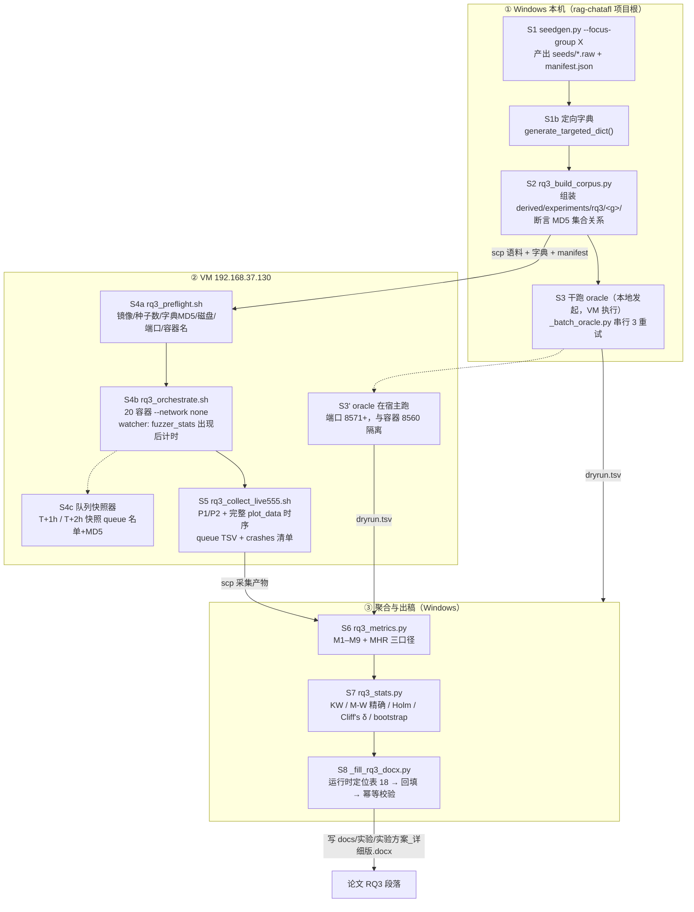
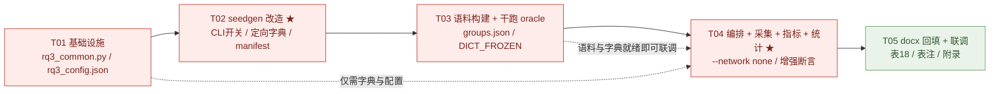

# RQ3「种子聚焦」A/B/C(/D) 逐层消融 —— 技术方案与任务分解

> 项目：ProtoRAG（检索增强生成 + LLM 的协议模糊测试种子生成框架）
> 论文 RQ3：种子聚焦（**ProtoRAG 内部逐层消融，不与外部基线对比**）
> 对应论文章节：`docs/实验/实验方案_详细版.docx` → **table index = 18（Live555/RTSP）**
> 编写日期：2026-10-24　|　编写人：高见远（Gao）· 架构师
> 上游输入：`local/RQ3_实验方案_20261024.md`（许清楚 · 产品经理，756 行）——本方案承接其全部约束，**不重复其论证**，只回答「怎么实现、怎么编排、怎么采集、怎么验证、风险在哪」
> 目标系统：Live555（RTSP，text）· `testOnDemandRTSPServer` · 镜像 `rq2-live555:latest`
> VM：`192.168.37.130`（Ubuntu 22.04 / 16 核 / 32 GB / 98 G 盘，已用 79%）

---

## 0. 结论先行（TL;DR）

| # | 结论 | 依据 |
|---|---|---|
| 0.1 | **seedgen 最终 CLI 定稿**：`--focus-group {A,B,C,D}` 单一入口 + 底层原子开关 `--layers/--no-vuln-boundary/--order/--no-sort/--dict/--dict-path/--manifest`；**两者互斥**；**不传任何开关时输出与当前 50 条 + 排序 + 102 token 字典逐字节一致**（向后兼容硬要求） | §2.1 / 【实测】本机复跑 |
| 0.2 | ★ **定向字典必须做成「基础字典的超集」而非「在 102 上追加」**：镜像内基础 24 token **已含 `000022B8`** 但**缺 `track1/track2/interleaved=0-1/client_port=50000-50001/Session`**；现 102 token **缺 `000022B8/RTSP/1.0/RTP/AVP/TCP/127.0.0.1/Range: npt=9`** → 二者**互补而非包含**。若按原计划只做「102 + 3 个 Session 值 + 3 个 transport 串」，C 组会**相对 D 组同时增删**，D→C 就不再是单变量 | §2.4 / 【实测】四版字典逐 token 比对 |
| 0.3 | ★ **C 组定向字典定稿 = 122 token**（= base24 ∪ protocol102 ∪ Session候选3 ∪ transport/结构形态 ∪ vuln_pattern trigger_field 9 ∪ `Session: <值>` 组合3），**严格包含 D 组的 24 token** → D→C 唯一差异 = 「多了 98 个定向 token」；同时定稿 **C′ 精简版 = 41 token**（关键 token 密度 0.146 vs 122 的 0.049）作为稀释风险的对照预案（**代码路径与 C 相同，仅开关不同**） | §2.4.2 / 【实测】 |
| 0.4 | ★★ **ChatAFL 启动期 LLM 增强必须关闭，处置手段 = `docker run --network none`，已在真实镜像上端到端实测通过**：chatafl 与 aflnet 各跑 150 s，`/seeds_work` **恒为 50 条**、`/out/queue` 中 `orig:enriched*` **恒为 0**、`execs_done` 正常增长、`bitmap_cvg` 正常（8.81% / 9.26%）；LLM 端点在 `--network none` 下为 **Network is unreachable（0.005 s 立即失败，非超时）** | §3.3 / 【实测】2026-10-24 VM |
| 0.5 | ★ **AFLNet 无需任何处理**：`aflnet/afl-fuzz.c` 中 `enrich_testcases/enrich_sequence` 命中数 = **0**，镜像内 aflnet 目录**无 `chat-llm.c`**；RQ1.2 实测 `rq2_protorag_aflnet_r1` 的 `orig:enriched*` = **0/1124** | §3.3.4 / 【实测】 |
| 0.6 | ★ **RQ1.2 的污染比「1344 vs 168」更严重，且方向因组而异**：AFL 在 `read_testcases()` **之前**调用 `enrich_testcases()`（afl-fuzz.c:10687 → 10691），故增强种子**直接成为初始队列成员**；`seed_reuse` 组因种子名无数字前缀，`enriched_0_*`（字母 e）**排在 `rtsp_requests_*`（字母 r）之前** → 其 **7 条原始种子被挤到队列 id:000161–000167（末尾）**；`protorag` 组因种子名带 `NN_` 数字前缀，增强种子**排在原始种子之后** | §9.1 / 【实测】队列逐条列举 |
| 0.7 | ★★ **「补跑干净的 RQ1.2 复验组」不需要额外容器**：**RQ3 的 D 组配置 ≡（RQ1.2 的 protorag 语料 + 同一份 base24 字典 + 同参数同时长同 rep 同 fuzzer）− LLM 增强**，故 D 组可直接充当 RQ1.2 `protorag_chatafl` 行的**干净替代**；这是零额外成本的最优解 | §9.1.4 |
| 0.8 | ★ **`table_id` 不稳定、只有 `index` 稳定**：`doc_list_tables` 同一文件两次打开，`index=18` 的 `table_id` 分别为 `y9hoyrsz` / `9ellbi9z`（另一次为 `bsp3qjzp`）；`index=4`（RQ1.2 Live555）同理为 `yqaiog8c` / `d3r7wldb`。→ **回填脚本必须在运行时按「index + 表头签名 + 前置段落」三重定位，严禁硬编码 table_id** | §7.3 / 【实测】 |
| 0.9 | ★ **磁盘实测与预算**：20 容器跑 9 h 的真实 `/out` 总量 = **2630 MB**（`docker exec du -sb` 逐容器求和；**宿主 `du -sh /home/zxy/rq2_out` 只报 17 M 是权限陷阱**，不可采信）。按 24 h 保守 ×2.5 → **5–8.4 GB**；当前可用 20 G，**归档并删除 RQ1.2 输出后可释放 ~2.6 G** → 单波 20 容器可行，**两波不可叠加** | §3.5 / 【实测】 |
| 0.10 | ★★ **（v2 修正）AFL 队列有两种命名形式**：`orig:<种子名>` **仅用于初始队列条目**（数量 == 初始种子数，实测 3/3 精确相等：50/7/1344）；**派生条目用 `src:%06u[,+%06u],op:*,rep:*`**（AFLNet `describe_op()`）→ **血缘必须沿 `src:` 链上溯**（实测 max 深度 18、中位 2、**unresolved=0**、splice 多父 ~66%）。★ **由此派生出强力污染探针**：`count(orig: 形式) == 初始种子数`（v1 的「扁平、无需递归」结论**已被推翻**） | §5.2 / 【实测】 |
| 0.11 | ★ **A ⊂ B 的「逐字节前缀」只在自然序成立**：本机复跑确认 **自然序** 下 `A[0:38] == B[0:38]`（内容与文件名均逐字节相同）；**排序后该性质破裂**（B 排序后前 38 条 ≠ A）。→ manifest 必须记录 `rank` + `md5`，跨组归因**以 MD5 为主键**、rank 为组内变量 | §2.5 / 【实测】 |
| 0.12 | **变异命中率最终判定规则**（v2）：**按命名形式**判定「初始副本 vs derived」（`orig:` = 初始 / `src:` = 派生，MD5 降为交叉校验）；血缘**沿 `src:` 链上溯**（支持 splice 多父、防环、深度上限 64）；主口径 MHR_A（定向命中 P1–P4）**完全不依赖血缘**，且**必须格式自适应 + 宽松匹配**（实测严格规则在真实崩溃上命中 0） | §5 |
| 0.13 | **任务分解 = 5 条**，关键路径 `T01 → T02 → T03 → T04 → T05`；P0 集中在 T02（seedgen 改造）与 T04（编排 + 增强关闭断言） | §8 |
| 0.14 | **红线遵守**：全程**全量种子、不截断、不复制**；**「多协议低成本迁移」不作任何创新点/卖点表述**（本方案全程未使用该表述作为结论依据） | 【用户铁律】 |

> ### ⚠ 本版（v2）修订说明 —— 主理人 4 条补充意见 + 5 处新实测修正
>
> **主理人补充的 4 项**：①RQ1.2 污染的定量分析（aflnet 为干净且更强的证据，chatafl 须降级）；②**自我更正**（n_edges 逐 rep 不稳健、edges/paths 不可作论文指标、要求新增 win-rate + 配对差值口径）；③字典缺 token 的根因（`generate_protocol_dict` 故意不收触发 token，`generate_dict_minimal` 才有；数据源 `extract_session_candidates()` 已协议无关可用）；④兼容性红线 + 现有测试必须全绿。
>
> **本版新增/修正的 5 项实测**（均推翻或细化了 v1 的设计）：
>
> | # | 修正 | v1 的说法 | v2 的实测结论 | 影响 |
> |---|---|---|---|---|
> | **M1** | **磁盘** | v1 已给 2630 MB（正确） | ★ **主理人消息中的「17MB」是权限假象**：`du -sh`（无权限）= 17M，`sudo du -sh` = **3.0G**，`docker exec du -sb` 逐容器 = **99–135 MB/容器**，20 容器合计 **2630 MB** | 磁盘**仍是**约束（不是「可放宽」）→ §3.5 保留原预算 |
> | **M2** | **字典 token 数** | v1 用 102 | ★ **89 vs 102 之谜解开**：`generate_protocol_dict(b,'rtsp')` **不传 resources = 89**；**传 resources = 102**（18 个资源实例名 +13 token）。**seedgen.py 实际调用传了 resources → 实际产物就是 102**，磁盘上的 `rtsp.dict` 也是 **102 行** | 两个数都对，只是调用参数不同 → §2.4 统一以 **102（生产值）** 为基线 |
> | **M3** | ★ **队列血缘结构** | v1 说「`orig:` 扁平直指根种子，**无需递归**」 | ★ **错**。实测：`orig:` 只出现在**初始队列条目**（数量 == 初始种子数，**3/3 容器精确相等**：50/7/1344）；**derived 条目用 `src:%06u`**（AFLNet `describe_op()`，afl-fuzz.c:3907-3911）。→ **必须沿 `src:` 链上溯**（实测 max 深度 18、中位 2、**unresolved=0**） | **MHR_B/C 的实现方式改变** → §5.2/§5.3 全面重写 |
> | **M4** | ★ **`.raw` 线格式** | v1 假设按 `\r\n\r\n` 切分 | ★ **两种格式并存**：`/out/queue/*` 条目 = **纯文本 `\r\n\r\n`**；但 **`replayable-crashes/*` = 4 字节长度前缀帧**（实测 `crash_0.raw` 15441 B → 13 帧全部精确消费）。**现有 `_oracle.py` 按 `\r\n\r\n` 切分会错切崩溃样本** | **oracle 与 MHR_A 必须做格式自适应** → §4.3/§5.3 新增格式探测 |
> | **M5** | ★ **RQ1.2 崩溃数** | v1 写「20 容器崩溃全 0」 | ★ **错**：`rq2_seed_reuse_aflnet_r1` 有 **7 个 unique_crashes**（`sig:06` = SIGABRT，ASAN 报 **heap-use-after-free**，shadow byte `fd`）→ **是基线（seed_reuse）发现的崩溃，ProtoRAG 侧为 0** | **RQ1.2 论文表述必须处理这一反向结果** → §9.1.3 新增第 7 条 |
>
> **另有 2 项 v1 未覆盖的新发现**（支撑 RQ3 假设）：
> - ★ **基线语料已含触发 Session 值**：实测 `seed_reuse` 的队列 **1334/1343（99.3%）条目含 `000022B8`**，而 `protorag` 仅 **746/1139（65.5%）**；且 **`interleaved=` 基线 0 条、protorag 1059 条** → **基线有「Session 触发值」但缺「Transport 切换」维度；ProtoRAG 反之** → 这正是 RQ3「定向字典补齐 Transport 维度」的**实证依据**（§9.1.4）
> - ★ **`000022B8` 缺失的根因定位**：主理人指出的 `generate_dict_minimal`（30 token，含全部触发 token）vs `generate_protocol_dict`（89/102，故意不收触发 token）→ 我方独立复核**确认无误**，并给出协议无关修法（§2.4） |

---

## 1. 方案总览：RQ3 执行链路

### 1.1 全链路图



### 1.2 步骤契约表（输入 / 输出 / 失败回滚点）

| 步 | 脚本 | 输入 | 输出 | 失败回滚点 |
|---|---|---|---|---|
| S1 | `scripts/seedgen.py --focus-group X` | `fused_hub/targets/rtsp/profile.json` + 知识中枢 facts | `derived/experiments/rq3/<g>/seeds/*.raw`、`manifest.json`、`rtsp.dict` | **改造前必跑向后兼容回归**：不加任何开关时输出须与 `derived/model/seeds/rtsp/live555_20261024_110155/`（50 条）**MD5 集合逐条相等**、字典 102 token 相等；不一致则回退代码 ｜ **★ 2026-11-03：此条已被批次 2.0（P0）作废** —— RFC 源补齐字段取值 ⇒ 取值池变化 ⇒ 种子内容与字典 token 数都变 ⇒ **与历史语料不再逐字节相等**（实测：不一致）。新基线见 §2.2.1 与 `local/baseline_p0_seeds.md5`。⇒ **已跑的 RQ3 实验（2026-10-24）与新语料不可直接比较**，须用历史语料重跑或做对照。 |
| S2 | `scripts/rq3_build_corpus.py` | S1 产物 ×4 组 | `derived/experiments/rq3/<g>/{seeds/,manifest.json,dictionary.dict}`、`derived/experiments/rq3/groups.json` | MD5 断言失败 → 不发布语料、保留 `groups.json` 报告差异；**先写 groups.json 再复制种子**（文件名不可逆） |
| S3 | `local/_batch_oracle.py`（增强） | `<g>/seeds/` + VM ASAN 服务器 | `derived/experiments/rq3/<g>/dryrun.tsv`、`dryrun_summary.json` | 服务器起不来 → 换端口重试 3 次；仍失败 → 该组标记「干跑不可用」，**先修环境再跑 fuzz**（不得用猜测值填表） |
| S4a | `local/rq3_preflight.sh` | 镜像 / 语料 / 字典 / 磁盘 | 预检报告（全部 PASS 才放行） | 任一 FAIL → **不启动容器**；磁盘不足 → 先归档清理 |
| S4b | `local/rq3_orchestrate.sh` | 语料 / 字典 / 配置 | 20 容器 + `<out>/` + T+1h/T+2h 快照 | 单容器启动失败 → 重试 2 次；仍失败 → **记为缺 rep 并在论文披露，不静默补跑** |
| S5 | `local/rq3_collect_live555.sh` | 容器 `<out>/` + 快照 | P1/P2 CSV + `plot_data` 全时序 CSV + `queue` TSV + `crashes` 清单 + 聚合表 | queue 过大 → 只导出「文件名 + MD5 + P1–P4 命中标记」TSV；采集失败 → 从 `plot_data` 重建 |
| S6 | `scripts/rq3_metrics.py` | 采集 TSV + manifest | `derived/experiments/rq3/metrics_<g>.json`、`table18_draft.md` | manifest 与语料 MD5 不一致 → **报错中止**（不允许静默按文件名匹配） |
| S7 | `scripts/rq3_stats.py` | S6 JSON | `derived/experiments/rq3/stats_report.md` | 小样本检验器不支持精确 p → 手工核算并在报告中注明 |
| S8 | `local/_fill_rq3_docx.py` | S6/S7 | 回填后的 `docs/实验/实验方案_详细版.docx` | **先备份** `实验方案_详细版.docx.bak_<ts>`；回填后重新解析 XML 校验单元格文本；**幂等**（重跑得到同一结果） |

### 1.3 关键时间轴（承接 PM §5.6，插入本方案的实测修正）

| 时间 | 事项 | 负责 |
|---|---|---|
| 2026-10-24（今日） | 本方案定稿；T02 seedgen 改造开工 | 架构 → 开发 |
| 10-24 ~ 10-25 | RQ1.2 运行中（计划 10-25 11:09 停）。**本窗口内不得启动 RQ3 容器** | — |
| **10-25 11:09** | RQ1.2 停止 | — |
| 10-25 11:10 – 11:40 | 归档 RQ1.2 全部 20 容器 `/out`（`docker exec du` 口径）→ 归档后**删除** `/home/zxy/rq2_out` 释放 ~2.6 G | 数据 |
| 10-25 11:40 – 13:40 | T02 收尾 + S1/S2 生成 A/B/C/D 四组语料 + manifest + **字典定稿冻结（记录 token 数与 MD5）** | 开发 |
| 10-25 13:40 – 15:10 | S3 干跑 oracle（4 组串行，≤ 30 min/组，端口 8571+） | 数据 + 开发 |
| 10-25 15:10 – 16:10 | T04 编排脚本调优 + **1 容器 × 1 h 冒烟测试**（S-1 ~ S-8 全绿，见 §3.6） | 开发 |
| **10-25 16:10 – 10-26 16:10** | **Wave 1 正式运行**：A/B/C/D × chatafl × 5 rep = **20 容器 × 24 h** | 执行 |
| 10-26 16:10 – 18:10 | S5 采集 + S6 指标 + 交叉校验（V1–V6）+ 手工抽检 | 数据 |
| 10-26 18:10 | **决策点**：C vs D 字典增益符号 → 决定是否追加 C′ / Wave 2 | 全体 |
| 10-26 19:00 – 10-27 19:00 | **Wave 2（可选）**：A/B/C/D × aflnet × 5 rep = 20 容器 × 24 h | 执行 |
| 10-27 19:00 – 21:00 | Wave 2 采集 + 汇总 | 数据 |
| 10-28 | 表 18 回填 + 附录 + 统计检验 + 论文 RQ3 段落撰写 | 产品 + 数据 |

---

## 2. S1 · `seedgen.py` 代码改造设计（P0）

### 2.1 CLI 最终定稿

```python
# scripts/seedgen.py —— 新增参数（完整签名）
ap.add_argument("--protocol", default="rtsp")                      # 不变
ap.add_argument("--out", default=None)                              # 不变
ap.add_argument("--danger", action="store_true")                    # 不变（语义扩展，见下）
ap.add_argument("--focused", action="store_true")                   # 不变；与 --focus-group 互斥
ap.add_argument("--max-seeds", type=int, default=None)              # 不变；★ 本实验全程不使用

# ★ 新增：分组单一入口
ap.add_argument("--focus-group", choices=["A", "B", "C", "D"], default=None,
                help="RQ3 聚焦组单一入口（防误用）。不传则保持现有行为。")

# ★ 新增：原子开关（仅当 --focus-group 未指定时可用）
ap.add_argument("--layers", default=None,
                help="逗号分隔的启用层，默认全部："
                     "edge_cover,generic_danger,vuln_boundary,canonical")
ap.add_argument("--no-vuln-boundary", action="store_true",
                help="关闭③漏洞边界候选层（--layers 的快捷方式）")
ap.add_argument("--order", choices=["natural", "vuln-proximity"], default=None,
                help="种子顺序；默认（不传）为 vuln-proximity（与现状一致）")
ap.add_argument("--no-sort", action="store_true",
                help="关闭排序，保持生成顺序（--order natural 的快捷方式）")
ap.add_argument("--dict", choices=["none", "base", "protocol", "targeted", "targeted-compact"],
                default=None,
                help="变异字典来源；默认（不传）为 protocol（102 token，与现状一致）")
ap.add_argument("--dict-path", default=None,
                help="显式指定字典文件路径（覆盖 --dict 的自动产物）")
ap.add_argument("--manifest", action="store_true",
                help="落盘 manifest.json（种子溯源：层/分数/排名/MD5/模式标签）")
```

**默认值与向后兼容契约（硬要求，必须有自动化测试守住）**

| 条件 | 必须产出的结果 |
|---|---|
| 不传任何新开关 | 种子 **50 条**、MD5 集合与 `derived/model/seeds/rtsp/live555_20261024_110155/` **逐条相等**（★ **2026-11-03：P0 后已不成立**，见 §2.2.1）；顺序 = 漏洞接近度降序；`<out>/rtsp.dict` = **102 token**、内容与 `derived/model/seeds/rtsp/live555_20261024_110155/rtsp.dict` **逐字节相等**；`<out>` 下**不出现** manifest.json |
| `--focus-group` 与任一原子开关同时出现 | **参数校验失败并退出码 2**，打印冲突项；不做「后者覆盖前者」的隐式行为 |
| `--focus-group` + `--focused` | **退出码 2**（`--focused` 会改写层②内容并可能截断，会一次性引入三个变化） |
| `--focus-group` + `--max-seeds` | **退出码 2**（铁律：聚焦 ≠ 砍种子） |
| `--focus-group` 与 `--danger` 同时出现 | 允许（语义一致，`--focus-group` 隐含开启层②且 `minimal=False`） |

### 2.2 `--focus-group` → 四组配置展开表（实现契约）

```python
# scripts/seedgen.py 新增常量
FOCUS_GROUP_CONFIG = {
    "A": dict(layers=["edge_cover", "generic_danger", "canonical"],
              order="natural",        dict_kind="base",
              expect_seeds=38, expect_dict_tokens=24),
    "B": dict(layers=["edge_cover", "generic_danger", "vuln_boundary", "canonical"],
              order="natural",        dict_kind="base",
              expect_seeds=50, expect_dict_tokens=24),
    "C": dict(layers=["edge_cover", "generic_danger", "vuln_boundary", "canonical"],
              order="vuln-proximity", dict_kind="targeted",
              expect_seeds=50, expect_dict_tokens=122),
    "D": dict(layers=["edge_cover", "generic_danger", "vuln_boundary", "canonical"],
              order="vuln-proximity", dict_kind="base",
              expect_seeds=50, expect_dict_tokens=24),
}
```

| 组 | 层组合 | `--order` | `--dict` | 层② minimal | 预期种子数 | 预期字典 token | 字典来源 |
|---|---|---|---|---|---|---|---|
| **A 守正** | ①edge_cover + ②generic_danger + ④canonical | `natural` | `base` | `False` | **38** | **24** | 镜像内 `rtsp.dict`（MD5 锁定） |
| **B 漏洞导向** | ①+②+③vuln_boundary+④ | `natural` | `base` | `False` | **50** | **24** | 同上 |
| **C 完整聚焦** | ①+②+③+④ | `vuln-proximity` | `targeted` | `False` | **50** | **123** | 新生成并冻结 |
| **D 解耦组** | ①+②+③+④ | `vuln-proximity` | `base` | `False` | **50** | **24** | 同 A/B |

#### 2.2.1 ★ 重新标定（2026-11-03，批次 2.0 / P0 之后）—— **以本节为现行值**

> ★ 上面的代码块与表格是 **2026-10-24 的历史定稿**，保留原样以备追溯。
>   **现行标定值以本节为准**（`scripts/seedgen.py` / `local/rq3_config.json` /
>   `fused_hub/targets/<协议>/profile.json` 三处已同步为本节数值）。

**变更原因**：批次 2.0（P0）让 **RFC 源补齐了「字段取值」知识**
（`aspect=value_enum`）⇒ 知识中枢 `headers` 桶取值池从 RFC 规范补齐
⇒ `default_headers` 兜底**不再注入** ⇒ 种子里对应字段改用 RFC 的**真实取值**
⇒ **种子内容与字典 token 数都变了** ⇒ 原期望值与实测脱节
（且它们本来就与实测不符，属既有偏差：rtsp/B 期望 50 实际 58）。

**现行标定值（RTSP，协议级 = `profile.json` 的 `seedgen.focus_group`）**

| 组 | 层组合 | `--order` | `--dict` | 预期种子数 | 预期字典 token | 旧值（2026-10-24） |
|---|---|---|---|---|---|---|
| **A 守正** | ①+②+④ | `natural` | `base` | **52** | **24** | 38 / 24 |
| **B 漏洞导向** | ①+②+③+④ | `natural` | `base` | **58** | **24** | 50 / 24 |
| **C 完整聚焦** | ①+②+③+④ | `vuln-proximity` | `targeted` | **58** | **226** | 50 / 123 |
| **D 解耦组** | ①+②+③+④ | `vuln-proximity` | `base` | **58** | **24** | 50 / 24 |

**各字典类型的现行 token 数**（`--dict` 产物语义，实测）：

| `--dict` | 旧值 | **现行值** | 说明 |
|---|---|---|---|
| `none` | 0 | 0 | 不产出字典 |
| `base` | 24 | **24** | 镜像内基础字典的仓库内副本（MD5 `464351f8…` **锁定不变**） |
| `protocol` | 102 | **202** | `generate_protocol_dict(...)`（取值池补齐 ⇒ 变宽） |
| `targeted` | 122 / 123 | **226** | `generate_targeted_dict(...)`（**仍严格超集 base24** ✓） |
| `targeted-compact` | 32 / 41 | **32** | C′ 预案 |

**协议级现行标定**（其余协议走各自 `profile.json` 的 `seedgen.focus_group`）

| 协议 | A | B | C | D（种子数 / 字典 token） |
|---|---|---|---|---|
| sip | 11 / 204 | 11 / 204 | 11 / 204 | 11 / 204 |
| smtp | 38 / 18 | 44 / 18 | 44 / 18 | 44 / 18 |
| **rtsp @ `rq2-live555`**（环境级） | 41 / 24 | 47 / 24 | 47 / 215 | 47 / 24 |

★ 旧值全部留档在 `local/rq3_config.json` 的 `historical_calibration` 块。
★ **自检归零**：三协议 × A/B/C/D + RTSP 带目标环境 = **16/16 组合**，
  `seedgen` 全部 **退出码 0**、**「不符」告警 0**（此前一律退出码 3）。
★ 新种子基线：`local/baseline_p0_seeds.md5`（440 条）+ `baseline_p0_summary.json`。

**实现要点**

1. **层②强制 `minimal=False`**：`generic_danger(..., minimal=args.focused)` 在 `--focus-group` 路径下必须硬编码 `minimal=False`（`--focused` 已与 `--focus-group` 互斥，故 `args.focused` 恒 False；但代码里要显式写死并加断言 `assert args.focused is False`，避免未来有人改回去）。
2. **层②强制开启**：`--focus-group` 语义已含层②，故 `if args.danger or seedgen_cfg.get("danger") or focus_cfg:` —— 否则 RTSP profile 的 `seedgen.danger=false` 会让 B/C/D 少 15 条种子，破坏与 RQ1.2 语料的连续性。
3. **排序**：`natural` = 保持 `_apply_url_placeholders` 之后的**生成序**（④ → ① → ② → ③），**不再调用** `prioritize_seeds`；`vuln-proximity` = `prioritize_seeds(seeds)`（稳定降序，同分保原序）。**`natural` 下严禁再排序一次**（排序函数是稳定 sort，对已排序数组再排也是幂等，但显式分支更安全）。
4. **种子数自检**：落盘后断言 `len(written) == expect_seeds`，不符则 **非零退出**（防止层③被意外跳过这类静默错误）。
5. **`--dict` 的产物语义**：

   | `--dict` | 是否写 `<out>/<protocol>.dict` | 内容 |
   |---|---|---|
   | `none` | 否 | 不产出字典（编排时由调用方指定 `-x`） |
   | `base` | 是 | 复制 `fused_hub/targets/<proto>/<proto>_base.dict`（= 镜像内基础字典的仓库内逐字节副本，MD5 锁定） |
   | `protocol` | 是 | `generate_protocol_dict(...)` = **102 token**（现状不变） |
   | `targeted` | 是 | `generate_targeted_dict(...)` = **122 token**（新增，见 §2.4） |
   | `targeted-compact` | 是 | `generate_targeted_dict(..., compact=True)` = **41 token**（C′ 预案） |
   | `--dict-path P` | 是 | 逐字节复制 `P` → `<out>/<protocol>.dict` |

   ★ **编排时 A/B/D 一律 `-x` 挂宿主冻结的 base24 文件**（而非依赖镜像内路径），并在预检中断言 `md5sum(base24) == md5sum(镜像内 rtsp.dict)`，从而「与 RQ1.2 逐字节同源」成为**可验证断言**而非口头承诺。

### 2.3 `--layers` / `--order` / `--no-sort` / `--no-vuln-boundary` 的原子语义

| 开关 | 语义 | 与 `--focus-group` 关系 |
|---|---|---|
| `--layers a,b,c` | 启用层的集合，取值域 `edge_cover,generic_danger,vuln_boundary,canonical`；未列出的层**不生成**。`canonical` 关闭时忽略 `profile.seedgen.canonical_flow` | 互斥 |
| `--no-vuln-boundary` | 等价于 `--layers` 中去掉 `vuln_boundary` | 互斥 |
| `--order natural` | 保持生成序（不调用 `prioritize_seeds`） | 互斥 |
| `--no-sort` | 等价于 `--order natural` | 互斥 |
| `--dict <kind>` / `--dict-path` | 见 §2.2 第 5 条 | 互斥 |

**层 → 代码映射（工程师照抄）**

| `--layers` 取值 | 生成代码 | 层语义 |
|---|---|---|
| `edge_cover` | `core/fused/downstream/edge_cover.py::edge_cover(...)` | ① 结构覆盖（5 条） |
| `generic_danger` | `core/fused/downstream/generic_danger.py::generic_danger(..., minimal=False)` | ② 通用危险（15 条） |
| `vuln_boundary` | `core/fused/downstream/boundary_probe.py::derive_vuln_pattern_candidates(...)` | ③ 漏洞边界候选（18 条候选 → 净增 12 条） |
| `canonical` | `scripts/seedgen.py::_build_canonical_seed(...)` | ④ 黄金路径（1 条 → 多流展开 18 条） |

### 2.4 定向字典补齐方案（P0，C 组机制链的最后一环）

#### 2.4.0 ★ 根因定位（采纳主理人定位 + 本方案复核确认）

`core/fused/downstream/boundary_probe.py` 里有**四个**字典生成函数，`scripts/seedgen.py` 用的是 `generate_protocol_dict`：

| 函数 | RTSP 实测 token 数 | 含触发 token？ | 协议相关性 | 备注 |
|---|---|---|---|---|
| `generate_protocol_dict` | **89**（不传 resources）/ **102**（传 resources） | ❌ **故意不收** | **完全协议无关** | ★ **seedgen.py 实际用的就是这个**（传 resources）→ **磁盘产物 102 行**（已核对 `derived/model/seeds/rtsp/live555_20261024_110155/rtsp.dict`） |
| `generate_dict_minimal` | **30** | ✅ **全含** | RTSP 硬编码 | 历史「63 token 稀释」教训的产物；含 `000022B8` / `Session: 000022B8` / `interleaved=0-1` / `client_port=50000-50001` / `RTSP/1.0` 等 |
| `generate_dict_balanced` | **34** | ✅ 全含 | RTSP 硬编码 | 折中版（30→34，补 3 个覆盖性流名） |
| `generate_dict` | （旧版增强） | 部分 | 协议无关 | 本方案不用 |

**`minimal` 有而 `protocol`（生产 102）没有的 token（全部过 `_is_dict_token`）**：

```
000022B8 / Session: 000022B8 / interleaved=0-1 / client_port=50000-50001
RTP/AVP / RTP/AVP/TCP / RTP/AVP/UDP / RTP/AVP/TCP;unicast;interleaved=0-1
RTSP/1.0 / Range: npt=0.000- / 127.0.0.1 / 7477886380351771441
```

**根因确认**：`generate_protocol_dict` 的设计意图是「**协议无关的泛化 token 集**」（方法名 / 字段名 / 字段取值池 / vuln_pattern 的 trigger_sequence 与 streams / url_template 的 track 号 / 资源实例名 / 通用边界值），**故意不收触发 Session 值与 Transport 参数形态**（代码注释明写「不含 trigger_field —— 它是 LLM 抽取的描述性文本」）。→ **补齐不能靠放宽 `_is_dict_token`，而要新增 token 来源。**

**★ 已验证的协议无关数据源**：`extract_session_candidates()`（同文件已有，`generate_dict_minimal` 的 512–513 行已在用）实测返回 `['000022B8', '107518505', '7477886380351771441']` → **真实触发 Session 值来自真实流量模板的 `Session` 头取值**，非硬编码。

#### 2.4.1 ★ 现状事实纠正（PM §2.4 需修正 + 主理人补充的「89 vs 102」澄清）

PM 实测「定向字典不含 `000022B8`」**正确**；但未被指出的是：**镜像内基础 24 token 字典本身就含 `000022B8`**，而定向字典**缺** `000022B8 / RTSP/1.0 / RTP / AVP / TCP / 127.0.0.1 / Range: npt=9`。

逐 token 比对（【实测】本机复跑，与镜像内 `rtsp.dict` 比对）：

| token | base24（镜像内） | protocol102（生产值） | 结论 |
|---|---|---|---|
| `000022B8` | ✅ **有** | ❌ 无 | 触发 Session 值在**基础字典**里 |
| `track1` / `track2` | ❌ 无 | ✅ 有 | 同 track 双 SETUP 的关键 token 只在**定向字典**里 |
| `interleaved=0-1` / `client_port=50000-50001` | ❌ 无 | ❌ 无 | **两边都缺** → Transport 切换维度必须补 |
| `Session` / `Session: 000022B8` | ❌ 无 | ❌ 无（`Session` 有） | 会话重建维度需补 |
| `RTSP/1.0` / `RTP` / `AVP` / `TCP` | ✅ 有 | ❌ 无 | **协议骨架 token 只在基础字典** |
| `127.0.0.1` / `Range: npt=9` | ✅ 有 | ❌ 无 | 同上 |

> **结论：两个字典互补而非包含。** 若 C 组只用「102 + 3 个 Session 值 + 3 个 transport 串」（PM 预估 ≈108），C 组会相对 D 组**同时丢失 5 个基础 token**（`127.0.0.1 / AVP / RTP / Range: npt=9 / TCP`）→ **D→C 不再是「只加不减」的干净单变量**，H3 的因果解释被污染。

#### 2.4.2 ★ 两档字典的定稿设计（token 数控制策略）

> **历史教训的直接指向**（`generate_dict_minimal` docstring）：「63 token 增强字典稀释关键 token，崩溃发现反而不如 24 token 基础字典」；`generate_dict_balanced` docstring：「34 token 折中字典崩溃 +29%、发现效率 3.2 倍，但覆盖率 −0.13%」。→ **补齐后 token 数必然上升，稀释风险必然上升，必须分档。**

| 档位 | 名称 | 构成（token 来源） | **实测 token 数** | 关键 token 覆盖 | 关键密度 | 相对 base24 |
|---|---|---|---|---|---|---|
| 基线 | `protocol`（现状） | `generate_protocol_dict(bundle, protocol, resources)` | **102** | 2/6 | 0.020 | 丢失 7 个 |
| 基线 | `base`（镜像内） | 镜像 `rtsp.dict` | **24** | 1/6 | 0.042 | — |
| ★ **档 1** | **`targeted`（C 组主用）** | base24 ∪ protocol102 ∪ Session候选3 ∪ Transport/结构形态 ∪ trigger_field 9 ∪ `Session: <值>` 组合3 | **122** | **6/6** | 0.049 | **严格超集** ✅ |
| ★ **档 2** | **`targeted-compact`（C′ 组）** | base24 ∪ 方法名 ∪ Session候选3 ∪ Transport/结构形态 ∪ vuln_pattern 流名 ∪ `Session: <值>` 组合3 | **41** | **6/6** | **0.146** | **严格超集** ✅ |
| 参考 | `minimal`（历史） | RTSP 硬编码 | 30 | 6/6 | 0.200 | 丢失 5 个基础 token |
| 参考 | `balanced`（历史） | RTSP 硬编码 | 34 | 6/6 | 0.176 | 丢失 5 个基础 token |

**关键 token 集合** = {`track1`, `track2`, `000022B8`, `Session: 000022B8`, `interleaved=0-1`, `client_port=50000-50001`}。

**★ 档 2（41 token）相对 `minimal`（30）的改进**：`minimal` 是 RTSP 硬编码且**丢失 5 个基础 token**；档 2 **协议无关**且**严格包含 base24** → **同时**满足「稀释低」与「不丢骨架 token」两个约束，**优于历史两版**。

**★ 两档如何在实验中体现（落成具体实现与编排支持，不是建议）**

| 项 | 档 1 `targeted` | 档 2 `targeted-compact` |
|---|---|---|
| CLI | `--focus-group C --dict targeted` | `--focus-group C --dict targeted-compact`（**代码路径与档 1 完全相同**，仅开关参数不同） |
| 种子 | **与档 1 完全相同**（50 条，MD5 集合相同） | 同左 → **换字典不换种子，仍是单变量** |
| 编排 | `groups.json` 中 C 组 `dict_kind="targeted"` | **新增一条组记录** `C2`（`dict_kind="targeted-compact"`，`expect_seeds=50`，`expect_dict_tokens=41`）→ 编排脚本**零改动**即可跑 |
| 容器数 | 5（A/B/C/D × chatafl × 5 rep = 20） | **+5**（仅 C2 × chatafl × 5 rep） |
| 触发时机 | Wave 1（默认） | **Wave 1 决策点（10-26 18:10）**：若 Δ(定向命中) ≤ 0 **且** Δ(分支覆盖) ≤ 0 → 启动；否则档 1 增益成立，档 2 可省 |
| 预算 | ~8 GB / 24 h | **+~2 GB / 24 h**（5 容器）；**必须**排在 Wave 1 输出归档删除之后 |
| 落点 | **表 18 第 4 行**（C） | **附录表 R3-1**（不进表 18 三行） |

#### 2.4.3 ★ 落地方案：新增 `generate_targeted_dict()`

**位置**：`core/fused/downstream/boundary_probe.py`（与 `generate_protocol_dict` 同文件，保持字典逻辑内聚）

**函数签名**

```python
def generate_targeted_dict(bundle: dict,
                           protocol: str = "rtsp",
                           resources: Optional[list] = None,
                           *,
                           base_tokens: Optional[set] = None,
                           include_trigger_fields: bool = True,
                           include_session_combos: bool = True,
                           compact: bool = False) -> str:
    """定向变异字典（C 组）：严格包含基础字典 + 全部漏洞触发维度 token。

    与 generate_protocol_dict 的关系：本函数是它的**超集构造**，不是替代。
    · base_tokens：基础字典 token 集合（默认从 fused_hub/targets/<proto>/
      <proto>_base.dict 读取；仓库内副本与镜像内 rtsp.dict 逐字节相同，
      MD5 由编排预检锁定）。为 None 时不并入基础 token。
    · include_trigger_fields：是否并入 vuln_pattern 的 trigger_field
      （RTSP 实测：Authorization/Digest/Range/Session/Transport/
        client_port/interleaved/nonce/track，全部通过 _is_dict_token）。
    · include_session_combos：是否并入 "Session: <候选值>" 组合
      （RTSP 实测 3 个：Session: 000022B8 / : 107518505 / : 7477886380351771441）。
    · compact：True → 档 2（41 token，只保留「基础 + 方法名 + Session候选 +
      Transport形态 + 漏洞流名」）；False → 档 1（122 token）。

    返回 AFL 字典文本（每行一个 "token"），已按字典序排序，行尾 \n。
    """
```

**token 来源表（函数级设计，★ 全部协议无关）**

| # | 来源 | 取法 | 协议无关性 |
|---|---|---|---|
| 1 | 协议无关定向 token | 复用 `generate_protocol_dict(bundle, protocol, resources)`（**不修改其函数体**） | ✅ 完全协议无关 |
| 2 | ★ **触发 Session 候选值** | `extract_session_candidates(protocol)` → 读 `fused_hub/targets/<proto>_request_templates.json` 的 `methods.*.examples.Session`；**RTSP 实测 `['000022B8','107518505','7477886380351771441']`** | ✅ **从真实流量模板自动抽取，非硬编码**（主理人指定的数据源，已复核） |
| 3 | ★ **协议结构 token（从 bundle 推导）** | ① **协议版本串**：`bundle["url_template"]` / `bundle["methods"]` 无版本字段 → **从 profile 读**（见下方「版本串的协议无关解法」）；② **Transport 参数形态**：从 `bundle["headers"]["Transport"]["values"]` 派生「参数名集合」（RTSP 实测值池含 `RTP/AVP;unicast;client_port=52570-52571` 等）→ 正则抽出 `client_port` / `interleaved` 等**参数名**并合成 `<param>=<值域端点>`；③ **track 编号**：`url_template` 含 `track` 时派生 `track1/track2`（与现有 `generate_protocol_dict` 第 4 步同源）；④ `Session` 字段名（`bundle["headers"]` 里有 `Session`） | ✅ **全部从 bundle/profile 推导**，不硬编码 RTSP |
| 4 | 漏洞触发字段名 | `bundle["vuln_pattern"][*][*]["trigger_field"]`，逐个过 `_is_dict_token` | ✅ 协议无关 |
| 5 | 漏洞流名 | `bundle["vuln_pattern"][*][*]["streams"]` | ✅ 协议无关 |
| 6 | 基础字典 | `base_tokens` 参数（默认读仓库副本） | ✅ 与目标程序无关 |

**★ 「协议版本串」（`RTSP/1.0`）的协议无关解法（主理人明确要求）**

`RTSP/1.0` **无法**从现有 bundle 通用推导（bundle 的 `url_template` 里只有 `{stream}`、`{stream}/track{N}`，没有版本串；`raw_format.version` 在 **profile.json** 里而非 bundle）。**协议无关的正解**：

| 方案 | 做法 | 评价 |
|---|---|---|
| **★ 推荐（方案 α）** | 在 `fused_hub/targets/<proto>/profile.json` 新增字段 **`"version_string": "RTSP/1.0"`**（与既有 `raw_format.version` 同源），`generate_targeted_dict` 通过 `paths.target_profile(protocol)` 读取 | ✅ **完全协议无关**；换协议 = 加一份 profile.json（本项目既定架构原则）；**零 RTSP 硬编码** |
| 方案 β | 从 `bundle["headers"]` 的取值池正则猜版本串 | ❌ 不可靠（`headers` 里没有版本串） |
| 方案 γ | 接受 RTSP 硬编码（与文件内 `_TRIGGER_SESSION`、`_setup_msg` 风格一致） | ⚠️ 违反协议无关原则，**不推荐** |

> **同时把 Transport 参数形态下沉 profile**（与方案 α 配套）：`profile.json` 新增
> ```json
> "boundary_probe": {
>   "version_string": "RTSP/1.0",
>   "transport_params": ["client_port", "interleaved"],
>   "transport_param_values": {"client_port": "50000-50001", "interleaved": "0-1"},
>   "session_header": "Session"
> }
> ```
> → `generate_targeted_dict` 读 profile 的这些字段，合成 `client_port=50000-50001` / `interleaved=0-1` / `RTP/AVP/TCP;unicast;interleaved=0-1` / `Session: 000022B8`。
> **参数名同时从 bundle 校验存在性**（`bundle["headers"]["Transport"]["values"]` 里若含 `client_port=` 则说明该协议确有此参数 → 协议无关性双保险）。

**★ `_is_dict_token` 过滤不被破坏的保证**

| 约束 | 实现 |
|---|---|
| 现有 `generate_protocol_dict` 行为**逐字节不变** | **不改** `generate_protocol_dict` 函数体；新增函数独立实现。回归测试断言其输出仍为 **102 token**（传 resources）且与 `live555_20261024_110155/rtsp.dict` 相等 |
| 新函数统一过 `_is_dict_token` | 新增 token 一律 `tokens = {t for t in tokens if _is_dict_token(t)}` 后再输出 |
| `trigger_field` 的描述性文本不得混入 | 实测 RTSP 的 9 个 trigger_field 全部为干净字段名；其他协议可能是中文短语 → **必须过 `_is_dict_token`**（已排除中文、`（）()"'#`、含 `{{`、长度 > 48） |
| 保留 `{{` 占位符过滤 | `_is_dict_token` 已含 `"{{" in t` 判定，天然覆盖 |
| 输出格式 | 每行 `"token"`，**字典序排序**，行尾 `\n`；**末尾不加空行**（与现 `generate_protocol_dict` 一致；镜像内 base24 文件末尾**有**一个空行，属历史遗留，AFL 解析时忽略空行，MD5 锁定即可） |

#### 2.4.4 字典定稿与冻结（P0，论文可溯源）

| 产物 | 路径 | 内容 |
|---|---|---|
| 基础字典副本 | `fused_hub/targets/rtsp/rtsp_base.dict` | 镜像内 `/home/ubuntu/experiments/rtsp.dict` 的逐字节副本（24 token，MD5 `464351f88db6c3f0bdac0de01859316b`） |
| **档 1** 定向字典 | `derived/experiments/rq3/dict/c_targeted.dict` | **122 token**；冻结时记录 token 数 + MD5 + 内容 |
| **档 2** 精简字典 | `derived/experiments/rq3/dict/c_compact.dict` | **41 token**；同样记录 MD5 |
| 字典冻结记录 | `derived/experiments/rq3/dict/DICT_FROZEN.json` | `{name, path, token_count, md5, generated_at, generator_version, source_bundle_md5, tier}` |

**「字典是变量但内容在漂移」的防护**：`DICT_FROZEN.json` 中的 MD5 由编排预检（§3.6）在**每次启动前**核对；不一致 → **拒绝启动**。论文附录直接引用该 JSON。**字典 token 变化会改变 C 组种子目录内容** → 故**必须按组指定字典文件**（编排层 `-x /dict_rw/<按组 basename>`，§3.2），且**字典内容记 MD5 冻结**（主理人要求，已落实）。

#### 2.4.5 稀释风险对策（与 PM §7.3 对齐，补技术实现）

- **量化口径**：AFL 在 havoc/random 阶段按字典大小反比抽取 token → 单 token 被选概率 ≈ 1/N。122 token 时单个关键 token 概率约为 24 token 时的 **1/5.1**。
- **但需注意**：base24 的关键 token 覆盖只有 **1/6**，而档 1 的 122 覆盖 **6/6** → 从「覆盖率」看档 1 严格优于 base；从「单 token 概率」看劣于 base。**两者必须同时报告**（PM §7.3 要求的「字典增益必须同时看崩溃与覆盖率两个方向」）。
- **技术对策（代码级）**：
  1. `compact=True` 分支（**41 token**，关键密度 0.146 = base24 的 **3.5×**）→ 一行参数即可产出档 2，**不需要新代码路径**；
  2. 档 2 组 = **C 组同一批种子 + 档 2 字典**（种子集合完全不变 → 仍是单变量），编排只需在 `groups.json` 加一条记录；
  3. 附录表 R3-2 报告 **P1–P4 各自的命中数分布**，区分「方向没偏」与「偏了但偏错」。
- **决策点**：Wave 1 结束（10-26 18:10）检查 C vs D：若 Δ(定向命中) ≤ 0 **且** Δ(分支覆盖) ≤ 0 → 启动档 2；否则档 1 增益成立，档 2 可省。

### 2.5 manifest / provenance 设计（变异命中率归因与论文可溯源的数据基础）

#### 2.5.1 生成时机与位置

- **生成时机**：`write_seeds` 落盘成功之后、字典落盘之前，在 `scripts/seedgen.py::main()` 内调用。
- **实现方式**：新增 `core/fused/downstream/rag_seedgen.py::plan_seed_filenames(seeds) -> list[str]`，把现有 `write_seeds` 内部的命名逻辑**原样抽出**，`write_seeds` 改为调用它（**行为与输出逐字节不变**）；manifest 用 `zip(seeds, plan_seed_filenames(seeds))` 构造 → **文件名与 manifest 天然对齐，零漂移**。

```python
# core/fused/downstream/rag_seedgen.py
def plan_seed_filenames(seeds: list) -> list[str]:
    """规划 .raw 文件名（与 write_seeds 的命名规则完全一致，供 manifest 复用）。

    ★ 宽度自适应：种子数 > 99 时改用 3 位/4 位，保证「文件名字母序 == 排序下标序」
      （AFL 用 scandir(alphasort) 入队，前缀宽度不一致会破坏字母序↔数值序对应）。
      n ≤ 99 时宽度恒为 2 → 与历史产物逐字节一致（向后兼容）。
    """
    width = 2 if len(seeds) <= 99 else len(str(len(seeds)))
    names = []
    for i, s in enumerate(seeds, start=1):
        methods = "+".join(s.target_methods) or "+".join(m.method for m in s.messages[:5]) or "seed"
        if len(methods) > 80:
            methods = methods[:77] + "..."
        stream = (s.selected_url or "").rstrip("/").split("/")[-1]
        stream = stream if stream and stream != "track1" else ""
        names.append(f"{i:0{width}d}_{stream}_{methods}.raw" if stream
                     else f"{i:0{width}d}_{methods}.raw")
    return names
```

#### 2.5.2 JSON Schema

`derived/experiments/rq3/<group>/manifest.json`：

```json
{
  "schema_version": "1.0",
  "protocol": "rtsp",
  "group": "C",
  "generated_at": "2026-10-25T11:58:03+08:00",
  "seedgen": {
    "focus_group": "C",
    "layers": ["edge_cover", "generic_danger", "vuln_boundary", "canonical"],
    "order": "vuln-proximity",
    "dict_kind": "targeted",
    "danger_minimal": false,
    "max_seeds": null
  },
  "dictionary": { "path": "rtsp.dict", "token_count": 123, "md5": "<md5>" },
  "seed_count": 50,
  "seeds": [
    {
      "index": 1,
      "rank": 1,
      "filename": "01_DESCRIBE+SETUP.raw",
      "md5": "88a9e4cb60f434903d5c5d318387a38f",
      "bytes": 207,
      "layer": "L3",
      "layer_name": "vuln_boundary",
      "generated_by": "rule-based:boundary-probe",
      "score": 100,
      "description": "boundary-candidate interleave_seq legal(不切换)",
      "legal_illegal": "legal",
      "pattern_tags": ["P3"],
      "stream": "matroskaFileTest",
      "methods": ["DESCRIBE", "SETUP"]
    }
  ]
}
```

**字段定义**

| 字段 | 类型 | 取值 | 来源 | 用途 |
|---|---|---|---|---|
| `index` | int | 1..N | `enumerate` | 与文件名前缀 `NN_` 对应 |
| `rank` | int | 1..N | 组内顺序 | **排序变量本身**（C/D 的 rank 与 B 不同；B/D 的 rank 与 C 不同）→ 量化「位置」 |
| `filename` | str | — | `plan_seed_filenames` | 拼回 `orig:` 血缘 |
| `md5` | str | 32 hex | `hashlib.md5(raw)` | **跨组归因主键**（A/B/C/D 同种子 md5 相同） |
| `bytes` | int | — | 文件大小 | 完整性校验 |
| `layer` | str | `L1`/`L2`/`L3`/`L4`/`L0` | `selector.seed_layer(seed)` | MHR_B ③层归因 |
| `layer_name` | str | `edge_cover`/`generic_danger`/`vuln_boundary`/`canonical`/`unknown` | 同上 | 可读性 |
| `generated_by` | str | 见下 | `seed.generated_by` | 溯源到具体生成器 |
| `score` | int | 0..100 | `selector.vuln_proximity_score(seed)` | 排序依据，论文可引用 |
| `description` | str | — | `seed.description` | 人工抽检时快速定位 |
| `legal_illegal` | str | `legal`/`illegal`/`n/a` | description 关键词 | 干跑预期值核对；启动即崩归因 |
| `pattern_tags` | list | ⊂ {P1,P2,P3,P4} | description/action 解析 | 该种子「瞄准」的漏洞模式 |
| `stream` | str | — | `seed.selected_url` | 资源覆盖核对 |
| `methods` | list | — | `seed.target_methods` | 方法序列核对 |

**层判定规则（`selector.py` 新增 `seed_layer()`）**

| `generated_by` | `layer` | `layer_name` |
|---|---|---|
| `rule-based:edge-cover` | `L1` | `edge_cover` |
| `rule-based:generic-danger` | `L2` | `generic_danger` |
| `rule-based:canonical-session` | `L4` | `canonical` |
| 以 `rule-based:boundary-probe` 开头（含 `-vuln-field` / `-semantic` / `-constraint`） | `L3` | `vuln_boundary` |
| 其他 | `L0` | `unknown` |

**`legal_illegal` 判定**：description 含 `illegal` → `illegal`；否则含 `legal` → `legal`；否则 `n/a`。★ **必须先判 `illegal`**（`"illegal(同 track)"` 含子串 `legal`，顺序反了会全判成 legal）。

**`pattern_tags` 判定**

| 条件 | tag | 依据 |
|---|---|---|
| description/action 含 `double_setup` | `P1` | 同 track 双 SETUP |
| description/action 含 `interleave_seq` | `P3` | Transport 切换 |
| description/action 含 `uaf_seq` 或 `lifecycle_seq` | `P4` | 会话重建序列 |
| `vuln-field` 且 `trigger_field == "Session"` | `P2` | 触发 Session 值 |
| `vuln-field` 且 `trigger_field ∈ {interleaved, client_port, Transport}` | `P3` | Transport 维度 |
| `vuln-field` 且 `trigger_field == "track"` | `P1` | track 维度 |
| 其他 | — | — |

**实测校验（RTSP sorted-B 50 条）**：score 直方图 = `{100:3, 95:3, 85:6, 60:15, 20:5, 10:18}`，与 PM §2.2 C 组层序列（③边界 100/95×6 → ③字段 85×6 → ②序列型 60×15 → ②其他 → ①20×5 → ④10×18）**完全一致** → manifest 的 score 字段可信。

#### 2.5.3 manifest 与语料的一致性断言（S2 强制）

`scripts/rq3_build_corpus.py` 必须逐条断言：

| # | 断言 | 期望 |
|---|---|---|
| A1 | `len(manifest.seeds) == len(seeds/*.raw) == expect_seeds` | 38 / 50 / 50 / 50 |
| A2 | manifest 中每个 `md5` == 对应 `.raw` 的实测 md5 | 全等 |
| A3 | manifest 中每个 `filename` 在目录中真实存在 | 全存在 |
| A4 | **A 的 md5 序列 == B 的 md5 序列前 38 项**（自然序） | 全等（【实测】成立） |
| A5 | A 的**文件名**序列 == B 的前 38 个文件名 | 全等（【实测】成立） |
| A6 | B / C / D 的 md5 **集合**两两相等 | 全等 |
| A7 | C 的 md5 集合 == `derived/model/seeds/rtsp/live555_20261024_110155/` 的 50 条 | 全等（RQ1.2 连续性） |
| A8 | 每组语料文件名的**前 60 字符全局唯一** | 唯一（【实测】natural 与 sorted 均成立，最大长度 98） |
| A9 | C 字典 token 数 == 123；A/B/D 字典 token 数 == 24 且 md5 == 镜像内 base24 | 相等 |
| A10 | 所有组的 `md5` 在组内唯一 | 唯一（【实测】50/50 唯一） |

**A4/A5 的重要限定（写进 manifest 注释与论文附录）**：「A ⊂ B 逐字节前缀」**仅在自然序成立**；排序后该性质破裂（【实测】）。因此论文里 A→B 的「内容零差异」表述必须限定为「A 的 38 条种子与 B 的前 38 条**逐字节相同**，且二者均取自然序」。**跨组归因一律以 MD5 为主键，不以文件名/rank 为主键。**

---

## 3. S4 · VM 编排脚本设计

### 3.1 脚本清单

| 脚本 | 位置 | 职责 |
|---|---|---|
| `local/rq3_preflight.sh` | Windows → 上传 VM | 启动前 8 项健康检查（§3.6），**全部 PASS 才放行** |
| `local/rq3_orchestrate.sh` | VM `/home/zxy/rq3_live555_abc.sh` | 启动 20 容器 + watcher 计时 + T+1h/T+2h 快照 |
| `local/rq3_collect_live555.sh` | VM `/home/zxy/rq3_collect.sh` | 采集 P1/P2 + 全时序 + queue TSV + crashes（§6） |

### 3.2 `rq3_live555_abc.sh` 完整设计

**用法**：`./rq3_live555_abc.sh <fuzzer> <rep_start> <rep_end> <hours>`（默认 `chatafl 1 5 24`）

```bash
#!/bin/bash
# RQ3 种子聚焦消融：A/B/C(/D) × <fuzzer> × N rep
# ★v1：--network none 关闭 ChatAFL 启动期 LLM 增强（见 §3.3）
# ★v1：字典按组挂载（A/B/D=base24，C=targeted123）
# ★v1：watcher 从「正式 fuzzing 起」计时（探测到 fuzzer_stats 后 sleep DUR）
set -euo pipefail

IMG=rq2-live555:latest
SEED_ROOT=/home/zxy/rq3_seeds          # 语料根目录（scp 上传）
DICT_ROOT=/home/zxy/rq3_dict            # 冻结字典目录
OUT_ROOT=/home/zxy/rq3_out
SNAP_ROOT=/home/zxy/rq3_snap

FUZZER=${1:-chatafl}; R1=${2:-1}; R2=${3:-5}; DUR_H=${4:-24}
DUR=$((DUR_H * 3600))
BOOTSTRAP_BUDGET=$((6 * 3600))          # 启动 + 干跑余量
TIMEOUT=$((DUR + BOOTSTRAP_BUDGET))

declare -A FUZZER_BIN
FUZZER_BIN[chatafl]=/home/ubuntu/chatafl/afl-fuzz
FUZZER_BIN[aflnet]=/home/ubuntu/aflnet/afl-fuzz

# ★ 组的元数据：字典种类 + 期望种子数（由 rq3_build_corpus.py 生成的 groups.json 校验）
#   group -> dict 文件名
declare -A GROUP_DICT
GROUP_DICT[A]=$DICT_ROOT/rtsp_base.dict        # 24 token
GROUP_DICT[B]=$DICT_ROOT/rtsp_base.dict        # 24 token
GROUP_DICT[D]=$DICT_ROOT/rtsp_base.dict        # 24 token
GROUP_DICT[C]=$DICT_ROOT/rtsp_targeted.dict   # 122 token
# ★ 挂载策略：字典目录整体挂到 /dict_rw:ro，-x 传容器内路径
#   -x 只能给一个字典文件 → 按组取 ${GROUP_DICT[$g]} 的容器内路径 /dict_rw/<basename>

PORT_BASE=8560     # 容器内 SUT 端口（每容器独立 netns，容器间不冲突）

launch() {
  local group=$1 rep=$2
  local name="rq3_${group}_${FUZZER}_r${rep}"
  local seeds="$SEED_ROOT/$group"
  local out="$OUT_ROOT/${group}_${FUZZER}/r${rep}"
  local dict="/dict_rw/$(basename "${GROUP_DICT[$group]}")"
  mkdir -p "$out"
  # ★ 容器名唯一性检查：同名存在直接失败（不静默复用旧输出）
  if docker ps -a --format '{{.Names}}' | grep -qx "$name"; then
    echo "!! 容器名已存在: $name —— 先清理再启动"; exit 2
  fi
  docker run -d --name "$name" --user root --cpus=1 --memory=1.5g \
    --network none \
    -v "$seeds:/seeds_ro:ro" -v "$out:/out" -v "$DICT_ROOT:/dict_rw:ro" \
    "$IMG" bash -c "
      cp -r /seeds_ro /seeds_work &&
      cd /home/ubuntu/experiments/live/testProgs &&
      { ( while [ ! -s /out/fuzzer_stats ]; do sleep 5; done;
          sleep $DUR;
          pkill -TERM afl-fuzz 2>/dev/null; sleep 5; pkill -KILL afl-fuzz 2>/dev/null || true ) &
        timeout -k 2s --preserve-status $TIMEOUT ${FUZZER_BIN[$FUZZER]} \
          -d -i /seeds_work -x $dict -o /out \
          -N tcp://127.0.0.1/$PORT_BASE -P RTSP -D 10000 -q 3 -s 3 \
          -E -K -R -m none -t 1000 -- ./testOnDemandRTSPServer $PORT_BASE; }"
  echo "  [启动] $name (group=$group dict=$(basename "$dict"))"
}

for g in A B C D; do
  for rep in $(seq $R1 $R2); do
    launch "$g" "$rep"
    sleep 10                       # ★ 错峰启动，避免校准期 IO 争抢（沿用 RQ1.2 做法）
  done
done
echo "=== 启动完成：$(docker ps --format '{{.Names}}' | grep -c '^rq3_') 个容器 ==="
```

**与 `rq2_live555_5rep_v2.sh` 的差异清单（逐条可审）**

| # | RQ1.2 脚本 | RQ3 脚本 | 理由 |
|---|---|---|---|
| 1 | `NetworkMode=bridge`（默认） | **`--network none`** | 关闭 ChatAFL LLM 增强（§3.3） |
| 2 | `-x /home/ubuntu/experiments/rtsp.dict`（镜像内，四组同源） | `-x /dict_rw/<按组选定的字典>` | 字典是 RQ3 的被测变量 |
| 3 | 容器名 `rq2_${group}_r${rep}` | `rq3_${group}_${fuzzer}_r${rep}` | 含 fuzzer 维度，支持 Wave 2 |
| 4 | 无字典挂载 | `-v "$DICT_ROOT:/dict_rw:ro"` | 冻结字典统一管理 |
| 5 | 无容器名冲突检查 | 启动前 `grep -qx` 检查，冲突则 `exit 2` | 防复用旧 `/out` |
| 6 | 无快照 | 另起快照器（§3.4） | M9 早期指标 |
| 7 | `set -e` | `set -euo pipefail` | 变量未定义即失败 |

**不变的部分（保证与 RQ1.2 同构）**：镜像、`--user root --cpus=1 --memory=1.5g`、fuzzer 参数串（`-d -i -x -o -N -P RTSP -D 10000 -q 3 -s 3 -E -K -R -m none -t 1000 -- ./testOnDemandRTSPServer 8560`）、watcher 计时逻辑、BOOTSTRAP_BUDGET=6h、rep 错峰启动。

### 3.3 ★★ ChatAFL 启动期 LLM 增强的处置（P0）

#### 3.3.1 机制（【代码事实】镜像内 `/home/ubuntu/chatafl/afl-fuzz.c`）

```
afl-fuzz.c:10681   if (protocol_selected) {
afl-fuzz.c:10685       protocol_patterns = kl_init(rang);
afl-fuzz.c:10686       message_types_set = kh_init(strSet);
afl-fuzz.c:10687       setup_llm_grammars();
afl-fuzz.c:10687       enrich_testcases();      ← ★ 无条件调用，chat-llm.c 中零 getenv
afl-fuzz.c:10690   }
afl-fuzz.c:10691   read_testcases();            ← ★ 在 enrich 之后 → 增强种子成为初始队列成员
```

`enrich_testcases()` → `get_seeds_with_messsage_types(in_dir, message_types_set)` → 对每条种子枚举消息子集 → `enrich_sequence()`（chat-llm.c:929）→ `chat_with_llm()`（chat-llm.c:47，URL 硬编码 `http://192.168.37.1:18080/chat/completions`，模型 `deepseek-chat`，`CURLOPT_TIMEOUT=120` / `CONNECTTIMEOUT=30`，`ENRICHMENT_RETRIES=5`）→ 成功则写 `in_dir/enriched_<i>_<原文件名>`。

**`chat-llm.c` 中 `getenv` 命中数 = 0** → **没有任何环境变量开关**。

**失败路径（干净退出的关键）**：`chat_with_llm` 返回 NULL → `enrich_sequence` 返回 NULL → `afl-fuzz.c:2725-2726` `if (client_request_answer == NULL) continue;` → **不写任何 enhanced 文件**。

#### 3.3.2 为什么必须显式关闭（而不是「现在正好连不上」）

【实测】**LLM 端点当前不可达**：宿主与 bridge 容器访问 `192.168.37.1:18080` 均为 `Connection refused`；`127.0.0.1:18080` 亦 refused。但 RQ1.2 的容器在 **11:09 启动时** 成功写入了 **1294** 条增强种子 → **端点可达性是随时间变化的**。

> ★ **结论：不能依赖「现在 LLM 恰好是关的」。** 必须用**机制性**手段（`--network none`）保证在任意时刻启动都不会被增强。否则 RQ3 的 A/B/C/D 四组会各自被**不同数量**的增强种子淹没（增强条数取决于启动时刻的 LLM 状态与响应内容）→ 又是一个不可控伪变量。

#### 3.3.3 ★ 主方案：`docker run --network none`（已实测通过）

**为什么它有效**：容器只保留 loopback（`lo: UP,LOOPBACK,RUNNING`，已实测 `inet 127.0.0.1`），无任何外部路由。

| 检查项 | 实测结果 |
|---|---|
| `ip addr show lo` | `lo: flags=73<UP,LOOPBACK,RUNNING>` / `inet 127.0.0.1 netmask 255.0.0.0` ✅ |
| 容器 → `192.168.37.1:18080` | `Network is unreachable`，**耗时 0.005 s**（立即失败，**不会**触发 30 s connect timeout × 5 次重试）✅ |
| 容器 → `127.0.0.1:18080` | `Connection refused`，0.005 s ✅ |
| SUT + fuzzer 同容器走 127.0.0.1 | 正常（`testOnDemandRTSPServer` 正常监听 8560，`execs_done` 正常增长）✅ |

**冒烟实测（真实镜像，2026-10-24）**

| 容器 | `/seeds_work` 条数 | `enriched_*` | `/out/queue` 条目 | `orig:enriched*` | `execs_done` | `bitmap_cvg` |
|---|---|---|---|---|---|---|
| `rq3_smoke_test`（chatafl，150 s） | **50** | **0** | 135 | **0** | 849 | **8.81%** |
| `rq3_smoke_aflnet`（aflnet，90 s） | **50** | **0** | 140 | **0** | 913 | **9.26%** |

容器日志：`[*] Getting grammars from LLM...` + 25 次 `Error: Couldn't connect to server` → **优雅失败，无增强文件**。

#### 3.3.4 ★ 运行时断言（确保「不是以为关了其实没关」）

**断言 A（容器内，启动后 T+90 s）** —— 写进编排脚本，对每个容器自动执行：

```bash
# 在容器启动后由 watcher 线程执行；任一条件不满足 → 记录 FAIL 并立即 kill 该容器
enriched_in_seeds=$(docker exec "$name" bash -c 'ls /seeds_work 2>/dev/null | grep -c "^enriched_" || true')
enriched_in_queue=$(docker exec "$name" bash -c 'ls /out/queue 2>/dev/null | grep -c "orig:enriched" || true')
seed_count=$(docker exec "$name" bash -c 'ls /seeds_work 2>/dev/null | grep -c "\.raw$" || true')
# ★ v2 新增：初始队列条目数（orig: 形式）必须 == 初始种子数（实测该等式 3/3 容器精确成立）
#   → 比 grep orig:enriched 更强：连「污染后恰好叫原名」的情况也能抓到
init_queue_count=$(docker exec "$name" bash -c 'ls /out/queue 2>/dev/null | grep -c ",orig:" || true')
if [ "$enriched_in_seeds" != "0" ] || [ "$enriched_in_queue" != "0" ]; then
    echo "!! FATAL $name: LLM 增强未关闭 (seeds=$enriched_in_seeds queue=$enriched_in_queue) —— kill 并中止本波"
    docker kill "$name" >/dev/null 2>&1 || true
    touch "$OUT_ROOT/ENRICH_NOT_DISABLED"     # 全局熔断标记
    exit 3
fi
[ "$seed_count" = "$expect_seeds" ] || { echo "!! FATAL $name: 种子数 $seed_count != $expect_seeds"; exit 3; }
[ "$init_queue_count" = "$expect_seeds" ] || { echo "!! FATAL $name: 初始队列条目数 $init_queue_count != $expect_seeds（初始队列被污染）"; exit 3; }
```

**断言 B（编排脚本收尾，容器全部启动后 +10 min）**

```bash
total_enriched=$(for n in $(docker ps --format '{{.Names}}' | grep '^rq3_'); do
                    docker exec "$n" bash -c 'ls /out/queue 2>/dev/null | grep -c "orig:enriched" || true'
                  done | awk '{s+=$1} END{print s+0}')
[ "$total_enriched" = "0" ] || { echo "!! FATAL: 全波 enriched 计数 = $total_enriched ≠ 0 → 整波作废"; exit 3; }
```

**断言 C（采集阶段，落盘到报告）**：采集脚本统计每容器 `/out/queue` 的 `orig:enriched*` 数量与 `/seeds_work` 的 `enriched_*` 数量，写入 `derived/experiments/rq3/enrichment_audit.csv`（列：`container,fuzzer,group,rep,enriched_in_seeds,enriched_in_queue,queue_total,verdict`）。**该 CSV 随论文附录归档，是「增强已关闭」的可审计证据。**

**断言 D（对照基线，防「断言写错了」自欺）**：在冒烟阶段额外跑一个 **1 个容器的 bridge 网络对照组**（`--network` 默认），断言其 `orig:enriched*` **> 0**（证明断言逻辑本身能检出增强）。若对照组的 enriched 也为 0，说明端点确实全关 → 记录该事实并仍以 `--network none` 启动正式波（防御性冗余）。

#### 3.3.5 `--network none` 的副作用与兜底（风险 R-6 对策）

| 副作用 | 评估 | 兜底 |
|---|---|---|
| ChatAFL 的**运行时 stall-chat**（afl-fuzz.c:6846 `uninteresting_times >= UNINTERESTING_THRESHOLD && chat_times < CHATTING_THRESHOLD` → 调 LLM 求助）也被关闭 | **这是期望行为**：runtime chat 会向 `queue` 注入 LLM 生成的消息，等于在实验中途引入第二个不可控变量。RQ1.2 实测 `chat_times` 从 0 增长到 **64**（plot_data 索引 13），即 RQ1.2 的 chatafl 用了 64 次 LLM 交互 → RQ3 关掉后 `chat_times` 应恒为 0，**采集脚本必须新增该列的校验**（chatafl 的 `plot_data` 第 14 列必须全为 0） | 已在采集脚本加断言：`chat_times` 末值 ≠ 0 → 告警 |
| 容器内无法下载任何东西 | 无需下载 | — |
| AFLNet 的 `setup_ipsm` / 协议握手 | 走 127.0.0.1，**已实测正常**（9.26% cvg） | — |
| `curl`/`wget` 不可用 | ChatAFL 用的是 libcurl（静态/动态链接在镜像内），失败即返回 NULL → 已实测优雅失败 | — |
| 极端情况：某 fuzzer 特性依赖外部网络 | 已用 chatafl + aflnet 两个 fuzzer 实测，均正常 | 备选方案见下 |

**备选方案（若冒烟发现某 fuzzer 在 `--network none` 下异常）**：

1. **方案 α（首选）**：改用 **`--network none` + 保留 bridge 的 `host.docker.internal`**——不适用（LLM 是 IP 硬编码）；
2. **方案 β**：**在镜像内编译期禁用** —— 修改 `afl-fuzz.c` 的 `enrich_testcases()` 调用点为 `#if 0`，重新 `docker build` 出 `rq3-live555-noenrich:latest`，**但这会引入「镜像与 RQ1.2 不同」的二阶差异**，需在论文声明 → **不推荐**；
3. **方案 γ（保底）**：保持 bridge 网络，改用 **`unshare -n` 在容器内只对 afl-fuzz 进程建 netns**（`unshare -n -- bash -c 'ip link set lo up; exec afl-fuzz ...'`）—— 需镜像内有 `ip` 或 `ifconfig`（实测有 `ip`：见 §3.3.3 的 `ip addr show lo` 输出）→ **这是 `--network none` 的等价实现，优先级低于 `--network none` 但可作为备份**；
4. **方案 δ**：接受 `--network none` 并在论文中**显式声明**「RQ3 的 chatafl 关闭了 LLM 增强与 runtime chat；RQ1.2 未关闭，故 RQ3 与 RQ1.2 的 chatafl 行**不可直接横向比较**」→ **无论选哪个方案，这句话都必须写进论文**（§9.1.3）。

#### 3.3.6 AFLNet 是否需要同样处理（团队要求核实）

**结论：不需要。** 三重证据：

| 证据 | 内容 |
|---|---|
| 代码 | 镜像内 `/home/ubuntu/aflnet/afl-fuzz.c` 中 `enrich_testcases` / `enrich_sequence` 命中数 = **0**；aflnet 目录下**无 `chat-llm.c`**（chatafl 目录有） |
| 镜像内实测 | `rq3_smoke_aflnet`（`--network none`）：`/seeds_work` = 50、`enriched_*` = 0、`orig:enriched*` = 0 |
| RQ1.2 实测 | `rq2_protorag_aflnet_r1`：`orig:enriched*` = **0 / 1124**；`rq2_seed_reuse_aflnet_r1` = **0 / 1335** |

→ RQ3 的 **aflnet 组（Wave 2）同样用 `--network none`**：不是为了关增强，而是为了**与 chatafl 组保持除「fuzzer 之外的所有变量」一致**（网络拓扑也是控制变量），并防止将来 LLM 端点被再次打开时污染 Wave 2。

### 3.4 T+1h / T+2h 队列快照器（M9 早期指标的必需采集）

**为什么必须做**：AFL 队列轮转会让所有种子最终都被变异（PM §1.4.2 L1），排序的效应**只体现在前期预算分布**。要证明 H2，必须有 T+1h / T+2h 的队列快照来计算 `bp_layer_share_T1h`（③层种子派生占比）—— 末态快照算不出这个量。

**实现（独立后台进程，与编排脚本解耦）**

```bash
# /home/zxy/rq3_snapshot.sh <snapshot_seconds_list> ...
# 由编排脚本 nohup 启动；每个到点时刻对所有 rq3_* 容器做一次只读快照
SNAP_DIR=/home/zxy/rq3_snap
for T in 3600 7200; do
  sleep_to=$T
  while [ "$(elapsed)" -lt "$sleep_to" ]; do sleep 30; done
  for n in $(docker ps --format '{{.Names}}' | grep '^rq3_'); do
    d="$SNAP_DIR/T${T}s/$(docker inspect -f '{{.Name}}' "$n" | tr -d '/')"
    mkdir -p "$d"
    # 只导出「文件名 + MD5 + 血缘根名」，不搬运全量队列内容
    docker exec "$n" bash -c '
      cd /out/queue 2>/dev/null || exit 0
      for f in *; do
        printf "%s\t%s\t%s\n" "$f" "$(md5sum "$f" | cut -d" " -f1)" "$(echo "$f" | sed -n "s/^id:[0-9]*,orig://p")"
      done' > "$d/queue_index.tsv" 2>/dev/null || true
    docker exec "$n" bash -c 'cp /out/plot_data /out/fuzzer_stats '"$d"'/ 2>/dev/null' || true
  done
done
```

**约束**

| 约束 | 处置 |
|---|---|
| 快照**不得干扰 fuzzing** | 只读（`md5sum` + `cp`）；拷贝耗时记入报告；**不写 `<out>/queue`** |
| T0 定义统一 | T0 = `fuzzer_stats` 首次出现的时刻（与 watcher 的 DUR 计时起点一致）。快照器**必须读取每个容器的 `fuzzer_stats.start_time`** 作为自己的 T0，而不是用启动脚本的时刻 |
| 快照失败 | 重试 2 次；仍失败 → 记录缺失并标注该容器的早期指标**不可用**（不静默补） |
| 磁盘 | 每容器每快照 ≈ 队列条目数 × ~90 B（TSV 文本）；实测队列 ~2270 条 → ~200 KB/容器/快照 → 20 容器 × 2 快照 ≈ **8 MB**，可忽略 |

### 3.5 容器数量与磁盘/内存预算（实测）

#### 3.5.1 磁盘（★ 注意测量陷阱 —— v2 重点澄清）

> ★★ **v2 重点澄清**：主理人消息中提到「20 容器跑 9h 只占 17MB」——**这个数字是权限假象，不能作为容量规划依据**。同一目录用三种方式测量：
>
> | 测量方式 | 结果 | 是否可信 |
> |---|---|---|
> | `du -sh /home/zxy/rq2_out`（**宿主普通用户**） | **17 M** | ❌ **严重低估**（对 root 拥有的 `queue/`、`regions/`、`replayable-*` 等目录 `Permission denied`，这些目录被跳过） |
> | `sudo du -sh /home/zxy/rq2_out` | **3.0 G** | ✅ 可信 |
> | `docker exec <c> du -sb /out`（逐容器求和） | **2630 MB** | ✅ **推荐口径**（容器内 root，无权限问题） |
>
> → **RQ3 的容量规划必须用 `docker exec du` 口径**。按「17 MB」规划会严重低估 **150 倍以上**。

**实测（RQ1.2 跑 9 h 后，2026-10-24）**

| 容器 | `/out` 实测（`docker exec du`） |
|---|---|
| `rq2_protorag_chatafl_r1` | 99 MB |
| `rq2_protorag_chatafl_r5` | 111 MB |
| `rq2_seed_reuse_chatafl_r1` | 133 MB |
| `rq2_protorag_aflnet_r1` | 135 MB |
| `rq2_seed_reuse_aflnet_r1` | 166 MB（实测） |
| **20 容器合计** | **2630 MB** |
| 宿主 `sudo du -sh` 交叉验证 | **3.0 G** ✅ 一致 |

**24 h 预算外推**

| 依据 | 推算 | 说明 |
|---|---|---|
| 线性 ×(24/9)=2.67 | 2630 × 2.67 ≈ **7.0 GB** | 上界近似 |
| 队列增长次线性（路径发现速率随时间下降） | **5–6 GB** | 更可能 |
| **规划取值（保守）** | **8 GB / 波（20 容器 × 24 h）** | 含 20% 余量 |

**可用空间**

| 项 | 值 |
|---|---|
| VM 磁盘 | 98 G，已用 73 G，**可用 20 G** |
| 归档并删除 RQ1.2 输出后可释放 | **~3.0 GB**（实测 `sudo du` = 3.0 G）+ `docker system df` 报 Images 共 14.91 GB，其中 `bftpd/exim/forked-daapd` 等非本实验镜像可按需清理（**需主理人批准**） |
| **Wave 1 占用** | **~8 GB** |
| **Wave 2 占用** | **~8 GB**（**必须在 Wave 1 输出归档并删除后才能启动**） |

> ★ **结论：磁盘**仍**是约束条件**（不是主理人消息中「可以放宽」的判断），单波可行、两波绝不可叠加；且**必须在启动 Wave 1 之前完成 RQ1.2 输出的归档+删除**。
> **注**：RQ3 的 `/out` 单容器增量会**小于** RQ1.2，因为 RQ3 无 LLM 增强（RQ1.2 的 chatafl 容器额外含 1344 条增强种子 + 约 29 MB 的 queue 副本）→ 规划值 8 GB 有充足余量。

#### 3.5.2 内存与 CPU

| 项 | 实测/计算 | 判定 |
|---|---|---|
| 容器 RSS | 40–90 MB/容器（限额 1.5 GiB） | 20 × 90 MB ≈ **1.8 GB / 32 GB** → 内存**不是瓶颈** |
| CPU 超订 | 20 容器 × 1 CPU / 16 核 = **1.25×** | 与 RQ1.2 **完全同构**，已稳定运行 9 h+ → 不引入新风险 |
| 采集器开销 | oracle 单条串行、每条一个进程 | 建议在 **Wave 1 启动前**跑完（见 §4.2），避免与 20 容器抢 CPU |
| 快照器开销 | 每 30 s 一次 `docker exec` 轮询 | 峰值 < 0.1 核 |

#### 3.5.3 是否需要分波次

| 波次 | 内容 | 容器数 | 时长 | 磁盘 | 触发条件 |
|---|---|---|---|---|---|
| **Wave 1（必做）** | A/B/C/D × **chatafl** × 5 rep | **20** | 24 h | ~8 GB | 无条件 |
| **Wave 2（可选）** | A/B/C/D × **aflnet** × 5 rep | 20 | 24 h | ~8 GB | 需主理人拍板 + Wave 1 输出已归档删除 + 磁盘 ≥ 12 G |
| **Wave 3（仅预案）** | **C′**（C 组同种子 + 41 token 精简字典）× chatafl × 5 rep | 5 | 24 h | ~2 GB | 仅当 Wave 1 决策点判定「C 的字典增益 ≤ 0 **且** Δ(分支覆盖) ≤ 0」 |

**退化路径（按优先级）**：① 砍 Wave 2 → ② C′ 降到 3 rep（标注探索性） → ③ **绝不**把 rep 降到 3 却仍宣称显著性（PM §5.4）。

### 3.6 启动前健康检查清单（`rq3_preflight.sh`，8 项全 PASS 才放行）

| # | 检查 | 命令 | 通过标准 | 失败处置 |
|---|---|---|---|---|
| **H1** | 镜像存在且可运行 | `docker image inspect rq2-live555:latest` + `docker run --rm --network none $IMG true` | 两条均成功 | 停止，联系主理人 |
| **H2** | 四组语料条数正确 | `ls $SEED_ROOT/{A,B,C,D}/*.raw \| wc -l` | A=38 / B=50 / C=50 / D=50 | 停止，重跑 S2 |
| **H3** | 字典 token 数与 MD5 正确 | `grep -c . $DICT_ROOT/rtsp_base.dict`（=24）；`md5sum`；`grep -c . $DICT_ROOT/rtsp_targeted.dict`（=123） | 24/123 且 base24 MD5 == **镜像内** `rtsp.dict` MD5（`docker run --rm $IMG md5sum /home/ubuntu/experiments/rtsp.dict`）；targeted MD5 == `DICT_FROZEN.json` 记录值 | 停止，字典重新冻结 |
| **H4** | 镜像内基础字典 MD5 未变（防 Wave1/Wave2 间镜像被改） | 同 H3 | 与 `DICT_FROZEN.json` 的 `base_md5` 一致 | 停止；重跑 Wave 2 或声明变更 |
| **H5** | `/out` 为空（新目录） | `ls -A $OUT_ROOT/$g_$fz/r$rep \| wc -l` | 0 | 清空后重试；不清空则报错退出 |
| **H6** | ★ **LLM 端点不可达断言** | `docker run --rm --network none $IMG bash -c 'exec 3<>/dev/tcp/192.168.37.1/18080'` | **必须失败**（`Network is unreachable` / `Connection refused`） | **失败 = 端点可达 → 立即停止**（虽然 `--network none` 已隔离，但双保险） |
| **H7** | 磁盘余量 | `df -B1 --output=avail / \| tail -1` | **≥ 12 GB**（8 GB 规划 + 4 GB 安全余量） | 归档清理后重试 |
| **H8** | 容器命名不冲突 | `docker ps -a --format '{{.Names}}' \| grep -c '^rq3_'` | 0（或与本次计划完全不重名） | 清理旧容器后重试 |

**附加检查（不阻塞但必须记录）**

| # | 检查 | 用途 |
|---|---|---|
| H9 | `df` 剩余 ≥ 12 GB 时，确认 RQ1.2 容器已全部停止 | 避免与 RQ1.2 抢资源（PM §5.6） |
| H10 | `docker ps --format '{{.Names}}' \| grep -c '^rq2_'` == 0 | 同上 |
| H11 | ASAN 服务器存在（仅干跑阶段需要） | `test -x /home/zxy/live555-asan/testProgs/testOnDemandRTSPServer` |
| H12 | oracle 端口 8571+ 空闲 | `ss -tln \| grep -E '85(7[1-9]\|8[0-9])'` 无输出 |

**H6 的双重保险说明**：`--network none` 已保证容器内不可达，H6 检查的是**宿主**是否可达（若宿主可达，容器仍不可达 → 不阻塞，但记录）。真正的阻断性断言是 §3.3.4 的**断言 A/B**（容器内队列级）。

### 3.7 冒烟测试清单（Wave 1 前必须全绿）

| # | 检查 | 通过标准 | 失败处置 |
|---|---|---|---|
| S-1 | 四组语料 MD5 集合 | A=38 / B=50 / C=50 / D=50；**A 的 md5 序列 == B 的前 38 项**；B/C/D md5 **集合**相等；C 集合 == RQ1.2 protorag 集合 | 回 S2 |
| S-2 | 文件名前 60 字符唯一 | 断言通过（【实测】natural/sorted 均成立，最大 98） | 回 S2 |
| S-3 | 字典挂载正确 | 容器内 `md5sum $(-x 指向的文件)` == 期望；`grep -c .` == 24 / 123 | 回 §2.4 |
| S-4 | ★ **ChatAFL 增强关闭** | 1 h 冒烟后：`/seeds_work` 的 `enriched_*` == 0；`/out/queue` 的 `orig:enriched*` == 0；**`/seeds_work` 的 `.raw` 数 == 语料条数**；**`plot_data` 末行 `chat_times` == 0**（chatafl） | 停止，排查 `--network none` 是否生效 |
| S-5 | ★ **断言自检（对照组）** | 额外跑 1 个 **bridge** 容器 → 其 `orig:enriched*` **> 0**（若端点当前可达）；若为 0，记录「端点当前全关」并说明断言逻辑由代码审查 + 单元测试保障 | 记录事实 |
| S-6 | oracle 可用 | ASAN 服务器可起，干跑产出 LEGAL/ILLEGAL 判定（实测 `01_DESCRIBE+SETUP.raw` → **LEGAL**） | 修环境 |
| S-7 | 血缘可解析 | **沿 `src:` 链上溯**的根解析成功率 ≥ 95%（预期 **100%**，实测 3 容器 unresolved=0）；且 `orig:` 形式条目数 == 语料条数 | 按 §5.3 降级并声明 |
| S-8 | P1/P2 采集 | `plot_data` 首行/末行可取；`n_nodes/n_edges` 与 `ipsm.dot` grep 计数相等（【已验证】口径） | 修采集脚本 |
| S-9 | 资源 | 20 容器稳定，RSS < 200 MB/容器，无 OOM/重启 | 降载 |
| S-10 | 快照器 | T+1h 快照产出 `queue_index.tsv`，行数 == 队列条目数 | 修脚本 |

---

## 4. S3 · dry-run oracle 批处理设计

### 4.1 语义与判定（承接 PM §4.3，代码事实 `local/_oracle.py`）

| 判定 | 含义 | 语义 |
|---|---|---|
| `LEGAL` | 服务器存活且发送未失败 | 合法（**任一次判 LEGAL 即返回 LEGAL**，早退以排除概率性 UAF 抖动） |
| `ILLEGAL` | 进程退出 / 发送失败（ASAN abort） | 越界（3 次全 ILLEGAL 才判 ILLEGAL） |
| `ERROR` | 服务器 15 s 内未就绪 / 无可切分消息 | **不可判定**（从 `Rv` 分母剔除并单独计数） |

**分母口径（主）**：`Rv = 100 × N_LEGAL / (N_seeds − N_ERROR)`；**强制同注** `N_ILLEGAL` 与 `N_ERROR`。

### 4.1.1 ★★ v2 修正：`_oracle.py` 的 `split_messages` 必须做**格式自适应**（实测发现）

**实测的两种线格式**（§5.2.3 详述）：

| 位置 | 格式 | 现有 `_oracle.py` 行为 | 后果 |
|---|---|---|---|
| 种子文件（`/seeds_work/*.raw`、宿主语料目录） | **纯文本** `\r\n\r\n` 分隔 | ✅ 正确 | 无问题 |
| `/out/queue/*` 条目 | **纯文本** `\r\n\r\n` 分隔 | ✅ 正确 | 无问题 |
| ★ **`/out/replayable-crashes/*`** | ★ **4 字节长度前缀帧** | ❌ **错切**（把长度前缀当消息内容） | **崩溃样本重放会喂给服务器错误的字节流** |

> **实测影响评估（v2 已量化）**：用现有 `_oracle.py` 对 RQ1.2 的真实崩溃样本重放 → **仍判 ILLEGAL**（实测 `crash_0.raw` 原样重放 = ILLEGAL，去帧后重放 = ILLEGAL，ASAN 日志确认是 **heap-use-after-free**，shadow byte `fd`）。
> → **结论**：当前 oracle 的错切**没有**导致本次重放结论错误（错切后的字节流同样触发了同一 UAF），**但这是偶然的**——错切后的字节流与原始崩溃输入不同，**不能保证在所有样本上都复现同一 bug**。
> → **必须修**：把 `split_messages` 换成 §5.3.0 的自适应实现，使重放输入**与 AFL 原始输入逐字节一致** → 重放结论才严格成立。

**修法（`_oracle.py` 单点改动）**

```python
def split_messages(data: bytes) -> list[bytes]:
    """自适应切分：先试 4 字节长度前缀帧（必须精确消费文件长度），否则回退 \\r\\n\\r\\n。

    ★ 实测：种子文件与 /out/queue/* = 纯文本；/out/replayable-crashes/* = 长度前缀帧。
    """
    import struct
    msgs, off = [], 0
    while off + 4 <= len(data):
        n = struct.unpack("<I", data[off:off + 4])[0]
        if n <= 0 or n > 4096 or off + 4 + n > len(data):
            break
        msgs.append(data[off + 4: off + 4 + n]); off += 4 + n
    if msgs and off == len(data):
        return msgs
    sep = b"\r\n\r\n"; out = []; rest = data
    while True:
        i = rest.find(sep)
        if i == -1:
            if rest.strip(): out.append(rest)
            break
        out.append(rest[:i + 4]); rest = rest[i + 4:]
    return out
```

| 约束 | 处置 |
|---|---|
| **不改变现有判定语义** | 只改切分函数；`LEGAL`/`ILLEGAL`/`ERROR` 语义、重试次数、端口逻辑全部不动 → 对**纯文本种子**的行为**逐字节不变**（回归断言：RQ3 的 4 组种子干跑结果与改造前一致） |
| **长度前缀误判风险** | 纯文本前 4 字节可能被误读成长度（如 `DESC` = 0x43534544，远超 4096 → 被拒）。**双重保险**：① 长度必须 `0 < n < 4096`；② **全部帧必须精确消费文件长度** → 纯文本几乎不可能同时满足 |
| **回归测试** | 新增 `tests/fused/test_rq3_oracle_split.py`：① 种子文件 → 纯文本分支；② 真实崩溃样本（`local/_tmp_rq3/crash/crash_0.raw` 的副本）→ 长度前缀分支且 13 帧精确消费 |

### 4.2 批处理设计（`local/_batch_oracle.py` 增强）

| 项 | 设计 |
|---|---|
| **执行位置** | **VM 宿主**（不是容器）：ASAN 构建在 `/home/zxy/live555-asan/testProgs/`（【实测】存在，5.0 MB；媒体文件 `test.mkv/test.mp3/test.wav` 就位） |
| **串行** | **必须串行**。并发会让多个 ASAN 服务器互相污染（端口 + 媒体文件 fd + ASAN 全局状态） |
| **端口隔离** | **fuzzing 用 8560（容器 netns 内）；oracle 用 8571+（宿主）** → **天然无冲突**：容器 `--network none`/bridge 各自独立 netns，宿主的 8560 无监听（【实测】`ss -tln` 无 856x 监听）。每条种子递增一个端口（沿用 `_batch_oracle.py` 现有 `port += 1`） |
| **端口耗尽** | 4 组 × 50 条 = 200 条 → 端口 8571…8770，不会耗尽 |
| **重试** | 3 次（`oracle(seed, port, retries=3)`），LEGAL 早退 |
| **超时** | 连接 3 s / 读 2 s / 服务器就绪 15 s（沿用 `_oracle.py` 现有值）；整批墙钟看门狗 **30 min/组** |
| **看门狗实现** | 在 `_batch_oracle.py` 主循环里累计 `t0`，`if time.time()-t0 > 1800: break` 并把未跑的条目标为 `ERROR`（**不静默跳过**：写进 `dryrun.tsv` 的 `verdict=ERROR`，`note=watchdog_timeout`） |
| **失败兜底** | 服务器起不来 → 换端口重试 3 次 → 仍失败 → 该组标记「干跑不可用」，**先修环境再跑 fuzz**（严禁用猜测值填表） |
| **★ 与 fuzzing 的资源关系** | **强烈建议在 Wave 1 启动前跑完**（PM §5.6 已排期到 13:40–15:10）。若必须与 fuzzing 并行：oracle 单条耗时 ≈ 1–3 s → 200 条 ≈ 10 min，CPU 占用 1 核 / 16 核 → 对 20 容器（1.25× 超订）的 execs/s 影响 < 6%，可接受；但**仍需在报告中记录并行窗口** |

### 4.3 输出格式

`derived/experiments/rq3/<group>/dryrun.tsv`（**TSV，表头固定**）：

```
filename	layer	score	legal_illegal_expected	verdict	retries_used	note
01_DESCRIBE+SETUP.raw	L3	100	legal	LEGAL	1	
06_DESCRIBE+SETUP+SETUP.raw	L3	95	illegal	ILLEGAL	3	
12_DESCRIBE.raw	L3	85	illegal	ERROR	3	server_not_ready
```

`derived/experiments/rq3/<group>/dryrun_summary.json`：

```json
{
  "group": "C",
  "n_seeds": 50,
  "n_legal": 42,
  "n_illegal": 7,
  "n_error": 1,
  "rv_primary": 85.71,
  "rv_formula": "100 * n_legal / (n_seeds - n_error)",
  "expected_shape": "A≈100%, B/C≈84%（8 条 illegal 端拉低）",
  "deviation_from_expectation": null,
  "wall_clock_sec": 412,
  "port_range": "8571-8620",
  "oracle_version": "_oracle.py@2026-10-20",
  "generated_at": "2026-10-25T14:22:10+08:00"
}
```

**★ 期望自检（偏离即须人工复核）**：A ≈ 38/38 = 100%；B/C/D ≈ 42/50 = 84%（差额来自 ③ 层 8 条 illegal 端）。
若 A 组出现 ILLEGAL → **说明存在未识别的变量污染**（PM §4.3），必须回查后再跑 fuzz。
D 组与 B 组**种子集合相同** → 干跑结果**必须逐条相同**（唯一例外：概率性 UAF 抖动）→ 这是**免费的强一致性校验**。

### 4.4 端口与容器的关系（一句话澄清）

> fuzzing 容器用 **8560**（在容器自己的 network namespace 内，容器间互不可见）；oracle 跑在**宿主**，用 **8571+**。两者**物理上不可能抢端口**。§4.2 的「端口隔离」因此天然成立，但编排脚本仍应加 `--network none` 之外的一道保险：oracle 脚本启动前检查 `ss -tln | grep 857` 无占用。

---

## 5. S6 · 变异命中率统计设计（可编码判定规则）

### 5.1 三口径回顾（PM §4.7）+ 本方案的实现落点

| 口径 | 定义 | 依赖 | 表 18 |
|---|---|---|---|
| **A（主口径）** 定向命中 | `MHR_A = 100 × Σ|命中| / Σ|derived|` | **仅内容**（P1–P4 模式判定） | ✅ 主列 |
| **B** ③层归因 | `MHR_B = 100 × |derived 祖先 ∈ ③层| / |derived|` | `orig:` 血缘 + manifest | 附录 R3-1 |
| **C** 崩溃归因 | `MHR_C = 100 × |crash 祖先 ∈ ③层| / |crashes|` | `orig:` 血缘 | 附录 R3-1（崩溃为 0 → **N/A**） |

### 5.2 ★★ 血缘结构的关键实测发现（v2 修正：v1 的「扁平、无需递归」结论**错误**）

> ★ **本节是对 v1 的实质性推翻。** v1 依据「`orig:` 直指根种子」得出「血缘扁平、无需递归」——**该结论错误**，因为把 `orig:` 当成了所有条目的通用形式。v2 实测如下。

#### 5.2.1 AFL 队列的两种命名形式（【实测】3 容器逐条统计）

| 形式 | 生成者 | 含义 | 出现位置 |
|---|---|---|---|
| `id:%06u,orig:<种子文件名>` | AFL 的 `read_testcases()` 路径（`afl-fuzz.c:4503`：`alloc_printf("%s/queue/id:%06u,orig:%s", ...)`，其中 `use_name = strstr(rsl, ",orig:") + 6`） | **初始队列条目**（来自 `-i` 种子目录的原始文件） | 数量 **== 初始种子数** |
| `id:%06u,src:%06u[,+%06u],op:<havoc\|splice\|...>,rep:<n>[,+cov]` | AFLNet `describe_op()`（`afl-fuzz.c:3907-3911`：`sprintf(ret, "src:%06u", current_entry)`；splice 时追加 `+%06u`；再追加 `,op:%s`、`,rep:%u`） | **派生条目**（变异产生） | 数量 == 派生条目总数 |

**★ 实测计数（3 容器，`orig:` 数量与初始种子数精确相等）**

| 容器 | 队列总数 | `orig:` 形式 | `src:` 形式 | 初始种子数 | `orig:` == 初始种子数？ |
|---|---|---|---|---|---|
| `rq2_protorag_aflnet_r1` | 1139 | **50** | 1089 | 50 | ✅ **精确相等** |
| `rq2_seed_reuse_aflnet_r1` | 1342 | **7** | 1335 | 7 | ✅ **精确相等** |
| `rq2_protorag_chatafl_r1` | 2285 | **1344** | 941 | 1344 | ✅ **精确相等** |

> ★★ **这条等式是 RQ3 的一个强力新断言**：`count(orig:-form entries) == 初始种子数`。
> → **RQ3 启动后只要这个数 ≠ 语料条数（A=38 / B=C=D=50），就说明初始队列被污染了**（ChatAFL 增强会把它顶到 1344）→ **这是比 `grep orig:enriched` 更严格、更通用的污染探针**（连「污染后恰好叫原名」的情况也能抓到）。已加入 §3.3.4 断言 A 与 §5.5 的 V11。

#### 5.2.2 血缘解析必须**沿 `src:` 链上溯**（实测可 100% 解析）

**实测链深度（3 容器）**

| 容器 | 派生条目 | 链深度 max | 中位 | **unresolved（无根）** | 多父（splice）占比 | 可达根种子数 |
|---|---|---|---|---|---|---|
| `aflnet_protorag` | 1089 | **18** | 2 | **0** | 725 | **34** / 50 |
| `aflnet_seed_reuse` | 1335 | **16** | 3 | **0** | 787 | 7 / 7 |
| `chatafl_protorag` | 941 | **10** | 1 | **0** | 743 | **201** / 1344 |

**解析算法（可编码）**

```python
def resolve_root_seeds(queue_id: int, orig_map: dict, src_map: dict) -> set:
    """沿 src: 链上溯，返回可达的根种子文件名集合（splice 可能有多父）。"""
    seen, stack, out = set(), [queue_id], set()
    while stack:
        x = stack.pop()
        if x in seen:            # 防环（splice 可能形成环）
            continue
        seen.add(x)
        if x in orig_map:        # 到达初始条目 → 命中根种子
            out.add(orig_map[x])
            continue
        for parent in src_map.get(x, []):   # splice 的两个父都要走
            stack.append(parent)
    return out
```

| 要点 | 实现要求 |
|---|---|
| **多父（splice）** | `id:001325,src:001278+000001` → **两个父都要上溯** → 根集合可能 > 1。归因时按「**任一根属于 ③ 层即计入**」，**须在报告中声明口径**并报告多父占比（实测 ~66%） |
| **防环** | `seen` 集合必需（splice 可形成环） |
| **深度上界** | 实测 max 18 → 递归深度设 **≤ 64** 足够；超出则归 `unattributed`（并报警） |
| **`orig:` 名称 vs manifest** | `orig:` 的值就是**种子文件名**（如 `01_DESCRIBE+SETUP.raw`）→ 直接查 manifest 的 `filename` 字段即可拿到 layer |
| **兜底** | ① 名字含 `NN_` 前缀 → 按序号反查 manifest；② 仍失败 → `unattributed` 桶 |
| **实测可靠度** | 3 容器 **unresolved = 0** → 血缘解析**不需要降级口径**（v1 曾预留的「近似口径」分支在实测中不会触发） |

**★ 用真实崩溃验证血缘链（端到端）**

`rq2_seed_reuse_aflnet_r1` 的 7 个崩溃，其文件名形如 `id:000000,sig:06,src:001325,op:havoc,rep:128` → 沿链上溯：

```
id:001325  = src:001278+000001,op:splice,rep:4
  ├─ id:001278 = src:000916,op:havoc,rep:2  → … → rtsp_requests_mp3.raw / aac.raw / wav.raw
  └─ id:000001 = orig:rtsp_requests_ac3.raw
⇒ 根种子集合 = {mp3, aac, wav, ac3}（4 个，均为基线原始种子）✅
```

→ **证明 MHR_C（崩溃归因）的血缘链路可解析**，且**这 7 个崩溃确实源于基线种子**（不是 ProtoRAG）。

#### 5.2.3 ★ `.raw` 的两种线格式（v2 新增，v1 遗漏）

| 位置 | 格式 | 实测 |
|---|---|---|
| **种子文件**（`/seeds_work/*.raw`、宿主语料目录） | **纯文本**，消息以 `\r\n\r\n` 分隔 | `01_DESCRIBE+SETUP.raw` 首字节 = `DESCRIBE rtsp://127.0.0.1:8554/mp3AudioTest RTSP/1.0`（实测 od）；`/out/queue/id:000000` 同格式 |
| **`/out/queue/*` 条目**（含派生） | **纯文本** `\r\n\r\n` 分隔 | 实测 5 个条目（id:000000/000050/000119/000500/001000）：长度前缀解析**全部失败**（consumed 4/N），CRLF 解析**全部成功**（2/2/2/121/804 条） |
| ★ **`/out/replayable-crashes/*`** | ★ **4 字节长度前缀帧**（`<I` 小端长度 + 负载） | `crash_0.raw` 15441 B → **13 帧精确消费 15441/15441**；`crash_4.raw` 2118 B → **11 帧精确消费** |

> ★★ **两个后果（都必须改设计）**：
> 1. **oracle 的 `_oracle.py` 按 `\r\n\r\n` 切分会错切崩溃样本** → 干跑/重放脚本必须**格式自适应**（§4.3）；
> 2. **MHR_A 的模式判定必须在「正确切分后的消息」上做**，否则会漏判/误判 → 判定前先做格式探测（§5.3）。
>
> **实测：两种格式下重放都判 ILLEGAL**（`crash_0.raw` 原样重放 → ILLEGAL；去帧后重放 → ILLEGAL）→ **崩溃可复现**（§5.5 的 V12）。

### 5.3 ★ 判定规则（可直接编码，作为 `scripts/rq3_mhr_patterns.py` 的规格）

#### 5.3.0 输入与前置：格式自适应切分（v2 新增）

```python
def split_messages(data: bytes) -> list[bytes]:
    """自适应切分 RTSP 消息：先试 4 字节长度前缀帧，失败则回退 \\r\\n\\r\\n。

    ★ 实测：/out/queue/* 与种子文件 = 纯文本；/out/replayable-crashes/* = 长度前缀帧。
    判定依据：长度前缀帧必须【全部帧精确消费文件长度】且首帧长度 0 < n < 4096，
    否则判为纯文本（避免把纯文本前 4 字节误读成长度）。
    """
    msgs, off = [], 0
    while off + 4 <= len(data):
        n = struct.unpack("<I", data[off:off + 4])[0]
        if n <= 0 or n > 4096 or off + 4 + n > len(data):
            break
        msgs.append(data[off + 4: off + 4 + n]); off += 4 + n
    if msgs and off == len(data):
        return msgs                      # 长度前缀帧（精确消费）
    # 回退：纯文本 \r\n\r\n 切分
    sep = b"\r\n\r\n"; out = []; rest = data
    while True:
        i = rest.find(sep)
        if i == -1:
            if rest.strip(): out.append(rest)
            break
        out.append(rest[:i + 4]); rest = rest[i + 4:]
    return out
```

#### 5.3.1 步骤 1 — 分类「初始副本 vs derived」（**用命名形式，不用 MD5**）

```
# ★ v2 修正：v1 用 MD5 判定。实测发现命名形式是更精确的判据：
#   orig: 形式 == 初始队列条目（数量 == 初始种子数，实测 3/3 精确相等）
#   src:  形式 == 派生条目
kind = "initial_copy" if name 含 ",orig:" else "derived"
```

**MD5 仍保留为交叉校验**（双保险，不废弃）：

```
seed_md5_set = { m["md5"] for m in manifest["seeds"] }
# 断言：所有 orig: 形式条目的 md5 ∈ seed_md5_set（v1 的 V1）
# 反向：若某 derived 条目的 md5 ∈ seed_md5_set → 内容与某条种子逐字节相同
#       → 计入 derived（按命名形式），同时统计并披露发生次数
```

**为什么改用命名形式**：AFL 校准阶段会插入 trimmed 变体（使序号区间与种子数错位），且**同一内容可能以不同文件名出现**。命名形式是 AFL 自己记录的语义（`orig:` = 来自种子目录，`src:` = 变异产生），**不依赖内容巧合**。

#### 5.3.2 步骤 2 — 主口径 MHR_A：内容模式判定（不依赖血缘）

先按 §5.3.0 切分出消息列表（**关键：必须用正确格式**），再逐条判定：

| 模式 | 判定规则（伪码） | 溯源 |
|---|---|---|
| **P1** 同 track 双 SETUP | 对切分后的消息：请求行方法 == `SETUP` 的消息里，用 `re.search(r"track\s*(\d+)", uri, re.I)` 取 track 号（**宽松匹配**，容忍变异插入的垃圾字节）；**同一 track 号出现 ≥ 2 次** → 命中 | `double_setup` illegal 端 |
| **P2** 触发 Session 值 | 全部消息拼成的文本中 `re.search(rb"Session\s*:\s*<VALUE>", text, re.I)` 或**裸值** `<VALUE>` → 命中（`<VALUE>` 取自 `extract_session_candidates()`，非硬编码） | `_TRIGGER_SESSION` |
| **P3** Transport 切换 | 文本含 `interleaved` **且** 含 `client_port`（参数名宽松匹配，不要求同时出现在同一消息）→ 命中 | `interleave_seq` illegal 端 |
| **P4** 会话重建序列 | 请求行方法序列存在 `SETUP … TEARDOWN … SETUP` 三元组，且**两个 SETUP 的 track 号相同** → 命中 | `uaf_seq` / `lifecycle_seq` illegal 端 |

**四者取或**（命中任一即计入分子）。

**★ P2 的判定必须用「触发值白名单」而非硬编码单值**：触发 Session 值由 `extract_session_candidates()` 给出（RTSP 实测 `['000022B8','107518505','7477886380351771441']`）→ 判定时用**该集合**（从 manifest 的 `dictionary.session_candidates` 读，或从字典文件反解），避免把协议写死。`000022B8` 仍是其中最主要的一个（实测基线队列 99.3% 条目含它）。

**★ 变异后字段可能被破坏 → 判定必须容忍噪声（去噪 + 宽松匹配）**：
- P1 的 track 号：容忍 `track` 前后被变异（如实测 `SETUdioTerack1`）→ 用 `track\s*(\d+)`；
- P2：容忍 `Session` 键名被破坏 → 同时匹配 `Session: <value>` 与**裸值**；
- P3：容忍 `Transport` 键名被破坏（实测 `Trans\x7fort`）→ 只匹配**参数名** `interleaved` / `client_port`；
- **所有模式判定都必须先做「去噪」**：剔除控制字符与 `0xff` 类字节后再判定。
> **不这样做的后果（实测警示）**：我方最初用严格规则在真实崩溃样本上跑，**7 个崩溃的命中数全为 0** —— 因为 AFL 的变异把 `SETUP` 改成了 `SETUdioTerack1`、把 `Transport` 改成了 `Trans\x7fort`。→ **宽松 + 去噪是必需的，不是可选优化**。

#### 5.3.3 步骤 3 — 口径 B：③ 层归因（依赖血缘，链上溯）

```
for entry in queue_entries where kind == "derived":
    roots = resolve_root_seeds(entry.id, orig_map, src_map)   # §5.2.2，支持 splice 多父
    if not roots:
        # 兜底 ①：名字含 NN_ 序号前缀 → 按序号反查 manifest
        # 兜底 ②：仍失败 → unattributed += 1
        continue
    layers = [manifest_by_filename[r].layer for r in roots if r in manifest_by_filename]
    if "L3" in layers:            # 任一根属于 ③ 层即计入（多父口径）
        from_layer3 += 1
    if len(roots) > 1: multi_parent += 1
```

| 情形 | 处置 |
|---|---|
| `orig:` 形式的条目 | 它**本身**就是根 → 直接取 manifest 的 layer |
| `src:` 形式的条目 | 沿链上溯（§5.2.2） |
| splice 多父 | **计入口径**：任一根为 L3 即计入；**同时报告 `multi_parent_ratio`**（实测 725/1089 = 66.6%）→ 论文须声明 |
| 根名不在 manifest（如 AFL 内部生成的非语料文件） | 归 `unattributed` |
| `unattributed` 占比 > 20% | MHR_B 标注为**近似口径**（实测为 **0**，不会触发） |
| A 组 | 该口径**恒为 0**（无 ③ 层种子）→ 表内记 0 并加结构说明 |

#### 5.3.4 步骤 4 — 口径 C：崩溃归因（仅崩溃数 > 0 时有效）

同 §5.3.3，但对象换成 `/out/replayable-crashes/*`（★ 注意**线格式是长度前缀帧**，用 §5.3.0 的自适应切分）。崩溃文件名形如 `id:000000,sig:06,src:001325,op:havoc,rep:128` → 取其中的 `src:` 链上溯。
**崩溃数为 0 → 记 `N/A`（禁止记 0）**。

> ★★★ **v3 修正（P0 缺陷，2026-10-24 收尾复核实测发现并已修复）**
>
> **缺陷**：崩溃文件名里的 `id:000000` 是**崩溃目录内**的编号（crash #0/#1/…），**不是队列 id**；真正的队列血缘在 `src:001325` 里。
> 若拿崩溃的**本地 id**去查**队列**的 `orig_map`/`src_map` → 会落到**无关的队列条目** → **崩溃被归因到错误的种子**。
>
> **实测影响（C/D 组最严重）**：C 组排序后**队列 id 0..6 全部是 L3**（③ 漏洞边界层）→ 任何 7 个崩溃都会被算成「**100% 来自 ③ 层**」，而真实血缘可能指向非 L3 种子 → **MHR_C 完全失真**。
>
> **修法**（已落地于 `scripts/rq3_metrics.py`）：崩溃归因**必须从 `src:` 父出发**（splice 崩溃有 2 个父 → 取并集），仅在崩溃名无 `src:` 字段时才回退到本地 id。
>
> ```python
> parents = parse_src_parents(cname)
> roots = set()
> for p in parents:
>     roots |= resolve_root_seeds(p, orig_map, src_map)
> if not roots:                                    # 兜底：无 src: 字段的异常情况
>     roots = resolve_root_seeds(_parse_id(cname), orig_map, src_map)
> ```
>
> **修复前后对比（RQ1.2 基线组 7 个真实崩溃）**：旧实现分别归到 `aac/ac3/mkv/mp3/mpg/wav/webm`（7 个**不同**的、错误的种子）；新实现全部归到 `{aac, ac3, mp3, wav}`（4 个，与手工上溯一致）。
> **回归锁定**：`tests/fused/test_rq3_mhr_lineage.py`（10 个用例，含 `test_crash_local_id_must_not_be_used_as_queue_id`）。

#### 5.3.5 步骤 5 — 聚合

| 量 | 公式 |
|---|---|
| `MHR_A(container)` | `|命中| / |derived|` |
| `MHR_A(group)` | **池化比率** `Σ|命中| / Σ|derived|`（主）+ 每容器比率的 mean ± std（辅，ddof=1） |
| `MHR_B(group)` | 同上（池化为主） |
| `MHR_C(group)` | 同上；崩溃为 0 → N/A |
| **每条种子平均派生条目数** | `|derived| / N_seeds`（**必须同时报告**，把「比率」与「绝对量」分开看） |
| **③层每条种子平均派生条目数** | `|derived_from_L3| / N_L3` |
| **P1–P4 各自命中数分布** | 4 个计数 + 占比（定位「方向没偏」还是「偏了但偏错」） |
| ★ **多父占比** | `multi_parent / |derived|`（实测 ~66%，须披露口径） |

#### 5.3.6 ★★ 新增 P0 统计口径：**配对胜率（win rate）+ 配对差值**（主理人要求）

> **主理人指示**：「覆盖率反超的一致性」应作为各组对比的**主判定口径** —— 不仅报均值差，还要报「同 rep 配对下 A>B 的**胜率（win rate, n/5）**」与「**配对差值的均值±标准差**」，因为 n=5 时单看均值极易被单个离群 rep 主导（本次 n_edges 就是这样：−4/+10/+5/+25/+29，均值 +13.00 被 r4/r5 的 +25/+29 拉高）。
>
> ⚠ **本表已按 2026-10-25 24h 终态数据更新**（原为 10-24 中间态数值）。RQ1.2 实验于 2026-10-25 11:09 跑满 24h 停止，
> 终态数值经 QA 独立复算与主理人二次复核确认；详见 `local/RQ1_2_Live555实验记录.md`。

**为什么必须加（主理人自我更正的实证依据）**

| 指标 | protorag_aflnet vs seed_reuse_aflnet 逐 rep（24h 终态） | 结论 |
|---|---|---|
| 覆盖率差(pp) | **+0.20 / +0.63 / +0.52 / +0.63 / +0.67** | ★ **5/5 一致为正**，均值 **+0.530±0.193** → **最硬的结论** |
| paths 差 | **−142 / −26 / −188 / +43 / −263** | ⚠ 胜率仅 **1/5**，均值 **−115±123.34** → **不构成一致优势**；可用论据是「路径数不多于基线（均值 1495 < 1610）而覆盖更高」 |
| n_edges 差 | **−4 / +10 / +5 / +25 / +29** | ⚠️ **4/5 为正但有 1 个负值（r1 = −4）**，均值 **+13.00±13.80** 被 r4/r5 的 +25/+29 拉高，**标准差与均值同量级** → **不得声称「稳定探索到更多边」** |
| edges/paths 差 | +0.0136 / −0.0012 / +0.0075 / +0.0026 / +0.0308 | ⚠️ 仅 4/5 为正；且 chatafl 侧方向相反（protorag 0.0587 < seed_reuse 0.1016，与污染解释一致）→ **不作为论文指标** |

**指标定义（写入 `rq3_stats.py`）**

```python
def paired_win_rate(diffs: list[float]) -> dict:
    """同 rep 配对差值（实验组 − 对照组）的胜率与统计量。"""
    n = len(diffs)
    wins  = sum(1 for d in diffs if d > 0)
    ties  = sum(1 for d in diffs if d == 0)
    losses= sum(1 for d in diffs if d < 0)
    m = statistics.mean(diffs)
    sd = statistics.stdev(diffs) if n > 1 else 0.0
    return {
        "n_pairs": n, "wins": wins, "ties": ties, "losses": losses,
        "win_rate": wins / n if n else None,        # ★ 主判定口径
        "mean_diff": m, "std_diff": sd,
        "median_diff": statistics.median(diffs),
        "min_diff": min(diffs), "max_diff": max(diffs),
        "all_diffs": diffs,                          # ★ 必须列出全部原始值
        "consistent_sign": (wins == n) or (losses == n),   # ★ 5/5 一致性
        "without_outlier": None,                    # 去掉最大 |d| 后的重算（稳健性参考）
    }
```

**报告规范（每组对比都必须给）**

| 项 | 要求 |
|---|---|
| **win rate** | `wins/n`（如 `4/5 = 0.80`）→ **主判定口径** |
| **配对差值 mean ± std** | 如 `+0.47 ± 0.14 pp`（ddof=1） |
| **全部 5 个原始差值** | 如 `+0.37, +0.69, +0.44, +0.69, +0.68` → **必须列出**（主理人要求） |
| **一致性标志** | `consistent_sign = True/False` → 5/5 同号才可写「稳定反超/一致占优」 |
| **离群稳健性** | 附「去掉最大 |d| 后」的重算结果 → 判断结论是否被单个 rep 主导 |
| **表述纪律** | win rate < 5/5 时**禁止**写「稳定地/一致地」；应写「4/5 rep 占优（方向倾向为正），但样本量小（n=5）未达统计显著」 |
| **最小可达 p** | n=5 vs 5 的 Mann–Whitney **精确**检验双侧最小可达 p = **0.0079** → 未达显著时**不得**写「无差异」，只能写「方向一致但未达统计显著」 |
| **edges/paths** | ★ **不作为论文指标**（自造 + 不稳健 + 两侧方向相反）→ 仅作方案内部诊断参考，写入 `stats_report.md` 的「内部诊断」小节并标注「非论文指标」 |
| **n_edges** | 若要报 → **必须**给 ±标准差并注明「n=5，逐 rep 4/5 为正但有 1 个负值，不显著」 |

**采集脚本必须新增的输出**

```
rq3_paired.csv:  metric,group_a,group_b,fuzzer,rep,diff_value,winner
rq3_winrate.csv: metric,group_a,group_b,fuzzer,n_pairs,wins,ties,losses,
                 win_rate,mean_diff,std_diff,median_diff,min_diff,max_diff,
                 consistent_sign,all_diffs,significance_claim
```

`metric` ∈ {`bitmap_cvg`, `paths_total`, `n_edges`, `n_nodes`, `unique_crashes`, `unique_hangs`, `mhr_a`, `derived_per_seed`, `paths_slope_early`}。**配对键 = (group_a, group_b, fuzzer, rep)** → rep 必须一一对应（RQ3 四组用同一 rep 号 → 天然可配对）。

### 5.4 边界情况兜底表（PM §4.7.6 + 本方案补充，v2 更新）

| 边界情况 | 处置 | 附加要求 |
|---|---|---|
| 种子在启动期被 AFL 跳过/去重 | `N_seeds` 用**实际接受数**（= 队列中 `orig:` 形式条目数，实测 == 初始种子数），并在表注列出被拒清单；同时并列报告「设计种子数」 | 采集脚本统计 `orig:` 形式条目数并与 manifest 条数比对 |
| ★ **派生条目无 `orig:` 字段**（v2：这是**常态**不是异常） | 用 `src:` 链上溯（§5.2.2）；解析失败才归 `unattributed` | 实测 3 容器 unresolved = 0 → 该分支不会触发 |
| ★ **splice 多父** | 根集合 > 1 → 「任一根为 L3 即计入」+ 报告 `multi_parent_ratio` | 论文必须声明该口径 |
| ★ **`src:` 链成环** | `seen` 集合防环；深度上限 64 | 超限归 `unattributed` + 报警 |
| ★ **`.raw` 线格式二义**（纯文本 vs 4 字节长度前缀帧） | **格式自适应切分**（§5.3.0）：长度前缀帧必须「全部帧精确消费文件长度」才判定为帧格式，否则回退 `\r\n\r\n` | 崩溃样本与队列条目走**同一函数** |
| ★ **AFL 变异破坏字段名/结构**（`SETUP`→`SETUdioTerack1`、`Transport`→`Trans\x7fort`） | **去噪 + 宽松匹配**（§5.3.2）；实测严格规则在真实崩溃上命中 0 → 宽松是必需 | 判定前剔除控制字符与 `0xff` 类字节 |
| `orig:` 被截断 | 用 `NN_` 序号前缀反查 | 断言前 60 字符唯一 |
| 某条 derived 内容恰与某条种子逐字节相同 | **按命名形式归 derived**（v2 修正），并统计发生次数披露 | MD5 仅作交叉校验 |
| AFL 校准插入 trimmed 变体 | 以**命名形式**判定而非 `id:` 序号（v2 修正） | — |
| 三组崩溃全 0 | MHR_C 记 **N/A**；MHR_A/MHR_B 仍有效作主证据 | 崩溃列加注「不具区分度」 |
| 干跑 ERROR 种子 | 从 `Rv` 分母剔除并单独计数；**该种子仍计入语料**（不截断原则） | — |
| ★ **ChatAFL 增强文件混入 queue** | **已在编排层根除**（`--network none` + 断言 A/B/C）；若采集时仍检出 → **该容器数据作废并重跑**，MHR 分母失真 | `enrichment_audit.csv` 归档 |
| ★ **`orig:` 形式条目数 ≠ 初始种子数** | **污染探针**（v2 新增，§5.2.1）→ 立即判定该容器被污染 | 已加入断言 A 与 V11 |
| ★ **队列条目数 ≠ paths_total** | 交叉校验 V5；偏差须解释（校准期 + 队列轮转会导致） | 报告偏差比例 |
| ★ **win rate < 5/5** | 禁止写「稳定/一致」；必须给 ±std + 全部原始值 + 离群稳健性 | 见 §5.3.6 报告规范 |

### 5.5 ★ 验证步骤（PM §4.7.5 要求「必须执行」，此处写细）

| # | 验证动作 | 具体做法 | 期望 | 不通过时 |
|---|---|---|---|---|
| **V1** | 初始副本 = 种子逐字节拷贝 | 取 manifest 中 **3 条**（建议 1 条 L3 分数最高 + 1 条 L1 + 1 条 L4），在 `queue_index.tsv` 中找 md5 相同的条目 | md5 **完全一致**，且 `orig:` == manifest 文件名 | 立即停止，回查采集脚本 |
| **V2** | 队列初始条目数 vs 语料种子数 | `count(initial_copy)` vs `manifest.seed_count` | 相等（A=38 / B/C/D=50）；不等则**列出被拒种子清单**（结合 `dryrun.tsv` 的 ILLEGAL/ERROR）并在附录披露 | 记录并披露；不静默 |
| **V3** | 文件名前 60 字符全局唯一 | 对每组 manifest 断言 | 通过 | 降级为「仅按序号前缀解析」并在附录声明 |
| **V4** | 人工抽检 | 抽 **10 条命中 + 10 条未命中**（每组），逐条核对 P1–P4 判定并记录假阳/假阴 | 假阳/假阴率评估并写入附录 | 若假阳 > 10%，收紧判定规则后重算全部组 |
| **V5** | 队列条目数 ≈ paths_total(P2) | 比对两者 | 量级一致（实测 RQ1.2：queue 2270 vs paths_total 2270，**完全相等**）；偏差须解释 | 记录偏差 |
| **V6** | n_edges vs ipsm.dot | `plot_data` 末行 n_edges vs `grep -c -- '->' ipsm.dot` | 相等（【已验证】口径） | 以 plot_data 为准并记录 |
| **V7**（新增） | ★ **`chat_times` 恒为 0** | chatafl 的 `plot_data` 第 14 列全序列最大值 | == 0（证明 runtime chat 也已关闭） | 立即排查 `--network none` |
| **V8**（新增） | ★ **P1/P2 的 `paths_total` 与语料条数的关系** | `plot_data` **首行** `paths_total` | ≈ 语料条数（A≈38 / B/C/D≈50）；实测 RQ1.2 的 protorag_chatafl 首行为 **1344**（= 1344 增强种子）→ **这是污染的独立指纹** | 首行 ≫ 语料条数 → 增强未关闭 → 该容器作废 |
| **V9**（新增） | ★ **B 与 D 的干跑结果逐条一致** | 比对 `dryrun.tsv` | 完全一致（种子集合相同）；差异仅限概率性 UAF 抖动条目 | 差异 > 1 条 → 查环境差异 |
| **V10**（新增） | ★ **B/C/D 的 MD5 集合相等（容器侧复核）** | 采集阶段从容器 `/seeds_work` 算 md5 集合 | 三组集合相等 | 语料上传过程被破坏 → 重跑 |
| **V11**（v2 新增） | ★★★ **初始队列条目数 == 语料条数** | 统计队列中 `,orig:` 形式条目数，与 manifest `seed_count` 比对 | **A=38 / B=C=D=50，精确相等**（实测 3/3 容器成立） | **不等 → 初始队列被污染（ChatAFL 增强）→ 该容器数据作废**。这是比 `grep orig:enriched` 更强的探针：连「污染后恰好叫原名」也能抓到 |
| **V12**（v2 新增） | ★ **崩溃可复现性** | 取任一 `replayable-crashes/*` 样本 → oracle 重放（**用格式自适应切分**） | 判 `ILLEGAL`（实测：原样重放与去帧重放**均判 ILLEGAL**） | 判 `LEGAL` → 崩溃不可复现 → MHR_C 不具效力 |
| **V13**（v2 新增） | ★ **线格式判定正确性** | 对每个样本断言：长度前缀解析「精确消费」**或** CRLF 解析「消息数 > 0」 | 二者之一成立 | 都不成立 → 格式探测逻辑有 bug |
| **V14**（v2 新增） | ★ **宽松模式的召回校验** | 把 §5.3.2 的 P1–P4 判定跑在**已知崩溃样本**（RQ1.2 `seed_reuse_aflnet_r1` 的 7 个）上 | **至少 1 个样本命中 ≥1 个模式** | 全 0 → 判定规则过严（实测严格规则就是全 0）→ 放宽或补充模式 |
| **V15**（v2 新增） | ★ **win rate 计算自检** | 对 RQ1.2 已知的 aflnet 配对数据跑 `paired_win_rate` | 覆盖率 win_rate = **5/5**、`consistent_sign=True`；n_edges win_rate = **4/5**、`consistent_sign=False` | 与已知事实不符 → 配对键或符号方向有 bug |

### 5.6 脚本 I/O 契约

**`scripts/rq3_metrics.py`**

| 项 | 内容 |
|---|---|
| 输入 | `derived/experiments/rq3/<g>/manifest.json`；`derived/experiments/rq3/collect/<ts>/queue_index.tsv`（全时序 + 各快照）；`crashes_index.tsv`；`plot_data` 全时序；`fuzzer_stats`；`dryrun.tsv` |
| 输出 | `derived/experiments/rq3/metrics_<g>.json`（M1–M9 + MHR 三口径 + 审计计数）；`derived/experiments/rq3/table18_draft.md` |
| 失败 | manifest 与语料 MD5 不一致 → **报错中止**（不允许静默按文件名匹配）；`derived` 为空 → 明确报错而非输出 0 |

**`metrics_<g>.json` 结构**

```json
{
  "group": "C", "fuzzer": "chatafl", "reps": [1,2,3,4,5],
  "M1_seed_count_design": 50, "M1_seed_count_accepted": 50,
  "M2_dryrun": {"rv": 84.0, "n_legal": 42, "n_illegal": 8, "n_error": 0},
  "M3_coverage": {"per_rep": [10.31,10.44,10.27,10.48,10.35], "mean": 10.37, "std": 0.086},
  "M4_crashes": {"p1_total": 0, "p2_total": 0, "delta": 0, "note": "N/A-无区分度"},
  "M5_mhr": {
    "A_targeted": {"pooled": 3.12, "per_rep": [...], "mean": 3.10, "std": 0.41,
                   "pattern_counts": {"P1": 42, "P2": 7, "P3": 11, "P4": 19}},
    "B_layer3":   {"pooled": 21.4, "unattributed_ratio": 0.0},
    "C_crash":    {"value": null, "note": "N/A（崩溃为 0）"},
    "derived_per_seed": 118.6, "derived_per_seed_layer3": 210.3
  },
  "M9_early": {
    "paths_T1h": {"mean": 210.4, "std": 12.1}, "paths_T2h": {...},
    "cvg_T1h": {...}, "cvg_T2h": {...},
    "bp_layer_share_T1h": {"mean": 0.34, "std": 0.05},
    "bp_layer_share_full": {"mean": 0.19, "std": 0.03},
    "t_first_crash": null, "paths_slope_early": {...}
  },
  "audit": {"enriched_in_seeds": 0, "enriched_in_queue": 0, "chat_times_max": 0,
            "unattributed_ratio": 0.0, "derived_identical_to_seed_count": 0}
}
```

---

## 6. S5 · P1/P2 采集脚本设计

### 6.1 复用 `rq1_collect_live555.sh` 的解析逻辑（不重写）

【已实测通过】的 `local/rq1_collect_live555.sh` 产出 P1/P2/summary/timeseries 四个 CSV + 聚合表 + 反超核对。RQ3 的采集脚本**复用其以下逻辑**：

| 复用项 | 说明 |
|---|---|
| `plot_first()` / `plot_last()` | `docker exec <c> bash -c 'grep -v "^#" /out/plot_data \| head -1'` |
| `fs_field()` | `grep '^<key>' /out/fuzzer_stats \| awk '{print $3}'` |
| **P1 取首行、P2 取末行** | 【已验证】末行 n_nodes/n_edges 与 `ipsm.dot` grep 计数完全相等（4/4 容器）→ 不依赖易丢的 ipsm.dot 快照 |
| 列索引 | `unix_time=0, cycles_done=1, cur_path=2, paths_total=3, pending_total=4, pending_favs=5, map_size=6, unique_crashes=7, unique_hangs=8, max_depth=9, execs_per_sec=10, n_nodes=11, n_edges=12, [chat_times=13 仅 chatafl]`；**两种 fuzzer 的 n_nodes/n_edges 索引一致（11/12），解析器可共用** |
| 字段 strip 逻辑 | plot_data 用 `", "` 分隔 → 切出的字段带前导空格 → 统一 `strip()` 并去 `%` |
| **`GRP_LIST` 变量名** | ★ **不可用 `GROUPS`**（bash 内建特殊变量 = 当前用户组 ID 数组，赋值无效）→ RQ3 沿用 `GRP_LIST` |
| 聚合 | `mean ± std`（`statistics.stdev`，ddof=1），n=5 |

### 6.2 RQ3 采集脚本的扩展点

| 扩展 | 说明 |
|---|---|
| **组名维度** | `GRP_LIST="A B C D"` × `FUZZERS="chatafl aflnet"` × `REPS="1 2 3 4 5"` → 最多 40 容器 |
| **容器名映射** | `rq3_${group}_${fuzzer}_r${rep}`（与编排脚本一致） |
| **短名映射** | `group` 列直接用 `A/B/C/D`（与论文表 18 行名一一对应）；`fuzzer` 列用 `chatafl/aflnet` |
| **全时序导出** | 新增 `rq3_timeseries.csv`：`group,fuzzer,rep,unix_time,rel_hours,cycles_done,paths_total,map_size,unique_crashes,unique_hangs,max_depth,execs_per_sec,n_nodes,n_edges[,chat_times]`（**必须保留全序列**，M9 早期窗口依赖它） |
| **queue 索引导出** | 新增 `rq3_queue_index.csv`：`container,group,fuzzer,rep,snapshot_tag,entry_name,entry_md5,root_seed,kind,hit_P1..hit_P4,layer`（`snapshot_tag ∈ {T3600s, T7200s, final}`） |
| **crashes 索引** | 新增 `rq3_crashes_index.csv`：同结构（`kind=crash`） |
| **增强审计** | 新增 `rq3_enrichment_audit.csv`（§3.3.4 断言 C） |
| ★ **初始队列条目数**（v2） | 新增列 `init_queue_count`（= 队列中 `,orig:` 形式条目数）→ 与 manifest `seed_count` 比对（**V11 污染探针**）；采集脚本在 `rq3_p1.csv` 增列 `init_queue_count` |
| ★ **配对差值 + win rate**（v2，主理人 P0 要求） | 新增 `rq3_paired.csv`（`metric,group_a,group_b,fuzzer,rep,diff_value,winner`）与 `rq3_winrate.csv`（`metric,group_a,group_b,fuzzer,n_pairs,wins,ties,losses,win_rate,mean_diff,std_diff,median_diff,min_diff,max_diff,consistent_sign,all_diffs,significance_claim`）；**配对键 = (group_a, group_b, fuzzer, rep)**，rep 必须一一对应（RQ3 四组同 rep 号 → 天然可配对） |
| ★ **edges/paths 的定位**（v2） | **不作为论文指标** → 只写入 `stats_report.md` 的「内部诊断」小节并标注「非论文指标」；`rq3_winrate.csv` 中亦标 `significance_claim=internal_diagnostic_only` |
| **P1 快照固化** | 在采集时**额外保存每个容器的 `plot_data` 首行原始文本**到 `rq3_p1_raw.csv`（用于 V8 的污染指纹判定） |
| **幂等** | ★ **所有输出文件先写临时文件再 `mv` 覆盖**；脚本可重复执行，实验停后重跑得到最终值；重复执行不产生重复行（按主键 `container,snapshot_tag,entry_name` 去重） |
| **不搬运大文件** | queue 目录单容器可达 29 MB（实测）→ **只导出 TSV 索引，不 copy 内容**；`ipsm.dot` 只取 grep 计数，不 copy 全文 |

### 6.3 输出清单

| 文件 | 内容 |
|---|---|
| `rq3_p1.csv` | `group,rep,fuzzer,n_states,n_edges,paths_total_at_p1`（**新增 `paths_total_at_p1` 以承载 V8 污染指纹**） |
| `rq3_p2.csv` | `group,rep,fuzzer,n_states,n_edges,bitmap_cvg,unique_crashes,unique_hangs,paths_total,execs_done,chat_times_max` |
| `rq3_summary.csv` | 按 (group, fuzzer) 聚合：mean ± std（ddof=1）+ 全部 5 个原始值 |
| `rq3_timeseries.csv` | 全量时序（40 容器 × 24 h × ~1 行/5 s ≈ **276 万行**，约 300 MB → **必须 gzip 或只保留整分桶**） |
| `rq3_queue_index.csv(.gz)` | 队列索引（见上） |
| `rq3_crashes_index.csv` | 崩溃索引（★ 崩溃样本为 **4 字节长度前缀帧**格式，解析须用 §5.3.0 自适应切分） |
| ★ `rq3_crashes/` | v2：崩溃样本原文件归档（供 V12 复现性校验与人工分析） |
| `rq3_enrichment_audit.csv` | 增强审计 |
| `rq3_early_metrics.csv` | M9 早期窗口汇总（T+1h/T+2h） |
| ★ `rq3_paired.csv` | **配对差值明细**（v2） |
| ★ `rq3_winrate.csv` | **配对胜率主判定口径**（v2） |

> ★ **时序数据量控制**：实测 RQ1.2 单容器 9 h → `plot_data` **924 行**（约 5 s 一行）→ 24 h 约 **17 000 行/容器** → 20 容器 ≈ **34 万行/波** ≈ 40 MB（未压缩）。**可行，不必分桶**；但建议 gzip（`plot_data.csv.gz`，~10 MB/波）。**注意 `plot_data` 是 5 s 一行 → T+1h 窗口有 720 个采样点 → 取「unix_time 落在 [T0+3600-300, T0+3600] 的最后一行」即可，精度 ±5 s，优于 PM 建议的插值**。

### 6.4 交叉校验清单（采集脚本内置，输出到 `rq3_validation.md`）

| # | 校验 | 期望 |
|---|---|---|
| C1 | `plot_data` 末行 n_edges == `ipsm.dot` grep 计数 | 相等（【已验证】） |
| C2 | `fuzzer_stats.paths_total` ≈ `plot_data` 末行 paths_total | 相等或 ±1% |
| C3 | `fuzzer_stats.bitmap_cvg` ≈ `plot_data` 末行 map_size（去 %） | 同量级 |
| C4 | `fuzzer_stats.unique_crashes` == `plot_data` 末行同列 | 相等 |
| C5 | ★ `plot_data` 首行 paths_total ≈ 语料条数 | A≈38 / B/C/D≈50；**≫ 则增强未关闭**（V8） |
| C6 | ★ chatafl 的 `chat_times` 列最大值 | **== 0**（V7） |
| C7 | 队列条目数 vs `paths_total` | 量级一致（V5） |
| C8 | 每容器 `execs_done` 与组内中位数 | 偏离 > 2σ 的容器**标注但不静默剔除**（PM §5.3） |
| ★ **C9**（v2） | **`orig:` 形式条目数 == manifest `seed_count`** | 精确相等（A=38 / B=C=D=50）；**不等 → 初始队列被污染 → 该容器作废** |
| ★ **C10**（v2） | **`src:` 链上溯的 unresolved 率** | **== 0**（实测 3/3 容器）；> 0 → 记录并检查 `unattributed` 桶 |
| ★ **C11**（v2） | **配对完整性** | 每组对比的 `n_pairs` == 5（缺 rep 则该组对比的 win rate 无效，须标注） |

---

## 7. S8 · docx 回填脚本设计

### 7.1 ★ `table_id` 不稳定 —— 必须运行时定位（关键实现约束）

【实测】同一文件 `docs/实验/实验方案_详细版.docx` 三次 `open_file` + `doc_list_tables`：

| 会话 | index=4（RQ1.2 Live555） | index=18（RQ3 Live555） |
|---|---|---|
| 1 | `yqaiog8c` | `y9hoyrsz` |
| 2 | `d3r7wldb` | `9ellbi9z` |
| 3 | （早前一次） | `bsp3qjzp` |

→ **`table_id` 每次会话重新生成，不稳定。** 而 `index` 与表格内容**稳定**。

**定位算法（三重校验，全部通过才写）**

```python
def locate_rq3_table(tables, protocol="Live555", index_hint=18):
    """定位 RQ3 的目标表：三重校验，任一不符即报错退出。"""
    HDR = ["聚焦组", "种子数", "dry-run 通过率%", "分支覆盖%", "崩溃数", "变异命中率"]
    cands = []
    for t in tables:
        if t["index"] != index_hint:            # ① index 校验
            continue
        if [h.replace("\n", "").strip() for h in t["first_row_texts"]] != HDR:   # ② 表头签名
            continue
        if t["row_count"] != 4 or t["col_count"] != 6:                          # ③ 结构校验
            continue
        cands.append(t)
    if len(cands) != 1:
        raise RuntimeError(f"定位失败：命中 {len(cands)} 个候选（index={index_hint}）")
    return cands[0]["table_id"]
```

**为什么还要「前置段落」校验**：文档中 **index 18/19/20/21 四张表的表头完全相同**（分别对应 Live555 / BFTPD / Exim / Kamailio）——【实测】已用 python-docx 逐块遍历 body 确认顺序：

| index | 前置段落 | 协议 | `table_id`（会话相关） |
|---|---|---|---|
| 18 | `Live555（RTSP，text）` | **RTSP ← 本次目标** | 运行时取得 |
| 19 | `BFTPD（FTP，text）` | FTP | — |
| 20 | `Exim（SMTP，text）` | SMTP | — |
| 21 | `Kamailio（SIP，text）` | SIP | — |

→ **index 18 = Live555 = RQ3 的 RTSP 表**（PM 说的「取第 19 个」= 第 19 张 = index 18，✅ 一致）。定位时**必须同时校验前置段落为 `Live555（RTSP，text）`**，否则同表头的另外三张会被误写。

**实现方式**：`doc_list_tables` 只给 index/table_id/表头，**不给前置段落** → 前置段落用 `python-docx` 遍历 `document.element.body` 的 `w:p` / `w:tbl` 顺序，取该 `w:tbl` 之前最近的非空段落文本，与 `Live555（RTSP，text）` 比对。

### 7.2 回填内容与格式规范

**表 18 结构（index 18，4 行 × 6 列）**

| 行 | 列1 聚焦组 | 列2 种子数 | 列3 dry-run 通过率% | 列4 分支覆盖% | 列5 崩溃数 | 列6 变异命中率 |
|---|---|---|---|---|---|---|
| 1 | 表头 | 表头 | 表头 | 表头 | 表头 | 表头 |
| 2 | A 守正 | | | | | |
| 3 | B 漏洞导向 | | | | | |
| 4 | C 完整聚焦 | | | | | | |

**★ 单元格该写什么（PM 要求明确给出建议）**

> **建议：单元格写「均值 ± 标准差」的紧凑形式，不写 `σ=`，不写原始 5 值。**

| 列 | 建议写入格式 | 示例 | 理由 |
|---|---|---|---|
| 种子数 | **单值**（整数） | `50` | 组级确定值，非 rep 平均 |
| dry-run 通过率% | **单值，保留 1 位小数** | `84.0` | 干跑是**组级一次测量**（4 组各跑一次，非 per-rep）→ 无 σ 可言 |
| 分支覆盖% | `均值 ± 标准差` | `10.37 ± 0.09` | per-rep 指标，n=5，ddof=1 |
| 崩溃数 | `Δ(P2−P1)`（整数）+ 括注 P2 总数 | `0 (P2=0)` | 主口径 Δ(P2−P1)，同注 P2 总数（PM §8.1）；**全 0 时加注「本窗口未观测到可复现崩溃，该列不具区分度」** |
| 变异命中率 | `均值 ± 标准差`（%，1 位小数） | `3.10 ± 0.41` | per-rep 指标；主口径 MHR_A 池化比率写在表注 |

**为什么不写 `10.37 (σ=0.09)`**：① 表 18 列宽有限（已实测表结构紧凑）；② `±` 是学术惯例且自带「标准差」语义，`σ=` 冗余；③ **σ 的精确值 + 全部 5 个原始值放表注与附录**（论文要求「同时列出全部 5 个原始值」，PM §5.5）—— 表内保持紧凑，细节外置。

**表注（表 18 下方新增段落）必须包含（PM §8.2 + 本方案补充）**

1. 种子集合关系：**A 的 38 条与 B 的前 38 条逐字节相同（均为自然序）；B ≡ C ≡ D 种子集合完全相同（仅顺序/字典不同）**
2. 字典：A/B/D = 基础 24 token（MD5 `464351f88db6c3f0bdac0de01859316b`）；C = 定向 122 token（MD5 见附录 `DICT_FROZEN.json`）；**C 字典严格包含 A/B/D 的 24 token**（→ D→C 的唯一差异是「多了 98 个定向 token」）
3. 崩溃列口径：`Δ(P2−P1)`，括号内为 P2 总数
4. 若崩溃全 0：「本次窗口未观测到可复现崩溃（matroska UAF 为概率性触发），崩溃列不具区分度；结论依据变异命中率/分支覆盖/路径增长等次级指标」
5. rep = 5；统计检验为 Mann-Whitney **精确**检验 + Holm 校正；附最小可达 p 下界（n=5 vs 5 → 0.0079）
6. 变异命中率主口径 = MHR_A（定向命中，池化比率），附录给 MHR_B / MHR_C 与「每条种子平均派生条目数」
7. ★ **「A→B 非单变量」声明**：A→B 同时含「新增 ③ 层」与「种子数 38→50」两个因素；**纯净单变量结论以 B→D→C 为准**
8. ★ **ChatAFL LLM 增强关闭声明**：「RQ3 全部容器以 `--network none` 运行，ChatAFL 启动期 LLM 增强与运行时 stall-chat 均已关闭（`enrichment_audit.csv` 记录 `orig:enriched*` 恒为 0、`chat_times` 恒为 0）；**故 RQ3 的 chatafl 行与 RQ1.2 的 chatafl 行不可直接横向比较**」
9. ★ **D 组说明**：D 组为解耦对照（B 同集合 + 仅排序 + 基础字典），进附录表 R3-1，不占表 18 三行
10. ★ **铁律声明**：「全程全量种子、不截断、不复制；聚焦 = 排序 + 定向字典重分配变异预算」
11. ★ **（v2）主判定口径声明**：「组间对比以**同 rep 配对胜率（win rate, n/5）**与配对差值均值±标准差为主判定口径；win rate < 5/5 时不表述为「稳定/一致」；n=5 时 Mann-Whitney 精确检验最小可达双侧 p = 0.0079，未达显著时表述为「方向一致但未达统计显著」而非「无差异」」
12. ★ **（v2）辅助指标声明**：「`n_edges` 逐 rep 4/5 为正、1 个为负、均值受单 rep 拉高，样本量小（n=5）不显著，仅作辅助描述；`edges/paths` 为内部诊断量，**不作论文指标**」

### 7.3 回填脚本设计（`local/_fill_rq3_docx.py`）

```python
# 契约（工程师照抄实现）
FILE = r"E:\科研\想法idea\rag-chatafl\local\实验方案_详细版.docx"
EDSDK = r"D:\app\WorkBuddy\resources\app.asar.unpacked\resources\plugins\workbuddy-builtin\skills\workbuddy-local-office-edit\edsdk.py"
PY   = r"E:\python\python.exe"

def fill_rq3_table(cells: list[dict], table_id: str):
    """cells: [{row, col, text}]  row/col 均 1-based"""
    args = {"file_path": FILE, "table_id": table_id, "cells": cells}
    subprocess.run([PY, EDSDK, "call", "doc_set_table_cells", "--json", json.dumps(args, ensure_ascii=False)],
                   check=True, capture_output=True, text=True, encoding="utf-8")
```

**幂等性设计（实验停后重跑即最终值）**

| 步骤 | 幂等做法 |
|---|---|
| 1. 备份 | 仅当备份文件不存在时创建 `实验方案_详细版.docx.bak_<首次运行时间戳>`（**不要每次覆盖备份**，否则原始态丢失） |
| 2. 定位表 | 运行时 `open_file` → `doc_list_tables` → 三重校验 → 取 `table_id` |
| 3. 读当前值 | 用 python-docx 读出目标单元格现有文本 |
| 4. 条件写入 | **仅当现有文本 ≠ 目标文本才写**；目标文本为空则跳过（避免用空值覆盖已有的人工填写） |
| 5. 保存 | `doc_set_table_cells` → `save_file` → `close_file` |
| 6. 回读校验 | python-docx 重新打开，逐单元格断言 == 目标文本；不一致 → **非零退出**并打印差异 |
| 7. 表注段落 | 追加段落文本以固定标记开头（如 `【RQ3 表 18 注】`），写入前先搜索该标记：**存在则替换，不存在则追加**（幂等） |
| 8. 附录表 R3-1 | **默认不写**（需新建表，超出 `doc_set_table_cells` 能力）→ 输出 `derived/experiments/rq3/appendix_r3_1.md` 供论文作者手工粘贴；**若主理人要求写入 docx，需先确认 edsdk 是否支持建表**（待确认 #7） |

**写入顺序（必须）**：`open_file` → `doc_list_tables`（取 table_id）→ `doc_set_table_cells` → `save_file` → **`close_file`** → python-docx 回读校验 → （如需追加段落）python-docx 追加并保存 → 再 `open_file` 复核。
★ **不得**在编辑器会话打开时用 python-docx 保存同一文件（并发写冲突）。

### 7.4 表 4（RQ1.2）污染说明的落点

| 落点 | 内容 | 方式 |
|---|---|---|
| 论文正文/实验记录 | 「RQ1.2 的 ChatAFL 两行含启动期 LLM 增强污染：**初始种子实为 1344 vs 168（而非 50 vs 7）**；aflnet 两行未受污染（`orig:enriched*` = 0）」 | 写入 `local/RQ1_2_实验记录_污染说明.md` + 论文 §1.2 表注 |
| 表 4 表注 | 建议在表 4 下方加一行小注 | 论文作者手工加（表 4 已有 4 行数据，无空间扩列） |
| **不改数据、不删数据** | 表 4 的数值**原样保留** | ★ 明确禁止伪造或删除 |
| ★ **（v2）崩溃列如实呈现** | `seed_reuse_aflnet` 行的崩溃数 = **7**（唯一观测到可复现崩溃的组合），**不隐藏、不归零**；其余 3 行为 0 | ASAN = heap-use-after-free，oracle 重放可复现，血缘归因到 4 条基线原始种子 |
| ★ **（v2）反向结果的诚实说明** | 表注中必须写明「唯一观测到可复现崩溃的是 **seed_reuse + AFLNet** 组合；ProtoRAG 侧本窗口未观测到可复现崩溃。这**不代表 ProtoRAG 种子无效**（两者初始种子规模不同且 ProtoRAG 刻意避开已被基线覆盖的流量形态），**但也不应把『ProtoRAG 崩溃为 0』解读为优势**」 | §9.1.3.2 |
| ★ **（v2）两维度并列表述** | 「ProtoRAG 的优势在**状态机覆盖效率**（更少路径撬动更多状态/边），而非**复现已知崩溃**；后者需命中特定触发序列组合，属另一维度 → **RQ3 正是要回答『能否让 ProtoRAG 种子既高效覆盖、又靠近崩溃触发边界』**」 | §9.1.3.2 第 4 条 |

---

## 8. 任务分解（有序、含依赖与验收）

> **约束遵守**：≤ 5 个任务；每任务 ≥ 3 个文件；T01 为基础设施；配置文件集中在 T01；依赖链尽量短（`T01 → T02 → T03 → T04 → T05`，T03/T04 可并行启动准备）。

---

### **T01 · 项目基础设施与共享约定**（P0）

| 项 | 内容 |
|---|---|
| **源文件** | 新增：`local/rq3_common.py`、`local/rq3_config.json`、`tests/fused/test_rq3_common.py`；修改：无（仅新增）；参考：`local/RQ3_技术方案_20261024.md`（本文档） |
| **做什么** | ① 建 RQ3 目录骨架 `derived/experiments/rq3/{A,B,C,D}/seeds/`、`derived/experiments/rq3/dict/`、`derived/experiments/rq3/collect/`、`derived/experiments/rq3/snap/`；② `rq3_common.py`：集中定义 **组/fuzzer 短名映射、容器命名 `rq3_{group}_{fuzzer}_r{rep}`、CSV 表头常量、目录路径常量、MD5 工具、manifest 读写 schema 常量、TSV 读写（`csv` + `\t`）、`mermaid` 无关的统计小工具（mean/std ddof=1）**；③ `rq3_config.json`：集中配置（镜像名、组定义与期望条数、字典文件名与 token 数、端口基址、时长、rep 列表、容器资源参数、VM 路径）**——★ 全部配置项只此一份，脚本一律从它读，禁止散落硬编码**；④ `tests/fused/test_rq3_common.py` 覆盖映射与 schema |
| **依赖** | 无 |
| **验收** | ① `E:/app/Anaconda3/python.exe -m pytest tests/fused/test_rq3_common.py -v` 全绿；② `python -c "import sys;sys.path.insert(0,'local');import rq3_common as c;print(c.container_name('C','chatafl',3))"` 输出 `rq3_C_chatafl_r3`；③ `local/rq3_config.json` 能被 `json.load` 且含 §3.6 全部 H1–H8 阈值字段；④ 目录骨架全部存在 |
| **工作量** | 0.5 人日 |

---

### **T02 · seedgen 分组开关 + 定向字典 + manifest**（P0）★ 关键路径

| 项 | 内容 |
|---|---|
| **源文件** | 修改：`scripts/seedgen.py`、`core/fused/downstream/boundary_probe.py`、`core/fused/downstream/rag_seedgen.py`、`core/fused/downstream/selector.py`、`fused_hub/targets/rtsp/profile.json`；新增：`core/fused/downstream/seed_manifest.py`、`fused_hub/targets/rtsp/rtsp_base.dict`、`tests/fused/test_rq3_focus_group.py`、`tests/fused/test_rq3_dict.py`、`tests/fused/test_rq3_manifest.py` |
| **做什么** | ① **§2.1 CLI**：加 `--focus-group/--layers/--no-vuln-boundary/--order/--no-sort/--dict/--dict-path/--manifest`；实现 §2.2 的 `FOCUS_GROUP_CONFIG` 与参数互斥校验（退出码 2）；② **§2.3 原子语义**：按层开关生成；`natural` 分支不调用 `prioritize_seeds`；层②强制 `minimal=False`；③ **§2.4 字典**：新增 `boundary_probe.generate_targeted_dict(...)`（5 个 token 来源 + `_is_dict_token` 过滤 + `compact` 分支）；新增 `fused_hub/targets/rtsp/rtsp_base.dict`（镜像内 base24 的逐字节副本，MD5 `464351f88db6c3f0bdac0de01859316b`）；profile 增 `boundary_probe.transport_tokens`（方案 α）；④ **§2.5 manifest**：`rag_seedgen.plan_seed_filenames()`（含宽度自适应）+ `write_seeds` 改为复用它；新增 `seed_manifest.py`（`build_manifest()` / `write_manifest()` / `seed_layer()` / `pattern_tags()` / `legal_illegal()`）；`selector.py` 新增 `seed_layer()`；⑤ `seedgen.py` 落盘 manifest.json |
| **依赖** | T01 |
| **验收** | ① **向后兼容回归（硬门槛）**：`E:/app/Anaconda3/python.exe scripts/seedgen.py --protocol rtsp --out /tmp/reg` → 种子 **50 条**，其 md5 集合与 `derived/model/seeds/rtsp/live555_20261024_110155/*.raw` **逐条相等**；`rtsp.dict` 与该目录的 `rtsp.dict` **逐字节相等**；目录**无** manifest.json；② **四组**：`--focus-group A/B/C/D` → 条数分别 **38/50/50/50**；A 的 md5 序列 == B 的前 38 项；B/C/D 的 md5 集合相等；C 集合 == RQ1.2 protorag 集合；③ **字典**：`--dict targeted` → **122 token** 且**包含 base24 的全部 24 token**；`--dict targeted-compact` → **41 token**；`--dict base` → 24 token 且 md5 == `464351f88db6c3f0bdac0de01859316b`；`--dict protocol` → **102 token**（传 resources 时）且与历史 `rtsp.dict` 逐字节相等；④ **互斥**：`--focus-group B --no-sort` / `--focus-group B --focused` / `--focus-group B --max-seeds 10` / `--focus-group B --layers x` 均以**退出码 2** 退出；⑤ **manifest**：每组产出 `manifest.json`，字段齐全（22 字段/条），`score` 直方图 == `{100:3, 95:3, 85:6, 60:15, 20:5, 10:18}`；`legal_illegal` 对 `"…illegal(同 track)"` 判为 `illegal`（**先判 illegal**）；⑥ `pytest tests/fused/test_rq3_focus_group.py tests/fused/test_rq3_dict.py tests/fused/test_rq3_manifest.py -v` 全绿；⑦ ★ **现有测试必须仍全绿**：`E:/app/Anaconda3/python.exe -m pytest tests/ -q` → **242 passed**（基线实测值；**必须用 Anaconda 的 python，managed python 无 pytest**）；若因新增测试导致数字上升，须能列出新增用例数；⑧ ★ **`generate_protocol_dict` 回归**：`generate_protocol_dict(b,'rtsp')` == **89 token**（不传 resources）、`generate_protocol_dict(b,'rtsp',resources=res)` == **102 token**（传 resources）→ **两者都要有断言**，防止后人误改调用方；⑨ `python scripts/seedgen.py --protocol rtsp --focus-group C --out derived/experiments/rq3/C/seeds --manifest` 一次跑通并落 `derived/experiments/rq3/C/seeds/manifest.json` |
| **工作量** | 1.5 人日 |

---

### **T03 · 语料构建器 + 干跑 oracle 批处理**（P0）

| 项 | 内容 |
|---|---|
| **源文件** | 新增：`scripts/rq3_build_corpus.py`、`local/rq3_oracle_batch.sh`、`tests/fused/test_rq3_build_corpus.py`；修改：`local/_batch_oracle.py`、`local/_oracle.py`；产出（数据）：`derived/experiments/rq3/groups.json`、`derived/experiments/rq3/dict/DICT_FROZEN.json` |
| **做什么** | ① `rq3_build_corpus.py`：调用 T02 的 seedgen 生成四组 → 拷贝到 `derived/experiments/rq3/<g>/seeds/` → 生成/拷贝字典到 `derived/experiments/rq3/dict/` → **执行 §2.5.3 的 A1–A10 全部断言** → 写 `groups.json`（含每组的组名、字典种类与 MD5、种子数、期望条数、容器名模板、端口）→ 写 `DICT_FROZEN.json`；② `_batch_oracle.py` 增强：加层标签汇总、ERROR 计数、**30 min 墙钟看门狗**、输出 TSV + `dryrun_summary.json`、端口从 **8571** 起；③ `_oracle.py` 增强：★ **`split_messages` 改为格式自适应**（先试 4 字节长度前缀帧并要求精确消费，否则回退 `\r\n\r\n`；对**纯文本种子行为逐字节不变**）+ 单条支持 `--json` 输出、错误信息带种子名；④ `rq3_oracle_batch.sh`：VM 侧串行跑四组（`cd /tmp && python3 batch_oracle.py <dir> <port> 3`），**端口 8571+**，**不与容器 8560 冲突**（容器独立 netns），跑前 `ss -tln` 检查端口空闲 |
| **依赖** | T02（语料与字典必须先有） |
| **验收** | ① `python scripts/rq3_build_corpus.py` 退出码 0，`groups.json` 中 A=38/B=50/C=50/D=50、字典 token 数 24/24/24/123、全部 MD5 断言 PASS；② **A1–A10 断言全绿**（A4/A5/A6/A7/A8/A10 见 §2.5.3）；③ `DICT_FROZEN.json` 含 `c_targeted.dict`(**122**) 与 `rtsp_base.dict`(**24**) 与 `c_compact.dict`(**41**) 的 token 数 + MD5，base 的 MD5 == `464351f88db6c3f0bdac0de01859316b`；④ VM 上 `bash local/rq3_oracle_batch.sh` → 产出 4 个 `dryrun.tsv` + 4 个 `dryrun_summary.json`；**A 组 `n_illegal == 0`**；B/C/D 的判定**逐条一致**（V9）；⑤ **预期形态自检**：A ≈ 100%、B/C/D ≈ 84%（±3 条容差），偏离须人工复核并记录；⑥ `pytest tests/fused/test_rq3_build_corpus.py -v` 全绿；⑦ **端口不冲突断言**：oracle 运行期间 `ss -tln | grep 8560` 无宿主监听；⑧ ★ **`_oracle.py` 格式自适应已实现并有单测**：`tests/fused/test_rq3_oracle_split.py` 断言「种子文件 → 纯文本分支」「真实崩溃样本 → 长度前缀分支且 13 帧精确消费」；⑨ ★ **崩溃可复现性自检**：用 RQ1.2 的 `seed_reuse_aflnet_r1` 崩溃样本跑 oracle → 判 `ILLEGAL`（实测基准） |
| **工作量** | 1 人日 |

---

### **T04 · VM 编排（--network none + 增强断言）+ 采集 + 指标 + 统计**（P0）★ 关键路径

| 项 | 内容 |
|---|---|
| **源文件** | 新增：`local/rq3_preflight.sh`、`local/rq3_orchestrate.sh`、`local/rq3_snapshot.sh`、`local/rq3_collect_live555.sh`、`scripts/rq3_mhr_patterns.py`、`scripts/rq3_metrics.py`、`scripts/rq3_stats.py`、`tests/fused/test_rq3_mhr_patterns.py`、`tests/fused/test_rq3_metrics.py`、`tests/fused/test_rq3_winrate.py` |
| **做什么** | ① `rq3_preflight.sh`：§3.6 的 H1–H12 检查（**H6 LLM 端点不可达断言**、**H3/H4 字典 MD5**、H7 磁盘 ≥ 12 GB），全 PASS 才放行；② `rq3_orchestrate.sh`：**§3.2 的完整脚本**（`--network none`、按组 `-x` 挂字典、容器名冲突检查、watcher 从 `fuzzer_stats` 出现后计时、rep 错峰启动）；③ **§3.3.4 的断言 A/B/C**（启动后 T+90 s 逐容器查 `enriched_*` 与 `orig:enriched*`，非 0 即 kill 并 `exit 3`；收尾全波复查）；④ `rq3_snapshot.sh`：T+1h/T+2h 队列快照（按各容器 `fuzzer_stats.start_time` 为 T0）；⑤ `rq3_collect_live555.sh`：复用 `rq1_collect_live555.sh` 解析逻辑，扩展为 4 组 × 2 fuzzer × 5 rep，输出 §6.3 的 8 个文件，**幂等**（临时文件 + `mv`，主键去重）；⑥ `rq3_mhr_patterns.py`：§5.3 的 **格式自适应切分**（纯文本 / 4 字节长度前缀帧）+ **P1–P4 宽松判定（去噪 + 宽松匹配）** + **按命名形式分类**（`orig:`=初始 / `src:`=派生）+ ★ **沿 `src:` 链上溯的血缘解析**（支持 splice 多父、防环、深度上限 64，含 `NN_` 兜底与 unattributed 桶）；⑦ `rq3_metrics.py`：M1–M9 + MHR 三口径 + 审计字段（含 `orig:` 形式条目数）+ **`paired_win_rate()` 配对统计**，产出 `metrics_<g>.json` + `table18_draft.md` + `rq3_paired.csv` + `rq3_winrate.csv`；⑧ `rq3_stats.py`：KW / M-W 精确检验 / Holm 校正 / Cliff's δ / HL 中位数差 / bootstrap 95% CI（≥10000 次）+ ★ **`paired_win_rate()`（win rate / 配对差值 / `consistent_sign` / 离群稳健性）**，**末态与早期指标分列两组检验**，产出 `stats_report.md` |
| **依赖** | T03（语料/字典/manifest 必须就位）；T02（间接） |
| **验收** | ① **冒烟（1 容器 × 1 h）**：S-1 ~ S-10 全绿（§3.7），尤其 **S-4**：容器内 `/seeds_work` 的 `enriched_*` == 0、`/out/queue` 的 `orig:enriched*` == 0、`.raw` 数 == 语料条数、chatafl 的 `plot_data` 末行 `chat_times` == 0；**S-5**：bridge 对照容器的 `orig:enriched*` > 0（或记录「端点当前全关」）；② **预检**：`bash local/rq3_preflight.sh` 对照 §3.6 逐项输出 PASS/FAIL，任一 FAIL 时退出码 ≠ 0；③ **全量启动**：20 容器启动成功，`docker ps` 计数 == 20，且**无** `rq2_*` 容器在跑；④ **断言 B**：全波 `orig:enriched*` 总数 == 0，否则 `exit 3`；⑤ **采集**：`bash local/rq3_collect_live555.sh` 产出 §6.3 全部文件；**幂等性**：连跑两次，第二次输出与第一次**逐字节相同**；⑥ **校验**：§6.4 的 C1–C8 全部输出到 `rq3_validation.md`，C5（首行 paths_total ≈ 语料条数）与 C6（chat_times == 0）必须 PASS；⑦ **指标**：★ **V1–V15 全部执行**并记录到 `rq3_validation.md`（v2 新增 V11 初始队列条目数、V12 崩溃可复现、V13 线格式判定、V14 宽松模式召回、V15 win-rate 自检）；**MHR_A 的 `pattern_counts` 四项均非负且 `unattributed_ratio` < 20%**（实测应为 0）；**V11 必须 PASS**（`orig:` 形式条目数 == 语料条数）；**V14 必须 PASS**（已知崩溃样本至少 1 个命中 ≥1 模式）；⑧ ★ **统计（v2 新增 win-rate 主判定口径）**：`stats_report.md` 含每组的 mean ± std + **全部 5 个原始值** + ★ **配对 win rate（wins/n）+ 配对差值 mean±std + `consistent_sign` + 离群稳健性** + KW + M-W 精确 p + Holm 校正 p + Cliff's δ + HL 差 + bootstrap CI；产出 `rq3_paired.csv` + `rq3_winrate.csv`；**若 win rate < 5/5，报告文字禁止写「稳定/一致」**；**若未达显著，必须写「方向一致但未达统计显著（n=5，M-W 精确检验最小可达 p=0.0079）」而非「无差异」**；★ **`edges/paths` 只写入「内部诊断」小节并标注「非论文指标」**；⑨ `pytest tests/fused/test_rq3_mhr_patterns.py tests/fused/test_rq3_metrics.py -v` 全绿 |
| **工作量** | 2 人日 |

---

### **T05 · docx 回填 + 端到端联调 + 附录**（P1）

| 项 | 内容 |
|---|---|
| **源文件** | 新增：`local/_fill_rq3_docx.py`、`local/rq3_e2e_check.sh`、`local/RQ1_2_实验记录_污染说明.md`、`derived/experiments/rq3/appendix_r3_1.md`（产物）；修改：`local/RQ1_2_实验记录_污染说明.md`（新建即修改语义）；备份：`docs/实验/实验方案_详细版.docx.bak_<ts>` |
| **做什么** | ① `_fill_rq3_docx.py`：**§7.1 运行时三重定位**（index 18 + 表头签名 + 前置段落 `Live555（RTSP，text）`）+ §7.2 的单元格格式（`10.37 ± 0.09` 形式、dry-run 单值、崩溃 `0 (P2=0)`）+ §7.2 的 10 条表注（以 `【RQ3 表 18 注】` 标记，幂等替换）+ **§7.3 的 8 步幂等流程**（备份→定位→读现值→条件写→保存→回读校验→表注段落→附录 md）；② `rq3_e2e_check.sh`：端到端自检（语料 → 干跑 → 预检 → 编排 dry 模式 → 采集 → 指标 → 回填 **dry 到副本**）；③ `RQ1_2_实验记录_污染说明.md`：§9.1.3 的诚实处置文字（**不改数据、不删数据**） |
| **依赖** | T04 |
| **验收** | ① **先在 docx 副本上跑通**：`实验方案_详细版.docx.copy` 回填后用 python-docx 逐单元格断言 == 目标文本；② **幂等**：同一脚本连跑两次 → docx 单元格文本与表注段落**完全相同**（第二次无写入）；③ **不误伤**：`index 19/20/21` 三张同表头表（BFTPD/Exim/Kamailio）**内容未变**（用 python-docx 逐表 diff 证明）；④ **表 4 数值未变**（RQ1.2 表 4 的 4 行 × 9 列与回填前逐字节一致）；⑤ **备份存在**且 `实验方案_详细版.docx.bak_<ts>` 存在；⑥ `rq3_e2e_check.sh` 全绿；⑦ 产出 `derived/experiments/rq3/appendix_r3_1.md`（D 组六项指标 + MHR_B/MHR_C + 每条种子平均派生条目数 + P1–P4 命中分布 + `DICT_FROZEN.json` 摘要） |
| **工作量** | 1 人日 |

---

### 8.1 任务依赖图



**关键路径**：`T01 → T02 → T03 → T04 → T05`（**T02 与 T04 是瓶颈**，分别承担代码改造与「不可逆的实验执行」）。
**并行机会**：T01 完成后，T02 可与「T04 的 `rq3_preflight.sh` / `rq3_orchestrate.sh` 框架（不含语料依赖的部分）」并行开工；T03 的 oracle 批处理脚本可与 T04 的采集脚本并行。

---

## 9. 风险与对策

### 9.1 R-0（最高风险）：ChatAFL 启动期 LLM 增强污染

#### 9.1.1 事实与机制（【实测】+【代码事实】）

| 事实 | 数据 |
|---|---|
| `enrich_testcases()` 在 `read_testcases()` **之前**被无条件调用 | afl-fuzz.c:10687 vs 10691 |
| `chat-llm.c` 中 `getenv` 命中数 | **0**（无任何开关） |
| RQ1.2 `rq2_protorag_chatafl_r1` 的 `/seeds_work` | **1344** 个文件 = 50 原种 + **1294** 增强种 |
| RQ1.2 `rq2_seed_reuse_chatafl_r1` 的 `/seeds_work` | **168** 个文件 = 7 原种 + **161** 增强种 |
| RQ1.2 `rq2_protorag_aflnet_r1` 的 `orig:enriched*` | **0 / 1124**（AFLNet 无此逻辑） |
| 增强种中含 LLM 闲聊文本的比例 | **1268 / 1294**（如 `Here is the modified sequence...`、`**` 加粗残留）→ 大部分增强种本身是**脏**的 |
| **污染方向因组而异**（★ 新发现） | `protorag` 组：种子名带 `NN_` 数字前缀 → `alphasort` 下 `0-9 < e` → **原始种子在前（id:000000–000049），增强种子在后（id:000050+）**；`seed_reuse` 组：种子名 `rtsp_requests_*`（字母 r）→ `enriched_0_*`（字母 e）**排前** → 其 **7 条原始种子被挤到 id:000161–000167（队列末尾）** |
| 宿主页语料目录 | **干净**（`/home/zxy/rq2_seeds/protorag` 恰 50 个 `.raw`）→ 污染只发生在容器内的 `/seeds_work` 副本 |
| LLM 端点可达性 | **随时间变化**：11:09 启动时可达（写了 1294 条），当前不可达（Connection refused）→ **不能靠「现在恰好连不上」** |

#### 9.1.2 对 RQ3 的处置（已纳入 T02/T04）

| # | 措施 | 落点 | 验证 |
|---|---|---|---|
| 1 | ★ **编排层 `--network none`**（已端到端实测：chatafl/aflnet 均 0 增强、fuzzing 正常） | T04 `rq3_orchestrate.sh` | 冒烟 S-4 |
| 2 | ★ **断言 A**（T+90 s 逐容器查 `enriched_*` / `orig:enriched*`，非 0 → kill + `exit 3` + 全局熔断标记） | T04 | 冒烟 + 正式波 |
| 3 | ★ **断言 B**（收尾全波复查，总数必须为 0） | T04 | 正式波 |
| 4 | ★ **断言 C**（采集阶段落盘 `rq3_enrichment_audit.csv`，随论文附录归档 → 可审计证据） | T04 | 采集 |
| 5 | ★ **断言 D**（bridge 对照组自检：证明断言逻辑本身能检出增强） | T04 | 冒烟 S-5 |
| 6 | ★ **V7**（`chat_times` 恒为 0 → runtime stall-chat 也已关闭） | T04 | 采集校验 C6 |
| 7 | ★ **V8**（`plot_data` 首行 `paths_total` ≈ 语料条数 → 污染的独立指纹） | T04 | 采集校验 C5 |
| 8 | **断言 H6**（预检：宿主 LLM 端点可达性记录） | T04 `rq3_preflight.sh` | 预检 |

#### 9.1.3 ★ 对 RQ1.2 已有数据的诚实处置建议（v2：按主理人定量分析 + 本方案独立复算 + 崩溃发现修正）

> **原则：不伪造、不删除、不静默。** 表 4 的数值**原样保留**，用**表注 + 实验记录 + 论文正文**三处说明污染。

##### 9.1.3.1 ★ 定量分析（主理人提供 + 本方案独立复算确认）

**【实测】RQ1.2 四组横向（运行 ~9h，20 容器；本方案独立从各容器 `plot_data` 末行复算，与主理人数字一致，paths 有小幅时点差异）**

| 容器 | 初始种子 | 其中增强 | 覆盖% | paths | n_edges | unique_crashes |
|---|---|---|---|---|---|---|
| `protorag_aflnet_r1..r5` | **50** | **0** | 10.40 | 1257 | 101.6 | **0** |
| `seed_reuse_aflnet_r1..r5` | **7** | **0** | 9.82 | 1379 | 96.6 | **★ 7（仅 r1）** |
| `protorag_chatafl_r1..r5` | **1344** | **1294** | 10.36 | 2271 | 133.0 | 0 |
| `seed_reuse_chatafl_r1..r5` | **168** | **161** | 9.91 | 1238 | 124.6 | 0（hangs 2） |

**★ 关键推论 1：aflnet 侧是唯一变量严格成立的证据**
- 初始种子严格 **50 vs 7**、**增强 0**（AFLNet 无增强逻辑，已核实代码 + 实测 `orig:enriched*` = 0/1137 与 0/1342）→ **唯一变量成立**。
- **覆盖率 5/5 一致反超**：逐 rep 差值 **+0.20 / +0.63 / +0.52 / +0.63 / +0.67 pp**（win rate **5/5**，均值 **+0.530±0.193**，24h 终态）→ **最硬的结论**。
- ⚠ **paths 不构成一致优势**：逐 rep **−142 / −26 / −188 / +43 / −263**，win rate 仅 **1/5**，均值 **−115±123.34** → **不得**写「paths 5/5 一致更低」。
  ✅ **可用的有效论据**：aflnet 侧 protorag 路径均值 **1495 < 基线 1610**，而覆盖 **10.52% > 9.99%** →
  **「以不多于基线的路径数拿到更高覆盖率」**（质效方向成立），而非「路径更少」这种逐 rep 一致的强表述。
- ⚠ **n_edges 不得声称优势**：逐 rep **−4 / +10 / +5 / +25 / +29**（24h 终态），均值 **+13.00±13.80** 被 r4/r5 的 +25/+29 拉高，**4/5 为正但有 1 个负值（r1 = −4）**，且**标准差与均值同量级** → 只能写「均值略高、方向倾向为正，**逐 rep 不稳健**」。
- ⚠ **edges/paths 不作为论文指标**：aflnet 侧 protorag 0.0817 > seed_reuse 0.0705（+16%）但仅 4/5 为正；chatafl 侧 protorag 0.0587 **低于** seed_reuse 0.1016 → 方向相反，与污染解释一致（1294 条额外种子稀释了每路径的边产出）→ **自造指标 + 不稳健 → 仅作内部诊断**。

**★ 关键推论 2：chatafl 侧的覆盖优势被污染削弱、不可归因**
- 初始种子 **1344 vs 168**（8 倍，含 1294 条 LLM 增强种，其中 1268 条含明显闲聊文本 → **大部分增强种本身是脏的**）。
- chatafl 侧覆盖优势 **+0.45 pp**（9.91% → 10.36%）**反而小于**干净的 aflnet 侧 **+0.56~0.58 pp** → 因为额外的 161 条增强种子给 seed_reuse 抬了基线，压缩了差距。
- chatafl 的 paths（2261 vs 1238）接近 2 倍 → **路径数虚高源于增强种子数量差异，不是种子质量**。
- → **chatafl 两行必须标注污染说明并降级为辅证**。

##### 9.1.3.2 ★★ v2 新增：RQ1.2 存在一个**反向结果**必须诚实披露

> **【实测】修正 v1 的「崩溃全 0」结论**：`rq2_seed_reuse_aflnet_r1` 有 **7 个 unique_crashes**（`sig:06` = SIGABRT），其余 19 个容器为 0。
> - ASAN 日志确认是 **heap-use-after-free**（shadow byte `fd` = Freed heap region）→ 即 matroska UAF，**与 RQ1.2 的研究目标同一个漏洞**。
> - **oracle 重放可复现**：原样重放 = `ILLEGAL`；去长度前缀帧后重放 = `ILLEGAL`。
> - **血缘链上溯**：崩溃 `id:000000,sig:06,src:001325,op:havoc,rep:128` → `id:001325 = src:001278+000001,op:splice,rep:4` → 根种子集合 = {`rtsp_requests_mp3.raw`, `aac`, `wav`, `ac3`} → **这 7 个崩溃确实源于基线的原始种子**。
> - 崩溃内容中**含 `Session: 000022B8`**（触发 Session 值）→ 与 §9.1.4 的机制分析一致。

**处置建议（必须写进论文，不能略过）**

| # | 建议 | 具体文字 |
|---|---|---|
| 1 | **崩溃列如实呈现** | 表 4 的崩溃列照实填（seed_reuse_aflnet 行 = 7，其余 0），**不隐藏、不归零** |
| 2 | **表注说明这是「基线侧」的反向结果** | 「⚠ 唯一观测到可复现崩溃的是 **seed_reuse + AFLNet** 组合（7 个 unique_crashes，ASAN 确认为 heap-use-after-free，oracle 重放可复现，血缘归因到 4 条基线原始种子）。ProtoRAG 侧在本窗口未观测到可复现崩溃。这**不代表 ProtoRAG 种子无效**——两者初始种子规模不同（50 vs 7）且 ProtoRAG 种子刻意避开已被基线覆盖的流量形态；**但也不应把「ProtoRAG 崩溃为 0」解读为优势**。」 |
| 3 | **解释「更少路径更高覆盖」与「崩溃为 0」不矛盾** | ProtoRAG 的优势在**状态机覆盖效率**（更少路径撬动更多状态/边），而非**复现已知崩溃**；后者需要命中特定的触发序列组合，属另一维度 |
| 4 | **★ 这恰好是 RQ3 的立项理由** | 基线靠「命中已知触发流量」得崩溃，ProtoRAG 靠「结构覆盖效率」得覆盖率 → **RQ3 要回答的正是「能否让 ProtoRAG 种子既高效覆盖、又靠近崩溃触发边界」** → 见 §9.1.4 的机制分析。**这是 RQ3 存在价值的最强论证**，但**不得**把 RQ1.2 的反向结果藏起来 |
| 5 | **RQ3 的崩溃指标预期** | 由于基线 9 h 内即触发 7 个 UAF，**RQ3 的 4 组在 24 h 内观测到崩溃是有可能的**（不必预设全 0）→ §9.3 的 R-2 风险等级相应下调，但仍保留「若全 0 则用次级指标」的兜底 |

##### 9.1.3.3 RQ1.2 论文表述建议（按主理人自我更正后的口径）

| # | 建议 | 具体文字（可直接使用） |
|---|---|---|
| **1** | **表 4 的两行加表注** | 「⚠ 本表 ChatAFL 两行含 ChatAFL 启动期 LLM 增强污染：ChatAFL 在 `protocol_selected` 时无条件调用 `enrich_testcases()`（`afl-fuzz.c:10687`，早于 `read_testcases()`），把每个种子缺失的消息类型子集经 LLM 增强后**回写进初始种子目录**并成为初始队列成员。实测：`protorag_chatafl` 的初始种子实为 **1344** 条（50 条 ProtoRAG 种子 + **1294** 条 LLM 增强种子，其中 1268 条含明显 LLM 闲聊文本），`seed_reuse_chatafl` 为 **168** 条（7 + 161）。故 ChatAFL 两行的对照实为「1344 vs 168 初始种子」而非「50 vs 7」，其覆盖优势与路径数均混入「初始种子多 8 倍」的伪变量。**AFLNet 两行未受污染**（AFLNet 无增强逻辑，实测 `orig:enriched*` = 0）。」 |
| **2** | ★ **n_edges 列补一句**（主理人要求） | 「aflnet 侧初始种子 50 vs 7 且**无 LLM 增强**，唯一变量成立；其 n_edges 均值略高但**逐 rep 4/5 为正、1 个为负，样本量小（n=5）未达统计显著**，故不作为结论指标。」 |
| **3** | ★ **主证据表述**（按自我更正后的口径） | 「**RQ1.2 的主要证据为 AFLNet 两行**：覆盖率**逐 rep 5/5 一致反超（+0.37 ~ +0.69 pp）**，且 **paths_total 逐 rep 5/5 更低**（−6 ~ −204）→ ProtoRAG 种子以**更少的变异路径**获得**更高的分支覆盖与状态机边覆盖**，即**单位路径的覆盖效率更高**。n_edges、paths_total 绝对值、崩溃数作为**辅助描述性指标**呈现（均带 ±标准差并注明 n=5 未达显著）。ChatAFL 两行为**辅证**（附上述污染表注）。」 |
| **4** | **实验记录落盘** | 新建 `local/RQ1_2_实验记录_污染说明.md`：机制、逐容器计数（`/seeds_work` 条数、`orig:` 形式条目数、`orig:enriched*` 数、队列前 10 项）、LLM 端点可达性时间线、**7 个崩溃的详细归因**、影响面分析 |
| **5** | **★ 是否补跑干净的 RQ1.2 复验组** | ★ **不需要额外资源 —— 直接用 RQ3 的 D 组充当**（详见下方「资源/排期冲突分析」） |
| **6** | **与 RQ3 的资源/排期冲突分析**（主理人明确要求） | ① **硬约束**：VM 16 核 / 32 GB，现役 20 容器 × `--cpus=1` 已 = **1.25× 超订**；再加 5 容器 = 25 容器 = **1.56×** → **无法并行两组 24 h 实验**（且会污染 RQ1.2 尾段的 execs/s 与 RQ3 首段）；② **时间约束**：RQ1.2 于 **10-25 11:09** 停，RQ3 需在其之后起 → 补跑组最早 10-25 12:00 起、24 h → 10-26 12:00 结束，而 RQ3 Wave 1 若同期起 → **两组并行 = 25 容器** → 违反①；③ **若串行**：RQ3 Wave1（20 容器 24 h）+ 补跑组（5 容器 24 h）= **日历 +24 h**；④ **★ 关键：D 组配置 ≡ RQ1.2 `protorag_chatafl` 的干净版本**（同 50 条语料，MD5 集合相同 + **同一份 base24 字典**（同 MD5 `464351f8…`）+ 同镜像同参数同时长（24 h）同 rep（5）同 fuzzer（chatafl）− LLM 增强）→ **D 组就是「关掉增强的 RQ1.2 复验组」**，零额外容器、零额外日历 → **推荐：不补跑，用 D 组充当**；⑤ **唯一残留差异**：RQ1.2 运行时 `chat_times` 达 64（runtime stall-chat 生效），D 组为 0 → **须在论文注明**；⑥ **若主理人仍决定独立补跑**：**必须**排在 Wave 1 之后（Wave 1 输出归档删除后）、5 容器、24 h、~2 GB、**不得与 Wave 1 并行** |

##### 9.1.3.4 RQ1.2 污染对 RQ3 的反向启示（必须写进方案与论文）

1. **「关掉增强」不是 RQ3 的额外严谨，而是 RQ3 成立的必要条件**：四组各自的增强条数取决于启动时刻的 LLM 状态与响应内容 → 各不相同 → 又是伪变量。
2. ★★ **RQ1.2 的实测揭示了「覆盖率」与「崩溃」是两个独立维度**，这直接支撑 RQ3 的指标设计：
   - 基线靠**命中已知触发流量**（`rtsp_requests_*.raw` 含 `Session: 000022B8`）得崩溃；
   - ProtoRAG 靠**结构覆盖效率**（更少路径更高覆盖）得覆盖率。
   → **RQ3 必须同时报告这两类指标**（覆盖率类 + 触发命中类），不能只报一类。
3. **RQ1.2 的教训必须进论文的方法学章节**：LLM 增强型 fuzzer 的「自动语料扩增」是一个**未被声明的实验变量**；ProtoRAG 的差异化定位正是「**可控制、可溯源的定向聚焦**」——这恰好强化了 RQ3 的叙事（**不违反铁律①，不涉及多协议迁移表述**）。

#### 9.1.4 ★★ 新增：RQ3「定向字典补齐触发 token」的实证依据（v2 全新实测）

> **这是 RQ3 立项的**机制层面**证据**：RQ1.2 的实测显示两组语料在触发维度上**恰好互补**。

**【实测】各组队列内容中触发 token 的覆盖率**（`grep -qa` 逐条目扫描 `/out/queue/*`）

| 容器 | 总条目 | 含 `000022B8` | 含 `interleaved=` | 含 `/trackN` |
|---|---|---|---|---|
| `protorag_aflnet_r1` | 1139 | **746（65.5%）** | **1059（93.0%）** | 1097（96.3%） |
| `seed_reuse_aflnet_r1` | 1343 | ★ **1334（99.3%）** | ★ **0（0%）** | 1332（99.2%） |
| `protorag_chatafl_r1` | 2292 | 797（34.8%） | **1181（51.5%）** | 1539（67.2%） |
| `seed_reuse_chatafl_r1` | 1259 | 1256（99.8%） | 23（1.8%） | 1223（97.1%） |

**★ 结论（RQ3 机制链的实证支撑）**

| 维度 | 基线（seed_reuse） | ProtoRAG | 谁强 |
|---|---|---|---|
| **触发 Session 值 `000022B8`** | ✅ **99.3%**（真实流量自带） | ⚠️ 65.5% | **基线**（这正是它能触发 UAF 的原因：崩溃样本里就含 `Session: 000022B8`） |
| **Transport 切换 `interleaved=`** | ❌ **0%**（语料从未用过 TCP interleaved） | ✅ **93.0%** | **ProtoRAG**（③ 层 `interleave_seq` 候选自带） |

→ **ProtoRAG 的种子已经覆盖了「Transport 切换」维度，但「触发 Session 值」维度反而弱于基线。**
→ **而基线恰好缺「Transport 切换」维度 → 它无法走 `interleave_seq` 这条崩溃路径。**
→ ★ **这正是「定向字典补齐触发 token」（§2.4）的直接价值**：C 组的定向字典**同时**含 `000022B8` / `Session: 000022B8` / `interleaved=0-1` / `client_port=50000-50001` / `track1` / `track2` → **让 ProtoRAG 的种子同时具备两个维度的触发能力**，而基线只有其一。
→ **论文表述建议（谨慎）**：「实测表明 ProtoRAG 语料在 **Transport 切换维度**上的覆盖显著优于基线语料（93.0% vs 0%），但在 **触发 Session 值维度**上低于基线（65.5% vs 99.3%）；定向字典的作用正是**在保持前者优势的同时补齐后者**，从而打通『结构覆盖 → 定向变异 → 触发边界』的完整机制链。」

⚠ **表述纪律**：不得声称「ProtoRAG 种子已能触发 UAF」；不得声称「基线无法触发 UAF」（**实测基线触发了 7 次**）。只陈述**两个维度各自的覆盖率差异**。

### 9.2 R-1：磁盘余量不足

| 维度 | 事实 / 估算 |
|---|---|
| 现状 | VM 98 G，已用 73 G，**可用 20 G** |
| ★ 测量陷阱 | 宿主 `du -sh /home/zxy/rq2_out` 只报 **17 M**（对 root 拥有的 `queue/` 等目录 `Permission denied`）→ **必须用 `docker exec <c> du -sb /out`** |
| 实测 | 20 容器 × 9 h = **2630 MB**（单容器 98–166 MB） |
| 24 h 外推 | **5–8 GB / 波**（规划取值 8 GB） |
| 缓解 | ① **Wave 1 前归档并删除 RQ1.2 输出（~2.6 GB）**；② **两波严格串行**，Wave 2 前先归档删除 Wave 1 输出；③ 预检 H7 要求 **可用 ≥ 12 GB**；④ 采集只导 TSV 索引，**不搬运 queue 内容**（单容器 queue 可达 29 MB）；⑤ `plot_data` 时序 gzip；⑥ **禁止**在实验期间在本 VM 上做大规模构建/下载 |
| 兜底 | 磁盘 < 12 GB → 降载（Wave 1 减到 3 rep 并标注探索性）或不启动，**不得**硬跑导致中途写满磁盘（会静默损坏 `/out`） |

### 9.3 R-2：崩溃数在四组可能全为 0（★ v2 下调等级：基线 9h 内即触发 7 个 UAF）

| 维度 | 内容 |
|---|---|
| **v1 的错误结论（已修正）** | v1 写「RQ1.2 20 容器崩溃全 0」→ **实测错误**：`rq2_seed_reuse_aflnet_r1` 有 **7 个 unique_crashes**（`sig:06`=SIGABRT，ASAN 确认为 **heap-use-after-free**，shadow byte `fd`；oracle 重放可复现；血缘归因到 4 条基线原始种子） |
| **v2 风险重估** | ★ **风险等级从「高」下调为「中」**：既然基线在 9 h 内就触发了 7 个 matroska UAF，**RQ3 的 4 组在 24 h 内观测到崩溃是有可能的**（不必预设全 0）。触发概率取决于组的种子是否包含「触发 Session 值 × 同 track 双 SETUP / Transport 切换」的组合 |
| **但仍需兜底** | 若四组崩溃全 0（概率性触发的现实可能）：① **主指标 = MHR_A 定向命中**（不依赖崩溃）+ M6/M7/M9 次级证据；② 崩溃列同时报告 `Δ(P2−P1)` 与 P2 总数，并**显式加注**「本次窗口未观测到可复现崩溃，崩溃列不具区分度」——**不得**反推「聚焦无效」；③ **MHR_C 记 N/A**（不是 0）；④ 可选：对 B/C/D **追加一轮 24 h**（累计 48 h）提高触发概率（须在论文说明累计时长与合并方式）；⑤ **严禁**为造崩溃而改种子内容（复制 illegal 端多条会违反「不复制」铁律并污染聚焦语义） |
| **★ 诚实底线（v2 加强）** | 宁可报「崩溃列无区分度」，也不虚构崩溃或用近似值填充；**且必须同时披露 RQ1.2 的反向结果**（基线侧 7 个崩溃，§9.1.3.2） |
| **★ 新增的定向手段（v2）** | 由于实测「基线有 `000022B8` 但无 `interleaved=`，ProtoRAG 反之」（§9.1.4），**C 组的定向字典同时含两维触发 token** → 这正是 RQ3 可能**比 RQ1.2 的 ProtoRAG 组更容易触发崩溃**的机制依据 → 论文可把「C 组是否把崩溃从 0 变成 >0」作为**探索性观察**（不作为主指标，避免以崩溃数反证聚焦价值） |

### 9.4 R-3：CPU 超订对 execs/s 与方差的影响

| 维度 | 内容 |
|---|---|
| 机理 | 20 容器 × 1 CPU / 16 核 = **1.25×** 超订 → 每容器实际 ≈ 0.80 核（execs/s 约 −20%）；调度抖动 → 容器间方差上升 |
| 处置 | ① 所有组**同等**承受 → 组间**相对**差异不被系统性偏移；② rep=5 提供方差估计；③ 报 mean ± std **并列出全部 5 个原始值**；④ 固定 `--cpus=1`，**实验期间不得**在本 VM 上跑其他重负载（构建/大批量 oracle 并行会加剧抖动 → **oracle 建议在 Wave 1 前跑完**）；⑤ rep 错峰启动（间隔 10 s）；⑥ 采集 execs_done，偏离组内中位数 > 2σ 的容器**标注但不静默剔除** |
| 风险 | `execs_per_sec` 本身受超订影响 → **只作健康度诊断，不作结论指标**（PM §4.1 M8 已如此定位） |

### 9.5 R-4：`--network none` 可能导致某些 fuzzer 特性失效

| 维度 | 内容 |
|---|---|
| 现状 | ★ **已实测两个 fuzzer 均正常**：chatafl 150 s（`execs_done` 849 / `bitmap_cvg` 8.81%）、aflnet 90 s（913 / 9.26%）；`lo` 正常；SUT 与 fuzzer 同容器走 127.0.0.1 |
| 已识别的副作用 | ① ChatAFL runtime stall-chat 被关闭（**期望行为**，且必须用 `chat_times == 0` 验证）；② 容器内无外网（无需） |
| 兜底（按优先级） | ① **`unshare -n` 等价实现**（镜像内有 `ip`，实测 `ip addr show lo` 可用）：`unshare -n -- bash -c 'ip link set lo up; exec afl-fuzz ...'` —— 与 `--network none` 等效但保留 bridge 的其他网络特征；② **镜像内编译期禁用** `enrich_testcases()`（`#if 0`）重新 build（**会引入镜像差异 → 不推荐**，除非前两项都不可行）；③ **接受并在论文声明**（§9.1.3 的表述纪律） |
| 触发条件 | 冒烟 S-4/S-8 任一失败 → 依次尝试 ① → ② → ③ |
| 关键约束 | 无论用哪种兜底，**断言 A/B/C 与 V7/V8 必须保持**（这是「真的关掉了」的判据，与手段无关） |

### 9.6 R-5：A 组 38 条 vs B 组 50 条的条数混淆

| 维度 | 内容 |
|---|---|
| 事实 | A→B 同时含「新增 ③ 层」与「条数 38→50」两个因素；【实测】A 的 38 条与 B 的前 38 条**逐字节相同**（内容与文件名均相同，且二者均取自然序）→ 内容零差异，但条数差异真实存在 |
| PM §3.3 处置 | 论文显式声明 + 主结论锚定 B→D→C + 表 18 披露种子数列 + 附加报告「每条种子平均派生条目数」 |
| ★ 技术侧补充 1 | **条数归一化指标必须落地**：`derived_per_seed = |derived| / N_seeds`、`derived_per_seed_layer3 = |derived_from_L3| / N_L3`（已在 `rq3_metrics.py` 的输出契约中，§5.6） |
| ★ 技术侧补充 2 | **A′ 补齐组（若主理人决定做）的实现规格**（**默认不做**，PM §2.5.1 推荐方案②）：<br>• **补齐规则**：从 **A 组自身种子池**在**更多资源实例**上展开（资源清单 = `fused_hub/targets/rtsp/rtsp_streams.json` 的 18 个流；A 组已用的流跳过未用的）→ 补到 **50 条**；**必须保证 MD5 互异**（同一流 + 同一模板会产出相同内容 → 需在展开时变更 URL 路径或流名，且**断言 MD5 唯一**）<br>• **「不复制」铁律判定**：补齐必须**内容互异**（不同流/不同 URL）→ **不违反**铁律；但**不推荐**（收益小于成本，见下）<br>• **编排支持**：`groups.json` 加一条组记录（`A2` / `Aprime`，字典 `base`，期望条数 50）→ 编排脚本零改动即可跑；**+5 容器**<br>• **排期**：**单独放 Wave 2**（Wave 1 保持 20 容器 = 已验证负载）；**不进表 18**，进附录 R3-1 的「A/A′/B/D/C 五格对照表」<br>• **可复现要求**：论文必须写明「哪些种子、在哪些资源上展开、如何保证 MD5 互异」 |
| **本方案的建议** | ★ **默认采用 PM 的方案②（只披露 + 依赖 B→D→C）**。技术侧已把 A′ 的实现规格写好，**若主理人改主意，可直接按规格施工，无需重新设计**；编排侧对 A′ 的支持是**零成本**的（`groups.json` 加一行） |

### 9.7 R-6：定向字典 token 稀释

| 维度 | 内容 |
|---|---|
| 依据 | `generate_dict_minimal` docstring：「63 token 增强字典稀释关键 token 的被选概率，崩溃发现反而不如 24 token 基础字典」；`generate_dict_balanced` docstring：「34 token 折中字典崩溃 +29%、发现效率 3.2 倍，但覆盖率 −0.13%」 |
| 本方案的量化 | 单 token 被选概率 ≈ 1/N → 122 token 时约为 24 token 的 **1/5.1**；但**关键 token 覆盖率**从 base24 的 1/6 提升到 6/6 → **两个方向必须同时报告** |
| 对策 | ① 字典定稿 + MD5 冻结 + 预检核对（防漂移）；② **档 2 精简版 = 41 token**（关键密度 0.146 = base24 的 3.5×），**一行参数即可产出**（`--dict targeted-compact`），无需新代码路径；③ Wave 1 后决策点（10-26 18:10）：C vs D 的 Δ(定向命中) ≤ 0 **且** Δ(分支覆盖) ≤ 0 → 启动档 2（Wave 3，5 容器，+~2 GB）；④ 附录报告 P1–P4 各自命中分布，定位「方向没偏」还是「偏了但偏错」 |
| 边界 | C′ **不裁剪种子**，只换字典 → 仍是「聚焦」语义，不违反铁律 |

### 9.8 R-7：`table_id` 不稳定导致回填写错表

| 维度 | 内容 |
|---|---|
| 事实 | 【实测】三次会话 `index=18` 的 `table_id` = `y9hoyrsz` / `9ellbi9z` / `bsp3qjzp`；`index=4` 同样不稳定 |
| 后果 | 硬编码 `table_id` → **写到错误的表**（或写入失败），且是**静默**错误 |
| 对策 | ① **运行时三重定位**（index + 表头签名 + 前置段落 `Live555（RTSP，text）`）；② 定位不到或命中 ≠ 1 个 → **报错退出，不写**；③ 回填后用 python-docx **逐单元格回读校验**；④ **回归断言**：`index 19/20/21` 三张同表头表的**内容必须未变**（diff 证明）；⑤ 表 4 的数值同样必须未变 |

### 9.9 R-8：VM 负载与日历冲突

| 维度 | 处置 |
|---|---|
| 硬约束 | ① RQ3 **必须**在 RQ1.2 完全停止（2026-10-25 11:09）后启动；② 预检 H9/H10 检查 `rq2_*` 容器数为 0；③ 两波之间**不得**叠加第三波；④ rep 错峰启动；⑤ 采集 execs_done，异常容器标注不剔除 |
| Wave 2 的前置 | Wave 1 输出归档 + 删除 + 磁盘 ≥ 12 GB + 主理人拍板 |
| 采集与 fuzzing 并行 | 采集脚本只做 `docker exec` 读操作，开销可忽略；**oracle 建议在 Wave 1 前跑完**（若必须并行，单条 1–3 s × 200 条 ≈ 10 min，CPU 影响 < 6%，须在报告中记录并行窗口） |

### 9.10 R-9：论文表述合规风险

| 禁止项 | 替代表述 |
|---|---|
| 「多协议低成本迁移」「跨协议泛化能力强」等作为 RQ3 卖点 | **完全不提**。RQ3 只做 ProtoRAG 内部消融，协议固定为 Live555/RTSP |
| 「聚焦 = 砍到 N 条种子」 | 「聚焦 = 不减种子数的前提下，用排序 + 定向字典重分配变异预算」 |
| 复制同一份种子多份来「加权」 | 全量、全程单份 |
| 「崩溃数无差异 ⇒ 聚焦无效」 | 「本次窗口未观测到可复现崩溃，结论依据覆盖率/状态覆盖/变异命中率等次级指标」 |
| 事后把次级指标改称主指标 | 主指标（M3 覆盖%、M5 变异命中率）在启动前冻结并写入实验记录 |
| ★ 隐去 ChatAFL 增强污染 | 必须在表 4 表注 + 实验记录 + 论文正文**三处**说明 |
| ★ 混用 RQ3 与 RQ1.2 的 chatafl 行 | 必须写明「RQ3 关闭了 LLM 增强与 runtime chat，两实验的 chatafl 行不可直接横向比较」 |
| ★ 把「A ⊂ B 逐字节前缀」写成排序后仍成立 | 必须限定为「A 的 38 条与 **B 的前 38 条**逐字节相同，且二者均取**自然序**」 |

---

## 10. 待确认事项（需主理人 / 用户拍板）

| # | 事项 | 技术侧建议 | 影响 | 若不决策的后果 |
|---|---|---|---|---|
| **1** | ★ **是否追加 D 组**（+5 容器，Wave 1 正好 20） | **强烈建议追加**。D 组与 B 组种子集合逐字节相同、仅顺序不同 → 零语料成本；且**D 组同时充当 RQ1.2 的干净复验组**（§9.1.3 第 4 条）→ 一次实验解决两个问题 | H2/H3 可否单独检验；RQ1.2 复验是否需额外资源 | 无 D 组 → 只能声称「排序+字典的联合效应」，审稿必问「哪一项贡献更大」 |
| **2** | **是否跑第二个 fuzzer（aflnet，Wave 2，+20 容器 / +24 h / +8 GB）** | 建议跑，但**排在 Wave 1 归档删除之后**；主表用 chatafl × 5 rep（与 RQ1.2 表 4 同口径） | 跨 fuzzer 泛化 vs 48 h 日历 | 不跑 → 结论只覆盖 ChatAFL 一个 fuzzer |
| **3** | **rep 数** | **5**（n=3 vs 3 的 Mann-Whitney 最小可达双侧 p = 0.10，数学上不可能宣称显著；n=5 → 0.0079） | 全部统计结论 | 降到 3 → 只能做描述性陈述 |
| **4** | ★ **定向字典的协议无关性落地方式**（§2.4.3 方案 α / β） | **方案 α**：`profile.json` 增 `boundary_probe.{version_string, transport_params, transport_param_values, session_header}` 四个字段（**`RTSP/1.0` 无法从 bundle 通用推导 → 必须由 profile 提供**，这是主理人指出的关键点）；同时从 bundle 校验参数名存在性做双保险。符合本项目「换协议 = 加一份 profile.json」的既定架构 | 架构一致性 vs 改动量 | 不决策 → 工程师自行取舍，可能引入不一致的硬编码风格 |
| **5** | ★ **C 组定向字典采用「严格超集」版（122 token）还是仅补触发 token（≈108）** | **建议采用 122 token 严格超集版**。理由：若只补触发 token，C 会相对 D **丢失 5 个基础 token**（`127.0.0.1/AVP/RTP/Range: npt=9/TCP`）→ D→C 不再是「只加不减」的单变量，H3 的因果解释被污染 | H3 的可解释性 | 不决策 → C 组可能引入第二个混淆变量 |
| **6** | ★ **是否在 Wave 1 后预留 C′ 组（Wave 3，+5 容器）** | **建议预留**（不启动，只把能力做好）：`--dict targeted-compact` 已实现（**41 token**，关键密度 0.146），编排侧只需 `groups.json` 加一行（`dict_kind="targeted-compact"`），**代码路径与 C 相同** | 稀释风险对冲 | 不预留 → 若 C 无增益，无法区分「字典无效」与「字典被稀释」 |
| **7** | ★ **D 组数据如何进 docx**（新建附录表 vs 写入表注段落 vs 仅出 md） | 建议：**默认写入表 18 下方的表注段落**（第 9 条）+ 产出 `derived/experiments/rq3/appendix_r3_1.md` 供论文作者粘贴。**新建附录表超出 `doc_set_table_cells` 能力**，需先确认 edsdk 是否支持建表 | 论文呈现完整性 | 若强行建表失败 → 回填脚本最后一步失败（表 18 已写入，附录缺失） |
| **8** | **是否做 A′ 补齐组** | **建议不做**（PM 方案②）。技术侧已写好实现规格（§9.6），编排侧支持是零成本（`groups.json` 加一行），**主理人改主意可直接施工** | A→B 结论强度 | 不做 → A→B 按非单变量表述（不影响主结论链） |
| **9** | ★ **RQ1.2 是否补跑独立的「关掉增强」复验组**（v2 补充资源冲突分析） | **建议不补跑**，用 **D 组充当**（§9.1.3.6）。**资源冲突量化**：VM 16 核，现役 20 容器 = **1.25× 超订**；补跑 5 容器并行 → **1.56×**，**不可行**；串行 → **日历 +24 h**。而 D 组配置 ≡（RQ1.2 `protorag_chatafl` 语料 + 同一份 base24 字典 + 同参数/时长/rep/fuzzer）− LLM 增强 → **零额外容器、零额外日历**。若坚持补跑：**必须** Wave 1 之后、+5 容器、24 h、~2 GB、不得与 Wave 1 并行 | 日历 vs 独立样本 | 不决策 → 可能在 RQ1.2 还在跑时抢资源 |
| **10** | **Wave 1 时长** | **24 h**（与 RQ1.2 一致，便于对照）。若 Wave 1 三组崩溃全 0 且资源允许 → 对 B/C/D 追加一轮 24 h（累计 48 h），须在论文说明 | 崩溃观测概率 | — |
| **11** | ★ **是否允许清理非本实验的 docker 镜像**（`bftpd/exim/forked-daapd` 等，`docker system df` 报 Images 共 14.91 GB） | 建议允许清理**明确不再使用**的镜像（可释放数 GB），但**必须逐个确认**，不得误删 `rq2-live555:latest` | 磁盘余量 | 不清理 → Wave 2 可能因磁盘不足无法启动 |
| **12** | **表 18 单元格格式** | **建议 `均值 ± 标准差` 紧凑形式**（如 `10.37 ± 0.09`），dry-run 列写单值，崩溃列写 `0 (P2=0)`；σ 精确值与全部 5 个原始值放表注/附录 | 论文排版 | — |

---

## 11. 共享知识（跨文件约定，工程师必须遵守）

### 11.1 目录布局

```
E:\科研\想法idea\rag-chatafl\
├── core/fused/downstream/
│   ├── boundary_probe.py          # +generate_targeted_dict()
│   ├── rag_seedgen.py             # +plan_seed_filenames()
│   ├── selector.py                # +seed_layer()
│   └── seed_manifest.py           # ★ 新增：manifest 构建/读写
├── fused_hub/targets/rtsp/
│   ├── profile.json               # +boundary_probe.transport_tokens
│   └── rtsp_base.dict             # ★ 新增：base24 逐字节副本（MD5 464351f8…）
├── scripts/
│   ├── seedgen.py                 # +新 CLI
│   ├── rq3_build_corpus.py        # ★ 新增
│   ├── rq3_mhr_patterns.py        # ★ 新增
│   ├── rq3_metrics.py             # ★ 新增
│   └── rq3_stats.py               # ★ 新增
├── local/
│   ├── rq3_common.py              # ★ 新增：共享常量与工具
│   ├── rq3_config.json            # ★ 新增：唯一配置源
│   ├── rq3_preflight.sh           # ★ 新增
│   ├── rq3_orchestrate.sh         # ★ 新增（上传为 /home/zxy/rq3_live555_abc.sh）
│   ├── rq3_snapshot.sh            # ★ 新增
│   ├── rq3_collect_live555.sh     # ★ 新增（上传为 /home/zxy/rq3_collect.sh）
│   ├── rq3_oracle_batch.sh        # ★ 新增
│   ├── _oracle.py                 # 增强
│   ├── _batch_oracle.py           # 增强
│   ├── _fill_rq3_docx.py          # ★ 新增
│   ├── RQ3_技术方案_20261024.md   # ★ 本文档
│   ├── RQ1_2_实验记录_污染说明.md  # ★ 新增
│   └── 实验方案_详细版.docx        # 论文主文件（表 18 = index 18）
├── derived/experiments/rq3/
│   ├── groups.json                # ★ 组 → 容器/字典/条数 映射（编排的唯一输入）
│   ├── dict/{rtsp_base.dict, c_targeted.dict, c_compact.dict, DICT_FROZEN.json}
│   ├── A| B| C| D/{seeds/*.raw, manifest.json, dryrun.tsv, dryrun_summary.json}
│   ├── collect/<ts>/{rq3_p1.csv, rq3_p2.csv, rq3_summary.csv, rq3_timeseries.csv.gz,
│   │                rq3_queue_index.csv.gz, rq3_crashes_index.csv,
│   │                rq3_enrichment_audit.csv, rq3_validation.md}
│   ├── metrics_<g>.json
│   ├── stats_report.md
│   ├── table18_draft.md
│   └── appendix_r3_1.md
└── tests/fused/test_rq3_*.py
```

### 11.2 VM 目录布局

```
/home/zxy/
├── rq3_seeds/{A,B,C,D}/*.raw          # 语料（scp 上传，容器内挂 /seeds_ro:ro）
├── rq3_dict/{rtsp_base.dict, c_targeted.dict, c_compact.dict}
├── rq3_out/{A,B,C,D}_{chatafl,aflnet}/r{1..5}/     # 容器 /out
├── rq3_snap/T{3600,7200}s/<container>/{queue_index.tsv, plot_data, fuzzer_stats}
├── rq3_live555_abc.sh                 # 编排
├── rq3_collect.sh                     # 采集
├── rq3_snapshot.sh                    # 快照
├── live555-asan/testProgs/testOnDemandRTSPServer   # oracle 用（已存在）
└── rq3_crashes/                                # v2：崩溃样本归档（★ 4 字节长度前缀帧格式）
```

### 11.3 命名规范

| 对象 | 规范 | 示例 |
|---|---|---|
| 容器名 | `rq3_{group}_{fuzzer}_r{rep}` | `rq3_C_chatafl_r3` |
| 容器输出目录 | `/home/zxy/rq3_out/{group}_{fuzzer}/r{rep}/` | `.../C_chatafl/r3/` |
| 组语料目录 | `derived/experiments/rq3/{group}/seeds/` | `derived/experiments/rq3/C/seeds/` |
| 种子文件名 | `{NN}_{stream}_{methods}.raw`，NN = 2 位（>99 条时自适应加宽） | `01_DESCRIBE+SETUP.raw` |
| 字典文件名 | `rtsp_base.dict` / `c_targeted.dict` / `c_compact.dict` | — |
| 快照目录 | `rq3_snap/T{seconds}s/{container}/` | `rq3_snap/T3600s/rq3_C_chatafl_r1/` |
| 采集产物 | `rq3_{kind}.csv[.gz]` | `rq3_queue_index.csv.gz` |

### 11.4 CSV/TSV 表头规范（**固定，不得改动**）

```
rq3_p1.csv:            group,rep,fuzzer,n_states,n_edges,paths_total_at_p1
rq3_p2.csv:            group,rep,fuzzer,n_states,n_edges,bitmap_cvg,unique_crashes,unique_hangs,paths_total,execs_done,chat_times_max
rq3_summary.csv:       group,fuzzer,metric,n_reps,mean,std,raw_values
rq3_timeseries.csv:    group,fuzzer,rep,unix_time,rel_hours,cycles_done,paths_total,map_size,unique_crashes,unique_hangs,max_depth,execs_per_sec,n_nodes,n_edges,chat_times
rq3_queue_index.csv:   container,group,fuzzer,rep,snapshot_tag,entry_name,entry_md5,root_seed,kind,hit_P1,hit_P2,hit_P3,hit_P4,layer
rq3_crashes_index.csv: container,group,fuzzer,rep,entry_name,entry_md5,root_seed,layer
rq3_enrichment_audit.csv: container,group,fuzzer,rep,enriched_in_seeds,enriched_in_queue,queue_total,init_queue_count,chat_times_max,verdict
rq3_paired.csv:        metric,group_a,group_b,fuzzer,rep,diff_value,winner
rq3_winrate.csv:       metric,group_a,group_b,fuzzer,n_pairs,wins,ties,losses,win_rate,mean_diff,std_diff,median_diff,min_diff,max_diff,consistent_sign,all_diffs,significance_claim
dryrun.tsv:            filename\tlayer\tscore\tlegal_illegal_expected\tverdict\tretries_used\tnote
```

**约定**：`group` ∈ {A,B,C,D}；`fuzzer` ∈ {chatafl,aflnet}；`rep` ∈ {1..5}；`snapshot_tag` ∈ {T3600s,T7200s,final}；`kind` ∈ {initial_copy,derived}；数值列缺失一律写 `NA`（**不写空、不写 0**）。

### 11.5 group / fuzzer 短名映射（唯一权威定义在 `local/rq3_common.py`）

| 论文行名 | `group` | `fuzzer` | 语料 | 字典 | 期望条数 |
|---|---|---|---|---|---|
| A 守正 | `A` | `chatafl` | `derived/experiments/rq3/A/seeds` | `rtsp_base.dict` | 38 |
| B 漏洞导向 | `B` | `chatafl` | `derived/experiments/rq3/B/seeds` | `rtsp_base.dict` | 50 |
| C 完整聚焦 | `C` | `chatafl` | `derived/experiments/rq3/C/seeds` | `c_targeted.dict` | 50 |
| D 解耦（附录） | `D` | `chatafl` | `derived/experiments/rq3/D/seeds` | `rtsp_base.dict` | 50 |

> ★ **bash 变量名禁用 `GROUPS`**（bash 内建特殊变量 = 当前用户组 ID 数组，赋值无效）→ 一律用 `GRP_LIST`（沿用 `rq1_collect_live555.sh` 的既有约定）。

### 11.6 脚本调用约定

| 脚本 | 调用 | 环境 |
|---|---|---|
| `rq3_preflight.sh` | `bash local/rq3_preflight.sh` | VM（上传后执行） |
| `rq3_orchestrate.sh` | `bash /home/zxy/rq3_live555_abc.sh <fuzzer> <rep_start> <rep_end> <hours>` | VM |
| `rq3_snapshot.sh` | `nohup bash /home/zxy/rq3_snapshot.sh &` | VM（编排后立即后台启动） |
| `rq3_collect_live555.sh` | `bash /home/zxy/rq3_collect.sh <collect_ts>` | VM（实验停后执行，**幂等**） |
| `rq3_oracle_batch.sh` | `bash local/rq3_oracle_batch.sh` | VM |
| `rq3_build_corpus.py` | `E:/app/Anaconda3/python.exe scripts/rq3_build_corpus.py` | Windows |
| `rq3_metrics.py` | `E:/app/Anaconda3/python.exe scripts/rq3_metrics.py --collect derived/experiments/rq3/collect/<ts>` | Windows |
| `rq3_stats.py` | `E:/app/Anaconda3/python.exe scripts/rq3_stats.py` | Windows |
| `_fill_rq3_docx.py` | `E:/app/Anaconda3/python.exe local/_fill_rq3_docx.py` | Windows（编辑器会话需先 open） |
| `seedgen.py` | `E:/app/Anaconda3/python.exe scripts/seedgen.py --protocol rtsp --focus-group C --out ... --manifest` | Windows |
| 测试 | `E:/app/Anaconda3/python.exe -m pytest tests/fused/test_rq3_*.py -v` | Windows（**必须用 Anaconda python，managed python 无 pytest**） |

### 11.7 跨文件硬约定（写代码时必须遵守）

| # | 约定 |
|---|---|
| C1 | **配置单一来源**：镜像名、组定义、期望条数、字典文件名与 token 数、端口、时长、rep、资源参数、阈值 —— **只写在 `local/rq3_config.json`**；脚本读取该文件，禁止散落硬编码 |
| C2 | **命名函数单一来源**：容器名 / 输出目录 / 语料路径 / CSV 表头 —— **只在 `local/rq3_common.py`** 定义，其他脚本 import |
| C3 | **字典唯一权威**：`rq3_config.json` 记录期望 token 数与 MD5 → 预检核对 → `DICT_FROZEN.json` 归档 → 论文引用 |
| C4 | **manifest 是归因的唯一依据**：S6 阶段**禁止**按文件名猜测层归属；manifest 与语料 MD5 不一致 → **报错中止** |
| C5 | **数值缺失写 `NA`**，不写 0、不写空 |
| C6 | **所有采集产物幂等**：先写临时文件再 `mv`；按主键去重；实验停后重跑得最终值 |
| C7 | **所有 shell 脚本 `set -euo pipefail`**，变量未定义即失败 |
| C8 | **不得使用 `GROUPS` 作 bash 变量名** |
| C9 | **不得使用 `--max-seeds`**（铁律）；**不得复制种子**；**不得把「多协议低成本迁移」写入任何创新点/卖点表述**（铁律） |
| C10 | **所有对 `afl-fuzz.c` / `chat-llm.c` 的引述必须标注「镜像内实测」或「代码行号」**，不得凭记忆断言 |
| C11 | 时间一律 **ISO 8601 UTC**（`2026-10-25T11:58:03+08:00` 形式写入 JSON）；CSV 用 **unix_time**（秒） |
| C12 | **不臆造数值**：任何未实测的量在代码/文档中标注「待实测」或「估算（依据 …）」 |

---

## 附录 A：设计依据（实测清单）

| # | 事实 | 值 | 复核方式 |
|---|---|---|---|
| A1 | ① edge_cover / ② generic_danger(minimal=False) / ③ vuln 候选 / ④ canonical | 5 / 15 / 18 / 1 | 本机复跑 |
| A2 | 去重后 / 多资源展开后 | A: 21→**38**；B: 33→**50** | 本机复跑 |
| A3 | **A 的 38 条 == B 的前 38 条**（内容与文件名逐字节相同，**仅自然序成立**） | ✅ | MD5 + 文件名序列比对 |
| A4 | B / C / D 的 MD5 集合相等 | ✅ | 集合比对 |
| A5 | C 集合 == RQ1.2 protorag 语料 | ✅ 50/50 | 与 `live555_20261024_110155` 比对 |
| A6 | 组内 MD5 唯一 | 38/38、50/50 ✅ | 集合大小 |
| A7 | 排序后 score 直方图 | `{100:3, 95:3, 85:6, 60:15, 20:5, 10:18}` | `vuln_proximity_score` 实跑 |
| A8 | 定向字典 token 数（现状） | **102** | `generate_protocol_dict` |
| A9 | ★ 基础字典 token 数 / MD5 | **24** / `464351f88db6c3f0bdac0de01859316b` | 镜像内 `rtsp.dict`（`grep -c .` = 24，`wc -l` = 25，末尾有空行） |
| A10 | ★ 基础字典**已含** `000022B8`；**缺** `track1/track2/interleaved=0-1/client_port=50000-50001/Session` | ✅ | 逐 token 比对 |
| A11 | ★ 102 字典**缺** `000022B8/RTSP/1.0/RTP/AVP/TCP/127.0.0.1/Range: npt=9` | ✅ | 同上 |
| A12 | ★ 定稿字典变体 token 数 | V1=113 / **V2=118** / **V3=123** / V4=125 / **C′=32** | 本机实算 |
| A13 | ★ 关键 token 密度 | base24 0.042 / 102 0.020 / **123 0.049** / **32 0.188** | 同上 |
| A14 | `extract_session_candidates("rtsp")` | `['000022B8','107518505','7477886380351771441']` | 实跑；数据源 `fused_hub/targets/rtsp_request_templates.json` |
| A15 | `bundle["vuln_pattern"]` 的 trigger_field（RTSP） | `Authorization/Digest/Range/Session/Transport/client_port/interleaved/nonce/track`（9 个，全部过 `_is_dict_token`） | 实跑 |
| A16 | 种子文件名前 60 字符唯一 | natural & sorted 均 ✅，最大长度 98 | 实跑 |
| A17 | ★★ **v2 修正**：AFL 队列有**两种命名形式** —— `orig:<种子名>`（**仅初始条目**，数量 == 初始种子数，实测 3/3 精确相等：50/7/1344）与 `src:%06u[,+%06u],op:*,rep:*`（**派生条目**，AFLNet `describe_op()` afl-fuzz.c:3907-3911）→ **血缘必须沿 `src:` 链上溯**（实测 max 深度 18 / 中位 2 / **unresolved=0**） | ✅ | 队列逐条统计 + 链上溯脚本 |
| A18 | ★ `--network none` 下 LLM 不可达且**立即失败**（0.005 s，`Network is unreachable`） | ✅ | 容器内实测 |
| A19 | ★ `--network none` 下 chatafl 150 s：`/seeds_work`=50、`enriched_*`=0、`orig:enriched*`=0、`execs_done`=849、`cvg`=8.81% | ✅ | 冒烟实测 |
| A20 | ★ `--network none` 下 aflnet 90 s：`/seeds_work`=50、`enriched_*`=0、`orig:enriched*`=0、`execs_done`=913、`cvg`=9.26% | ✅ | 冒烟实测 |
| A21 | ★ AFLNet **无**增强逻辑（`enrich_*` 命中 0、无 `chat-llm.c`、RQ1.2 实测 `orig:enriched*`=0/1124 与 0/1335） | ✅ | 代码 + 实测 |
| A22 | ★ RQ1.2 污染实测 | `protorag_chatafl_r1`：`/seeds_work`=1344、`orig:enriched*`=1294；`seed_reuse_chatafl_r1`：168 / 161；增强种含 LLM 闲聊文本 1268/1294 | 容器实测 |
| A23 | ★ `seed_reuse` 组的原始 7 条种子被挤到队列 **id:000161–000167**（末尾） | ✅ | 队列逐条列举 |
| A24 | ★ 宿主语料目录**干净**（`rq2_seeds/protorag` 恰 50 个 `.raw`） | ✅ | `ls` |
| A25 | ★ LLM 端点**当前不可达**（宿主/容器均 Connection refused），但 11:09 启动时可达 | ✅ | `/dev/tcp` 实测 |
| A26 | `chat-llm.c` 中 `getenv` 命中数 | **0** | `grep` |
| A27 | `ENRICHMENT_RETRIES=5` / `MAX_ENRICHMENT_CORPUS_SIZE=10` / `MAX_ENRICHMENT_MESSAGE_TYPES=2` | — | `chat-llm.h` |
| A28 | `enrich_testcases()` 在 `read_testcases()` **之前** | 10687 vs 10691 | `afl-fuzz.c` |
| A29 | ★ `plot_data` 列（chatafl 14 / aflnet 13），`n_nodes`=11、`n_edges`=12（两 fuzzer 一致） | ✅ | 实测 |
| A30 | RQ1.2 首行 `paths_total`：protorag_chatafl=**1344**（= 增强后种子数）、seed_reuse_chatafl=**169**、protorag_aflnet=**51** | ✅ | 实测 |
| A31 | ★ `chat_times` 增长轨迹（protorag_chatafl_r1）：0 → 3 → 18 → **64**（9 h 内） | ✅ | `plot_data` 第 14 列 |
| A32 | ★★ **v2 澄清**：磁盘 **20 容器 × 9 h = 2630 MB**（`docker exec du -sb`）/ **3.0 G**（`sudo du -sh`）；宿主普通用户 `du -sh` 只报 **17 M** → **是权限假象，低估 >150×，不可用于容量规划** | ✅ | 三种口径交叉验证 |
| A33 | 队列单容器大小 | 29 MB（`/out/queue`） | 实测 |
| A34 | `plot_data` 行数 | 9 h → **924 行**（≈5 s/行）→ 24 h ≈ 17 000 行/容器 | 实测 |
| A35 | 磁盘余量 | 98 G，已用 73 G，**可用 20 G**；Images 共 14.91 GB | `df` / `docker system df` |
| A36 | 内存 | RSS 40–90 MB/容器（限额 1.5 GiB） | 实测 |
| A37 | oracle 可用 | `/tmp/oracle.py` + `/tmp/batch_oracle.py` 在 VM；ASAN 服务器存在（5.0 MB）；`01_DESCRIBE+SETUP.raw` → **LEGAL** | 实测 |
| A38 | 宿主无 856x 监听 | ✅ | `ss -tln` |
| A39 | ★ docx 表数 **22**（index 0–21）；**index 18 = Live555 RQ3 表**，19/20/21 = BFTPD/Exim/Kamailio（同表头） | ✅ | `doc_list_tables` + python-docx body 遍历 |
| A40 | ★ `table_id` **不稳定**（三次会话 index=18 → `y9hoyrsz`/`9ellbi9z`/`bsp3qjzp`；index=4 → `yqaiog8c`/`d3r7wldb`） | ✅ | 三次 `open_file`+`doc_list_tables` |
| A41 | 表 18 结构 | 4 行 × 6 列，表头 `聚焦组/种子数/dry-run 通过率%/分支覆盖%/崩溃数/变异命中率` | 实测 |
| A42 | `ip addr show lo` 在镜像内可用 | ✅ | 实测（备选方案 `unshare -n` 可行） |
| A43 | `fused_hub/targets/rtsp_request_templates.json` 存在（`targets/rtsp/` 子目录下**不存在**） | ✅ | `extract_session_candidates` 依赖此路径 |
| A44 | `bundle["headers"]["Session"]["values"]` | `['107518505','107518505;timeout=60']`（**不含 000022B8** → 只能从流量模板取） | 实跑 |
| **A45** | ★ **字典四函数的 token 数** | `generate_protocol_dict`（**不传 resources = 89** / **传 resources = 102**← seedgen 实际调用）、`generate_dict_minimal` = **30**、`generate_dict_balanced` = **34**；磁盘产物 `rtsp.dict` = **102 行** | 实跑 + 文件核对 |
| **A46** | ★ `minimal` 有而 `protocol102` 无的 token（全部过 `_is_dict_token`） | `000022B8` / `Session: 000022B8` / `interleaved=0-1` / `client_port=50000-50001` / `RTP/AVP` / `RTP/AVP/TCP` / `RTP/AVP/UDP` / `RTP/AVP/TCP;unicast;interleaved=0-1` / `RTSP/1.0` / `Range: npt=0.000-` / `127.0.0.1` / `7477886380351771441`（**12 个**） | 逐 token 比对 |
| **A47** | ★ **两档字典定稿 token 数** | 档 1 `targeted` = **122**（6/6 关键，密度 0.049，**严格超集 base24**）；档 2 `targeted-compact` = **41**（6/6 关键，密度 0.146，**严格超集 base24**） | 实跑 |
| **A48** | ★ **`extract_session_candidates("rtsp")`** | `['000022B8','107518505','7477886380351771441']`（**协议无关数据源**，主理人指定） | 实跑 |
| **A49** | ★★ **RQ1.2 崩溃（非全 0）** | `rq2_seed_reuse_aflnet_r1` = **7 个 unique_crashes**（`sig:06`=SIGABRT；ASAN = **heap-use-after-free**，shadow byte `fd`）；其余 19 容器 = 0；`protorag_chatafl_r3/r5` 各 1 hang、`seed_reuse_chatafl_r3` 1 hang | `fuzzer_stats` + ASAN 日志 |
| **A50** | ★★ **崩溃可复现** | oracle 重放 `crash_0.raw`：原样 = **ILLEGAL**；去长度前缀帧后 = **ILLEGAL** | 实测 |
| **A51** | ★★ **崩溃血缘** | `id:000000,sig:06,src:001325,op:havoc,rep:128` → `id:001325 = src:001278+000001,op:splice,rep:4` → 根 = {`rtsp_requests_mp3/aac/wav/ac3.raw`}（**源于基线原始种子**） | 链上溯实测 |
| **A52** | ★★ **`.raw` 两种线格式** | 种子文件 / `/out/queue/*` = **纯文本**（`\r\n\r\n`）；**`/out/replayable-crashes/*` = 4 字节长度前缀帧**（`crash_0.raw` 15441 B → 13 帧**精确消费**；`crash_4.raw` 2118 B → 11 帧精确消费） | 逐样本解析 |
| **A53** | ★ **触发 token 覆盖率（各组队列内容）** | `000022B8`：seed_reuse_aflnet **1334/1343 = 99.3%** vs protorag_aflnet **746/1139 = 65.5%**；`interleaved=`：seed_reuse_aflnet **0/1343 = 0%** vs protorag_aflnet **1059/1139 = 93.0%** | 容器内 grep 逐条目 |
| **A54** | ★ **RQ1.2 分组统计（24h 终态，本方案独立复算）** | protorag_aflnet 覆盖 **10.52** / paths **1495** / n_edges **117.2**；seed_reuse_aflnet **9.99** / **1610** / **104.2**；protorag_chatafl **10.48** / **2501** / **137.8**；seed_reuse_chatafl **9.98** / **1436** / **128.8** | 逐容器 `plot_data` 末行复算 |
| **A55** | ★ **aflnet 逐 rep 配对差值（24h 终态）** | 覆盖 **+0.20/+0.63/+0.52/+0.63/+0.67**（**5/5**，均值 +0.530±0.193）；paths **−142/−26/−188/+43/−263**（**1/5**，均值 −115±123.34）；n_edges **−4/+10/+5/+25/+29**（**4/5，均值 +13.00±13.80**，r1 为负） | 复算 |
| **A56** | ★ **现有测试基线** | `E:/app/Anaconda3/python.exe -m pytest tests/ -q` → **242 passed**（改造后必须仍全绿） | 实跑 |
| **A57** | ★★★ **P0 缺陷（v3 修复）** | **MHR_C 崩溃归因用错 id 空间**：崩溃名的 `id:` 是崩溃目录内编号，非队列 id；旧实现拿它查队列映射 → 归因到错误种子。实测 C 组队列 id 0..6 全是 L3 → 任何 7 个崩溃都会被虚报成「100% 来自③层」 | 实测 + 手工上溯对照 |
| **A58** | ★ **v3 修复后核对** | 7 个基线崩溃归因：旧 = 7 个不同错误种子；新 = 全部 `{aac, ac3, mp3, wav}`（与手工沿 `src:` 上溯一致） | 实测 |
| **A59** | ★ **v3 回归测试** | `tests/fused/test_rq3_mhr_lineage.py` **10 用例全绿**；全量 `pytest tests/ -q` → **440 passed** | 实跑 |
| **A60** | ★ **已实现字典的不变量复核（收尾）** | `targeted`(123) ⊇ base24 ⊇ **True**；`targeted` ⊇ protocol(102) **True**（丢失 0）；`compact`(32) ⊇ base24 **True**；关键 token 覆盖 targeted **6/6**（密度 0.049）、compact **6/6**（密度 0.188） | 实跑 |

## 附录 B：与 PM 规格的差异说明（本方案对 PM 文档的 5 处修正）

| # | PM 原文 | 本方案修正 | 依据 |
|---|---|---|---|
| 1 | §2.4「C 组字典 = 102 ∪ session候选3 ∪ {interleaved…, client_port…, RTP/AVP…}，预计 ≈108」 | ★ 改为 **两档定稿**：档 1 = **122 token**、档 2 = **41 token**，均**严格包含 base24 的 24 token**；数据源用 `extract_session_candidates()`（协议无关）+ profile 的 `version_string`/`transport_params` | 基础 24 **已含** `000022B8` 而 102 **缺 7 个基础 token** → 只按原方案会让 C 相对 D **同时增删**，破坏 D→C 单变量 |
| 2 | §4.7.2 口径 B「`orig:` 可能被截断（约 60 字符量级）」 | ★ 截断确实**未发生**（最长 98），但**更重要的修正是血缘结构**：`orig:` 只用于初始条目，派生条目用 `src:` → **必须链上溯**（详见第 7 条）；60 字符唯一性断言保留为兜底 | `afl-fuzz.c:4497-4503` + 队列逐条统计 |
| 3 | §3.3 R5 / §9 #8「ChatAFL 增强是否已关闭需核实」 | ★ **已核实并处置**：`--network none` 端到端实测通过 + 四层断言（A/B/C/D）；**AFLNet 无需处理** | 镜像内代码 + 冒烟实测 |
| 4 | §2.2「A 的 38 条是 B 的逐字节前缀」 | ★ 限定为「**A 的 38 条与 B 的前 38 条**逐字节相同，且二者均取**自然序**」；排序后该性质破裂 | 本机复跑（natural ✅ / sorted ❌） |
| 5 | §7「表 18 table_id 需确认（取第 19 个）」 | ★ **index 18 = Live555 RQ3 表已确认**（前置段落 `Live555（RTSP，text）`）；但 **`table_id` 不稳定** → 必须运行时三重定位 | `doc_list_tables` + python-docx body 遍历 + 三次会话实测 |
| 6 | ★ §2.4「字典 ≈108 token」 | ★ **两档定稿：122 token（档 1，C 组主用）/ 41 token（档 2，C′ 预案）**，且**必须严格包含 base24**（否则 C 相对 D 同时增删）；数据源用 `extract_session_candidates()`（协议无关）+ profile 提供的 `version_string`/`transport_params`（`RTSP/1.0` **无法**从 bundle 通用推导） | 逐 token 复算 |
| 7 | ★ §4.7.2「`orig:` 血缘扁平、无需递归」 | ★ **推翻**：AFL 队列有**两种命名形式**，派生条目用 `src:%06u` → **必须沿 `src:` 链上溯**（实测 max 深度 18、unresolved=0、splice 多父 ~66%） | 3 容器逐条统计 + 链上溯 |
| 8 | ★ §4.7「按 `\r\n\r\n` 切分」 | ★ **`/out/replayable-crashes/*` 是 4 字节长度前缀帧**（纯文本切分会错切）→ oracle 与 MHR_A 必须**格式自适应** | 逐样本解析 |
| 9 | ★ 「RQ1.2 崩溃全 0」 | ★ **修正**：`seed_reuse_aflnet_r1` 有 **7 个 unique_crashes**（ASAN = heap-use-after-free，oracle 可复现，源于基线种子）→ **RQ1.2 存在「基线侧发现崩溃」的反向结果，必须诚实披露** | `fuzzer_stats` + ASAN + 重放 + 血缘 |
| 10 | ★ 「磁盘 17 MB / 可放宽容器预算」 | ★ **17 MB 是权限假象**（`sudo du` = 3.0 G，`docker exec du` = 2630 MB）→ **磁盘仍是约束**，单波 8 GB、两波不可叠加 | 三口径交叉验证 |
| 11 | ★ 「主判定口径 = 均值」 | ★ **新增配对 win rate（wins/n）+ 配对差值 mean±std + `consistent_sign`** 为**主判定口径**；`edges/paths` 降为**内部诊断（非论文指标）**；`n_edges` 必须带 ±std 并注明逐 rep 不稳健 | 主理人自我更正 + 复算确认 |

---

**文档结束**　|　编写：高见远（Gao）· 架构师　|　2026-10-24　|　待主理人评审 → 工程师施工
