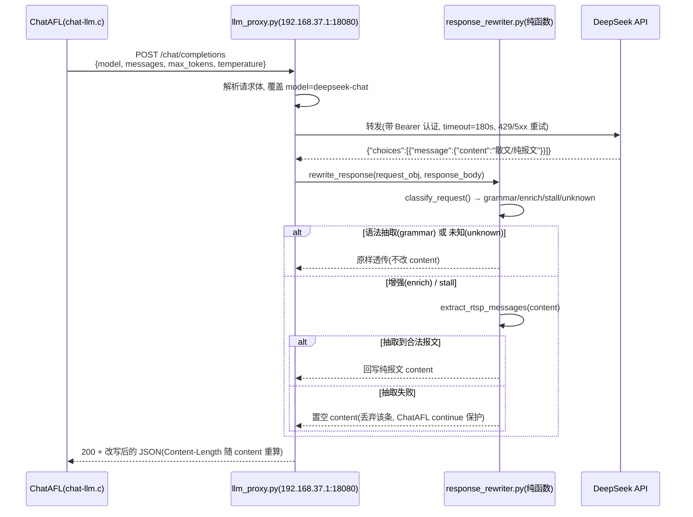

# ChatAFL 代理层响应改写 · 实现方案

> 目标：在不改 ChatAFL、不偏离论文、不改 prompt 的前提下，在 `scripts/llm_proxy.py` 收到 DeepSeek 响应后、回传 ChatAFL 之前，插入一个「响应改写层」，把增强 / stall 两条路径的聊天式散文剥离为纯 RTSP 报文，根治 deepseek-chat 替换 gpt-3.5-turbo 导致的语料污染问题（RQ1.2 中 chatafl 半侧 96% 语料被散文污染）。

---

## 1. 整体架构设计

### 1.1 代理层在系统中的位置

```
┌────────────────────────── VMware 虚拟机 (Ubuntu, 192.168.37.130, 无外网) ──────────────────────────┐
│                                                                                                    │
│   ChatAFL (/home/ubuntu/chatafl/afl-fuzz)                                                          │
│     ├─ chat-llm.c ── 三处 LLM 调用：                                                              │
│     │     ① 语法抽取  construct_prompt_for_templates   → 期望 COMMAND: ["..."]                    │
│     │     ② 启动期增强 enrich_sequence                 → 期望纯 RTSP 报文序列                      │
│     │     ③ 运行期 stall  construct_prompt_stall       → 期望下一条 client request                 │
│     └─ format_request_message(): 裸 \n → \r\n + 尾部补 \r\n\r\n（不做报文抽取）                     │
│                                                                                                    │
│   libcurl ───── HTTP POST http://192.168.37.1:18080/chat/completions ──────────┐                    │
└───────────────────────────────────────────────────────────────────────────────┼────────────────────┘
                                                                                 │
                                                              VMnet8 (宿主机可达虚拟机)
                                                                                 ▼
┌──────────────────────────────── Windows 宿主 (192.168.37.1) ───────────────────────────────────┐
│                                                                                                 │
│   scripts/llm_proxy.py  (ThreadingHTTPServer, 监听 192.168.37.1:18080)                         │
│     do_POST:                                                                                    │
│       1) 解析请求体 → 请求改写（model 覆盖为 deepseek-chat）                                      │
│       2) 转发 DeepSeek（urllib + 超时 + 重试 + 502 兜底）                                        │
│       3) 【新增】响应改写层 rewrite_response(request, response)                                  │
│          └─ 调用 scripts/response_rewriter.py：判路径 → 条件抽取 → 回写 content                  │
│       4) 回传 ChatAFL                                                                           │
│                                                                                                 │
└────────────────────────────────┬───────────────────────────────────────────────────────────────┘
                                 │ HTTPS (宿主机可出网)
                                 ▼
                     DeepSeek API: https://api.deepseek.com/v1/chat/completions
```

### 1.2 请求流 / 响应流时序（Mermaid）



### 1.3 响应改写层作为独立模块的边界

- `scripts/response_rewriter.py` 是**纯函数模块**：只依赖标准库 `json` / `re`，不依赖第三方包，不访问网络，无任何共享可变状态（线程安全）。
- `scripts/llm_proxy.py` 只负责 HTTP 转发（I/O）与调用改写层，不承载任何抽取/判路逻辑。
- 改写层对外暴露一个入口 `rewrite_response(request_body, response_body) -> RewriteResult`，输入是「请求体 + 响应体」，输出是「回传字节 + 观测元信息」；这样本机单测可以完全脱离网络验证。

---

## 2. 代理层的请求/响应改写逻辑

### 2.1 请求改写（model 覆盖 + 路径判别）

请求改写分两步，都在 `do_POST` 里完成：

```python
# 步骤 A：解析请求体（供改写层判路径；解析失败则 req_obj=None → 改写层透传）
req_obj = None
try:
    parsed = json.loads(body)
    if isinstance(parsed, dict):
        req_obj = parsed
except (ValueError, TypeError):
    pass

# 步骤 B：model 覆盖（保留原逻辑，避免 reasoning 模型 content 为空）
if MODEL_OVERRIDE and req_obj is not None and "model" in req_obj:
    req_obj["model"] = MODEL_OVERRIDE
    body = json.dumps(req_obj).encode()
```

**路径判别**（在 `response_rewriter.py`，纯函数，只看 `messages` 里 `role=user` 的 content）：

```python
def classify_request(request_obj) -> str:
    user_text = extract_user_text(request_obj)   # 拼接所有 user 消息文本
    if not user_text:
        return UNKNOWN
    if any(m in user_text for m in ("Output ONLY", "COMMAND:")):   # 语法抽取 → 跳过
        return GRAMMAR
    if "the modified sequence of client requests is:" in user_text: # 增强
        return ENRICH
    if any(m in user_text for m in ("Communication History:", "next proper client request")):  # stall
        return STALL
    return UNKNOWN
```

> 判定优先级：**语法抽取最先**。这是最关键的安全约束——语法抽取返回 `COMMAND: ["..."]` 格式，不是 RTSP 报文，一旦套用抽取器必然破坏它。把 GRAMMAR 判定放最前，任何含 `Output ONLY` / `COMMAND:` 的请求都无条件透传。

### 2.2 响应改写（条件分流 + 抽取器）

```python
def rewrite_response(request_body, response_body) -> RewriteResult:
    req_obj = _coerce_object(request_body)
    if req_obj is None:                       # 请求不可解析 → 透传
        return passthrough("request unparseable")

    path = classify_request(req_obj)

    if path not in (ENRICH, STALL):           # grammar / unknown → 原样透传
        return passthrough(f"path={path}: passthrough")

    resp_obj = _coerce_object(response_body)
    if resp_obj is None:                      # 响应非 JSON / 结构异常 → 透传
        return passthrough("response unparseable")

    original = choices[0].message.content      # 取 content
    if not original:                          # content 本就为空 → 透传
        return passthrough("empty content")

    cleaned = extract_rtsp_messages(original) # 纯报文抽取器

    if not cleaned:                           # 失败安全：置空 content
        choices[0].message.content = ""
        return emptied("no valid RTSP message")

    choices[0].message.content = cleaned       # 回写纯报文
    return rewritten("rewritten ok")
```

### 2.3 三条路径各自的处理策略

| 路径 | 判别特征（user content） | 期望返回 | 代理层策略 | 理由 |
|------|--------------------------|----------|-----------|------|
| ① 语法抽取 | 含 `Output ONLY` 或 `COMMAND:` | `COMMAND: ["..."]` | **原样透传，不套抽取器** | 其 prompt 自带防散文约束，deepseek-chat 实测返回干净；且 `COMMAND:` 格式不是报文，套抽取器会破坏它 |
| ② 启动期增强 | 含 `the modified sequence of client requests is:` | 纯 RTSP 报文序列 | **抽取器剥离散文 → 回写纯报文** | prompt 无约束，deepseek-chat 返回「前言 + 围栏 + 报文 + Explanation」散文，是污染主源 |
| ③ 运行期 stall | 含 `Communication History:` 或 `next proper client request` | 下一条 client request | **抽取器剥离散文 → 回写纯报文** | prompt 无约束，同样返回散文 |
| 其它/未知 | 三者均不匹配 | — | **原样透传** | 向后兼容，绝不误伤未知调用 |

### 2.4 抽取器核心算法（真代码，见附录 `extract_rtsp_messages`）

```python
METHOD_RE = re.compile(
    r"^(OPTIONS|DESCRIBE|SETUP|PLAY|PAUSE|TEARDOWN|GET_PARAMETER|SET_PARAMETER|"
    r"ANNOUNCE|RECORD|REDIRECT)\s+\S+\s+RTSP/1\.0\s*$", re.IGNORECASE)
HEADER_RE = re.compile(
    r"^(?:Accept|Accept-Encoding|Accept-Language|Authorization|Bandwidth|Blocksize|"
    r"Cache-Control|Conference|Connection|Content-Base|Content-Encoding|"
    r"Content-Language|Content-Length|Content-Location|Content-Type|CSeq|Date|"
    r"Expires|From|If-Modified-Since|Last-Modified|Location|Proxy-Authenticate|"
    r"Proxy-Require|Public|Range|Referer|Require|Retry-After|RTP-Info|Scale|Server|"
    r"Session|Speed|Transport|Unsupported|User-Agent|Vary|Via|WWW-Authenticate)\s*:",
    re.IGNORECASE)  # RTSP 标准头部白名单：裸 Note:/Explanation: 等散文行天然不在名单内

def extract_rtsp_messages(text):
    lines = text.replace("\r\n","\n").replace("\r","\n").split("\n")
    blocks, cur = [], None
    for raw in lines:
        s = raw.strip()
        if s.startswith("```"):            # 代码围栏：忽略，不打断当前块
            continue
        m = METHOD_RE.match(s)             # 报文首行：开新块（方法名统一大写）
        if m:
            close(cur, blocks); cur = [m.group(1).upper() + s[m.end(1):]]
            continue
        if cur is None: continue           # 块外散文：忽略
        if s == "": cur.append(""); continue
        if HEADER_RE.match(s) or raw.startswith(" ") or raw.startswith("\t"):
            cur.append(s); continue        # 头部行 / 折叠续行：保留
        close(cur, blocks)                 # 其它行：散文，结束当前块
    close(cur, blocks)
    return "\n\n".join("\n".join(b) for b in blocks)   # 多块之间仅一个空行
```

相对实测参考版的完善点：

1. **多请求块之间只留一个空行**：每个方法首行开启独立 block，最终 `"\n\n".join(...)`，保证块间恰一个空行。
2. **`\r\n` 规范化下放给 ChatAFL**：抽取器只用 `\n` 连接、不补尾部 `\r\n\r\n`，最终由 ChatAFL 的 `format_request_message()` 统一转 CRLF 并补尾。
3. **代码围栏 ``` 正确忽略**：围栏行（含 ```rtsp）既不进结果、也不打断当前块，容忍块内夹缝围栏。
4. **方法名统一大写**：正则大小写不敏感匹配后，仅把方法 token 转大写（URI 保留原大小写，避免破坏路径大小写），保证请求行合法。

---

## 3. 与 deepseek-chat API 的对接方式

### 3.1 Endpoint 与认证

- **Endpoint**：`https://api.deepseek.com/v1/chat/completions`（OpenAI 兼容协议）。
- **认证**：HTTP Header `Authorization: Bearer <DEEPSEEK_KEY>`。
- **Content-Type**：`application/json`。

### 3.2 请求体结构（ChatAFL 已生成，代理仅覆盖 model）

```json
{
  "model": "deepseek-chat",
  "messages": [
    {"role": "system", "content": "You are a helpful assistant."},
    {"role": "user", "content": "The following is one sequence of client requests:\n..."}
  ],
  "max_tokens": 2048,
  "temperature": 0.5
}
```

- `model` 由代理强制覆盖为 `deepseek-chat`（非 reasoning），保证 `message.content` 有最终答案。
- `messages` 的 `content` 可能是 `string` 或 OpenAI 多段数组（`[{"type":"text","text":...}]`），改写层两种都兼容。
- `max_tokens` / `temperature` 由 ChatAFL 传入，代理不干预。

### 3.3 响应体结构

```json
{
  "id": "chatcmpl-...",
  "object": "chat.completion",
  "created": 1700000000,
  "model": "deepseek-chat",
  "choices": [
    {
      "index": 0,
      "message": {"role": "assistant", "content": "最终答案文本"},
      "finish_reason": "stop"
    }
  ],
  "usage": {"prompt_tokens": 100, "completion_tokens": 200, "total_tokens": 300}
}
```

改写层只读/写 `choices[0].message.content`，其余字段原样保留。改写后 `json.dumps` 回写并重算 `Content-Length`。

### 3.4 超时与重试

- **超时**：`urlopen(req, timeout=180)`（环境变量 `LLM_PROXY_TIMEOUT`，默认 180s）。
- **重试**：对 `429 / 500 / 502 / 503 / 504` 及网络异常做有限次重试（`LLM_PROXY_RETRIES` 默认 2 次额外重试，线性退避 `LLM_PROXY_RETRY_BACKOFF` 默认 2.0s × 尝试次数）。
- **502 兜底**：所有异常最终兜底为 `{"error":{"message":"..."}}` + HTTP 502（保留原逻辑）。

### 3.5 错误码处理

| 状态码 | 含义 | 代理层处理 |
|--------|------|-----------|
| 200 | 成功 | 进入响应改写层；改写层透传/抽取/置空 |
| 401/402 | 鉴权失败/欠费 | 不重试，原样透传错误体给 ChatAFL（改写层不触发） |
| 429 | 限流 | 重试（线性退避），超限后透传错误体 |
| 5xx | 服务端错误 | 重试，超限后透传错误体 |
| 其它/网络异常 | — | 重试，最终 502 兜底 |

> 注意：改写层只在 `status == 200` 时触发；错误响应（401/402/429/5xx）没有 `choices`，即使误入改写层也会因结构异常而原样透传，双重安全。

---

## 4. ChatAFL 调用所需的配置与参数修改

### 4.1 ChatAFL 侧：零改动（核心卖点）

ChatAFL 的 C 代码（`chat-llm.c`）、prompt、`format_request_message()` **全部不改**。它只把 LLM 回答原样写进 `.raw`，对空 content 已有 `continue` 保护——这正好被我们的「置空 content 丢弃」策略复用。

唯一需要确认的是 ChatAFL 的 LLM endpoint 指向代理。当前链路已打通（`local/test_proxy.py（已移除）（已移除）（已移除）`（已移除） 与 `local/chat_afl_enrich.py（已移除）（已移除）（已移除）`（已移除） 均用 `http://192.168.37.1:18080/chat/completions` 验证过），即：

```
LLM endpoint = http://192.168.37.1:18080/chat/completions
```

> 若曾临时把 ChatAFL 的 LLM URL 指向 DeepSeek 直连，改回上面的代理地址即可；代理的 `do_POST` 不校验 path，任何 path 的 POST 都统一转发，因此 `/chat/completions` 或其它 path 均可。

### 4.2 代理启动配置与开关清单（环境变量，均有默认值）

| 环境变量 | 默认值 | 含义 |
|----------|--------|------|
| `LLM_PROXY_HOST` | `192.168.37.1` | 监听地址（VMnet8 宿主侧地址） |
| `LLM_PROXY_PORT` | `18080` | 监听端口 |
| `LLM_PROXY_MODEL` | `deepseek-chat` | model 覆盖值；设为空字符串可关闭覆盖 |
| `LLM_PROXY_REWRITE` | `1` | 响应改写开关；`0/false/no/off` 关闭 |
| `LLM_PROXY_DEEPSEEK_URL` | `https://api.deepseek.com/v1/chat/completions` | DeepSeek endpoint |
| `LLM_PROXY_DEEPSEEK_KEY` | （原硬编码 key） | DeepSeek 密钥（建议生产用环境变量注入） |
| `LLM_PROXY_TIMEOUT` | `180` | 单次转发超时（秒） |
| `LLM_PROXY_RETRIES` | `2` | 额外重试次数 |
| `LLM_PROXY_RETRY_BACKOFF` | `2.0` | 重试退避基数（秒） |

> 默认值完全等于原有常量，**直接 `python scripts/llm_proxy.py` 启动即与旧行为一致 + 默认开启改写**，无需任何额外配置即可上线。

---

## 5. 关键代码模块划分

### 5.1 模块职责

| 文件（绝对路径） | 职责 | 依赖 |
|------------------|------|------|
| `E:\科研\想法idea\rag-chatafl\scripts\response_rewriter.py` | 纯函数：路径判别 + 抽取器 + 响应改写入口 | 仅标准库 `json` / `re` |
| `E:\科研\想法idea\rag-chatafl\scripts\llm_proxy.py` | HTTP 转发 + 请求改写(model 覆盖) + 调用改写层 + 日志 | 标准库 + `response_rewriter` |
| `E:\科研\想法idea\rag-chatafl\tests\test_response_rewriter.py` | 抽取器/判别/改写入口的单元测试（脱离网络） | `unittest` + `response_rewriter` |

### 5.2 公开函数签名（`response_rewriter.py`）

```python
# 常量
GRAMMAR / ENRICH / STALL / UNKNOWN          # 路径标签
ACTION_PASSTHROUGH / ACTION_REWRITTEN / ACTION_EMPTIED  # 动作标签

# 数据类
@dataclass
class RewriteResult:
    body: bytes                 # 回传字节
    path: str                   # 判定的路径
    action: str                 # passthrough | rewritten | emptied
    original_content: str       # 改写前 content
    rewritten_content: str      # 改写后 content（emptied 时为空）
    note: str                   # 说明

# 函数
def extract_user_text(request_obj) -> str                # 拼所有 user 消息文本
def classify_request(request_obj) -> str                 # 路径判别
def extract_rtsp_messages(text: str) -> str              # 纯报文抽取器
def rewrite_response(request_body, response_body) -> RewriteResult  # 改写入口
```

`llm_proxy.py` 新增/改动点：

```python
from response_rewriter import ACTION_REWRITTEN, ACTION_EMPTIED, rewrite_response

# do_POST 内，转发之后、回传之前：
if REWRITE_ENABLED and status == 200 and req_obj is not None:
    result = rewrite_response(req_obj, data)
    data = result.body
    # 按 result.action 打日志：rewritten / emptied / passthrough
```

---

## 6. 可能出现的兼容性问题及应对措施

| # | 症状 | 应对 |
|---|------|------|
| ① | 语法抽取被误伤（`COMMAND: ["..."]` 被当报文抽取） | **条件分流规避**：`classify_request` 把含 `Output ONLY` / `COMMAND:` 的请求判为 `grammar`，无条件透传；且该判定优先级最高，绝不套抽取器 |
| ② | 抽取失败 / 无合法报文 | **置空 content**（`action=emptied`），返回 `content=""`；ChatAFL 对空 content 有 `continue` 保护会跳过写入；打 WARNING 日志，可观测丢弃率 |
| ③ | 非 JSON 响应 / 缺 `choices` / 缺 `message` / 缺 `content` | `_coerce_object` 与 `_get_response_content` 逐层容错，结构异常一律**原样透传**，不做二次破坏 |
| ④ | DeepSeek 429 限流 / 401 鉴权失败 | 429 走线性退避重试；401/402 不重试、原样透传错误体；改写层仅对 200 触发，错误体无 `choices` 天然透传 |
| ⑤ | reasoning 模型 content 为空（token 全耗在 `reasoning_content`） | **保留 MODEL_OVERRIDE**：强制 `model=deepseek-chat`（非 reasoning），从源头保证 content 非空；若 content 仍为空，改写层透传，交由 ChatAFL 的 continue 保护兜底 |
| ⑥ | ThreadingHTTPServer 多线程并发 | 改写层是**纯函数、无共享可变状态**（正则/常量只读），可安全并发调用；不引入任何全局写 |
| ⑦ | 抽取后报文为空导致 ChatAFL 跳过 | 这正是**失败安全策略的预期行为**：宁可丢一条增强种子，也不写入散文污染语料；日志记录 `emptied` 便于回归统计 |
| ⑧ | 长响应 / 大报文 | 抽取器是 O(n) 单遍扫描 + 字符串拼接，无递归、无正则回溯风险；180s 超时 + 重试覆盖慢响应；`Content-Length` 随改写后字节数重算 |

> 关于「失败回退原样 vs 置空丢弃」的最终选择：**选择置空丢弃**。理由：若抽取失败回退原文，等于把散文重新写进 `.raw`，本次要根除的污染问题会原样复现；置空则复用 ChatAFL 既有的空 content 保护，安全且语义清晰（丢弃该条增强）。代价是可能少产出一条增强种子，远小于语料被污染的实验风险。

> **补充已知限制（有意为之的取舍）**：抽取器会丢弃 RTSP 报文的**消息体（body）**——对带 `Content-Length` 的 `ANNOUNCE` / `SET_PARAMETER`，头部行会被保留，但 body 行因不匹配「方法首行/白名单头部/折叠续行」而被当散文关闭块、丢弃，最终产出「声明有 body 却无 body」的报文。当前 enrich/stall 产出的客户端请求（`DESCRIBE/SETUP/PLAY/PAUSE/TEARDOWN`）均无 body，风险低；若未来涉及带体请求，需扩展抽取器（识别 `Content-Length` 后按长度续收 body 行）。这是**防散文优先**的取舍，暂不改代码。

---

## 7. 部署和测试步骤

> 统一用系统 Python：`E:\app\Anaconda3\python.exe`（3.13.9，标准库齐全，无第三方依赖）。

### 7.1 本机单元测试（脱离网络，先验证纯函数）

```bash
cd /e/科研/想法idea/rag-chatafl
E:/app/Anaconda3/python.exe tests/test_response_rewriter.py
# 期望：Ran 23 tests ... OK
```

（等价地可用 `pytest tests/test_response_rewriter.py`，同为 23 passed。）

### 7.2 语法/导入自检

```bash
cd /e/科研/想法idea/rag-chatafl
E:/app/Anaconda3/python.exe -c "import sys; sys.path.insert(0,'scripts'); import llm_proxy, response_rewriter; print('imports OK')"
```

### 7.3 启动代理（宿主）

```bash
cd /e/科研/想法idea/rag-chatafl
E:/app/Anaconda3/python.exe scripts/llm_proxy.py
# 期望日志：LLM 转发代理已启动: http://192.168.37.1:18080 -> ... (改写=ON)
```

### 7.4 本机连通性冒烟（可选，先确认转发正常）

```bash
E:/app/Anaconda3/python.exe local/test_proxy.py（已移除）（已移除）（已移除）
# 期望打印 content = OK（普通调用，无增强特征，改写层透传）
```

### 7.5 用真实 ChatAFL prompt 打一次看改写效果

用增强路径 prompt（含 `the modified sequence of client requests is:`）打代理，确认回传的 content 已是纯报文、无前言/围栏/Explanation：

```bash
E:/app/Anaconda3/python.exe - <<'PY'
import json, urllib.request
body = json.dumps({
    "model": "deepseek-chat",
    "messages": [{"role": "user", "content":
        "The following is one sequence of client requests:\n"
        "DESCRIBE rtsp://127.0.0.1:8554/mp3AudioTest RTSP/1.0\r\nCSeq: 1\r\nAccept: application/sdp\r\n\r\n"
        "Please add the SETUP client requests in the proper locations, "
        "and the modified sequence of client requests is:"}],
    "max_tokens": 2048, "temperature": 0.5,
}).encode()
req = urllib.request.Request("http://192.168.37.1:18080/chat/completions",
    data=body, headers={"Content-Type": "application/json"})
r = json.loads(urllib.request.urlopen(req, timeout=300).read())
print("content =\n" + r["choices"][0]["message"]["content"])
PY
```

验证要点：输出中不应出现 `Here is` / `Explanation` / ` ``` `；只应包含 `DESCRIBE/SETUP ... RTSP/1.0` 及其头部行。代理日志应出现 `改写[enrich] 成功: N -> M 字节`。

### 7.6 虚拟机连通性验证

```bash
# 在 VMware 虚拟机内（192.168.37.130）：
curl -s http://192.168.37.1:18080/chat/completions \
  -H "Content-Type: application/json" \
  -d '{"model":"deepseek-chat","messages":[{"role":"user","content":"Reply with exactly: OK"}],"max_tokens":20}'
# 期望：返回 JSON 且 content 含 OK（证明虚拟机 → 宿主代理 → DeepSeek 全链路通）
```

### 7.7 重启 RQ 实验验证语料干净

1. 确认代理已带改写开启运行。
2. 重新触发 RQ1.2 的 ChatAFL 增强流程（或先小规模跑一轮 `local/chat_afl_enrich.py（已移除）（已移除）（已移除）`（已移除） 复现路径）。
3. 检查产出的 `.raw` 种子：`grep -lE "Explanation|Here is|^\`\`\`" <seed_dir>/*.raw` 应**无命中**（或命中数从 96% 降到接近 0）。
4. 统计被丢弃的增强条数（代理日志 `改写[...] 丢弃(无合法报文)` 的计数），确认丢弃率可接受。
5. 复核语法抽取路径仍正常：确认生成的模板仍为 `COMMAND: ["..."]` 格式、未被改写层破坏。

---

## 附录：完整代码清单

### A.1 `scripts/response_rewriter.py`

```python
# -*- coding: utf-8 -*-
"""ChatAFL 代理层「响应改写」纯函数模块（仅依赖标准库 json / re）。

背景：ChatAFL 内部的 LLM 调用有三条路径，其中「启动期增强（enrich_sequence）」与
「运行期 stall-chat（construct_prompt_stall）」两条路径的 prompt 无格式约束，
deepseek-chat（聊天风格）会返回带前言/代码围栏/Explanation 的散文。ChatAFL 拿到回答后
只做 format_request_message()（裸换行转 CRLF + 尾部补 CRLFCRLF），不做报文抽取，散文会
被原样写进 .raw 种子文件，污染 fuzzing 语料。

本模块在「响应回传 ChatAFL 之前」根据**请求**内容判定路径，对增强/stall 两条路径用
抽取器剥离散文、只保留纯 RTSP 报文，再回写 choices[0].message.content。

安全约束（务必遵守）：
1. 语法抽取路径（返回 COMMAND: ["..."] 格式）**绝不**套抽取器，必须原样透传。
2. 抽取失败时不崩溃、不返回半截脏数据；策略：置空 content（丢弃该条增强），
   ChatAFL 侧对空 content 已有 continue 保护会跳过写入。
3. 抽取器为纯函数，无任何共享可变状态，线程安全（可被 ThreadingHTTPServer 多线程并发调用）。
"""

from __future__ import annotations

import json
import re
from dataclasses import dataclass

# ---------------------------------------------------------------------------
# 常量：RTSP 方法全集 + 报文/头部正则
# ---------------------------------------------------------------------------

# ChatAFL 增强会产出 REDIRECT，故必须包含；顺序不影响正确性（`\s+` 起到消歧作用）。
RTSP_METHODS = (
    "OPTIONS", "DESCRIBE", "SETUP", "PLAY", "PAUSE", "TEARDOWN",
    "GET_PARAMETER", "SET_PARAMETER", "ANNOUNCE", "RECORD", "REDIRECT",
)

# 报文首行：METHOD URI RTSP/1.0（大小写不敏感；group(1) 捕获方法名）。
_METHOD_RE = re.compile(
    r"^(" + "|".join(RTSP_METHODS) + r")\s+\S+\s+RTSP/1\.0\s*$",
    re.IGNORECASE,
)

# 头部行：仅接受 RTSP 标准头部白名单（HeaderName: value）。
# 不用 `^[A-Za-z][A-Za-z0-9_-]*\s*:` 的宽松匹配——会把裸的 Note: / Explanation: /
# Sure: / Here: 等散文行误判为头部行，混入抽取结果污染语料。
_HEADER_RE = re.compile(
    r"^(?:Accept|Accept-Encoding|Accept-Language|Authorization|Bandwidth|Blocksize|"
    r"Cache-Control|Conference|Connection|Content-Base|Content-Encoding|"
    r"Content-Language|Content-Length|Content-Location|Content-Type|CSeq|Date|"
    r"Expires|From|If-Modified-Since|Last-Modified|Location|Proxy-Authenticate|"
    r"Proxy-Require|Public|Range|Referer|Require|Retry-After|RTP-Info|Scale|Server|"
    r"Session|Speed|Transport|Unsupported|User-Agent|Vary|Via|WWW-Authenticate)\s*:",
    re.IGNORECASE,
)

# 代码围栏（``` 或 ```rtsp 等）。
_FENCE_PREFIX = "```"

# ---------------------------------------------------------------------------
# 路径判别特征（取自 chat-llm.c 三处 prompt 的稳定字面量）
# ---------------------------------------------------------------------------

# 增强路径：enrich_sequence 的 user prompt 含该句。
_ENRICH_MARKERS = ("the modified sequence of client requests is:",)

# stall-chat 路径：construct_prompt_stall 含这些字样。
_STALL_MARKERS = ("Communication History:", "next proper client request")

# 语法抽取路径：construct_prompt_for_templates 含 "Output ONLY" 与 "COMMAND:"。
# 该路径跳过改写（原样透传），判定优先级最高（最危险，绝不能破坏 COMMAND 格式）。
_GRAMMAR_MARKERS = ("Output ONLY", "COMMAND:")

# 路径标签
GRAMMAR = "grammar"          # 语法抽取：透传
ENRICH = "enrich"            # 启动期增强：抽取
STALL = "stall"              # 运行期 stall-chat：抽取
UNKNOWN = "unknown"          # 未知：透传（向后兼容）

# 改写动作标签
ACTION_PASSTHROUGH = "passthrough"
ACTION_REWRITTEN = "rewritten"
ACTION_EMPTIED = "emptied"


# ---------------------------------------------------------------------------
# 结果结构
# ---------------------------------------------------------------------------

@dataclass
class RewriteResult:
    """改写结果：body 为回传字节；其余字段用于观测/日志/统计。"""

    body: bytes = b""
    path: str = UNKNOWN
    action: str = ACTION_PASSTHROUGH
    original_content: str = ""
    rewritten_content: str = ""
    note: str = ""


# ---------------------------------------------------------------------------
# 基础工具
# ---------------------------------------------------------------------------

def _as_bytes(data) -> bytes:
    """把 str/bytearray/bytes 归一为 bytes（透传时尽量保持原字节不变）。"""
    if isinstance(data, bytes):
        return data
    if isinstance(data, bytearray):
        return bytes(data)
    if isinstance(data, str):
        return data.encode("utf-8")
    return data  # 理论上不会到达


def _dump_bytes(obj) -> bytes:
    """JSON 序列化为 UTF-8 字节。"""
    return json.dumps(obj, ensure_ascii=False).encode("utf-8")


def _coerce_object(data):
    """把 bytes/str/dict 归一为 dict（无法解析则返回 None）。"""
    if isinstance(data, dict):
        return data
    if isinstance(data, (bytes, bytearray)):
        data = bytes(data).decode("utf-8", "replace")
    if isinstance(data, str):
        try:
            obj = json.loads(data)
        except (ValueError, TypeError):
            return None
        return obj if isinstance(obj, dict) else None
    return None


def _content_to_text(content) -> str:
    """把 message.content（str 或 OpenAI 多段数组）转为纯文本。"""
    if isinstance(content, str):
        return content
    if isinstance(content, list):
        chunks: list[str] = []
        for item in content:
            if isinstance(item, dict):
                if isinstance(item.get("text"), str):
                    chunks.append(item["text"])
                elif isinstance(item.get("content"), str):
                    chunks.append(item["content"])
            elif isinstance(item, str):
                chunks.append(item)
        return "\n".join(chunks)
    return ""


def extract_user_text(request_obj) -> str:
    """从请求体拼出所有 role=user 消息的文本，用于路径判别。"""
    if not isinstance(request_obj, dict):
        return ""
    messages = request_obj.get("messages")
    if not isinstance(messages, list):
        # 兼容极少数把 user 文本直接放顶层的请求
        for key in ("prompt", "user"):
            value = request_obj.get(key)
            if isinstance(value, str):
                return value
        return ""
    parts: list[str] = []
    for msg in messages:
        if not isinstance(msg, dict):
            continue
        if msg.get("role") != "user":
            continue
        text = _content_to_text(msg.get("content"))
        if text:
            parts.append(text)
    return "\n".join(parts)


# ---------------------------------------------------------------------------
# 路径判别
# ---------------------------------------------------------------------------

def classify_request(request_obj) -> str:
    """根据请求体 user content 特征判定 ChatAFL 的三条 LLM 调用路径。

    返回 GRAMMAR / ENRICH / STALL / UNKNOWN 之一。
    - GRAMMAR：语法抽取，必须透传（不改写）。
    - ENRICH / STALL：需要抽取纯 RTSP 报文。
    - UNKNOWN：不匹配任何已知特征，透传（向后兼容）。
    """
    if not isinstance(request_obj, dict):
        return UNKNOWN
    user_text = extract_user_text(request_obj)
    if not user_text:
        return UNKNOWN
    # 语法抽取优先级最高：COMMAND: ["..."] 格式绝不能套抽取器。
    if any(marker in user_text for marker in _GRAMMAR_MARKERS):
        return GRAMMAR
    if any(marker in user_text for marker in _ENRICH_MARKERS):
        return ENRICH
    if any(marker in user_text for marker in _STALL_MARKERS):
        return STALL
    return UNKNOWN


# ---------------------------------------------------------------------------
# RTSP 报文抽取器
# ---------------------------------------------------------------------------

def extract_rtsp_messages(text: str) -> str:
    """从散文/带围栏的 LLM 回答中抽取纯 RTSP 报文序列。

    规则：
    - 一行匹配「METHOD URI RTSP/1.0」视为一个报文块的开始（方法名统一大写，URI 保持原样）。
    - 块内接受头部行（Header: value）与以空格/tab 开头的折叠续行。
    - 代码围栏行（``` 或 ```rtsp）一律忽略，且不打断当前块。
    - 其它行（前言/Explanation/列表项等）视为散文，结束当前块并忽略。
    - 多个报文块之间只保留**一个空行**。

    返回用 '\\n' 连接的报文序列（不含尾部换行）。换行规范化（\\n→\\r\\n 与尾部补
    \\r\\n\\r\\n）交给 ChatAFL 的 format_request_message。抽取不到任何合法报文时返回 ""。
    """
    if not isinstance(text, str) or not text:
        return ""

    lines = text.replace("\r\n", "\n").replace("\r", "\n").split("\n")
    blocks: list[list[str]] = []
    cur: list[str] | None = None

    def close_block() -> None:
        """结束当前块：去掉尾部空行，非空则入 blocks。"""
        nonlocal cur
        if cur is not None:
            while cur and cur[-1] == "":
                cur.pop()
            if cur:
                blocks.append(cur)
            cur = None

    for raw in lines:
        stripped = raw.strip()
        # 1) 代码围栏：忽略，且不打断当前块（容忍块内夹缝围栏）。
        if stripped.startswith(_FENCE_PREFIX):
            continue
        # 2) 报文首行：结束上一个块，开启新块（方法名统一大写，URI 保留原始大小写）。
        method_match = _METHOD_RE.match(stripped)
        if method_match:
            close_block()
            method = method_match.group(1).upper()
            cur = [method + stripped[method_match.end(1):]]
            continue
        if cur is None:
            # 3) 块外：忽略散文。
            continue
        if stripped == "":
            # 4) 块内空行：候选分隔（结束块时会去尾）。
            cur.append("")
            continue
        if _HEADER_RE.match(stripped) or raw.startswith(" ") or raw.startswith("\t"):
            # 5) 头部行 / 折叠续行：保留（用 stripped 去掉首尾空白）。
            cur.append(stripped)
            continue
        # 6) 其它行：散文，结束当前块。
        close_block()

    close_block()

    return "\n\n".join("\n".join(block) for block in blocks)


# ---------------------------------------------------------------------------
# 响应改写入口
# ---------------------------------------------------------------------------

def _get_response_content(response_obj) -> str:
    """从 DeepSeek 响应体取 choices[0].message.content（结构异常返回 ""）。"""
    if not isinstance(response_obj, dict):
        return ""
    choices = response_obj.get("choices")
    if not isinstance(choices, list) or not choices:
        return ""
    first = choices[0]
    if not isinstance(first, dict):
        return ""
    message = first.get("message")
    if not isinstance(message, dict):
        return ""
    content = message.get("content")
    return content if isinstance(content, str) else ""


def _set_response_content(response_obj, content: str) -> None:
    """回写 choices[0].message.content（调用方保证结构完整）。"""
    response_obj["choices"][0]["message"]["content"] = content


def rewrite_response(request_body, response_body) -> RewriteResult:
    """代理层响应改写入口：根据请求路径，对 DeepSeek 响应做条件改写。

    参数可传 bytes/str/dict（bytes 需为 UTF-8 JSON）。

    处理策略：
    - 请求不可解析 / 未知路径 / 语法抽取路径 → 原样透传。
    - 增强 / stall 路径 → 抽取纯 RTSP 报文回写 content。
    - 抽取失败（无合法报文）→ 置空 content（丢弃该条，ChatAFL 侧 continue 保护）。
    - 响应不可解析 / content 本就为空 → 原样透传。

    返回 RewriteResult（body 为回传字节）。
    """
    req_obj = _coerce_object(request_body)
    if req_obj is None:
        return RewriteResult(
            body=_as_bytes(response_body), path=UNKNOWN,
            action=ACTION_PASSTHROUGH, note="request unparseable",
        )

    path = classify_request(req_obj)

    # 仅增强 / stall 需要改写；语法抽取与未知路径一律透传。
    if path not in (ENRICH, STALL):
        return RewriteResult(
            body=_as_bytes(response_body), path=path,
            action=ACTION_PASSTHROUGH, note=f"path={path}: passthrough",
        )

    resp_obj = _coerce_object(response_body)
    if resp_obj is None:
        return RewriteResult(
            body=_as_bytes(response_body), path=path,
            action=ACTION_PASSTHROUGH, note="response unparseable, passthrough",
        )

    original = _get_response_content(resp_obj)
    if not original:
        return RewriteResult(
            body=_as_bytes(response_body), path=path,
            action=ACTION_PASSTHROUGH, original_content="",
            note="empty content, passthrough",
        )

    cleaned = extract_rtsp_messages(original)

    if not cleaned:
        # 失败安全：置空 content，让 ChatAFL 因空 content 跳过写入。
        _set_response_content(resp_obj, "")
        return RewriteResult(
            body=_dump_bytes(resp_obj), path=path, action=ACTION_EMPTIED,
            original_content=original, rewritten_content="",
            note="no valid RTSP message, content emptied",
        )

    _set_response_content(resp_obj, cleaned)
    return RewriteResult(
        body=_dump_bytes(resp_obj), path=path, action=ACTION_REWRITTEN,
        original_content=original, rewritten_content=cleaned,
        note="rewritten ok",
    )


__all__ = [
    "GRAMMAR", "ENRICH", "STALL", "UNKNOWN",
    "ACTION_PASSTHROUGH", "ACTION_REWRITTEN", "ACTION_EMPTIED",
    "RewriteResult", "classify_request", "extract_user_text",
    "extract_rtsp_messages", "rewrite_response",
]
```

### A.2 `scripts/llm_proxy.py`

```python
# -*- coding: utf-8 -*-
"""ChatAFL LLM 转发代理：把虚拟机 ChatAFL 的请求转发到 DeepSeek，绕过其 libcurl 毛病。

监听 192.168.37.1:18080（VMnet8，虚拟机可达），收到 POST 后原样转发到 DeepSeek
（用本机成熟的 urllib + 超时 + 重试），回传响应。在响应回传前插入「响应改写层」：
根据请求路径（增强/stall/语法抽取）对散文回答做条件剥离，只保留纯 RTSP 报文，
避免 deepseek-chat 的聊天风格散文污染 fuzzing 语料。

用法:
    python llm_proxy.py
    # 或自定义（均可选）：
    LLM_PROXY_HOST=192.168.37.1 LLM_PROXY_PORT=18080 \
    LLM_PROXY_MODEL=deepseek-chat LLM_PROXY_REWRITE=1 \
    python llm_proxy.py
"""
import json
import logging
import os
import sys
import time
import urllib.request
import urllib.error
from http.server import BaseHTTPRequestHandler, ThreadingHTTPServer
from pathlib import Path

# 保证无论从哪个目录启动，都能 import 到同目录的 response_rewriter.py。
_SCRIPT_DIR = Path(__file__).resolve().parent
if str(_SCRIPT_DIR) not in sys.path:
    sys.path.insert(0, str(_SCRIPT_DIR))

from response_rewriter import (  # noqa: E402
    ACTION_REWRITTEN, ACTION_EMPTIED, rewrite_response,
)

# ---------------------------------------------------------------------------
# 可配置项（环境变量优先，默认值保持与原有行为一致）
# ---------------------------------------------------------------------------
DEEPSEEK_URL = os.environ.get(
    "LLM_PROXY_DEEPSEEK_URL", "https://api.deepseek.com/v1/chat/completions")
# ★ 安全整改（2026-11-01）：不再硬编码 API key，改由环境变量 / .env 提供
DEEPSEEK_KEY = (
    os.environ.get("LLM_PROXY_DEEPSEEK_KEY")
    or os.environ.get("DEEPSEEK_API_KEY")
    or "")
LISTEN_HOST = os.environ.get("LLM_PROXY_HOST", "192.168.37.1")
LISTEN_PORT = int(os.environ.get("LLM_PROXY_PORT", "18080"))

# deepseek-flash / deepseek-v4-pro 是 reasoning 模型，会把 token 全耗在
# reasoning_content 上导致 content 为空（ChatAFL 只读 content）。这里强制改写为
# 非 reasoning 的 deepseek-chat，保证 content 字段有最终答案。
# 设为空字符串可关闭 model 覆盖。
MODEL_OVERRIDE = os.environ.get("LLM_PROXY_MODEL", "deepseek-chat")

# 响应改写开关：1/true/yes/on 开启（默认），0/false/no/off 关闭。
REWRITE_ENABLED = os.environ.get(
    "LLM_PROXY_REWRITE", "1").strip().lower() not in ("0", "false", "no", "off")

# 转发超时与重试：对 429 / 5xx / 网络异常做有限次重试（线性退避）。
TIMEOUT = int(os.environ.get("LLM_PROXY_TIMEOUT", "180"))
MAX_RETRIES = int(os.environ.get("LLM_PROXY_RETRIES", "2"))
RETRY_BACKOFF = float(os.environ.get("LLM_PROXY_RETRY_BACKOFF", "2.0"))
RETRYABLE_STATUS = (429, 500, 502, 503, 504)

log = logging.getLogger("llm-proxy")
logging.basicConfig(level=logging.INFO, format="%(asctime)s %(message)s")


class ProxyHandler(BaseHTTPRequestHandler):
    protocol_version = "HTTP/1.1"

    def _forward(self, body: bytes):
        """转发到 DeepSeek，返回 (data: bytes, status: int)。失败重试 + 502 兜底。"""
        last_data = json.dumps({"error": {"message": "proxy forward failed"}}).encode()
        last_status = 502
        for attempt in range(MAX_RETRIES + 1):
            req = urllib.request.Request(
                DEEPSEEK_URL, data=body, method="POST",
                headers={
                    "Content-Type": "application/json",
                    "Authorization": "Bearer " + DEEPSEEK_KEY,
                },
            )
            try:
                with urllib.request.urlopen(req, timeout=TIMEOUT) as resp:
                    return resp.read(), resp.status
            except urllib.error.HTTPError as e:
                data = e.read()
                status = e.code
                last_data = data
                last_status = status
                if status in RETRYABLE_STATUS and attempt < MAX_RETRIES:
                    delay = RETRY_BACKOFF * (attempt + 1)
                    log.warning("DeepSeek HTTP %d，%.1fs 后重试 (%d/%d)",
                                status, delay, attempt + 1, MAX_RETRIES)
                    time.sleep(delay)
                    continue
                return data, status
            except Exception as e:  # noqa: BLE001
                last_data = json.dumps({"error": {"message": str(e)}}).encode()
                last_status = 502
                if attempt < MAX_RETRIES:
                    delay = RETRY_BACKOFF * (attempt + 1)
                    log.warning("DeepSeek 请求异常 %s，%.1fs 后重试 (%d/%d)",
                                e, delay, attempt + 1, MAX_RETRIES)
                    time.sleep(delay)
                    continue
                return last_data, 502
        return last_data, last_status

    def do_POST(self):
        length = int(self.headers.get("Content-Length", 0) or 0)
        body = self.rfile.read(length)

        # 请求体解析（供改写层判路径；失败则 req_obj=None → 改写层透传）
        req_obj = None
        try:
            parsed = json.loads(body)
            if isinstance(parsed, dict):
                req_obj = parsed
        except (ValueError, TypeError):
            pass

        # 改写 model 字段，避免 reasoning 模型把 token 耗在 reasoning_content 上
        if MODEL_OVERRIDE and req_obj is not None and "model" in req_obj:
            req_obj["model"] = MODEL_OVERRIDE
            body = json.dumps(req_obj).encode()

        # 转发给 DeepSeek（本机稳定的 urllib + 超时 + 重试）
        data, status = self._forward(body)

        # 响应改写层：仅对 200 成功响应、且能解析出请求路径时执行
        if REWRITE_ENABLED and status == 200 and req_obj is not None:
            result = rewrite_response(req_obj, data)
            data = result.body
            if result.action == ACTION_REWRITTEN:
                log.info("改写[%s] 成功: %d -> %d 字节",
                         result.path, len(result.original_content.encode("utf-8")),
                         len(result.rewritten_content.encode("utf-8")))
            elif result.action == ACTION_EMPTIED:
                log.warning("改写[%s] 丢弃(无合法报文): %.200r",
                            result.path, result.original_content)
            else:
                log.info("改写[%s] 跳过: %s", result.path, result.note)

        self.send_response(status)
        self.send_header("Content-Type", "application/json")
        self.send_header("Content-Length", str(len(data)))
        self.end_headers()
        self.wfile.write(data)
        log.info("POST -> %d  (%d bytes body, %d bytes resp)",
                 status, len(body), len(data))

    def log_message(self, *args):
        pass  # 静默默认访问日志


if __name__ == "__main__":
    srv = ThreadingHTTPServer((LISTEN_HOST, LISTEN_PORT), ProxyHandler)
    log.info("LLM 转发代理已启动: http://%s:%d -> %s (改写=%s)",
             LISTEN_HOST, LISTEN_PORT, DEEPSEEK_URL,
             "ON" if REWRITE_ENABLED else "OFF")
    srv.serve_forever()
```

### A.3 `tests/test_response_rewriter.py`

> 完整代码见落盘文件 `E:\科研\想法idea\rag-chatafl\tests\test_response_rewriter.py`（23 个用例，均已通过）。覆盖：增强散文响应、stall 响应、语法抽取 COMMAND 响应（原样透传）、无合法报文（置空）、空 content、多请求序列、含代码围栏、折叠续行、REDIRECT、大小写不敏感、CRLF 规范化、非 JSON 响应、缺 choices、请求不可解析、未知路径透传。

---

## 附：完成结论（一句话总结）

- **分流策略**：`classify_request` 按请求体 user content 稳定字面量判别——含 `Output ONLY`/`COMMAND:` 判为语法抽取（**最高优先级原样透传**，绝不套抽取器）；含 `the modified sequence of client requests is:` 判为增强、含 `Communication History:`/`next proper client request` 判为 stall，两者走抽取器；三者皆不匹配透传（向后兼容）。
- **失败安全最终选择**：**置空 content 丢弃该条**（而非回退原文），复用 ChatAFL 既有的空 content `continue` 保护，从根上杜绝散文回灌污染语料，且全程不崩溃、打日志可观测。
- **测试覆盖**：抽取器（增强/stall/多块/围栏/REDIRECT/大小写/CRLF/折叠续行/无报文/尾部散文）、路径判别（四类 + 非 dict）、改写入口（改写/透传/置空/非 JSON/缺 choices/空 content/不可解析请求/未知路径）共 23 例，脱离网络全绿。
