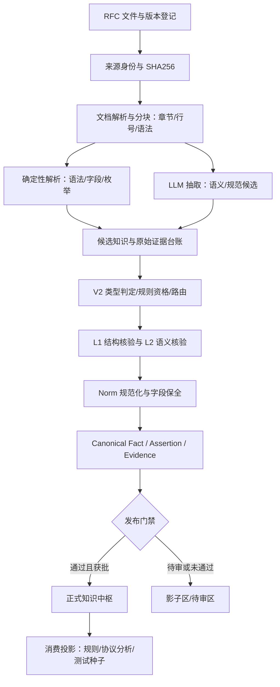

# RFC 规范源：从文档抽取到知识中枢的总体设计

**项目**：ProtoKG · `docs/设计/知识源层/规范源`  
**整理日期**：2026-11-17（正文）；2026-11-18（源码对应关系核验与归档）  
**性质**：设计说明与截至 V2-E4-R11 的阶段状态记录（不等于生产验收报告）  
**状态约定**：本文明确区分目标架构、已核验的影子能力、已冻结的评估产物与尚未获批的生产接入。具体代码路径、函数和字段定义须以本地仓库的冻结源码为准。

**本文的组成**：★ 主体为「RFC 规范源：从文档抽取到知识中枢的总体设计」。
★ 第 18 至 20 章为归档时补充的**源码对应关系核验**、**能力三态清单**与**待核验差异**，
★ 依据本地仓库冻结源码逐项核验后写入。★ 差异单独成章，★ 不改写上述设计结论。

**归档位置**：`docs/设计/知识源层/规范源/RFC规范源_从原文抽取到知识中枢_总体设计.md`  
**相关文档**：★ [RFC知识抽取流程.md](RFC知识抽取流程.md) 描述「8 步主线 + 4 组旁挂能力」的方法细节；
★ 本文为其上位总体设计与阶段状态载体，★ 两份文档的定位边界见 §19.4。

## 1. 问题定义与研究目标

RFC 是协议语义的权威文档载体，其中既有 ABNF、命令、消息结构、注册项、状态码等结构化知识，也有用自然语言描述的协议定义、行为义务、许可、禁止、条件、例外及跨句/跨章节依赖。

直接用 LLM 总结 RFC，容易遇到三类问题：

1. **识别不完整**：部分章节没有进入模型输入窗口；同一片段可能包含多条原子知识；跨句、跨节关系容易漏掉。
2. **语义不准确或流转失真**：`MUST NOT` 的否定极性、主体、对象和触发条件可能被漏抽；模型已经输出的字段也可能在派生层、Norm 或消费适配层丢失或未被识别。
3. **难以可靠复用**：来源版本不清、相同字段跨 RFC 发生身份碰撞、知识重复、证据无法回溯，都会影响中枢和后续模糊测试消费。

**总体目标**：建立“RFC 原文 → 多类型知识候选 → 语义及证据核验 → Norm → Canonical Fact → 受控知识中枢”的可追溯处理链，逐步使新协议接入标准化，形成多协议共用的知识表示与质量门禁。

本项目的主要研究关注点是：多类型知识抽取、跨阶段语义保全、证据驱动的事实治理及对协议模糊测试的支持。下游改善效果仍须通过实验验证，不能仅凭构建了知识库就宣称已提高漏洞发现率。

## 2. 总体端到端架构



**四个状态不能混淆**：已抽取候选 ≠ 已完成 Norm 映射 ≠ 已生成 Canonical Fact ≠ 已正式写入中枢。人工 Gold 是质量评估参考答案，也不直接等于应当发布的生产知识。

跨阶段的横向能力包括：来源追溯、事件诊断、缓存版本校验、版本哈希、身份一致性、回滚和回归测试。

## 3. RFC 输入与来源身份设计

### 3.1 文档登记

每个 RFC 输入应登记：RFC 编号和协议归属、实际文件路径、取得方式/版本、原文字节 SHA256、冻结时间，以及解析后章节与原文行号。对于不同版本或相近名称文档，应记录准确的身份，不依据模糊文件名进行匹配。

### 3.2 可靠来源链

核心链路：

`source_reference → normalized_document_id → source_file → source_sha256`

来源解析遵循：保留原始 ref；规范化由确定性纯函数执行并绑定版本；同名多协议匹配必须返回 `ambiguous`；找不到来源返回 `unresolved` 且不伪造哈希；拒绝行号越界和错误定位。

生产中曾发现不同解析点以及 `file:doc#@line` / `file:doc#section` 两种并存语法，因此需要统一兼容性规则，而不是把碰巧匹配成功当作来源正确。

**SHA256 的作用**是核实“后续读取的是与抽取时字节相同的 RFC 文件”。它不能定位具体知识；精确回溯还依赖章节、行号或证据跨度。文件路径是检索线索，文件哈希是完整性校验，二者结合原文位置才形成可信溯源。

### 3.3 版本管理

不得覆盖冻结原文。文档变化后应形成新的来源版本并重新核验关联；缓存或旧候选不能在版本不匹配时无声复用。来源 sidecar 属于影子兼容思路，投入生产需另行审批。

## 4. 文档解析、分块与覆盖审计

输入 RFC 后先识别章节、段落、ABNF、字段表、枚举、状态码与引用，保留行号、前后文和实际处理窗口。结构化片段可以走确定性解析，自然语言片段可送入 LLM 抽取。

分块与批处理是受调用预算约束的工程机制。每个文本块应保留至少四种状态：

- 已处理且生成候选；
- 已处理但没有候选；
- 未进入抽取窗口；
- 请求/响应/解析失败。

**未处理窗口不能算作“LLM 看过但漏抽”。** 先测覆盖，再测抽取召回；否则会混淆模型能力问题与运行策略导致的覆盖缺口。

历史排查中发现过批内 JSON 损坏导致整批候选损失、截断不可块级定位、缓存缺少来源版本、诊断事件未持久化等风险。改进应包括事件级留痕、失败归因和可复算统计，而不是事后凭内存汇总补造历史调用记录。

## 5. 多通道知识抽取设计

### 5.1 确定性结构化抽取

适合 ABNF 语法、消息格式、字段、协议命令、状态码与注册枚举等边界较明确的对象，优势是可复算、稳定、较少语义推断。既有解析通道的具体实现与覆盖类型以本地源码为准，不能仅凭概念分组认定每类都已正式支持。

### 5.2 LLM 自然语言抽取

主要针对 RFC 散文中的协议概念、含义、规范义务、禁止、许可、条件、例外及跨句关联。实际项目中涉及 `prose_semantics`、`prose_constraint` 等抽取输出与后续规则候选通道。

重点字段：

| 字段 | 含义 | 注意点 |
|---|---|---|
| `entity`、`meaning` | 实体及其描述性语义 | 描述性知识通常不需要规范强度 |
| `constraint` | 规范性限制或义务文本 | 不能强制要求所有语义类知识具有该字段 |
| `normative_subject` | 被约束的协议实体 | 可与自然语言中的语法主语不同 |
| `action` / `object` | 动作及作用对象 | 跨句、省略和并列动作需谨慎 |
| `strength` / `polarity` | MUST/SHOULD/MAY 与肯定/否定 | `SHOULD NOT` 不能变成正向 SHOULD |
| `condition` / `exception` | 生效条件及例外 | 不得把所有状语机械地当成触发条件 |
| `cross_ref_status` | 跨引用处理状态 | 未解析不可冒充已确认 |
| `evidence_span` | 原文证据位置 | 与冻结来源文件绑定 |

字段适用性分成 `required`、`optional`、`not_applicable` 和 `unknown` 等情况，依据真实 Schema、知识类型和原文证据确定；不允许把全部知识类型的规范字段分母一律设为 100%。

例如，一条 RFC 描述“字段 X 表示某种标识符”，`meaning` 可能已完整承载；`constraint` 为空不代表知识丢失。反之，如果原文有否定义务而系统漏掉 `NOT`，即使 `constraint` 非空也存在语义错误。

### 5.3 批处理与缓存

模型输出须保留原始内容、批次、块、真实请求事件及错误。分别统计 `actual_llm_request`、`cache_hit`、`local_replay`；请求数和块数不可互相代替，重试单列，失败事件不删除，缺失 token 记为 `unavailable`。缓存命中不能抹掉原先的真实调用统计。所有改动不得悄悄重置冻结 Prompt 或改变已有实验基线。

## 6. V2 知识类型闸门、资格与路由

**知识类型、规则资格、目标路由是三个不同判断问题。**

| 知识类别（评估口径） | 说明 | 路由原则 |
|---|---|---|
| `protocol_syntax` | ABNF、消息语法、格式 | 语法相关通道 |
| `protocol_registry_or_enumeration` | 注册/枚举/状态码 | 结构化枚举通道 |
| `protocol_descriptive_semantics` | 描述性知识、协议含义 | 描述性通道 |
| `normative_rule_candidate` | 协议行为义务、禁止或许可 | 再判断是否 eligible 进入规则候选通道 |
| `non_protocol_metadata` | 非协议行为元数据 | 不得误进入规则通道 |

不能仅凭“句子中出现 MUST/SHOULD”就判定存在协议行为规则；也不能因为没有 MUST 就把字段定义和语法知识判定为无知识。不同知识可能使用相同来源片段，每条独立命题应可原子化记录。

V2 的评估须保持原始机器预测不变，不能事后根据人工 Gold 修正模型类型和路由后再计算原始准确率。

## 7. 语义核验与人工 Gold

### 7.1 机器核验

L1 关注来源身份、行号越界、证据对应、字段及枚举是否合法等确定性问题；L2 关注语义是否得到原文支持，以及主体、动作、对象、强度、极性、条件和例外是否合理。模型自检只是信号，不能代替真正人工真值。

### 7.2 人工质量评价

人工审核使用冻结的 RFC 原文证据。A/B 分别独立判断，再由第三方处理分歧，记录裁定依据、审核者匿名 ID、时间和版本。

须区分：

- **片段级**：这个片段包含零条、一条还是多条目标知识；
- **候选级**：某条机器候选是否有效、属于什么类型、规则资格和路由；
- **原子知识级**：同一段内可能存在多条可单独评价的规范要求或定义；
- **字段级**：主体、动作、对象、强度、极性、条件和证据是否准确。

人工 Gold 与机器候选严格隔离：

`machine_original_proposition` 只能取冻结机器输出；`human_gold_proposition` 只能由真实人工依据与仲裁构成。人工重新组织的句子不能伪装成当时的模型回答。

## 8. Norm：规范化和跨阶段字段保全

统一流转链路为：

`source_span → raw_extraction → derived_fields → Norm → canonical_carrier → consumer_projection`

判断字段是否丢失时，不是检查同名键是否出现，而是检查**必要语义是否存在、被放在哪里、能否由下游正确恢复**。

对每个字段区分：

1. 直接保留；
2. 改名或映射；
3. 合入规范文本或 qualifiers；
4. 转移到 Assertion、Evidence 或 provenance；
5. 对此类型合法不适用；
6. 在某阶段真正非预期丢失；
7. 内容已保留但消费端没有识别。

项目在 H0/H1/R9 中发现过统计脚本将非同名映射误算为“丢失”、`normative_subject` 承载缺口疑问，以及 `meaning` 已存在但适配器只看 `constraint` 等问题。

R9 对跨协议 34 条 `constraint` 为空的候选进行核验：**31 条为合法缺省，3 条为已有 `meaning` 但适配未识别，0 条需凭人工重新伪造原始机器输出**。这说明“字段为空”与“知识语义丢失”不是同一指标。

## 9. Canonical Fact、Assertion 与 Evidence

不同来源的知识通过 Norm 统一后，进入既有 Canonical 知识身份体系。项目已确定：

- **不新增 21 aspects 之外的平行 aspect**，不为散文规范规则另起 FactID 体系；
- 散文规范规则继续使用既有 `definition` aspect，通过 `[RULE:v1]` 以及 Rule Slot / qualifiers 表达规范规则的内容和身份；
- `FactID` 对应稳定的事实身份；`strength`、`polarity` 属于 Assertion 语义，不直接参与 FactID 身份；
- Evidence/provenance 指向文件、版本、原文跨度及相关支持记录；
- 一条规范可能具有多个证据位置；不同声明也可能涉及同一稳定事实身份。

例如，RFC 规定“某实体在条件 C 下 MUST NOT 执行动作 A”时，应保留：实体、条件、动作、禁止极性、规范强度以及对应原文。不能仅存一个 `client→A` 关系就认为规则已完整保存。

### 9.1 已发现的身份碰撞风险

历史只读审计发现部分 `norm_id` 由种类与实体派生，缺少文档维度，从而在不同 RFC 的同名对象之间出现碰撞；同时 EvidenceID 的某路径 locator 为空，有继承碰撞风险。R3 曾有 1 组 3 个成员共享 NormID 的记录。

这是**身份与关联风险**，不能因为原始行未覆盖就断言所有消费链接都正确；也不能未经审批直接重写生产 NormID 或 FactID。当前可以通过复合索引 sidecar、版本化来源记录及消费端核验提出兼容修复，真正生产改动须另行验收。

## 10. 发布门禁、知识中枢与下游

完整发布链可以划分为：

1. **候选区**：抽取或解析得到，尚未确认可靠性。
2. **规范化/影子区**：已通过局部字段和身份校验，可离线做 Fact 构建或消费适配，但不改变正式中枢。
3. **正式发布区**：来源、语义、身份、证据、回归、生产兼容、回滚和审批全部满足后，才能进入正式中枢。

正式中枢中应能通过事实身份关联声明与证据，并能向不同消费视图投影知识。预期用途包括协议规则检索、消息结构和状态约束分析、为协议模糊测试提供知识条件与种子生成指导。

但“能映射到 Canonical Fact”**不等于**“当前已正式入库”；“有知识指导测试的设想”**不等于**“已证明覆盖率或漏洞发现率提升”。下游 `hub_view`、`rule_store`、Seed 的具体消费契约、错误关联风险和反向溯源必须另行验收。

生产接入还有严格限制：不经审批不得改动冻结 V2、FactID、21 aspects、正式中枢、Seed，不能将影子补丁无审查合并到生产路径。

## 11. 可观测性、版本治理与测试

### 11.1 诊断事件

将 `actual_llm_request`、`cache_hit`、`local_replay` 明确分离；采用追加式事件，分别记录批次、块数、真正请求数、重试、失败原因、token 和成本。汇总必须能从底层事件重算。未记录的 token 记为 `unavailable`，不存在的历史事件不得补造。

历史 H2/H3 的某些统计没有可持久化事件支撑，因此不能宣布其汇总数字可独立复算。生产 `LLMDiagnostics.flush()` 的调用时机、失败保护和缓存版本机制仍属于独立 P0 可观测性治理事项。

### 11.2 数据冻结与回归

应保持以下对象不可覆盖且有完整 SHA256：

- RFC 原始文件和抽取范围；
- 机器候选及相关配置、Prompt/Schema 版本；
- A/B/C 等人工原始审核与仲裁表；
- Gold 基线、修订候选版本和差异；
- 评估规则、脚本和映射定义；
- 中枢/Seed 正式版本及发布清单。

“已有护栏 5 failed，但没有新增失败”是**无新增回归**，不是“所有测试通过”。原有失败仍应独立追踪原因和范围。

## 12. 评估方法与指标边界

应分层报告，避免混淆分母和质量概念：

| 维度 | 核心问题 | 可用评估证据 |
|---|---|---|
| 文档覆盖 | 哪些 RFC 章节真正进入抽取窗口 | 文档/块处理台账 |
| 知识级 Precision / Recall / F1 | 候选有效吗？原文有效知识漏了多少？ | 冻结原子 Gold |
| 类型、资格、路由 | 知识是否被分错类或送错通道 | 候选级人工标签 |
| 字段语义准确性 | 主体、动作、对象、强度、极性、条件是否准确 | 人工字段级真值 |
| 阶段保全 | 已抽取的语义是否在 Norm、Fact、消费中被保留 | 字段及语义承载对账 |
| 来源追溯 | 可否从知识定位到完全一致的 RFC 版本与原文 | 身份链与 SHA256 |
| 运行可复算 | 请求、缓存、费用和重试是否可独立重算 | 追加式诊断事件 |
| 下游有效性 | 是否实际帮助协议测试 | 同预算对照/消融实验 |

**特别注意**：字段出现率、候选覆盖率、人工分类一致率都不能冒充“语义准确率”；没有可信真值的指标必须标记 `unavailable`。候选级 57 条与补充原子知识 8 条不是同一个分母，也不能把多条来自同一 RFC 的候选当作互相独立的文档级观测。

R10-P1 的文本投影规则（`constraint` 非空取原文，否则取原始 `meaning`）形成于人工结果出现之后，即使其实现只读取冻结机器字段，相关评估仍须标注为**事后分析**，不能包装成严格事前预注册的独立泛化验证。

## 13. 截至 R11 的真实阶段状态

以下是依据项目提交摘要整理的状态，不等于我已逐文件独立核验：

| 事项 | 当前状态 |
|---|---|
| SIP / RTSP / SMTP 跨协议机器候选 | 共 57 条，人工分类仲裁已经回收 |
| R10B 跨协议 Gold 冻结基线 | 65 条：57 条候选级 + 8 条原子级；原始冻结文件不可覆盖 |
| R11 来源字段修订 | 1 条 RTSP 补充知识由仅写“A”修正为可追踪 A/B 一致且 C 已确认；新版本仍是候选 |
| SC-05、SC-06 原子边界 | 4 条记录仍需真实人工裁定，可能改变原子知识总数 |
| 评估执行门禁 | R11 报告为 8 项通过、2 项未通过：原子边界未明确和评估脚本未冻结 |
| H3 Gold v4 | 单独的候选版本与审批链，不与跨协议 Gold 混合冻结 |
| V2 独立泛化评测 | 尚未正式完成 |
| N2-B 正式生产接入 / N4-P1 扩量 | 尚未批准 |
| 回归护栏 | R11 报告为 5 项既有 failed / 1901 passed，新增失败 0 |

**近期先后顺序**：回收 R11 四条原子知识的人工结果 → 对比冻结 Gold 并生成新的修订候选（不得覆盖 v1 或既有候选）→ 审核总数、去重、语义、来源 → 审批冻结 → 冻结评估脚本、标签和匹配规则 → 计算按协议区分的指标并报告事后规则影响 → 再讨论正式中枢接入。

## 14. 新协议（如 FTP）接入时的标准流程 SOP

目标是**一次性建设基础框架，多次复用协议接入能力**，而不是每引入新 RFC 都重做 H0～R11 的工程研究。

1. **确定文档集合**：选取协议基础规范与适用扩展，明确更新、废止、重叠关系并冻结原始文件 SHA256。
2. **小规模冒烟测试**：确认解析章节、命令、状态码、语法、散文规则等是否能够正确进入对应通道。
3. **协议特异性审计**：抽检字段依赖、状态关系、条件和例外，判断是否出现既有 Schema 无法表达的新知识类型。
4. **质量门禁**：抽查来源可溯、字段保全、身份碰撞、错误关联、失败事件及成本；有问题先定位局部机制。
5. **受控批量处理**：复用冻结抽取配置和发布门禁，输出 Norm/Fact/来源台账；未审批不写正式中枢。
6. **学术评估另做**：如研究目标是证明跨协议泛化，仍需准备**未用于调参**的独立 RFC 和 Gold，预先固定评测规则，不能把生产抽检自动当作独立泛化验证。

即使新协议通过常规接入，也不免除生产变更审批和必要的回归。若出现新知识类型或全新的语义难点，应专项扩展并评估兼容性，而非未经审查改 FactID 或 21 aspects。

## 15. 研究问题与学术意义

| 研究问题 | 技术路径 | 需要的验证 |
|---|---|---|
| **RQ1：如何准确、完整地从 RFC 提取多类型知识？** | 确定性解析 + LLM + V2 类型/资格闸门 | 与纯规则、直接 LLM、联合方案比较 Precision/Recall/F1 |
| **RQ2：如何防止知识在抽取至中枢途中失真？** | 语义字段保全、来源证据、身份分层与逐阶段对账 | 流转丢失率、错误关联率、可追溯率与消融实验 |
| **RQ3：结构化知识能否改善协议模糊测试？** | 可信中枢知识 → 协议条件/状态/约束投影 → 测试种子 | 同预算下有效输入、状态覆盖、代码覆盖和缺陷发现对照 |

这三个问题是**拟验证的研究贡献**，不是已得到充分实验支持的结论。应避免宣称“没有任何现有研究做过 RFC 抽取”，而应定位于多类型知识抽取、跨阶段语义保全、可追溯规范化以及面向下游多任务复用的系统性研究问题。

## 16. 给导师汇报的简明表述

> 老师，我们把 RFC 作为一种既包含机器可解析语法、又包含大量自然语言规范的协议知识源。首先固定 RFC 版本和文件指纹，恢复章节、行号及文本块；然后结合确定性解析和 LLM 抽取语法、字段、描述性语义及规范性行为要求。之后用 V2 判断知识类型、规则资格及目标路由，并核对原文证据，防止错把非规则信息当规则。通过校验的候选转换为 Norm，再进入统一的 Canonical Fact、Assertion 和 Evidence 表示，最后经过发布门禁，才能被正式中枢消费，用于协议分析和测试种子生成。
>
> 我们重点研究的不是生成了多少条文本，而是复杂协议语义是否抽得准、字段在跨阶段转换中是否保持完整，以及知识能否被稳定关联和追溯。当前已经构建跨协议 Gold 并完成多轮链路加固，仍在进行最后原子边界复核与正式评估准备，正式生产接入尚未验收通过。

---

## 17. 文档归档与后续核验要求

本文件应存放在：

`E:\科研\想法idea\ProtoKG\docs\设计\知识源层\规范源\RFC规范源_从原文抽取到知识中枢_总体设计.md`

本地 Agent 归档时应：

- 保持本文件 UTF-8 编码、Markdown 标题结构与代码块；
- 根据真实仓库补齐**已实现源码路径和函数映射**、真实字段 Schema/版本、完整哈希及生产/影子/提案三态清单；
- 若实际源码与本文设计陈述冲突，另列“待核验差异”，不悄悄改写历史设计及冻结证据；
- 不因“撰写设计文档”修改生产抽取代码、Prompt、V2、FactID、中枢、Seed 或人工 Gold；
- 文档归档完成后返回绝对路径、SHA256、git diff，以及是否只新增/修改了这一份设计文档。

---

## 18. 源码对应关系核验（2026-11-18 归档时补充）

★ 本章为归档时对本地仓库冻结源码的逐项核验结果。★ **只登记已核实的事实**，
★ 未核实项在 §20 单独列出。

### 18.1 抽取层实现文件（`core/fused/extraction/`）

| 能力 | 实现文件 | 关键函数 | 状态 |
|---|---|---|---|
| RFC 文本解析与结构化通道 | `rfc_extractor.py` | `_extract_rfc_file`、`_extract_abnf_fields`、`_extract_status_code_entries`、`_extract_command_entries`、`_extract_message_list_entries`、`extract_transition_norms`、`extract_constraint_norms` | 生产已实现 |
| 形式化形态（字段/转换） | `rfc_forms.py` | 字段与转换形态解析 | 生产已实现 |
| 散文语义切片（通道 I） | `prose_semantics.py` | `_split_blocks`、`_collect_blocks`、`_build_kind_review`、`_cache_path`、`_load_cache`、`_save_cache` | 影子层已验证（受开关控制） |
| 规范句抽取与核验 | `normative_extract.py` / `normative_verify.py` / `normative_rule.py` | 规范候选抽取、证据充分性判定、质量闸 fail-closed | 影子层已验证 |
| 身份规范化（Norm） | `norm.py` | `_make_evidence`、`_make_fact`、`transition_norm_to_fact`、`field_norm_to_facts`、`binary_layout_norm_to_fact` | 生产已实现 |
| 缓存键版本化 | `cache_key.py` | `cache_key` | 生产已实现 |
| 文档登记 | `doc_registry.py` | 文档自述状态、Updates/Obsoletes 登记 | 影子层已验证 |
| 覆盖台账 | `coverage_ledger.py` | 块级处理状态与覆盖率 | 影子层已验证 |
| 指代消解 | `coreference.py` | 跨句主体回指解析 | 影子层已验证 |
| 协议形态模式 | `protocol_patterns.py`、`rfc_classifier.py` | 协议特异性形态识别 | 生产已实现 |

### 18.2 散文通道的输出字段（★ 已核实存在）

`prose_semantics.py` 的提示词契约明确要求以下字段：

| 字段 | 行号 | 说明 |
|---|---|---|
| `entity` | 73、188 | 实体名，★ **不等于义务主体** |
| `meaning` | 73、188 | 一句话含义，★ 描述性知识常已完整承载 |
| `constraint` | 74、189 | 强制约束或空串，★ 允许为空 |
| `span` | 74、189 | 原文行号 |
| `cross_ref` / `cross_ref_status` | 79、67 | 跨节引用及其 `resolved`/`unresolved`/`unknown` 状态 |
| `normative_subject` | 80、58 | 真正承担义务的主体，★ 明确区别于 `entity` |
| `subject_span` | 61、176 | 主体所在行号，★ 不确定记 0 |

★ 上述字段与 §5.2 的字段表一致。

### 18.3 V2 知识类型闸门（已核实）

入库副本：`docs/实施/待办与勘误/M0对账交付/M1-Q3-N2-B0-V2知识类型闸门/scripts/v2_knowledge_gate.py`
SHA256 `81566fb71905e313bed67660e5d5ff788f3fbad46ccb145286e98457bd185047`。

| 常量 | 值 |
|---|---|
| 知识类别（六类） | `non_protocol_metadata`、`protocol_syntax`、`protocol_registry_or_enumeration`、`protocol_descriptive_semantics`、`normative_rule_candidate`、`mixed_or_uncertain` |
| 目标路由（五条） | `rule_channel`、`structured_channel`、`metadata_channel`、`descriptive_channel`、`pending_review` |

★ 公开接口：`classify_candidate`、`classify_sentence`、`route_of`、`is_declarative_normative`、`_sentences`、`_is_abnf`。
★ V2 为**离线影子**模块，★ 不接入生产抽取路径。

### 18.4 缓存键构成（已核实）

`cache_key.py` 的 `cache_key()` 纳入键的要素：

`prompt_version`、`prompt_digest`、`model`、`model_snapshot`、`inference`（temperature 与 max_tokens）、
`parser_version`、`schema_version`、`verifier_version`、`input_fingerprint`。

★ 任一要素变化即键变化，★ 旧缓存自动失效。★ `model_snapshot` 用于规避别名指向的底层版本变化。
★ §3.3 关于「缓存键含模型/推理/解析器/Schema/校验器版本」的陈述与实现一致。

### 18.5 影子开关（已核实）

`rfc_extractor.py` 的布尔型开关含 `enable_prose_semantics`（通道 I）、`enable_transitions`、
`enable_required_headers`。★ 关闭时产物逐字节不变。

### 18.6 身份碰撞（已核实）

R3 冻结机器基线中确有一组 norm_id 碰撞：

| norm_id | 成员 |
|---|---|
| `prose_constraint_server` | `X-smtp-rfc1870-02`、`X-sip-rfc2543-01`、`X-rtsp-rfc7826-02` |

★ 三条跨三份 RFC，★ 与 §9.1「R3 曾有 1 组 3 个成员共享 NormID」的陈述一致。★ 该组三条在 R10 的投影核验中全部保留，★ 未因碰撞删除。

### 18.7 冻结件哈希（归档时实测）

| 对象 | SHA256 |
|---|---|
| V2 判据（入库副本） | `81566fb71905e313bed67660e5d5ff788f3fbad46ccb145286e98457bd185047` |
| R3 冻结机器基线 | `694836b4bf497a083125b2d8b89c81a2854356f5967797359ec9af097f1a3b4a` |
| R10B 跨协议 Gold v1（冻结） | `bbce8979138605160f9af1c1c72a8c6c3b4750f31f808e9f03e2548f4b2a57eb` |
| R11 跨协议 Gold v2（候选） | `0f9ab8350da73359153473aeb9428001f45441828482583a1d0fed8f4f6cc38b` |
| H3 Gold v4（候选） | `0f507db8550697570de0e16769edb9a600571a5df55dfb68d8599d7bb81555b4` |
| R7 原始预注册文件 | `7cfa8430c4a1d07748bfbcc1fdb29fe12fdd034b2baa78c06bc4e73b40838a91` |
| 生产 `prose_semantics.py` | `4c1057037ffb1717416fabb920646489fb5ad94948eedd8d6f4e5fb1a2db2ab4` |

---

## 19. 能力三态清单与文档定位（2026-11-18 归档时补充）

### 19.1 三态定义

| 状态 | 判定标准 |
|---|---|
| **生产已实现** | 位于 `core/fused/` 生产路径，★ 已随护栏回归；★ 关闭影子开关时产物逐字节不变 |
| **影子层已验证** | 位于离线或受开关控制的模块，★ 已产出可核验的候选或事实；★ **不写入正式中枢** |
| **提案待审批** | 仅有设计或兼容修复方案，★ 生产改动须另行走审批与回归 |

### 19.2 逐项清单

| 能力 | 状态 | 依据 |
|---|---|---|
| RFC 文本解析、章节与行号保留 | 生产已实现 | `rfc_extractor.py` |
| 结构化通道（ABNF、字段、命令、状态码、转换表、消息清单） | 生产已实现 | `rfc_extractor.py` 的各 `_extract_*` 函数 |
| 散文语义切片（通道 I）与 `meaning`/`constraint`/`normative_subject` 抽取 | 影子层已验证 | `prose_semantics.py`；★ 受 `enable_prose_semantics` 开关控制 |
| 规范句候选与证据充分性判定 | 影子层已验证 | `normative_extract.py`、`normative_verify.py` |
| 质量闸 fail-closed 与重复身份拦截 | 影子层已验证 | `normative_rule.py` |
| Norm 规范化与 Fact 构造 | 生产已实现 | `norm.py` |
| 缓存键版本化与自动失效 | 生产已实现 | `cache_key.py` |
| 文档登记（Updates/Obsoletes） | 影子层已验证 | `doc_registry.py` |
| 覆盖台账（块级四态） | 影子层已验证 | `coverage_ledger.py` |
| 指代消解（跨句主体回指） | 影子层已验证 | `coreference.py` |
| V2 知识类型闸门与路由 | 影子层已验证 | `v2_knowledge_gate.py`；★ 离线，不接入生产 |
| 跨协议人工 Gold 与原子知识台账 | 提案待审批 | ★ R10B v1 已冻结；★ v2 为候选；★ 原子边界待人工确认 |
| 正式 V2 分类指标 | 提案待审批 | ★ 评估门禁 10 项中 2 项未通过；★ 评估脚本未冻结 |
| 影子补丁并入生产路径 | 提案待审批 | ★ 未获审批 |
| NormID 复合索引 sidecar（碰撞兼容修复） | 提案待审批 | ★ 已定位碰撞组；★ 生产改动须另行验收 |
| 正式中枢写入与下游消费验收 | 提案待审批 | ★ N2-B 正式接入与 N4/P1 扩量均未获批 |

### 19.3 数据路径（端到端）

```
kb/<协议>/spec/rfc*.txt
  → rfc_extractor._extract_rfc_file          （清洗、行号、章节、块）
  → _split_blocks / _collect_blocks          （prose_semantics；受开关控制）
  → LLM 抽取（entity/meaning/constraint/normative_subject/span/...）
  → extract_constraint_norms                  （规范候选）
  → normative_verify                          （证据充分性）
  → norm.extract_*_norm_to_fact*             （Norm → Fact）
  → core/fused/hub/                           （正式中枢；★ 影子产物不入库）
  → core/fused/graph/、core/fused/downstream/ （知识图与种子消费）
```

★ 缓存目录：`derived/cache/`；★ 影子产物：`derived/` 下按阶段的分目录。

### 19.4 两份设计文档的定位边界

| 文档 | 定位 | 读者 |
|---|---|---|
| 本文 | 总体架构、问题定义、研究问题、阶段状态与源码对应关系 | 导师、评审、跨协议接入决策 |
| `RFC知识抽取流程.md` | 8 步主线与 4 组旁挂能力的**方法细节**（逐步骤字段与判据） | 实现者、调试者 |

★ 两份文档的**历史结论各自保留**；★ 本文不复制方法细节，★ 改为交叉引用。

### 19.5 归档后本目录的文档清单

| 文档 | 内容 | 状态 |
|---|---|---|
| `RFC规范源_从原文抽取到知识中枢_总体设计.md` | 总体设计、阶段状态、源码对应关系与三态清单 | ACTIVE |
| `RFC知识抽取流程.md` | 8 步主线 + 4 组旁挂能力的方法细节 | ACTIVE |
| `README.md` | 目录索引与通用约定 | ACTIVE |

---

## 20. 待核验差异（归档时发现，★ 不改写既有设计结论）

★ 以下为归档时对照本地冻结源码发现的差异。★ **按要求单独记录**，
★ 不在本文正文中改写既有设计陈述，★ 也不改动生产代码或冻结证据。

### 20.1 通道数量：设计声明 10 条，源码出现 12 个通道标记

| 项 | 值 |
|---|---|
| 声明位置 | `RFC知识抽取流程.md` 第 22 行与第 149 行，均写作「10 条通道并行」 |
| 源码实测 | `rfc_extractor.py` 中出现通道标记 `A`、`A0`、`B`、`B1`、`C`、`D`、`E`、`F`、`G`、`H`、`I`、`J`，★ 共 12 个 |
| 差异性质 | ★ 「10 条」对应 A–J 十条主干；★ 源码另有 A0 系列（ABNF 方法枚举、ABNF 命令字面量、散文命令格式声明、消息清单表）与 B1 等派生通道 |
| 影响 | ★ 不影响本文 §5.1 的结论（★ 该节已声明「具体实现与覆盖类型以本地源码为准」）；★ 影响 `RFC知识抽取流程.md` 的「10 条」表述是否需更新 |
| 处置 | ★ **本轮不改写该历史文档**；★ 待审批后单独修订其表述 |

### 20.2 §13 阶段状态中的数字与实测一致

★ §13 的「R10B 跨协议 Gold 冻结基线 65 条」「R11 报告 5 failed / 1901 passed」
★ 与归档时实测一致（★ 见 §18.7 与 `R11_版本哈希与回归测试报告.md`）。★ 无差异。

### 20.3 §12 的「候选级 57 条与补充原子知识 8 条」

★ 与 R10B 冻结基线实测一致（★ 65 = 57 + 8）。★ 无差异。

### 20.4 未核实项（★ 本轮未逐项核验，★ 不作断言）

| 项 | 状态 |
|---|---|
| §3.2 所述 `source_reference → normalized_document_id → source_file → source_sha256` 四段来源链的**具体实现位置** | ★ 未逐文件核验 |
| §4 所述「批内 JSON 损坏导致整批候选损失」等历史风险的**具体发生批次与证据** | ★ 未核验；★ 本轮不在生产路径上复现 |
| §11.1 所述 `LLMDiagnostics.flush()` 的调用时机与失败保护现状 | ★ 未核验 |
| §10 所述 `hub_view`、`rule_store` 的下游消费契约与错误关联风险 | ★ 未核验；★ 属另一份文档的验收范围 |
| §9 所述 Assertion 与 qualifiers 的具体字段 Schema | ★ 未核验 |

### 20.5 本轮归档未做的事

| 项 | 说明 |
|---|---|
| 未修改生产抽取代码、Prompt、Schema | ★ 遵守 |
| 未修改 V2 判据、FactID、21 aspects | ★ 遵守；★ V2 判据哈希未变 |
| 未修改正式中枢与 Seed | ★ 遵守；★ 逐字节一致 |
| 未修改任何人工 Gold 与人工审核表 | ★ 遵守 |
| 未执行正式 V2 分类指标 | ★ 遵守 |
| 未清理 `core/` 与 `scripts/` 的装饰性标记 | ★ 按本轮要求未执行 |

